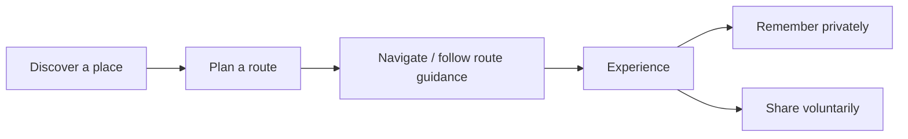
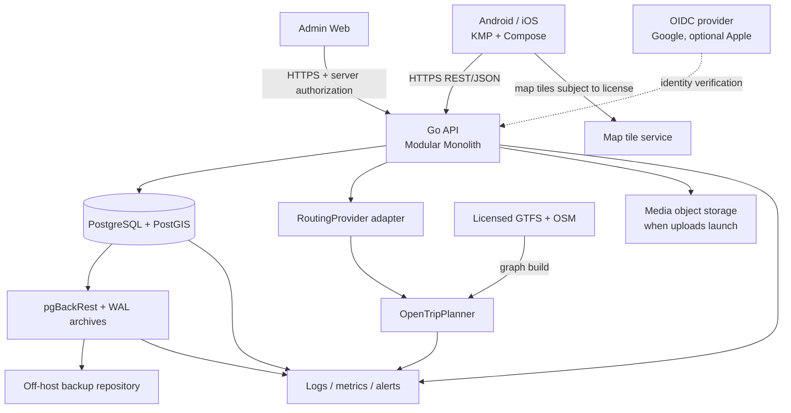

# GoWander — Project & Architecture Overview

> **Audience:** coding agents, contributors, technical reviewers.  
> **Status:** architecture and implementation plan, **not** proof of a running product.  
> **Updated:** 2026-11-11 · **Language:** Vietnamese (technical identifiers in English).  
> **Companion:** [`PIPELINE.md`](./PIPELINE.md) — execution order, gates and agent workflow.

## 1. Product in one minute

**GoWander — Move Smart. Explore More.** is an Android/iOS travel companion for Ho Chi Minh City, starting with a **limited, data-verified pilot area**. Its core value is the connected journey:



Two entry points:
- **Destination-first:** select origin/destination → compare *real, supported* bus / metro / walking itineraries → choose a route.
- **Discover-first:** browse food, places, historical stories and curated trip ideas → select destination → open route planning.

Later releases add personal exploration, community/reviews/following, contribution-based rewards and partnerships. A separate **Admin Web** manages content, transit data, moderation, reliability and eventually business transactions.

**Non-goals:** replicate Google Maps end-to-end; guarantee realtime ETA without a verified feed; build an all-purpose social network; rank users through levels/leaderboards; ship commerce/advanced AI in core MVP.

## 2. Scope and release boundaries

| Priority | In scope | Gate / caveat |
|---|---|---|
| **Core MVP** | Map, location permission/manual origin, place search, route plan/compare/details, Discover, food/place/story, feedback, basic event tracking | Must pass transit data, OTP and cross-platform map PoCs |
| **Weather (lightweight)** | Current conditions and rain warning on Map, route results and route details; served through the Go API with area-level caching | Provider not chosen; licence must allow the intended use; release proposed as Core MVP, not yet confirmed — see `docs/decisions/ADR-021-weather.md` |
| **Core operations** | Admin content CRUD, transit source/version visibility, feedback triage, minimal system health, RBAC/audit, scheduled/manual backup and tested restore | Required **before** a pilot with real production data |
| **Account release** | Guest mode + authenticated features, Google Sign-In, profile/contacts, optional Apple Sign-In | Provider choice and iOS store obligations to verify |
| **Personal & community** | Saved/visited/favorite, journal, posts, reviews, follow, moderation | Incremental; no auto-reward for likes/follows/self-declared visits |
| **Rewards** | Idempotent points ledger, eligibility/moderation, wallet/history | Voucher redemption conditional on real partners |
| **Monetization** | Partners, agreements, referrals, verified revenue, adjustments, expenses, settlements | Do not display invented revenue; revenue recognition follows actual contract |
| **Future** | Context-aware/ML recommendations, broader data coverage, HA, advanced analytics | Explicit validation needed |

Pilot planning targets (not achievements): **1–2 travel corridors/areas in HCMC**, approximately **30–50 verified places** and **10–15 sourced historical stories**.

## 3. Decisions: selected vs unverified

| Area | Chosen direction | Confidence/status |
|---|---|---|
| Mobile | Kotlin Multiplatform + Compose Multiplatform; Clean-ish architecture + MVVM | Selected; PoC required |
| UI/data | ViewModel + `StateFlow`, Coroutines, Ktor Client, `kotlinx.serialization`, Koin preferred | Proposed concrete implementation |
| Map | MapLibre Compose wrapped behind a small map abstraction | **Android/iOS PoC pending**; pin compatible version |
| Backend | Go **Modular Monolith**; REST/JSON + OpenAPI; Chi preferred | Selected architecture |
| SQL access | pgx + sqlc; explicit queries and domain ownership | Preferred |
| Primary DB | PostgreSQL + PostGIS, one database, relational-first | Selected |
| Routing | OpenTripPlanner 2.x behind `RoutingProvider`; GTFS/OSM graph managed by OTP | **Data and OTP PoC pending**; use supported OTP GraphQL API |
| Login | OIDC provider; Google first; account linking via issuer+subject | Provider/flow still to select and test |
| Admin | Browser-based separate frontend, same Go API (admin routes) | Framework TBD; server-side RBAC required |
| Infrastructure | Docker Compose for local/pilot, Linux hosting, HTTPS | Hosting sizing TBD |
| Backup | pgBackRest physical backups + continuous WAL archive + isolated PITR drills | Design decision; operational test pending |
| HA | Standby/Patroni possible later | **Not core MVP**; failover != data recovery |

**Never label a feature “working” just because it appears in a design document or a sample command.**

## 4. Container/component architecture



**Important boundaries:**
1. Mobile **never** calls OTP directly for production itinerary business logic; Go normalizes provider results/errors.
2. Admin browser **never** connects to PostgreSQL directly; authenticate and authorize in Go.
3. OTP owns the routable graph; don't duplicate all GTFS `stop_times`, `trips`, shapes or the OSM road graph in application tables.
4. Map tile provider and transit data source licenses must be verified; access to a public website is not a blanket reuse license.
5. PostgreSQL remains the source of truth for transactional state; analytics/read models are derived.

## 5. Mobile architectural rules

```text
Compose UI → ViewModel → Use case (when valuable) → Domain repository interface
                                            ↓
                           Repository implementation → Ktor API / local store
```

- Presentation contains UI states and gestures. Domain should not import Compose/HTTP frameworks.
- Prefer explicit sealed states: `Idle`, `Loading`, `Success`, `NoRoute`, `OutOfCoverage`, `Timeout`, `Error`.
- Native bridges handle GPS, permissions, keychain/keystore, map lifecycle and push notifications.
- Guest may browse Map/Discover without sign-in; ask location permission only when needed, provide manual origin.
- Never label schedule-derived arrival times as realtime ETA. Missing fares/coverage should be `unknown` or not shown.

Proposed (not precreated) structure:

```text
mobile/
  composeApp/src/commonMain/{app,core,feature}/
  composeApp/src/{androidMain,iosMain}/
  iosApp/
```

## 6. Go backend structure and ownership

```text
backend/
  cmd/api/               # one initial deployable
  cmd/worker/            # add only when a real async job exists
  internal/platform/     # config/http/database/auth/logging/observability
  internal/{mobility,discover,identity,access,exploration,community,
            moderation,rewards,business,feedback,notifications,analytics,operations}/
  api/openapi/
  migrations/
  tests/
```

Each feature may use `domain/application/infrastructure/transport` where that separation genuinely helps. Do not create dozens of empty abstraction packages. Modules own **writes** to their data; cross-module collaboration happens through application services/events. Avoid long SQL transactions around OTP or third-party network calls.

| Module | Responsibility |
|---|---|
| `mobility` | Plan routes, map errors/itineraries, OTP adapter |
| `discover` | Places, categories, media, food, stories, curated trip ideas |
| `identity` / `access` | Users, auth identities, contacts, profiles, roles and authorization |
| `exploration` | User place state, journals and collections |
| `community` / `moderation` | Posts, reviews, follows, reports and actions |
| `rewards` | Eligibility, grants, append-only points ledger |
| `business` | Partners, agreements, referrals, revenue and settlements |
| `feedback` / `operations` | User issues, transit data sources/versions, incident workflows |
| `analytics` | Allowed events, metric definitions, dashboard queries |

## 7. Database model: design inventory, not an initial migration

**Current logical inventory:** **49 proposed tables across 9 domains** (some conditional/future). Implement only the tables used by the current vertical slice.

| Domain | Tables |
|---|---|
| Identity (5) | `users`, `user_auth_identities`, `user_contacts`, `user_profiles`, `user_preferences` |
| Discover (11) | `places`, `place_details`*, `place_categories`, `place_category_links`, `place_media`, `food_items`, `place_foods`, `historical_stories`, `story_sources`*, `trip_ideas`, `trip_idea_places` |
| Mobility (3) | `transit_data_sources`, `transit_data_versions`, `transit_stop_refs`* |
| Exploration (5) | `user_place_status`, `exploration_entries`, `journal_media`, `exploration_collections`, `collection_places` |
| Community (8) | `posts`, `post_media`, `reviews`, `user_follows`, `post_likes`, `post_comments`, `content_reports`, `moderation_actions` |
| Rewards (3) | `points_ledger`, `reward_rules`*, `reward_grants`* |
| Supporting (4) | `feedback_reports`, `notifications`, `usage_events`, `outbox_events`* |
| Administration (3) | `roles`, `user_roles`, `admin_audit_logs` |
| Business (7) | `business_partners`, `partner_agreements`, `partner_referrals`, `revenue_transactions`, `revenue_adjustments`, `business_expenses`, `partner_settlements` |

`*` = conditional. Others may still be deferred by release. **49 is not a frozen SQL schema.** Detailed fields/constraints are in *Database Design & Data Modeling v1.2*. If settlement item-level traceability needs an extra join table, add one **only when the business flow is defined**, updating the inventory and migration design.

Core rules:
- Internal `users.id` stays stable. `user_auth_identities` uses **unique `(issuer, provider_subject)`**; never auto-merge by email.
- `user_contacts` holds optional private email/phone; no exposure in public profiles/feed.
- `places.location` uses PostGIS geography WGS84 and a GiST spatial index when queries justify it.
- Reviews generally use `UNIQUE(user_id, place_id)`; follows use unique `(follower_id, followee_id)` with no self-follow.
- `points_ledger` is append-only/idempotent. Business transactions need stable external references and audit/reconciliation.
- Prefer FK/UNIQUE/CHECK, parameterized SQL, selective JSONB, DTO projections and keyset pagination. No premature aggregate tables.
- SQL migrations must be versioned and tested; avoid creating 49 empty tables to “finish the schema.”

## 8. Security and privacy

- OAuth/OIDC: verify signature, issuer, audience, expiry and relevant flow claims; prefer Authorization Code + PKCE for mobile public clients.
- Authorization: server-side RBAC **plus resource ownership**, not merely hidden Admin UI controls.
- Admin privilege changes, data publication/removal, rewards and settlements require auditable actions.
- Never commit credentials, `.env`, access tokens, database files, raw private journals or backups.
- Exploration map/journal default **PRIVATE**; `Visited` is a user declaration, not GPS proof.
- Do not silently track full GPS trajectories; no raw personal data in analytics unless necessary and lawfully handled.
- Secrets/config from environment/secret manager; use TLS, least-privilege DB roles, safe logs, rate limiting and secure device storage.

## 9. Backup, recovery and disaster resilience (required before real production data)

**Chosen architecture:** PostgreSQL physical/base backups with **pgBackRest** + **continuous WAL archiving** to an **off-host protected repository**, validated via isolated restores.

| Operation | Initial proposed cadence | What it proves |
|---|---|---|
| Full backup | Sunday 02:00 (Asia/Ho_Chi_Minh) | New physical backup baseline |
| Differential backup | Mon–Sat 02:00 | Daily changes from base |
| WAL archive | Continuous | PITR coverage between backups |
| Repository/backup health | Frequent checks | Backups not stale or silently broken |
| Manual backup | On demand / before critical migration | Authorized recovery point |
| Automated restore drill | Weekly, isolated | Backups actually restore |
| DR exercise | Monthly/quarterly | Test complete recovery runbook |

**Proposed—not verified—pilot objectives:** RPO ≤15 min; RTO ≤4 h. Set the actual commitments only after repeated drills and WAL-lag measurement. `pg_dump` is a useful logical export, **not a substitute for PITR**. HA standby/failover is also **not** a backup.

**Failure policy:** monitor → alert → classify → contain → choose recovery → restore **into isolated environment first** → validate → authorize production cutover. Service restart can be automated under tight conditions. **Never automatically overwrite/rollback the production database merely because health checks or anomaly detection fired.** A full PITR rollback can discard valid transactions after the target time; selective recovery may be safer.

Backup job state must be independently observable: a database outage must not erase the only record of how to restore that database. Use scheduler logs/metrics/external runbooks; application DB backup-operation tables are optional.

## 10. Six meaningful admin dashboards

A dashboard must answer a decision question, not fill space. Each KPI has **formula + source + period + owner + data quality/limitations + action**.

| Dashboard | Operational question | Representative metrics |
|---|---|---|
| Executive | Are core journeys usable and urgent issues under control? | WAU, core journey completion, route found, critical issue backlog |
| Mobility | Is routing unavailable due to graph/data or infrastructure? | Route found, technical failure, p95 latency, transit-data freshness |
| Discover | Which content is inaccurate or fails to lead to action? | verified coverage, completeness, discover→route conversion |
| Users & Community | Do people return and contribute useful content? | D7 retention, valid contributions, moderation backlog |
| Revenue & Business | Which verified revenue channels/partners are effective? | net revenue, channel revenue, conversions, margin, unsettled amounts |
| Rewards | Do points encourage quality without abuse? | granted/reversed points, abuse incidents, eligible contributions |

**System Health**, including backup/restore status, is an operational monitoring page—not a seventh vanity business dashboard. Do not equate route requests with completed travel, clicks with paid conversions or partner gross merchandise value with GoWander revenue. Do not fabricate metrics when source data does not exist.

## 11. Implementation snapshot and immediate next action

No PoC, production system, user adoption, third-party data license or recovery SLA is claimed completed in this document.

**Start with:** repo/toolchain bootstrap → **GTFS/OSM data rights + quality audit** → OTP graph/routing PoC → KMP/MapLibre Android+iOS PoC → Go adapter + PostGIS + Discover vertical slice → minimal Admin + backups/restore drills → pilot. See [`PIPELINE.md`](./PIPELINE.md) for precise gates and agent instructions.

## 12. Reference documents and authoritative technical sources

Project docs: *Overview v4.0; Strategy & Research v7.0; Product & UX v4.0; Technical & System Architecture v2.1; Database Design & Data Modeling v1.2; Development & Implementation Guide v1.0.* Their full text lives in [`docs/design/`](./docs/design/README.md). These are **design sources** and must be updated when verified implementation differs.

Official / primary references (verify version and licensing before use):
- OTP: <https://docs.opentripplanner.org/en/latest/>; <https://github.com/opentripplanner/OpenTripPlanner>
- GTFS: <https://gtfs.org/documentation/schedule/reference/>
- KMP: <https://www.jetbrains.com/help/kotlin-multiplatform-dev/get-started.html>
- MapLibre Compose: <https://maplibre.org/maplibre-compose/>
- PostgreSQL WAL/PITR: <https://www.postgresql.org/docs/current/continuous-archiving.html>
- pgBackRest: <https://pgbackrest.org/user-guide.html>
- Google OIDC: <https://developers.google.com/identity/openid-connect/openid-connect>
- Apple App Review: <https://developer.apple.com/app-store/review/guidelines/>

**Agent rule:** treat these links as discovery/reference entry points; do not silently claim version-specific steps have been tested. Consult installed versions and upstream docs when integrating.
