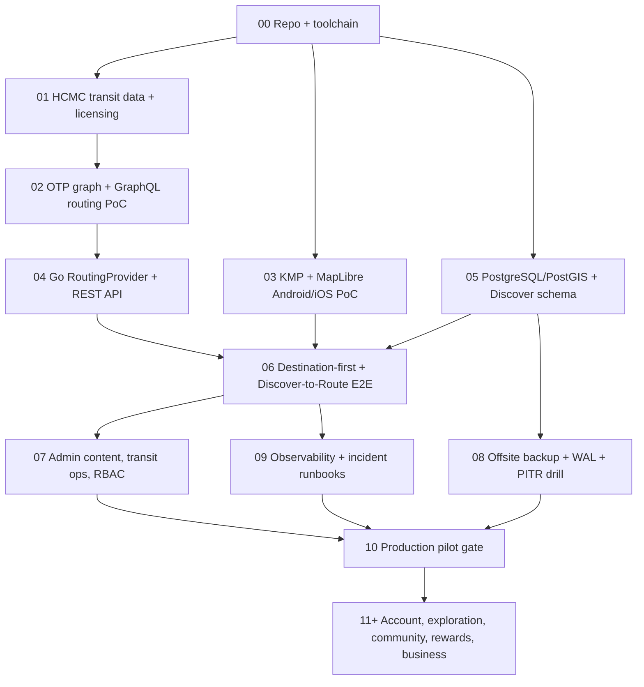

# GoWander — Agent Execution Pipeline

> **Audience:** autonomous/coding agents working inside the GoWander repository.  
> **Status:** **proposed implementation plan**, not a checklist of completed work.  
> **Companion:** [`OVERVIEW.md`](./OVERVIEW.md) — product, architecture, domain boundaries and non-goals.  
> **Date:** 2026-11-11.

## 0. Instructions to every agent (read first)

1. **Read `OVERVIEW.md` and this file first**, then inspect the *actual repo*, existing tests, tool versions and configuration. The design docs are specifications, **not proof that code or data exists**.
2. **Do not invent implementation state.** Report `PASS`, `FAIL`, `BLOCKED`, or `NOT STARTED` with executed commands and observable evidence. Never mark a check passed without running it.
3. **Do not skip technical gates.** Before writing a production transit path, validate GTFS/OSM availability, rights, coverage, OTP correctness and cross-platform map feasibility.
4. **Ship narrow vertical slices**, not dozens of empty packages or migrations. A milestone is done when behavior works end-to-end and has tests.
5. **Do not fabricate routes, realtime ETAs, fares, place locations, historical sources, usage stats or revenue.** Use unmistakably labeled synthetic fixtures only for tests and local demos.
6. **Protect user data and infrastructure.** No plaintext credentials committed, no production DB destructive SQL, no destructive restore/cutover without explicit authorized approval. Don't auto-merge accounts by email.
7. **Check upstream version-specific docs** before adopting an OTP GraphQL field, KMP/MapLibre API, Postgres setting or pgBackRest command. Pin dependencies and capture versions.
8. **Do not install/purchase/deploy external services, change live DNS, perform paid operations or mutate production without approval.** Continue with local PoCs or report blockers when required permissions/data are unavailable.
9. **Respect code ownership:** Mobile → Go REST → domain module → DB / OTP adapter; Admin → RBAC-protected Go APIs. Keep private contacts and journals inaccessible to public APIs.
10. **Keep documents truthful:** update ADR, README, API contract, migration notes and this pipeline's status when code proves or disproves assumptions.

## 1. Agent startup protocol

At the beginning of each work session:

```bash
pwd
ls -la
git status --short --branch
git log -5 --oneline 2>/dev/null || true
# Optional only when available:
go version; java -version; docker compose version; python3 --version
```

Then:
- Identify **current milestone** by actual artifacts and test evidence, not by directory names.
- Inspect `OVERVIEW.md`, `PIPELINE.md`, relevant code and documentation; avoid assuming the repo is empty.
- State a small implementation plan with **files to change**, commands/tests and risks.
- Preserve user work and uncommitted changes. Do not force-push, reset or overwrite unrelated files.
- Make the smallest useful diff, run applicable checks, log results, and provide a clear next step.

### Standard task report

```text
Task ID:
Goal:
Status: PASS | FAIL | BLOCKED | NOT STARTED
Files changed:
Commands executed:
Evidence/tests:
Risks or missing prerequisites:
Next recommended task:
```

Use `docs/development/implementation-log.md` once initialized. Mark blocked tasks with a concrete reason and an unblock criterion; do not silently substitute mocks in production.

## 2. Dependency-driven delivery map



Parallelization is allowed for independent PoCs, but a dependent milestone cannot pass while its prerequisites are blocked. The DB backup baseline must precede **any real-data production pilot**, regardless of where it appears in the sequence.

## 3. Milestones, exact outputs and gates

| ID | Deliverable | Exit criteria (must be observed) | Status |
|---|---|---|---|
| **M00** | Repository + local toolchain | Git clean baseline; README, `.gitignore`, `.env.example`; versions recorded; no secrets tracked | **PASS** (2026-11-11; committed by the owner as `bab9124` + `27b92da`; evidence in `docs/changes/change-11-11-2026.md` §6 and §9) |
| **M01** | Transit data feasibility | Pilot area, source inventory, rights/licensing decision, valid GTFS/OSM fixtures, 5–10 route cases | **BLOCKED** (2026-11-11): no legally usable HCMC bus/metro GTFS found; OSM available. Unblock criteria in `docs/research/transit-data-feasibility.md` §6. Owner decision (§7): record the blocker and continue with a clearly labelled, source-backed **assumed** dataset for PoC work only; pilot scope not yet fixed. 14-11-2026: OSM has 349 HCMC bus relations with headways and hours (research §9) → assumed bus feed in RD-0; still not official data |
| **M02** | OTP routing PoC | Version-pinned graph build; start; verified GraphQL itinerary; errors/no-route; logs + measurements | **PASS — technology only (2026-11-12)**; real-data gate BLOCKED with M01. Task 1: OTP 2.10.0 pinned by digest (ADR-023). Task 2: repeatable build in `infrastructure/otp/` (Geofabrik `vietnam-261111` cropped to the L1 corridor; build 6 s, peak container memory ≈0.8 GiB). Task 3: `serve.sh` serves the checksum-verified graph on 127.0.0.1 (start ≈1.7 s, ≈0.5 GiB). Task 4: routing via `planConnection` on `POST /otp/gtfs/v1` (`plan` deprecated); errors come with HTTP 200 in `routingErrors` or GraphQL `errors`. Task 5–6: `run_route_cases.py` — baseline 8/10 (RC-01/RC-03 waited headway + 120 s with `exact_times=0`); after switching the assumed feed to `exact_times=1` (`assumed-2026-11-12`, ADR-020 update) **10/10 PASS**; latency p50 15–39 ms, p95 ≤ 56 ms per case (20 runs, dev Mac). Evidence: `infrastructure/otp/results/route-cases-2026-11-12-*.md`, `infrastructure/otp/manifests/`. Open: OTP skips a departure < ~2 min after the requested time (board/transfer slack 0 does not change it; cause unknown); 6 stops unlinked by island pruning did not break any case. Technology PoC only (ADR-020) on the assumed Metro L1 feed; cannot claim HCMC readiness while M01 is blocked |
| **M03** | KMP Map PoC | Android+iOS render, gestures, markers, polylines, GPS permission/error states | PASS (12-11-2026, emulator/simulator only) — `mobile/` runs on Android API 37 emulator and iOS 27.0 simulator; both render the same DEMO RC-01 geometry; permission allow/deny/settings, GPS-unavailable, manual origin, rotation (Android), background/resume and back checked with evidence in `docs/evidence/m03/`. Not yet on a physical device. ADR-025, ADR-026 |
| **M04** | Go routing service | Health/readiness, typed route contract, OTP adapter, normalized errors, integration tests | PASS (12-11-2026, assumed feed) — `backend/` Go API `POST /api/v1/routes/plan` → OTP adapter; 10/10 route cases pass through the API (`backend/tests/results/route-cases-2026-11-12.md`); unit tests with `-race` pass; Go, security and silent-failure reviews done. Weather adapter (step 4.8) not started. ADR-027 |
| **M05** | PostgreSQL/PostGIS + Discover | Versioned migrations for needed tables; representative licensed place data; spatial queries tested | PASS (13-11-2026) — 7 tables via golang-migrate, app role SELECT-only (no superuser); 1,016 OSM places (ODbL) within 800 m of L1 stations + curated CSV pipeline; list/search/nearby/detail API; schema, store and route-case integration tests pass; GiST used by nearby (`backend/tests/results/discover-queries-2026-11-13.md`). ADR-028 |
| **M06** | Core end-to-end vertical slice | Mobile→Go→OTP→map and Discover→Place→Route work, including failures, on both platforms | PASS — technical, assumed transit data (13-11-2026): both flows on Android emulator (API 37) and iOS simulator (iOS 27); no-route, out-of-coverage, network-down + retry verified on Android; metro leg drawn in service hours; 24/24 shared tests on Android and iOS (`docs/evidence/m06/`). Transit schedule is still the assumed feed (M01 blocked), so not a pilot-data pass. ADR-029 |
| **M07** | Minimal Admin & RBAC | Role checks server-side; places/stories CRUD; transit source/feedback pages; audit | IN PROGRESS (16-11-2026, `feat/admin-rbac`): unblocked since M05 passed; stack and login chosen in ADR-037 (Go server-rendered + htmx, Google OIDC with role allowlist). Slice 1 done (sign-in, roles, sessions, CSRF, append-only audit); owner signed in with Google on 16-11-2026. One admin for now (owner, 16-11-2026): the role-granting page was removed, roles stay in the database for later. Admin restyled in the app look; overview shows real counts and a needs-attention list. Slice 2 done (16-11-2026): places list/search/filters and edit (name, description, address, main category, status), categories (rename, order, on/off); admin edits are kept when the OSM seed is re-imported (`edited_at`). Usage counters (16-11-2026, ADR-038, amended the same day by the owner): the API counts app starts (`POST /api/v1/usage/open`, no data sent) and successful searches per day, mode, origin/destination province, suggested line and destination place (aggregates only, no coordinates; items under 5 hidden); shown on the overview with period and province filters (no separate page); provinces from OSM (`data/areas/vn-provinces.sql`, 33 of 34: Khánh Hòa missing in OSM). Slice 3 done (16-11-2026): dishes and stories on the server, edited at `/admin/foods` and `/admin/stories`; the app reads `GET /api/v1/guide/hcm` and keeps the bundled copy offline. Admin sign-in with own accounts (16-11-2026, ADR-039, replaces Google): login + password (argon2id, lock after 5 failures), accounts made with `cmd/admin`, forgotten password by a one-time emailed link (Gmail SMTP; works with Mailpit, the Gmail app password is set by the owner). Overview redone after the owner's dashboard references (16-11-2026): customers and revenue at a glance (app opens and searches against the previous period, revenue and profit shown as "Chưa có" until a channel exists, opens chart, mode donut, top destinations, customer funnel); details moved to "Báo cáo thống kê" (tabs: customers, content & system). SMTP (Gmail) on in local `.env`, a test email went through. Next: owner creates the `baole` account and signs in; then app events (place views/saves, "Bắt đầu"), province map once DATA-1 has Khánh Hòa |
| **M08** | DB protection & recovery | Scheduled/manual backup, WAL archive, protected off-host repo, isolated PITR, alerts and measured drill | BLOCKED on DB setup |
| **M09** | Observability + CI | Instrumentation, alert scenarios, CI tests and recovery runbooks work | NOT STARTED |
| **M10** | Pilot release | Data/UX/testing/legal gate passed; restoration tested; monitoring live; scope explicitly documented | BLOCKED |
| **M06b** | UI theo Figma (Design Kit v4) | Map, Route results/detail, Discover, Place Detail match the Figma frames; components (Search Bar, Place Card, Route Option Card, Transit Leg, Status Chip, Category Filter); a11y checks; vi/en strings. Must pass before M10 | PASS (14-11-2026, Android emulator + iOS simulator) — UI rebuilt from the Design Kit v4 source (font, tokens, kit icons, 3 tabs, M1–M8, D1–D2), owner logo as app icon, Metro stations searchable, address search via self-hosted Photon (ADR-031). Not done: photos (data has none), Journey/Profile/weather (out of MVP), hi-res logo. ADR-030 |
| **RD-0** | Whole-HCMC graph: OSM-derived bus + car + bicycle | Assumed bus GTFS built from OSM `route=bus` (ADR-032); one OTP graph for all of HCMC with Metro L1 + bus; API modes `BUS`, `CAR`, `BICYCLE`; app mode selector; bus legs labelled "estimated"; RAM/disk/build time measured; old and new route cases pass. See §5a | IN PROGRESS — branch `feat/road-vehicles` (owner, 14-11-2026), ADR-032. Done 14-11: bus feed from OSM (230 relations, 151 routes, 5,001 stops; 119 relations skipped with reasons in `data/assumed/hcmc-bus-osm-gtfs/manifest.txt`), graph `hcmc-assumed` (build 37 s, peak ≈2 GiB, graph 94 MB, serve ≈1.2 GiB), API `CAR`/`BICYCLE`, app mode chips; 10/10 old route cases PASS on the new graph; bus/car/bicycle results via API in `infrastructure/otp/results/rd0-modes-2026-11-14.md`. Open: bus/car route cases in the automatic runner, Android/iOS UI check of the mode chips, reviews. Data is assumed, so M01 stays BLOCKED |
| **DATA-1** | Data collection and coordination (before M10) | One tracked list of every dataset the pilot needs, its source, licence, owner contact and status; request letters/emails drafted by the agent and sent by the owner; collected data imported only with source + licence recorded. See §5b | PLANNED — reserved by the owner on 14-11-2026. **Order changed by the owner 16-11-2026:** finish the features and the UI first (M07 and the app screens that still use mock data), then run DATA-1 as a dedicated, in-depth data research phase ("xong các chức năng và giao diện trước, sau đó sẽ có 1 phase research mạnh về dữ liệu") |
| **M11+** | Account/community/rewards/commerce | Separate scoped milestones and tests; only after their dependencies and product gates | DEFERRED |
| **NAV-1** | Navigation mode (MVP level) | Heading arrow, follow-me camera, warning for approximate location/low accuracy, split screen: top MapLibre 3D extruded buildings pitched along heading + bottom 2D overview, synced in real time; turn-by-turn guidance; verified on physical Android + iPhone (compass/GPS) | DEFERRED — after the MVP pilot (owner, 13-11-2026); needs HTTPS server for physical devices. **14-11-2026: owner asked again for a "Bắt đầu" (Start) button like Google Maps: full-screen map that keeps following the user, paced to how fast they move** — proposed as the next task after RD-0 (MVP part: start button, full-screen follow camera, progress along the route, rerouting later). **IN PROGRESS on `feat/navigation` (14-11-2026, ADR-033):** turn-by-turn steps from OTP, "Bắt đầu" navigation mode (follow camera, next-instruction banner, ETA, off-route + re-plan), "Đường đi" list, split "Xem trước tuyến đường" (Mapillary street photo or 3D map on top, 2D map below), full-screen route detail, 2D/3D map switch (satellite waits for a licensed provider). Verified on Android emulator with simulated GPS (`docs/evidence/nav1/`); not yet on iOS or a physical device |
| **UPG-1** | Upgrade phase: premium 3D/AR | Photorealistic 3D city (e.g. Google Photorealistic 3D Tiles + 3D engine) and/or camera AR arrows (ARCore/ARKit + VPS); cost, licensing and device-load ADR first | DEFERRED — upgrade phase (owner, 13-11-2026). Research notes (owner, 14-11-2026): infer missing lanes/direction/elevation for bridges and tunnels with deterministic geometry (OSM `bridge`/`tunnel`/`layer`/`lanes`/`incline`, open DEM, slope/curvature/continuity constraints) and automatic metrics; AI or human review only on samples, cheap models + batch for bulk checks. Data only from licensed sources (OSM, own or Mapillary-style CC dashcam, imagery whose licence allows tracing); **no scraping other map apps**; blur faces and plates; check the legality of publishing enforcement-camera locations; community uploads need contributor licence, moderation and personal-data compliance |
| **RD-1** | Road-vehicle routing | Car, motorbike and bicycle routing in the pilot area with lanes, one-ways, turn restrictions and speeds; routing-engine ADR (OTP has no motorbike profile; evaluate e.g. Valhalla `motor_scooter`); same normalized API errors; verified route cases per vehicle | DEFERRED — after the MVP pilot (owner, 14-11-2026); data rules as in UPG-1. **Car + bicycle on the whole-HCMC OTP graph pulled forward into RD-0** (owner, 14-11-2026); motorbike, lanes and the routing-engine ADR stay here |
| **UX-2** | App experience redesign (ADR-034) | 5-tab IA with centre "Đi đâu?" action; per-tab back stack; places as floating cards on the map; shared place sheet; route flow (unified destination search, grouped trips, 2-button detail, split 3D/2D step view and navigation, voice guidance); Discover with nationwide region map and region portfolios; Journey + manual trip planner; Profile with Portfolio · Plans · Saved. Every phase verified on Android **and** iOS (tests + screenshots). See §5c | APPROVED DESIGN (owner, 14-11-2026) — plan `docs/plans/UX-2-ke-hoach-lam-lai-trai-nghiem.md`; design reference https://claude.ai/artifact/XtZuZY6CkCk98ZPVd3dSp4#page-dcb81aee8d83; branch `feat/ux-2-redesign` from `develop` after `feat/navigation` merges; open questions in plan §16 |

**Status is a plan baseline.** An agent must inspect the actual repository before updating it.

## 4. M00 — Repository and environment

### Tasks
- Create/verify monorepo: `mobile/`, `backend/`, `admin/`, `infrastructure/{docker,otp,postgres,backup,monitoring}/`, `data/`, `docs/{architecture,development,decisions,research,runbooks}/`, `scripts/`, `.github/workflows/`.
- Record installed versions of Go, Java/JDK, Docker/Compose, Gradle/Kotlin, Xcode/Android Studio, Python.
- Initialize Git safely and add `.gitignore` for `.env`, credentials, build artifacts, raw datasets, DB volumes, backups and OTP graph artifacts.
- Write `README.md` quick start and `.env.example` with placeholder values **only**.
- Decide repository origin/module name from actual user/repo context; **never insert a guessed owner**.

### Gate
Bootstrap instructions work on a clean development checkout. `git status` shows no generated secrets/binary DB files. If required Apple/Android tooling is missing, report which platform is blocked.

## 5. M01 — Transit data due diligence **before OTP**

### Tasks
1. Choose a limited HCMC pilot region, documented with reasons and rough extent.
2. List GTFS Static, optional GTFS-RT, OSM extract and map tile sources; capture provider, source URL, license, allowed usage, update frequency and access restrictions.
3. **Do not presume HCMC GTFS is openly available just because a data portal exists.** Obtain permitted test data; if absent, report `BLOCKED` and options (licensed partnership, changed pilot scope, clearly labeled synthetic-only OTP experiment).
4. Validate feed specification and referential integrity: `agency`, `stops`, `routes`, `trips`, `stop_times`, service calendars and dates, timezone, stop coords, service coverage.
5. Define 5–10 representative cases (walking, bus, metro, transfer, no-route, invalid coordinates, calendar boundary). Expected results must come from the actual licensed feed, not guesswork.
6. Record source manifest and checksums; exclude large raw datasets from Git unless explicitly licensed and appropriate.

### Outputs
- `docs/research/transit-data-feasibility.md`
- `data/sources/source-inventory.csv`
- `data/test-cases/route-cases.*`
- `docs/decisions/ADR-001-transit-data.md` or the next available ADR ID.

### Gate
A documented, legally usable dataset covering some real pilot cases exists. Otherwise STOP production-routing work and report alternatives.

## 5a. RD-0 — Whole-HCMC graph with OSM-derived bus, car and bicycle

> Pulled forward by the owner on 14-11-2026 because results outside the Metro corridor were walking-only. Source study: `docs/research/transit-data-feasibility.md` §9. Branch: `feat/road-vehicles`.

### Tasks
1. **ADR-032:** bus GTFS derived from OSM (ODbL), labelled `ASSUMED`; how stop order, headways (`interval`), service hours (`opening_hours`) and estimated inter-stop times are produced; what is skipped; whole-HCMC graph extent and memory budget.
2. **`scripts/build_bus_gtfs_from_osm.py`** (test-first, like `build_metro_l1_assumed_gtfs.py`): read the OSM extract with osmium, emit `agency`, `stops`, `routes`, `trips`, `stop_times`, `frequencies`, `calendar`, `feed_info` (feed name contains `assumed`); report every relation skipped and why; record source file checksum.
3. **GTFS checks:** referential integrity, timezone `Asia/Ho_Chi_Minh`, coordinates inside the extent, every trip has ≥ 2 stops, headway and hours parsed.
4. **OTP graph for all of HCMC:** OSM extract + Metro L1 feed + bus feed; measure build time, peak memory, graph size and serve memory before deciding whether to keep the corridor graph (disk is tight).
5. **API:** `modes` accepts `BUS`, `CAR`, `BICYCLE` (plus existing ones); OpenAPI updated; unit + integration tests; same normalized errors (ADR-027).
6. **Mobile:** mode selector (public transport / bicycle / car); bus legs show the route number and "giờ ước tính"; shared tests.
7. **Route cases:** existing 10 still pass; new cases for bus, bus + metro transfer, car, bicycle, and the owner's example (Trương Đăng Quế) no longer walking-only.
8. Review (`ecc:go-reviewer`, `ecc:python-reviewer`, `ecc:kotlin-reviewer`, `ecc:silent-failure-hunter`), E2E on Android emulator + iOS simulator, change record.

### Out of scope
Motorbike (needs another engine, RD-1), lanes, real-time, fares, official timetables.

### Gate
Measured graph build and serve numbers recorded; bus, car and bicycle itineraries returned through the Go API and drawn in the app on both platforms; all assumed data is labelled in the feed, the API (`dataStatus`) and the UI. Does **not** pass M01: official licensed bus data is still required before M10.

## 5b. DATA-1 — Data collection and coordination

> Reserved by the owner on 14-11-2026: one phase where the agent gathers **all** the data the pilot needs and coordinates with the owner and data holders. The agent researches, drafts and imports; the owner sends requests, signs agreements and decides. No scraping, no unlicensed copying (as in UPG-1).

### Tasks
1. **Data register** `data/sources/data-register.csv`: dataset, purpose (screen or feature), source, licence, contact, request date, status (`NEEDED`, `REQUESTED`, `RECEIVED`, `IMPORTED`, `REJECTED`), next step. `source-inventory.csv` stays the record of researched sources.
2. **Transit, official:** request bus GTFS or route/stop/timetable files from the HCMC public transport management centre (`buyttphcm.com.vn`, Go!Bus) and the Metro L1 timetable from HURC1; agent drafts the letters in Vietnamese, owner sends them. Replaces the assumed feeds (ADR-020, ADR-032) when received.
3. **Transit, OSM quality:** check OSM bus routes against the official route list once it is available (route numbers, termini, changes since 01-07-2026); report differences. Corrections go into OSM only from sources whose licence allows it.
4. **Discover content:** descriptions, photos (licence per photo), opening hours, foods, historical stories for places near the pilot area; curated CSV (`data/curated/`, ADR-028 rule B), each row with source and licence. Candidate sources: owner's own photos and writing, Wikimedia Commons, Wikipedia (CC BY-SA), official tourism pages with permission.
5. **Addresses:** house-number coverage; Vietmap quote and terms (ADR-031); compare with Photon on a fixed list of test addresses.
6. **Road data for RD-1:** lanes, turn restrictions, motorbike rules from OSM; list gaps.
7. **Weekly coordination note** in `docs/changes/`: what was requested, what arrived, what blocks M10.

### Gate
Every dataset shown in the pilot has a register row with source, licence and status `IMPORTED`, or the screen that needs it is cut from the pilot scope. Official or permitted transit data is the M01 unblock path; if none arrives, M10 must document the assumed-data limitation and the owner must accept it explicitly.

## 5c. UX-2 — App experience redesign

> Approved by the owner on 14-11-2026 (ADR-034). Full design, screens and test cases: `docs/plans/UX-2-ke-hoach-lam-lai-trai-nghiem.md`.
>
> **Design reference (follow it for every UX-2 screen):** https://claude.ai/artifact/XtZuZY6CkCk98ZPVd3dSp4#page-dcb81aee8d83 — the approved preview canvas (17 screens, Design Kit v4 colours, Be Vietnam Pro only). Owner, 14-11-2026: "lưu link này vào pipeline luôn đi để lần sau theo được mẫu này". Each phase compares its screens with the matching canvas screen (plan §17) on Android **and** iOS; numbers, reviews and names in the canvas are sample data. The canvas is private: the owner shares it from its Share menu when someone else needs it. Backend, OTP and route logic stay; navigation, Map, place page, Discover, Journey and Profile are rebuilt step by step.

### Phases (each one: tests, Android + iOS screenshots, `ux_audit`, `e2e_ux.py`, iOS UI tests, change record, owner review)
1. **P1 Navigation shell:** 5 tabs, centre action, per-tab back stack in `commonMain`, no first-run screen, permission on demand, hide unfinished features, minimal real Journey/Profile screens.
2. **P2 Route flow:** shared destination search, editable From/To header, grouped trips, 2-button route detail, split 3D/2D step view and navigation; lower map has a 2D / 3D switch (satellite later). **DONE 14-11-2026** (Android E2E 63/63, iOS tests 65/65). **P2b:** voice guidance (platform TTS, `vi-VN`). **DONE 15-11-2026** (Android E2E 89/89, iOS tests 77/77; field test on real phones still required before pilot).
   **All 17 canvas screens drawn 15-11-2026** with mock data where real data is missing (register above); Android E2E 85/85, iOS tests 73/73. Phases P3–P5 below now replace mocks with real data and storage.
3. **P3 Map places (first slice DONE 15-11-2026:** `GET /api/v1/places/map`, cards and dots follow the area on screen, filters run on the server; dots can be tapped since 15-11-2026 (tap centres the map and gives the place a card); clusters since 15-11-2026 (below zoom 13.5 the map shows a count per grid cell from `GET /api/v1/places/map/clusters`; tapping zooms in); **open:** list of the area, reviews**):** spike (floating cards, fps on both platforms) → `GET /api/v1/places/map`, pins/clusters/cards/filters/list → shared place sheet (reviews area R1).
4. **P4 Discover:** Nearby + nationwide region map + TP.HCM region portfolio; tap image → show on map.
5. **P5 Journey + Profile (storage DONE 15-11-2026, ADR-036; content template for the owner: `docs/content/cam-nang-tp-hcm.md`):** suggested trips, manual planner, Plans/Saved tabs stored on device (ADR for local storage first).
- **Owner decisions, 15-11-2026:**
  - **Travel guide:** no new "Cẩm nang" module or extra Discover sections. The region guide (screen 14), dishes, suggested trips and the planner are the guide; what is missing is content. Order: (1) make the drawn screens real: TP.HCM guide content, 3–5 edited trips, plans stored on the device (P5); (2) pilot with that scope; (3) after the pilot: more countries, user reviews, Story Mode, Journey Memory.
  - **Sign-in:** never required to open the app, see the map, search, find a route, navigate or read Discover ("người dùng thường xảy ra đột ngột"). Sign-in is asked only at the moment a feature needs an account (posting a review or photo, a public portfolio, sharing, sync between devices). Which features exactly, and the auth method, are decided in the accounts ADR (COM-1 / M07); plans and saved places work on the device without an account.
6. **P6 Usability test** with 3–5 people. **Dropped by the owner 16-11-2026** ("không có người 3-5 người nên không cần làm").
- **Mock data rule (owner, 14-11-2026: "cái nào chưa có thì cứ mockup data nha, nhưng nhớ ghi trong pipeline là có dữ liệu mockup"):** every canvas screen is built in full now. Where real data or a backend does not exist yet (reviews, region portfolios, food/sight photos, trip plans, user portfolio, satellite imagery…), the screen uses **mock data** from one place per feature (a file named `Mock*.kt` in `commonMain`, each item marked as sample). The **mock data register** below lists every mock; replacing a mock with real data removes its row. The pilot (M10) may not ship a row still marked `MOCK` unless the owner accepts it in writing.

  | Screen / feature | Mock source | Replace with | Status |
  |---|---|---|---|
  | **Vệ tinh** choice (map-type panel, lower map of screen 6) | UI only: shows "Chưa có ảnh vệ tinh…" and keeps the map (owner, 14-11-2026: "có giao diện, bấm vào thì để vậy") | licensed satellite provider (ADR-033) | MOCK (UI only) |
  | Star ratings, review counts, rating split, reviews (screens 1, 2, 8, 14, 15) | `mock/MockData.kt`: `mockRating`, `mockReviewCount`, `MOCK_RATING_SPLIT`, `MOCK_REVIEWS` | real reviews (COM-1, accounts) | MOCK |
  | All photos (places, trips, regions, dishes, portfolio) | `ui/Pieces.kt` `MockPhoto` (tinted tile + icon, "Ảnh mẫu"). Real since 15-11-2026: the six region photos (Wikimedia Commons, `docs/photo-credits.md`) and the street photo on map place cards (Mapillary, ADR-033; it shows the street, not the venue). | licensed photos with credit (DATA-1 §4), stored on Cloudflare R2 (ADR-035) | MOCK |
  | Suggested trips (Journey, Discover card, region guide, Trip screen) | **owner's content since 15-11-2026**: 2 edited trips in `content/GuideHcm.kt` from `docs/content/cam-nang-tp-hcm.md` (draft: no photos, no durations, stops not walked yet; trip J03 with Metro left out as the file asks) | durations confirmed by the router, photos, on-site check; serve from the API when the admin exists (M07) | DRAFT CONTENT |
  | Regions, region guide text, seasons, dishes, shops, stories | TP.HCM guide: **owner's content since 15-11-2026** (`content/GuideHcm.kt`: intro, 5 tips, 8 highlights, 6 dishes with one unverified shop each, 3 stories), shown with an "đang biên tập" note and sources. Still mock: the list of regions (`MOCK_REGIONS`), other regions' guides (`MOCK_OTHER_REGION_INTRO`), community photos | verify hours, shops and coordinates on site; licensed photos; long description of each highlight has no screen yet | DRAFT CONTENT |
  | Map of Vietnam (screen 13) | real map since 15-11-2026 (OpenFreeMap / OSM tiles, regions at real coordinates, Hoàng Sa and Trường Sa labelled by the app); basemap labels prefer Vietnamese names ("Biển Đông") through the bundled style `composeResources/files/map_style.json`; the regions screen shows Vietnam's land only (`files/vn_mask.json`, owner 15-11-2026) and drops basemap text; **later phase: more countries, one mask per country** | none for the map itself; the bundled style is a frozen copy of OpenFreeMap "liberty", refresh it if their sprite or font paths change | REAL |
  | Portfolio: name, stats, about, featured trip, contributions, moments, section visibility | `MockPortfolio` | user account data (COM-1) | MOCK |
  | Plans: sample upcoming/draft/done plans and planner suggestions | `MOCK_PLANS`, `MOCK_PLAN_SUGGESTIONS`; user-made plans and saved places are **stored on the device since 15-11-2026** (`home/AppStore.kt`, ADR-036); the three sample plans still seed a first run. Since 15-11-2026 travel time between stops comes from the real router and a plan can be followed stop by stop (progress stored with it); no costs are shown (no verified fare or ticket data). Plans are listed in the Journey tab, "Của tôi" (ADR-034 item 10 amended) | sync with an account (COM-1); remove the sample plans when real suggested trips exist | PARTLY REAL |
  | Buttons that only explain themselves: Chia sẻ, Viết đánh giá, Video 1:30, portfolio Lưu (plan date / time / mode are real since 15-11-2026) | short notice via `LocalNotice` | COM-1 / P5 / CONTENT | MOCK (UI only) |

- Out of UX-2: **COM-1** (accounts, reviews R2, community photos, public portfolio; needs ADR-022 + M07) and **CONTENT** (region guides, stories, trips, videos, country boundary; part of DATA-1).

### Gate
All plan §14 test cases for the shipped phases pass on Android emulator and iOS simulator; screenshots of every new screen on both platforms; no "coming soon" controls; accessibility checks (labels, 48 dp targets, contrast, list alternative to map content) pass; owner signs off after P6.

**Owner decision 16-11-2026 (gate amended):** UX-2 closes without the remaining checks ("bỏ qua kiểm tra cho cái này tạm đi"), keeps the controls that only explain themselves ("nút sắp có vẫn giữ") and skips P6. What was verified and what was not is listed in `docs/changes/change-16-11-2026.md`; the open items move to the backlog below and are not a reason to keep the branch open.

**UX-2 backlog (after the merge):** iOS screenshots of the inner screens (needs a scripted iOS UI test or the owner driving the simulator); the two E2E steps for the plan calendar and time wheels; an E2E run in daytime (bus results need running buses); list of the area on the map tab; real reviews (COM-1); licensed photos for the guide.

## 6. M02 — OpenTripPlanner routing PoC

### Tasks
1. Inspect upstream OTP docs and pin a **specific compatible version/image digest**; record JVM requirements and API schema. Do **not** use `latest` as a durable dependency.
2. Build graph from permitted GTFS/OSM; store build config and repeatable scripts under `infrastructure/otp/`.
3. Start OTP with reproducible config. Ensure graph version and source checksums are recorded.
4. Use the GraphQL schema supported by that version; don't implement against the removed legacy REST API or assume a field like `planConnection` exists without schema inspection.
5. Test route cases, scheduled-vs-realtime labeling, geometry, transfers, no-route and failure behavior.
6. Measure build/start time, JVM memory, routing latency and errors under a stated machine/dataset.

### Gate
At least one **real, source-backed** valid itinerary; the predefined scenarios are reported PASS/FAIL with evidence. Fake/test GTFS may prove technology only, **not HCMC production readiness**.

## 7. M03 — KMP + MapLibre cross-platform PoC

### Tasks
1. Create project with upstream supported KMP/Compose toolchain; pin dependency versions.
2. Implement one map screen: tile rendering, camera, marker, polyline and gestures.
3. Implement platform-specific permission/location adapters and manual origin fallback.
4. Test Android physical/emulator **and** iOS simulator/physical device; include lifecycle/memory/error tests.
5. Keep SDK-specific calls inside a small map adapter/feature boundary; avoid premature generic map framework.

### Gate
Both target platforms render the same representative route geometry. If iOS map support is blocked, document the SDK alternative and architecture impact before proceeding.

## 8. M04 — Go backend and RoutingProvider

### Tasks
- `cmd/api` with config validation, graceful shutdown, structured logs, request IDs, liveness/readiness.
- Chi router (preferred), REST/JSON DTOs and OpenAPI contract.
- `mobility` module with `RoutingProvider` interface and concrete OTP GraphQL adapter.
- Normalize provider errors into `INVALID_REQUEST`, `NO_ROUTE_FOUND`, `OUT_OF_COVERAGE`, `DATA_UNAVAILABLE`, `ROUTING_TIMEOUT`, `ROUTING_UNAVAILABLE` where semantics truly apply.
- Context cancellation, bounded timeouts, input validation and integration tests using fixtures/mocks for *tests only*.
- Initial endpoint proposal: `POST /api/v1/routes/plan` (confirm in OpenAPI).

### Gate
Go-to-OTP integration works for actual graph test cases; clients never depend directly on OTP's GraphQL schema.

## 9. M05 — Database and Discover minimum slice

### Tasks
- Start pinned PostgreSQL/PostGIS image with persistent development volume and least-privilege app credentials.
- Add versioned migrations **only for current features**: `place_categories`, `places`, `place_category_links`, `place_media`, `food_items`, `place_foods`, `historical_stories` as needed.
- Use proper FKs, constraints and spatial type/index; no premature wholesale 49-table migration.
- Seed sourced/licensed content. If only test fixtures exist, label clearly as fixtures.
- Implement named SQL queries with pgx/sqlc; benchmark `ST_DWithin`, category filter and published-only projections.
- Add migration up/down or forward repair approach with realistic rollback limits and tests on fresh + existing dev DBs.

### Gate
Place listing/details/nearby queries return valid data, schema tests pass, and SQL does not require superuser privileges.

## 10. M06 — First complete vertical slice

### Tasks
- End-to-end: Mobile Map → origin/destination → Go route plan → OTP → normalized itinerary → map polyline.
- End-to-end: Discover → Place Detail → Directions → Map/route plan.
- Implement empty/loading/error/retry, preserve origin and destination across failures.
- Keep scheduled data labeled scheduled; omit unsupported realtime/fare fields.
- Run Android and iOS E2E checks plus API tests, recording evidence.

### Gate
Two user flows work with real permitted data in chosen pilot area. If one platform cannot run, milestone is not complete (report partial status).

## 11. M07 — Minimal Admin & controlled access

### Tasks
- Choose web stack after short ADR (table/forms, OpenAPI client, deployment, maintainability).
- Implement OIDC login, server RBAC, `roles` + `user_roles` as needed and `admin_audit_logs`.
- Admin content CRUD for verified Places/Foods/Stories, publish/hide workflow, source/license fields.
- Transit source/version state, feedback triage and focused operational health.
- Restrict role assignment, destructive actions and production operations; log actor/action/time/request ID.
- Start with decision-oriented Executive/Mobility/Discover dashboards; metric definitions and meaningful actions required.

### Gate
Unauthorized actions fail **at API**, not just UI. Content updates reach the Mobile API. Audit is correct; no private contacts exposed.

## 12. M08 — Backup, PITR, monitoring and DR (production gate)

### 12.1. Mandatory architecture

- PostgreSQL + **pgBackRest physical backups** and **continuous WAL archiving**.
- Protected **off-host** repository (S3-compatible or independent backup host), separate credentials, encryption and retention controls.
- Scheduler via `systemd timer` or `cron`; job results/errors sent to monitoring independently of the application DB.
- Production pilot target **proposed, unverified**: RPO ≤15 minutes, RTO ≤4 hours. Validate with real drills or revise targets.

### 12.2. Proposed initial jobs

| Job | Cadence (Asia/Ho_Chi_Minh) | Evidence |
|---|---|---|
| Full | Sunday ~02:00 | backup set visible and successful |
| Differential | Mon–Sat ~02:00 | diff set available |
| WAL archival | Continuous | no missing required segments; measured archive lag |
| Health checks | frequent | backup age, archiver failure, repository access |
| On-demand full/diff | authorized request / migration | reason, actor, result, audit |
| Isolated restore drill | weekly | usable recovered DB + duration + data checks |
| DR exercise | monthly/quarterly | recovery runbook/roles validated |

### 12.3. Implementation sequence

1. Choose PostgreSQL and pgBackRest versions and **read their version-matched docs**.
2. Configure WAL archive, stanza, off-host repository, credentials and retention. Test full physical backup and `pgbackrest info`/`check`.
3. Schedule full/differential jobs using host scheduler; add **manual on-demand runbook**. Don't store repository secrets in the admin DB.
4. Test isolated restore to a fresh host/container (network-isolated; never pointing at production payment/notification systems).
5. Test PITR by applying a known destructive **test-only** operation after a recovery target, then restore before it. Verify expected records, FK integrity and service startup.
6. Simulate backup failure, WAL archive lag, disk warning and restore-drill failure in **staging**; ensure alerts reach operator.
7. Record verified RPO/RTO and exact restore command/config in `docs/runbooks/database-recovery.md`, with secrets redacted.

### 12.4. Incident decision table

| Signal | Automatic action allowed | Must require human authorization |
|---|---|---|
| Transient DB connection issue | bounded retry, alert | destructive operations |
| DB process unavailable | controlled restart under policy | restore/cutover when data integrity unknown |
| WAL archiver stalled | alert, protect retention, diagnostics | resetting archive or deleting WAL |
| Backup failed | alert, safe retry if configured | deleting backup history |
| Suspected data deletion/corruption | alert, contain, preserve evidence, isolated restore | overwriting production / PITR cutover |
| Host failure | alert, DR activation preparations | production restore or untested failover |

**Never blind-auto-restore production.** PITR to an earlier time may discard subsequent valid transactions; isolate, compare and choose selective repair when appropriate. HA replication is **not** a substitute for backup.

### Gate
Backup cadence tested, WAL continuously archiving, off-host copy available, isolated physical restore + PITR **PASS**, recovery documentation accurate, alert scenarios pass. **Block production pilot until this gate is met.**

## 13. M09 — CI/CD, observability and security

### Tasks
- CI: lint, tests, migrations, API contract, builds, dependency/security checks where practical.
- Build immutable, versioned artifacts (backend version, Mobile versions, schema migration, OTP image, graph/source manifest).
- Measure API p95/error, OTP routing performance, Postgres health, backup age and WAL lag. Use `pg_stat_archiver` with correct interpretation (low WAL activity can make latest archive time old without a fault).
- Structured logs with request IDs; mask PII, secrets and private journal content.
- Alerts with severity, persistence window, responsible operator, and runbook link.
- Ensure no build/deploy flow automatically executes destructive migrations or restores without review.

### Gate
CI and operational checks have **observed** results, not placeholder dashboards. Restore coverage is visible outside DB being restored.

## 14. M10 — Pilot launch gate

**Do not ship a production pilot until all applicable items pass:**

- [ ] Legal/technical rights to routing and map datasets verified.
- [ ] OTP test scenarios pass; graph/source versions pinned.
- [ ] Android and iOS map & essential UX tested.
- [ ] Mobile→Go→OTP and Discover→Route end-to-end pass.
- [ ] Published content verified and licensed.
- [ ] Go/Admin API security and error semantics verified.
- [ ] Database migrations tested with realistic data.
- [ ] Backups are **off-host**, scheduled, WAL archive healthy and **isolated PITR restore succeeded**.
- [ ] RPO/RTO based on drill or explicitly revised.
- [ ] Logging, monitoring, alerts, incident runbook and backup manual procedure work.
- [ ] Privacy policy, data retention and relevant release requirements reviewed.

Track metrics with definitions: route found vs technical failure, p95, discover→route, content completeness, critical issues. Route request ≠ completed journey.

## 15. Deferred scope — only activate after gates

### Accounts and exploration
- Guest mode remains available. Google/OIDC sign-in; `(issuer, subject)` identity, stable `users.id`, private contacts; Apple provider as required by iOS policy/selected release.
- Saved / visited / favorite / journal: private by default, with ownership checks.

### Community and rewards
- Posts, Reviews, Follow, reporting/moderation. No leaderboard/levels.
- Reward eligibility → approval → **idempotent** ledger. Never award automatically for follow/like/positive review/self-marked visit.

### Business and revenue
- Confirm partner agreements and precise money flow *before* migrations/integrations.
- Referrals/clicks are not paid conversions. Contract-based revenue, adjustments, currencies, expenses and settlements require auditable source evidence.
- Revenue dashboard is `not monetized yet` until real confirmed records exist; never populate with synthetic numbers.

### HA / advanced analytics
- Evaluate standby/Patroni when availability requirements exceed pilot needs. Replication does not protect against logical deletion.
- Add computed aggregate tables/cache/partitions only after measured query bottlenecks.

## 16. Implementation conventions and file-level hygiene

- Source code, comments and identifiers: English; docs can be Vietnamese with technical English names.
- Prefer typed DTOs and small explicit interfaces; avoid magical generic repositories.
- Use SQL migrations and deterministic test data; never edit production manually as a substitute for migration.
- Do not treat `EXPLAIN` without representative data as a performance guarantee.
- User-visible states clearly distinguish `NO_ROUTE`, missing coverage and technical errors.
- `usage_events` must carry no unnecessary contact details, tokens or raw continuous GPS history.
- For every new API, update OpenAPI, validation, authorization, errors and tests.
- For every schema change, update migration, repository queries, tests and Data Dictionary when meaning changes.
- For every deployment/recovery change, update runbook and verify in a non-production environment.

## 17. Source-of-truth documents and agent handoff

| Artifact | Purpose | Update when |
|---|---|---|
| `OVERVIEW.md` | Product + architecture + immutable guardrails | Meaningful architecture/product decision changes |
| `PIPELINE.md` | Milestones, gates, agent protocol | A task completes/blocks, plan changes |
| `AGENTS.md` | Agent/skill per step and milestone, change-record rule | Workflow, tooling or branch plan changes |
| `docs/changes/change-DD-MM-YYYY.md` | What/where/how/why of every change | **Every change**, same commit |
| `docs/design/<document>/*.md` | Full design sources (six documents converted from the PDF, split into section files; index in `docs/design/README.md`) | A new document version is issued or implementation disproves a design |
| `README.md` | Human developer quick start | Commands/toolchain/environment change |
| `docs/research/transit-data-feasibility.md` | Real feeds, rights, coverage | Feed/source status changes |
| `docs/decisions/ADR-*.md` | Decision and rationale | A significant design choice changes |
| `docs/development/implementation-log.md` | Evidence-based step history | Each completed/failed task |
| `docs/runbooks/database-recovery.md` | Backup + recovery process | Config/schedule/recovery tested or changed |
| `backend/api/openapi/` | REST contract | Endpoint/DTO/error changes |
| `backend/migrations/` | Physical schema source of truth | Every DB schema change |

**Work queue selection rule:** choose the earliest **unblocked** high-priority milestone. Never implement deferred features to bypass a blocker in the core route-to-discover path.

### Minimal per-task handoff template

```markdown
## GW-XXX — Short title
- Status: NOT STARTED / IN PROGRESS / PASS / FAIL / BLOCKED
- Goal:
- Inputs/assumptions:
- Files added/edited:
- Commands run:
- Test evidence:
- Security/data implications:
- Decisions made / ADR:
- Blockers:
- Next task:
```

## 18. Immediate instruction for the next coding agent

> Read `OVERVIEW.md` and `PIPELINE.md`. Inspect the current repository before making changes. Start at **M00** unless there is verifiable evidence that M00 passed. Record real tool versions and create only the smallest required scaffold; then prepare **M01 transit-data feasibility**. Do **not** build 49 tables, Community or Revenue prematurely. If legal usable HCMC GTFS is absent, report M01 BLOCKED rather than claiming production routing readiness. Never perform production restore without explicit operator approval.
