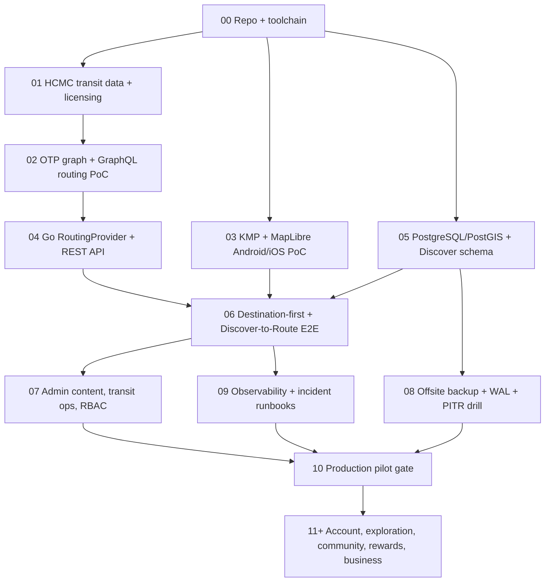

# GoWander — Agent Execution Pipeline

> **Audience:** autonomous/coding agents working inside the GoWander repository.  
> **Status:** **proposed implementation plan**, not a checklist of completed work.  
> **Companion:** [`OVERVIEW.md`](./OVERVIEW.md) — product, architecture, domain boundaries and non-goals.  
> **Date:** 2026-11-11.

## 0. Instructions to every agent (read first)

1. **Read `OVERVIEW.md` and this file first**, then inspect the *actual repo*, existing tests, tool versions and configuration. The design docs are specifications, **not proof that code or data exists**.
2. **Do not invent implementation state.** Report `PASS`, `FAIL`, `BLOCKED`, or `NOT STARTED` with executed commands and observable evidence. Never mark a check passed without running it.
3. **Do not skip technical gates.** Before writing a production transit path, validate GTFS/OSM availability, rights, coverage, OTP correctness and cross-platform map feasibility.
4. **Ship narrow vertical slices**, not dozens of empty packages or migrations. A milestone is done when behavior works end-to-end and has tests.
5. **Do not fabricate routes, realtime ETAs, fares, place locations, historical sources, usage stats or revenue.** Use unmistakably labeled synthetic fixtures only for tests and local demos.
6. **Protect user data and infrastructure.** No plaintext credentials committed, no production DB destructive SQL, no destructive restore/cutover without explicit authorized approval. Don't auto-merge accounts by email.
7. **Check upstream version-specific docs** before adopting an OTP GraphQL field, KMP/MapLibre API, Postgres setting or pgBackRest command. Pin dependencies and capture versions.
8. **Do not install/purchase/deploy external services, change live DNS, perform paid operations or mutate production without approval.** Continue with local PoCs or report blockers when required permissions/data are unavailable.
9. **Respect code ownership:** Mobile → Go REST → domain module → DB / OTP adapter; Admin → RBAC-protected Go APIs. Keep private contacts and journals inaccessible to public APIs.
10. **Keep documents truthful:** update ADR, README, API contract, migration notes and this pipeline's status when code proves or disproves assumptions.

## 1. Agent startup protocol

At the beginning of each work session:

```bash
pwd
ls -la
git status --short --branch
git log -5 --oneline 2>/dev/null || true
# Optional only when available:
go version; java -version; docker compose version; python3 --version
```

Then:
- Identify **current milestone** by actual artifacts and test evidence, not by directory names.
- Inspect `OVERVIEW.md`, `PIPELINE.md`, relevant code and documentation; avoid assuming the repo is empty.
- State a small implementation plan with **files to change**, commands/tests and risks.
- Preserve user work and uncommitted changes. Do not force-push, reset or overwrite unrelated files.
- Make the smallest useful diff, run applicable checks, log results, and provide a clear next step.

### Standard task report

```text
Task ID:
Goal:
Status: PASS | FAIL | BLOCKED | NOT STARTED
Files changed:
Commands executed:
Evidence/tests:
Risks or missing prerequisites:
Next recommended task:
```

Use `docs/development/implementation-log.md` once initialized. Mark blocked tasks with a concrete reason and an unblock criterion; do not silently substitute mocks in production.

## 2. Dependency-driven delivery map



Parallelization is allowed for independent PoCs, but a dependent milestone cannot pass while its prerequisites are blocked. The DB backup baseline must precede **any real-data production pilot**, regardless of where it appears in the sequence.

## 3. Milestones, exact outputs and gates

| ID | Deliverable | Exit criteria (must be observed) | Status |
|---|---|---|---|
| **M00** | Repository + local toolchain | Git clean baseline; README, `.gitignore`, `.env.example`; versions recorded; no secrets tracked | **PASS** (2026-11-11; committed by the owner as `bab9124` + `27b92da`; evidence in `docs/changes/change-11-11-2026.md` §6 and §9) |
| **M01** | Transit data feasibility | Pilot area, source inventory, rights/licensing decision, valid GTFS/OSM fixtures, 5–10 route cases | **BLOCKED** (2026-11-11): no legally usable HCMC bus/metro GTFS found; OSM available. Unblock criteria in `docs/research/transit-data-feasibility.md` §6. Owner decision (§7): record the blocker and continue with a clearly labelled, source-backed **assumed** dataset for PoC work only; pilot scope not yet fixed |
| **M02** | OTP routing PoC | Version-pinned graph build; start; verified GraphQL itinerary; errors/no-route; logs + measurements | IN PROGRESS — task 1 done 2026-11-12: OTP 2.10.0 pinned by digest (ADR-023). Task 2 done 2026-11-12: repeatable graph build in `infrastructure/otp/` (Geofabrik `vietnam-261111` cropped to the L1 corridor, 14 stops, 2 patterns, build ≈9 s, peak container memory ≈0.7 GiB, 0 ERROR; manifest `infrastructure/otp/manifests/metro-l1-assumed.txt`). Open data issue: 6 stops unlinked by island pruning — check in task 5. Technology PoC only (ADR-020) on the assumed Metro L1 feed in `data/assumed/hcmc-metro-l1-gtfs/`; cannot claim HCMC readiness while M01 is blocked |
| **M03** | KMP Map PoC | Android+iOS render, gestures, markers, polylines, GPS permission/error states | NOT STARTED — Android half blocked until Android Studio + SDK are installed (see `docs/development/toolchain-versions.md`) |
| **M04** | Go routing service | Health/readiness, typed route contract, OTP adapter, normalized errors, integration tests | BLOCKED on M02 |
| **M05** | PostgreSQL/PostGIS + Discover | Versioned migrations for needed tables; representative licensed place data; spatial queries tested | NOT STARTED |
| **M06** | Core end-to-end vertical slice | Mobile→Go→OTP→map and Discover→Place→Route work, including failures, on both platforms | BLOCKED on M02–M05 |
| **M07** | Minimal Admin & RBAC | Role checks server-side; places/stories CRUD; transit source/feedback pages; audit | BLOCKED on M05 |
| **M08** | DB protection & recovery | Scheduled/manual backup, WAL archive, protected off-host repo, isolated PITR, alerts and measured drill | BLOCKED on DB setup |
| **M09** | Observability + CI | Instrumentation, alert scenarios, CI tests and recovery runbooks work | NOT STARTED |
| **M10** | Pilot release | Data/UX/testing/legal gate passed; restoration tested; monitoring live; scope explicitly documented | BLOCKED |
| **M11+** | Account/community/rewards/commerce | Separate scoped milestones and tests; only after their dependencies and product gates | DEFERRED |

**Status is a plan baseline.** An agent must inspect the actual repository before updating it.

## 4. M00 — Repository and environment

### Tasks
- Create/verify monorepo: `mobile/`, `backend/`, `admin/`, `infrastructure/{docker,otp,postgres,backup,monitoring}/`, `data/`, `docs/{architecture,development,decisions,research,runbooks}/`, `scripts/`, `.github/workflows/`.
- Record installed versions of Go, Java/JDK, Docker/Compose, Gradle/Kotlin, Xcode/Android Studio, Python.
- Initialize Git safely and add `.gitignore` for `.env`, credentials, build artifacts, raw datasets, DB volumes, backups and OTP graph artifacts.
- Write `README.md` quick start and `.env.example` with placeholder values **only**.
- Decide repository origin/module name from actual user/repo context; **never insert a guessed owner**.

### Gate
Bootstrap instructions work on a clean development checkout. `git status` shows no generated secrets/binary DB files. If required Apple/Android tooling is missing, report which platform is blocked.

## 5. M01 — Transit data due diligence **before OTP**

### Tasks
1. Choose a limited HCMC pilot region, documented with reasons and rough extent.
2. List GTFS Static, optional GTFS-RT, OSM extract and map tile sources; capture provider, source URL, license, allowed usage, update frequency and access restrictions.
3. **Do not presume HCMC GTFS is openly available just because a data portal exists.** Obtain permitted test data; if absent, report `BLOCKED` and options (licensed partnership, changed pilot scope, clearly labeled synthetic-only OTP experiment).
4. Validate feed specification and referential integrity: `agency`, `stops`, `routes`, `trips`, `stop_times`, service calendars and dates, timezone, stop coords, service coverage.
5. Define 5–10 representative cases (walking, bus, metro, transfer, no-route, invalid coordinates, calendar boundary). Expected results must come from the actual licensed feed, not guesswork.
6. Record source manifest and checksums; exclude large raw datasets from Git unless explicitly licensed and appropriate.

### Outputs
- `docs/research/transit-data-feasibility.md`
- `data/sources/source-inventory.csv`
- `data/test-cases/route-cases.*`
- `docs/decisions/ADR-001-transit-data.md` or the next available ADR ID.

### Gate
A documented, legally usable dataset covering some real pilot cases exists. Otherwise STOP production-routing work and report alternatives.

## 6. M02 — OpenTripPlanner routing PoC

### Tasks
1. Inspect upstream OTP docs and pin a **specific compatible version/image digest**; record JVM requirements and API schema. Do **not** use `latest` as a durable dependency.
2. Build graph from permitted GTFS/OSM; store build config and repeatable scripts under `infrastructure/otp/`.
3. Start OTP with reproducible config. Ensure graph version and source checksums are recorded.
4. Use the GraphQL schema supported by that version; don't implement against the removed legacy REST API or assume a field like `planConnection` exists without schema inspection.
5. Test route cases, scheduled-vs-realtime labeling, geometry, transfers, no-route and failure behavior.
6. Measure build/start time, JVM memory, routing latency and errors under a stated machine/dataset.

### Gate
At least one **real, source-backed** valid itinerary; the predefined scenarios are reported PASS/FAIL with evidence. Fake/test GTFS may prove technology only, **not HCMC production readiness**.

## 7. M03 — KMP + MapLibre cross-platform PoC

### Tasks
1. Create project with upstream supported KMP/Compose toolchain; pin dependency versions.
2. Implement one map screen: tile rendering, camera, marker, polyline and gestures.
3. Implement platform-specific permission/location adapters and manual origin fallback.
4. Test Android physical/emulator **and** iOS simulator/physical device; include lifecycle/memory/error tests.
5. Keep SDK-specific calls inside a small map adapter/feature boundary; avoid premature generic map framework.

### Gate
Both target platforms render the same representative route geometry. If iOS map support is blocked, document the SDK alternative and architecture impact before proceeding.

## 8. M04 — Go backend and RoutingProvider

### Tasks
- `cmd/api` with config validation, graceful shutdown, structured logs, request IDs, liveness/readiness.
- Chi router (preferred), REST/JSON DTOs and OpenAPI contract.
- `mobility` module with `RoutingProvider` interface and concrete OTP GraphQL adapter.
- Normalize provider errors into `INVALID_REQUEST`, `NO_ROUTE_FOUND`, `OUT_OF_COVERAGE`, `DATA_UNAVAILABLE`, `ROUTING_TIMEOUT`, `ROUTING_UNAVAILABLE` where semantics truly apply.
- Context cancellation, bounded timeouts, input validation and integration tests using fixtures/mocks for *tests only*.
- Initial endpoint proposal: `POST /api/v1/routes/plan` (confirm in OpenAPI).

### Gate
Go-to-OTP integration works for actual graph test cases; clients never depend directly on OTP's GraphQL schema.

## 9. M05 — Database and Discover minimum slice

### Tasks
- Start pinned PostgreSQL/PostGIS image with persistent development volume and least-privilege app credentials.
- Add versioned migrations **only for current features**: `place_categories`, `places`, `place_category_links`, `place_media`, `food_items`, `place_foods`, `historical_stories` as needed.
- Use proper FKs, constraints and spatial type/index; no premature wholesale 49-table migration.
- Seed sourced/licensed content. If only test fixtures exist, label clearly as fixtures.
- Implement named SQL queries with pgx/sqlc; benchmark `ST_DWithin`, category filter and published-only projections.
- Add migration up/down or forward repair approach with realistic rollback limits and tests on fresh + existing dev DBs.

### Gate
Place listing/details/nearby queries return valid data, schema tests pass, and SQL does not require superuser privileges.

## 10. M06 — First complete vertical slice

### Tasks
- End-to-end: Mobile Map → origin/destination → Go route plan → OTP → normalized itinerary → map polyline.
- End-to-end: Discover → Place Detail → Directions → Map/route plan.
- Implement empty/loading/error/retry, preserve origin and destination across failures.
- Keep scheduled data labeled scheduled; omit unsupported realtime/fare fields.
- Run Android and iOS E2E checks plus API tests, recording evidence.

### Gate
Two user flows work with real permitted data in chosen pilot area. If one platform cannot run, milestone is not complete (report partial status).

## 11. M07 — Minimal Admin & controlled access

### Tasks
- Choose web stack after short ADR (table/forms, OpenAPI client, deployment, maintainability).
- Implement OIDC login, server RBAC, `roles` + `user_roles` as needed and `admin_audit_logs`.
- Admin content CRUD for verified Places/Foods/Stories, publish/hide workflow, source/license fields.
- Transit source/version state, feedback triage and focused operational health.
- Restrict role assignment, destructive actions and production operations; log actor/action/time/request ID.
- Start with decision-oriented Executive/Mobility/Discover dashboards; metric definitions and meaningful actions required.

### Gate
Unauthorized actions fail **at API**, not just UI. Content updates reach the Mobile API. Audit is correct; no private contacts exposed.

## 12. M08 — Backup, PITR, monitoring and DR (production gate)

### 12.1. Mandatory architecture

- PostgreSQL + **pgBackRest physical backups** and **continuous WAL archiving**.
- Protected **off-host** repository (S3-compatible or independent backup host), separate credentials, encryption and retention controls.
- Scheduler via `systemd timer` or `cron`; job results/errors sent to monitoring independently of the application DB.
- Production pilot target **proposed, unverified**: RPO ≤15 minutes, RTO ≤4 hours. Validate with real drills or revise targets.

### 12.2. Proposed initial jobs

| Job | Cadence (Asia/Ho_Chi_Minh) | Evidence |
|---|---|---|
| Full | Sunday ~02:00 | backup set visible and successful |
| Differential | Mon–Sat ~02:00 | diff set available |
| WAL archival | Continuous | no missing required segments; measured archive lag |
| Health checks | frequent | backup age, archiver failure, repository access |
| On-demand full/diff | authorized request / migration | reason, actor, result, audit |
| Isolated restore drill | weekly | usable recovered DB + duration + data checks |
| DR exercise | monthly/quarterly | recovery runbook/roles validated |

### 12.3. Implementation sequence

1. Choose PostgreSQL and pgBackRest versions and **read their version-matched docs**.
2. Configure WAL archive, stanza, off-host repository, credentials and retention. Test full physical backup and `pgbackrest info`/`check`.
3. Schedule full/differential jobs using host scheduler; add **manual on-demand runbook**. Don't store repository secrets in the admin DB.
4. Test isolated restore to a fresh host/container (network-isolated; never pointing at production payment/notification systems).
5. Test PITR by applying a known destructive **test-only** operation after a recovery target, then restore before it. Verify expected records, FK integrity and service startup.
6. Simulate backup failure, WAL archive lag, disk warning and restore-drill failure in **staging**; ensure alerts reach operator.
7. Record verified RPO/RTO and exact restore command/config in `docs/runbooks/database-recovery.md`, with secrets redacted.

### 12.4. Incident decision table

| Signal | Automatic action allowed | Must require human authorization |
|---|---|---|
| Transient DB connection issue | bounded retry, alert | destructive operations |
| DB process unavailable | controlled restart under policy | restore/cutover when data integrity unknown |
| WAL archiver stalled | alert, protect retention, diagnostics | resetting archive or deleting WAL |
| Backup failed | alert, safe retry if configured | deleting backup history |
| Suspected data deletion/corruption | alert, contain, preserve evidence, isolated restore | overwriting production / PITR cutover |
| Host failure | alert, DR activation preparations | production restore or untested failover |

**Never blind-auto-restore production.** PITR to an earlier time may discard subsequent valid transactions; isolate, compare and choose selective repair when appropriate. HA replication is **not** a substitute for backup.

### Gate
Backup cadence tested, WAL continuously archiving, off-host copy available, isolated physical restore + PITR **PASS**, recovery documentation accurate, alert scenarios pass. **Block production pilot until this gate is met.**

## 13. M09 — CI/CD, observability and security

### Tasks
- CI: lint, tests, migrations, API contract, builds, dependency/security checks where practical.
- Build immutable, versioned artifacts (backend version, Mobile versions, schema migration, OTP image, graph/source manifest).
- Measure API p95/error, OTP routing performance, Postgres health, backup age and WAL lag. Use `pg_stat_archiver` with correct interpretation (low WAL activity can make latest archive time old without a fault).
- Structured logs with request IDs; mask PII, secrets and private journal content.
- Alerts with severity, persistence window, responsible operator, and runbook link.
- Ensure no build/deploy flow automatically executes destructive migrations or restores without review.

### Gate
CI and operational checks have **observed** results, not placeholder dashboards. Restore coverage is visible outside DB being restored.

## 14. M10 — Pilot launch gate

**Do not ship a production pilot until all applicable items pass:**

- [ ] Legal/technical rights to routing and map datasets verified.
- [ ] OTP test scenarios pass; graph/source versions pinned.
- [ ] Android and iOS map & essential UX tested.
- [ ] Mobile→Go→OTP and Discover→Route end-to-end pass.
- [ ] Published content verified and licensed.
- [ ] Go/Admin API security and error semantics verified.
- [ ] Database migrations tested with realistic data.
- [ ] Backups are **off-host**, scheduled, WAL archive healthy and **isolated PITR restore succeeded**.
- [ ] RPO/RTO based on drill or explicitly revised.
- [ ] Logging, monitoring, alerts, incident runbook and backup manual procedure work.
- [ ] Privacy policy, data retention and relevant release requirements reviewed.

Track metrics with definitions: route found vs technical failure, p95, discover→route, content completeness, critical issues. Route request ≠ completed journey.

## 15. Deferred scope — only activate after gates

### Accounts and exploration
- Guest mode remains available. Google/OIDC sign-in; `(issuer, subject)` identity, stable `users.id`, private contacts; Apple provider as required by iOS policy/selected release.
- Saved / visited / favorite / journal: private by default, with ownership checks.

### Community and rewards
- Posts, Reviews, Follow, reporting/moderation. No leaderboard/levels.
- Reward eligibility → approval → **idempotent** ledger. Never award automatically for follow/like/positive review/self-marked visit.

### Business and revenue
- Confirm partner agreements and precise money flow *before* migrations/integrations.
- Referrals/clicks are not paid conversions. Contract-based revenue, adjustments, currencies, expenses and settlements require auditable source evidence.
- Revenue dashboard is `not monetized yet` until real confirmed records exist; never populate with synthetic numbers.

### HA / advanced analytics
- Evaluate standby/Patroni when availability requirements exceed pilot needs. Replication does not protect against logical deletion.
- Add computed aggregate tables/cache/partitions only after measured query bottlenecks.

## 16. Implementation conventions and file-level hygiene

- Source code, comments and identifiers: English; docs can be Vietnamese with technical English names.
- Prefer typed DTOs and small explicit interfaces; avoid magical generic repositories.
- Use SQL migrations and deterministic test data; never edit production manually as a substitute for migration.
- Do not treat `EXPLAIN` without representative data as a performance guarantee.
- User-visible states clearly distinguish `NO_ROUTE`, missing coverage and technical errors.
- `usage_events` must carry no unnecessary contact details, tokens or raw continuous GPS history.
- For every new API, update OpenAPI, validation, authorization, errors and tests.
- For every schema change, update migration, repository queries, tests and Data Dictionary when meaning changes.
- For every deployment/recovery change, update runbook and verify in a non-production environment.

## 17. Source-of-truth documents and agent handoff

| Artifact | Purpose | Update when |
|---|---|---|
| `OVERVIEW.md` | Product + architecture + immutable guardrails | Meaningful architecture/product decision changes |
| `PIPELINE.md` | Milestones, gates, agent protocol | A task completes/blocks, plan changes |
| `AGENTS.md` | Agent/skill per step and milestone, change-record rule | Workflow, tooling or branch plan changes |
| `docs/changes/change-DD-MM-YYYY.md` | What/where/how/why of every change | **Every change**, same commit |
| `docs/design/<document>/*.md` | Full design sources (six documents converted from the PDF, split into section files; index in `docs/design/README.md`) | A new document version is issued or implementation disproves a design |
| `README.md` | Human developer quick start | Commands/toolchain/environment change |
| `docs/research/transit-data-feasibility.md` | Real feeds, rights, coverage | Feed/source status changes |
| `docs/decisions/ADR-*.md` | Decision and rationale | A significant design choice changes |
| `docs/development/implementation-log.md` | Evidence-based step history | Each completed/failed task |
| `docs/runbooks/database-recovery.md` | Backup + recovery process | Config/schedule/recovery tested or changed |
| `backend/api/openapi/` | REST contract | Endpoint/DTO/error changes |
| `backend/migrations/` | Physical schema source of truth | Every DB schema change |

**Work queue selection rule:** choose the earliest **unblocked** high-priority milestone. Never implement deferred features to bypass a blocker in the core route-to-discover path.

### Minimal per-task handoff template

```markdown
## GW-XXX — Short title
- Status: NOT STARTED / IN PROGRESS / PASS / FAIL / BLOCKED
- Goal:
- Inputs/assumptions:
- Files added/edited:
- Commands run:
- Test evidence:
- Security/data implications:
- Decisions made / ADR:
- Blockers:
- Next task:
```

## 18. Immediate instruction for the next coding agent

> Read `OVERVIEW.md` and `PIPELINE.md`. Inspect the current repository before making changes. Start at **M00** unless there is verifiable evidence that M00 passed. Record real tool versions and create only the smallest required scaffold; then prepare **M01 transit-data feasibility**. Do **not** build 49 tables, Community or Revenue prematurely. If legal usable HCMC GTFS is absent, report M01 BLOCKED rather than claiming production routing readiness. Never perform production restore without explicit operator approval.
