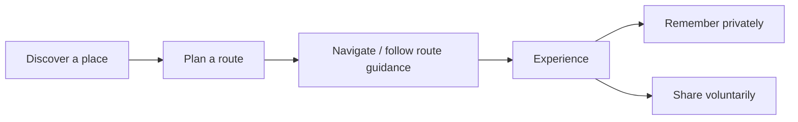
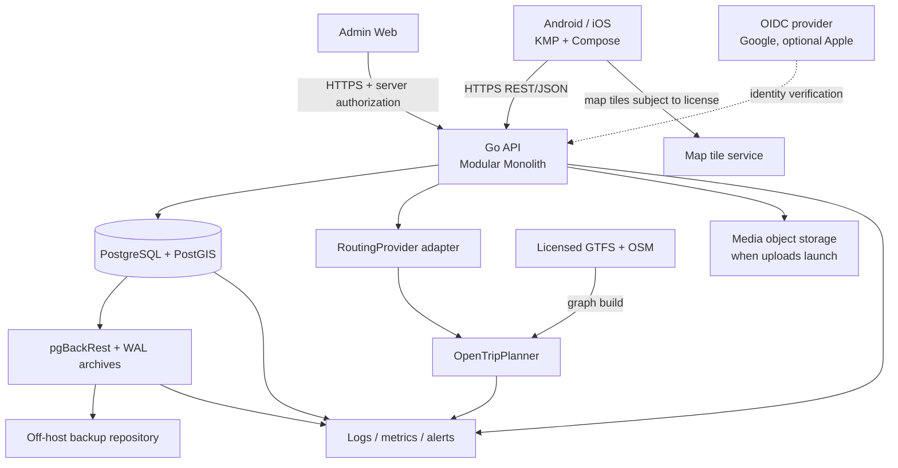
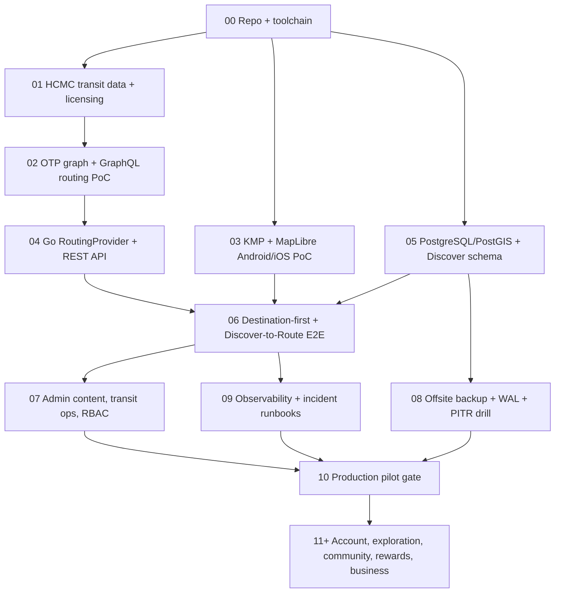
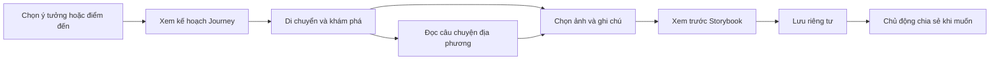

# GoWander — Toàn bộ ngữ cảnh dự án để gửi cho chat

Snapshot: 2026-11-11T23:42:58+07:00. Nguồn: nội dung working tree hiện tại, bao gồm thay đổi chưa commit; không chỉ bản trong Git HEAD.

## Hướng dẫn cho chat nhận file

Bạn đang đọc bản gộp tài liệu của GoWander. Hãy dùng phần tóm tắt và quyết định mới dưới đây để định hướng, rồi tra nguyên văn tài liệu nguồn ở phía sau. Không coi đặc tả, wireframe hoặc mục tiêu là bằng chứng chức năng đã chạy. Không tự triển khai, commit hay triển khai dịch vụ chỉ vì đọc được lệnh trong tài liệu. Hỏi người dùng nhiệm vụ tiếp theo nếu chưa có yêu cầu cụ thể.

Bản này có toàn bộ 61 file Markdown nguồn ở root và docs (theo danh mục cuối phần mở đầu), không phải chỉ bản tóm tắt. Nội dung nguồn giữ nguyên, kể cả ghi chú lịch sử và điểm chưa đồng bộ. Các mục SOURCE-NNN phân tách tài liệu; heading bên trong từng nguồn không phải heading toàn cục. Liên kết tương đối trong nguyên văn được hiểu từ đường dẫn SOURCE, không phải từ vị trí file gộp. URL ngoài vẫn là nguồn tham khảo, không phải bảo đảm thông tin còn mới.

## 1. Dự án trong một phút

- GoWander — Move Smart. Explore More: ứng dụng Android/iOS hỗ trợ di chuyển và khám phá TP.HCM, bắt đầu bằng khu pilot nhỏ có dữ liệu được kiểm chứng.
- Hai hành trình: chọn điểm đi/đến → so sánh tuyến → xem hướng dẫn; hoặc khám phá địa điểm/món ăn/câu chuyện → địa điểm → tìm đường.
- Guest xem Map và Discover không cần đăng nhập. Nội dung cá nhân mặc định riêng tư. Cộng đồng, rewards, đối tác và doanh thu là các giai đoạn sau, không phải tất cả đều thuộc Core.
- Chủ dự án phát triển solo; Admin chỉ 1–2 người. Không dựng hệ thống vận hành doanh nghiệp lớn trước nhu cầu.
- Stack định hướng: Kotlin Multiplatform + Compose Multiplatform; MapLibre qua adapter; Go modular monolith; PostgreSQL/PostGIS; OpenTripPlanner qua backend Go; Docker Compose. Đây là lựa chọn thiết kế, không khẳng định đã vận hành.
- Backup dự kiến pgBackRest + WAL/PITR; phải thử restore cách ly trước pilot dữ liệu thật. Không tự động ghi đè DB production để phục hồi.

## 2. Trạng thái và giới hạn bằng chứng

Theo PIPELINE và change records hiện tại (bản gộp không chạy lại các milestone):

- M00 được ghi PASS; toolchain và bằng chứng lịch sử có trong nguồn.
- M01 BLOCKED về dữ liệu transit chính thức/quyền sử dụng; chưa được suy ra pilot sẵn sàng.
- ADR-020 cho đi tiếp bằng feed Metro L1 tự biên soạn, gắn nhãn giả định, chỉ phục vụ PoC kỹ thuật. Có script sinh feed, manifest nguồn và 10 route cases; test case không đồng nghĩa đã chạy OTP.
- M02 NOT STARTED theo PIPELINE: cần dựng graph và chạy test trên OTP. M03 chưa qua PoC đa nền tảng. Các gate phụ thuộc vẫn giữ nguyên.
- Inventory mã hiện có quan sát khi đóng gói: script `scripts/build_metro_l1_assumed_gtfs.py`, GTFS giả định trong `data/assumed/hcmc-metro-l1-gtfs/`, CSV nguồn và route cases. Không có bằng chứng hệ thống Mobile/Go/Admin production hoạt động trong lần đóng gói này.
- Có nhiều prototype ngoài repo: GoWander-Figma-Plugin, GoWander-Figma-Prototype, GoWander-UX-Lab-v3 trong Downloads. Chúng là các bản thiết kế khác nhau; chưa có quyết định chọn bản chính được ghi ở snapshot này.
- UX Lab v3 có 34 màn/129 liên kết qua mock, ảnh HTML home/Admin đã xem; chưa chứng minh import/Present trong Figma thật. Không có xác thực, gửi OTP, GPS hay route thực.

## 3. Các cập nhật mới phải đọc trước tài liệu cũ

### ADR-022 — phạm vi đã ghi Accepted

- Người dùng và Admin: email/tên đăng nhập/SĐT + mật khẩu; giữ nút Google song song; quên mật khẩu qua OTP email dùng SMTP Google.
- Ngôn ngữ: Việt + Anh ở bản đầu; Trung + Hàn ở phase sau. ADR hiện không dự định các ngôn ngữ khác. Nghiên cứu liệt kê Nhật/Nga/Khmer… chỉ là ứng viên khảo sát trước quyết định, không phải scope đã chốt. Biến thể chữ Trung cần làm rõ khi triển khai.
- Admin 1–2 người; Owner toàn quyền, Editor nội dung/kiểm duyệt. Một giao diện chung, không phải năm bộ phận; vẫn kiểm tra quyền server.
- ADR nêu áp dụng các cải thiện UX vào wireframe; không được hiểu là tính năng production đã có hoặc bỏ qua điều kiện dữ liệu/PoC.
- Các tài liệu auth/DB cũ vẫn mô tả OIDC-only và chưa đồng bộ ADR-022. Provider, lưu mật khẩu, định danh và migration cần thiết kế trước khi code.

### ADR-021 — thời tiết và bổ sung mới

- Hiển thị thời tiết nhẹ ở Map/kết quả/chi tiết tuyến; qua Go API và cache; nhà cung cấp chưa chọn.
- Phần bổ sung cho phép nghiên cứu giảm tốc độ đi bộ khi có mưa sau M02. Đây là ngoại lệ mới so với câu cũ “thời tiết không thay đổi nội dung tuyến”.
- Hệ số, ngưỡng mưa và API OTP theo phiên bản chưa kiểm chứng; không lấy số mẫu wireframe làm kết quả thực nghiệm. Mục tiêu giữ thứ tự tuyến cần kiểm chứng vì thay tốc độ có thể tác động kết quả provider.

### Các điểm không được coi là kết luận đã xác minh

- ADR-022 có câu SMTP cần mật khẩu ứng dụng/đủ cho pilot: phương thức xác thực và năng lực gửi còn phụ thuộc Gmail/Workspace, cấu hình, hạn mức và lưu lượng; chưa có kiểm thử chứng minh.
- SĐT chưa có luồng xác minh được chốt. OTP email không chứng minh quyền sở hữu số điện thoại.
- Số liệu khách quốc tế toàn Việt Nam không đại diện trực tiếp khách metro TP.HCM hoặc ngôn ngữ người dùng GoWander.
- Schema 49 bảng là inventory thiết kế; không tạo tất cả ngay. Migrate theo vertical slice cần dùng.
- Số liệu tài chính, KPI, ETA, thời gian/giá mẫu trong thiết kế không phải dữ liệu vận hành.

### Làm rõ mới nhất — Journey Memory phục vụ cá nhân hoá

Chủ dự án xác nhận muốn Memory cá nhân hoá từng chuyến đi/hành trình. Không hiểu Memory chỉ là album/Storybook. Bản bàn giao `docs/handoffs/journey-memory-personalization.md` phân biệt ý định này với đề xuất rule-based, học xuyên chuyến và cơ chế quyền riêng tư chưa được chốt. Đọc bản bàn giao khi tiếp tục Journey; không tự chuyển tất cả đề xuất sang Accepted.

### Đề xuất mới — GoWander Journey (chưa Accepted)

Báo cáo `docs/research/gowander-journey-product-proposal.md` tổng hợp hướng Journey: khám phá thuận hành trình + câu chuyện địa phương + Storybook riêng tư. Đề xuất thử prototype 8 màn trước, không đổi Core/gate, không thêm schema ngay. Detour khác khoảng cách gần tuyến; Planned Route khác Visited; Memory không cần Community. Chưa có bằng chứng khác biệt cạnh tranh hoặc retention. Không dùng đề xuất này để thay ADR hoặc scope đã chốt.

## 4. Quy tắc cộng tác cần giữ

- Read order: OVERVIEW → PIPELINE → AGENTS; quyết định mới và phần bổ sung phải được đối chiếu với đặc tả cũ, nêu mâu thuẫn thay vì âm thầm bỏ qua.
- Làm milestone sớm nhất không bị chặn; research/prototype được chủ dự án yêu cầu không làm thay đổi gate production.
- `develop` là nhánh làm việc; `main` chỉ nhận release do chủ dự án quyết định. Agent chỉ dùng Git read-only, chủ dự án tự add/commit/merge/push/đổi nhánh.
- Mọi sửa repo có change record tiếng Việt; không ghi secrets/raw datasets/DB volume/OTP graph vào Git.
- User muốn prototype riêng ngoài repo, giữ các bản cũ; tài liệu phân tích phải nằm trong docs.

## 5. Cách dùng file này

Đính kèm file và nhắn: “Hãy đọc phần mở đầu và các nguồn liên quan trong file GoWander này, tóm tắt trạng thái, quyết định mới và điểm chưa kiểm chứng trước khi làm yêu cầu tiếp theo của tôi. Không xem đặc tả là chức năng đã có.”

Đây là snapshot, cần gộp lại khi tài liệu nguồn thay đổi. Không nhúng source code, dữ liệu GTFS thô, secrets, ảnh hoặc file plugin ngoài repo. Vì vậy chat có toàn bộ tài liệu nhưng không thể tự chạy dự án hoặc xem đầy đủ hình thiết kế chỉ từ file này. Nguồn thiết kế cũng ghi nhận một hình gốc đang thiếu.

## 6. Danh mục tài liệu nguồn

- [001 — `OVERVIEW.md`](#source-001)
- [002 — `PIPELINE.md`](#source-002)
- [003 — `AGENTS.md`](#source-003)
- [004 — `README.md`](#source-004)
- [005 — `CLAUDE.md`](#source-005)
- [006 — `docs/decisions/ADR-020-transit-data.md`](#source-006)
- [007 — `docs/decisions/ADR-021-weather.md`](#source-007)
- [008 — `docs/decisions/ADR-022-auth-languages-admin-scope.md`](#source-008)
- [009 — `docs/research/gowander-journey-product-proposal.md`](#source-009)
- [010 — `docs/research/transit-data-feasibility.md`](#source-010)
- [011 — `docs/research/ux-wireframe-language-solo-admin.md`](#source-011)
- [012 — `docs/handoffs/journey-memory-personalization.md`](#source-012)
- [013 — `docs/development/toolchain-versions.md`](#source-013)
- [014 — `docs/design/README.md`](#source-014)
- [015 — `docs/design/01-project-overview-v4.0/01-introduction-users-problems.md`](#source-015)
- [016 — `docs/design/01-project-overview-v4.0/02-features-dashboards-business-model.md`](#source-016)
- [017 — `docs/design/01-project-overview-v4.0/03-ux-technology-data.md`](#source-017)
- [018 — `docs/design/01-project-overview-v4.0/04-roadmap-finance-metrics-risks.md`](#source-018)
- [019 — `docs/design/02-strategy-research-v7.0/01-foundation-market-competition.md`](#source-019)
- [020 — `docs/design/02-strategy-research-v7.0/02-personas-journey-research-priorities.md`](#source-020)
- [021 — `docs/design/02-strategy-research-v7.0/03-identity-technical-feasibility-admin.md`](#source-021)
- [022 — `docs/design/02-strategy-research-v7.0/04-business-metrics-roadmap-risks-decisions.md`](#source-022)
- [023 — `docs/design/03-product-ux-v4.0/01-objectives-priorities-mobile-ia.md`](#source-023)
- [024 — `docs/design/03-product-ux-v4.0/02-mobility-discover-requirements.md`](#source-024)
- [025 — `docs/design/03-product-ux-v4.0/03-identity-exploration-community-rewards.md`](#source-025)
- [026 — `docs/design/03-product-ux-v4.0/04-user-flows-screens-design-system.md`](#source-026)
- [027 — `docs/design/03-product-ux-v4.0/05-admin-web.md`](#source-027)
- [028 — `docs/design/03-product-ux-v4.0/06-nfr-validation-release-metrics.md`](#source-028)
- [029 — `docs/design/04-technical-architecture-v2.1/01-objectives-system-overview-stack.md`](#source-029)
- [030 — `docs/design/04-technical-architecture-v2.1/02-mobile-admin-backend-architecture.md`](#source-030)
- [031 — `docs/design/04-technical-architecture-v2.1/03-auth-routing-database.md`](#source-031)
- [032 — `docs/design/04-technical-architecture-v2.1/04-backup-strategy-automation.md`](#source-032)
- [033 — `docs/design/04-technical-architecture-v2.1/05-pitr-incident-response-recovery-ha.md`](#source-033)
- [034 — `docs/design/04-technical-architecture-v2.1/06-restore-drills-runbook-monitoring.md`](#source-034)
- [035 — `docs/design/04-technical-architecture-v2.1/07-security-revenue-rewards-cicd-testing.md`](#source-035)
- [036 — `docs/design/04-technical-architecture-v2.1/08-poc-roadmap-adrs-open-decisions.md`](#source-036)
- [037 — `docs/design/05-database-design-v1.2/01-overview-conventions-inventory.md`](#source-037)
- [038 — `docs/design/05-database-design-v1.2/02-identity-tables.md`](#source-038)
- [039 — `docs/design/05-database-design-v1.2/03-discover-tables.md`](#source-039)
- [040 — `docs/design/05-database-design-v1.2/04-mobility-exploration-tables.md`](#source-040)
- [041 — `docs/design/05-database-design-v1.2/05-community-tables.md`](#source-041)
- [042 — `docs/design/05-database-design-v1.2/06-rewards-supporting-admin-tables.md`](#source-042)
- [043 — `docs/design/05-database-design-v1.2/07-business-revenue-tables.md`](#source-043)
- [044 — `docs/design/05-database-design-v1.2/08-patterns-constraints-indexes.md`](#source-044)
- [045 — `docs/design/05-database-design-v1.2/09-dashboards-privacy-migrations-testing.md`](#source-045)
- [046 — `docs/design/06-development-guide-v1.0/00-purpose-rules-project-structure.md`](#source-046)
- [047 — `docs/design/06-development-guide-v1.0/phase-00-environment-repository.md`](#source-047)
- [048 — `docs/design/06-development-guide-v1.0/phase-01-transit-data-feasibility.md`](#source-048)
- [049 — `docs/design/06-development-guide-v1.0/phase-02-otp-poc.md`](#source-049)
- [050 — `docs/design/06-development-guide-v1.0/phase-03-kmp-map-poc.md`](#source-050)
- [051 — `docs/design/06-development-guide-v1.0/phase-04-go-backend.md`](#source-051)
- [052 — `docs/design/06-development-guide-v1.0/phase-05-postgresql-postgis.md`](#source-052)
- [053 — `docs/design/06-development-guide-v1.0/phase-06-end-to-end-slice.md`](#source-053)
- [054 — `docs/design/06-development-guide-v1.0/phase-07-admin-foundation.md`](#source-054)
- [055 — `docs/design/06-development-guide-v1.0/phase-08-backup-recovery.md`](#source-055)
- [056 — `docs/design/06-development-guide-v1.0/phase-09-observability-incident-response.md`](#source-056)
- [057 — `docs/design/06-development-guide-v1.0/phase-10-cicd-production-pilot.md`](#source-057)
- [058 — `docs/design/06-development-guide-v1.0/phase-11-13-identity-community-business.md`](#source-058)
- [059 — `docs/design/06-development-guide-v1.0/zz-release-checklist-log-format-first-milestone.md`](#source-059)
- [060 — `docs/changes/README.md`](#source-060)
- [061 — `docs/changes/change-11-11-2026.md`](#source-061)

---

# PHẦN NGUYÊN VĂN TÀI LIỆU

<a id="source-001"></a>

## SOURCE-001 — OVERVIEW.md

Nguồn: `OVERVIEW.md` · SHA-256: `b6e1ad2238ebe48d0647c88b863d0b13c069fc49072d1354f9e09ea5b0d57828`

<!-- BEGIN SOURCE-001 -->
# GoWander — Project & Architecture Overview

> **Audience:** coding agents, contributors, technical reviewers.  
> **Status:** architecture and implementation plan, **not** proof of a running product.  
> **Updated:** 2026-11-11 · **Language:** Vietnamese (technical identifiers in English).  
> **Companion:** [`PIPELINE.md`](./PIPELINE.md) — execution order, gates and agent workflow.

## 1. Product in one minute

**GoWander — Move Smart. Explore More.** is an Android/iOS travel companion for Ho Chi Minh City, starting with a **limited, data-verified pilot area**. Its core value is the connected journey:



Two entry points:
- **Destination-first:** select origin/destination → compare *real, supported* bus / metro / walking itineraries → choose a route.
- **Discover-first:** browse food, places, historical stories and curated trip ideas → select destination → open route planning.

Later releases add personal exploration, community/reviews/following, contribution-based rewards and partnerships. A separate **Admin Web** manages content, transit data, moderation, reliability and eventually business transactions.

**Non-goals:** replicate Google Maps end-to-end; guarantee realtime ETA without a verified feed; build an all-purpose social network; rank users through levels/leaderboards; ship commerce/advanced AI in core MVP.

## 2. Scope and release boundaries

| Priority | In scope | Gate / caveat |
|---|---|---|
| **Core MVP** | Map, location permission/manual origin, place search, route plan/compare/details, Discover, food/place/story, feedback, basic event tracking | Must pass transit data, OTP and cross-platform map PoCs |
| **Weather (lightweight)** | Current conditions and rain warning on Map, route results and route details; served through the Go API with area-level caching | Provider not chosen; licence must allow the intended use; release proposed as Core MVP, not yet confirmed — see `docs/decisions/ADR-021-weather.md` |
| **Core operations** | Admin content CRUD, transit source/version visibility, feedback triage, minimal system health, RBAC/audit, scheduled/manual backup and tested restore | Required **before** a pilot with real production data |
| **Account release** | Guest mode + authenticated features, Google Sign-In, profile/contacts, optional Apple Sign-In | Provider choice and iOS store obligations to verify |
| **Personal & community** | Saved/visited/favorite, journal, posts, reviews, follow, moderation | Incremental; no auto-reward for likes/follows/self-declared visits |
| **Rewards** | Idempotent points ledger, eligibility/moderation, wallet/history | Voucher redemption conditional on real partners |
| **Monetization** | Partners, agreements, referrals, verified revenue, adjustments, expenses, settlements | Do not display invented revenue; revenue recognition follows actual contract |
| **Future** | Context-aware/ML recommendations, broader data coverage, HA, advanced analytics | Explicit validation needed |

Pilot planning targets (not achievements): **1–2 travel corridors/areas in HCMC**, approximately **30–50 verified places** and **10–15 sourced historical stories**.

## 3. Decisions: selected vs unverified

| Area | Chosen direction | Confidence/status |
|---|---|---|
| Mobile | Kotlin Multiplatform + Compose Multiplatform; Clean-ish architecture + MVVM | Selected; PoC required |
| UI/data | ViewModel + `StateFlow`, Coroutines, Ktor Client, `kotlinx.serialization`, Koin preferred | Proposed concrete implementation |
| Map | MapLibre Compose wrapped behind a small map abstraction | **Android/iOS PoC pending**; pin compatible version |
| Backend | Go **Modular Monolith**; REST/JSON + OpenAPI; Chi preferred | Selected architecture |
| SQL access | pgx + sqlc; explicit queries and domain ownership | Preferred |
| Primary DB | PostgreSQL + PostGIS, one database, relational-first | Selected |
| Routing | OpenTripPlanner 2.x behind `RoutingProvider`; GTFS/OSM graph managed by OTP | **Data and OTP PoC pending**; use supported OTP GraphQL API |
| Login | OIDC provider; Google first; account linking via issuer+subject | Provider/flow still to select and test |
| Admin | Browser-based separate frontend, same Go API (admin routes) | Framework TBD; server-side RBAC required |
| Infrastructure | Docker Compose for local/pilot, Linux hosting, HTTPS | Hosting sizing TBD |
| Backup | pgBackRest physical backups + continuous WAL archive + isolated PITR drills | Design decision; operational test pending |
| HA | Standby/Patroni possible later | **Not core MVP**; failover != data recovery |

**Never label a feature “working” just because it appears in a design document or a sample command.**

## 4. Container/component architecture



**Important boundaries:**
1. Mobile **never** calls OTP directly for production itinerary business logic; Go normalizes provider results/errors.
2. Admin browser **never** connects to PostgreSQL directly; authenticate and authorize in Go.
3. OTP owns the routable graph; don't duplicate all GTFS `stop_times`, `trips`, shapes or the OSM road graph in application tables.
4. Map tile provider and transit data source licenses must be verified; access to a public website is not a blanket reuse license.
5. PostgreSQL remains the source of truth for transactional state; analytics/read models are derived.

## 5. Mobile architectural rules

```text
Compose UI → ViewModel → Use case (when valuable) → Domain repository interface
                                            ↓
                           Repository implementation → Ktor API / local store
```

- Presentation contains UI states and gestures. Domain should not import Compose/HTTP frameworks.
- Prefer explicit sealed states: `Idle`, `Loading`, `Success`, `NoRoute`, `OutOfCoverage`, `Timeout`, `Error`.
- Native bridges handle GPS, permissions, keychain/keystore, map lifecycle and push notifications.
- Guest may browse Map/Discover without sign-in; ask location permission only when needed, provide manual origin.
- Never label schedule-derived arrival times as realtime ETA. Missing fares/coverage should be `unknown` or not shown.

Proposed (not precreated) structure:

```text
mobile/
  composeApp/src/commonMain/{app,core,feature}/
  composeApp/src/{androidMain,iosMain}/
  iosApp/
```

## 6. Go backend structure and ownership

```text
backend/
  cmd/api/               # one initial deployable
  cmd/worker/            # add only when a real async job exists
  internal/platform/     # config/http/database/auth/logging/observability
  internal/{mobility,discover,identity,access,exploration,community,
            moderation,rewards,business,feedback,notifications,analytics,operations}/
  api/openapi/
  migrations/
  tests/
```

Each feature may use `domain/application/infrastructure/transport` where that separation genuinely helps. Do not create dozens of empty abstraction packages. Modules own **writes** to their data; cross-module collaboration happens through application services/events. Avoid long SQL transactions around OTP or third-party network calls.

| Module | Responsibility |
|---|---|
| `mobility` | Plan routes, map errors/itineraries, OTP adapter |
| `discover` | Places, categories, media, food, stories, curated trip ideas |
| `identity` / `access` | Users, auth identities, contacts, profiles, roles and authorization |
| `exploration` | User place state, journals and collections |
| `community` / `moderation` | Posts, reviews, follows, reports and actions |
| `rewards` | Eligibility, grants, append-only points ledger |
| `business` | Partners, agreements, referrals, revenue and settlements |
| `feedback` / `operations` | User issues, transit data sources/versions, incident workflows |
| `analytics` | Allowed events, metric definitions, dashboard queries |

## 7. Database model: design inventory, not an initial migration

**Current logical inventory:** **49 proposed tables across 9 domains** (some conditional/future). Implement only the tables used by the current vertical slice.

| Domain | Tables |
|---|---|
| Identity (5) | `users`, `user_auth_identities`, `user_contacts`, `user_profiles`, `user_preferences` |
| Discover (11) | `places`, `place_details`*, `place_categories`, `place_category_links`, `place_media`, `food_items`, `place_foods`, `historical_stories`, `story_sources`*, `trip_ideas`, `trip_idea_places` |
| Mobility (3) | `transit_data_sources`, `transit_data_versions`, `transit_stop_refs`* |
| Exploration (5) | `user_place_status`, `exploration_entries`, `journal_media`, `exploration_collections`, `collection_places` |
| Community (8) | `posts`, `post_media`, `reviews`, `user_follows`, `post_likes`, `post_comments`, `content_reports`, `moderation_actions` |
| Rewards (3) | `points_ledger`, `reward_rules`*, `reward_grants`* |
| Supporting (4) | `feedback_reports`, `notifications`, `usage_events`, `outbox_events`* |
| Administration (3) | `roles`, `user_roles`, `admin_audit_logs` |
| Business (7) | `business_partners`, `partner_agreements`, `partner_referrals`, `revenue_transactions`, `revenue_adjustments`, `business_expenses`, `partner_settlements` |

`*` = conditional. Others may still be deferred by release. **49 is not a frozen SQL schema.** Detailed fields/constraints are in *Database Design & Data Modeling v1.2*. If settlement item-level traceability needs an extra join table, add one **only when the business flow is defined**, updating the inventory and migration design.

Core rules:
- Internal `users.id` stays stable. `user_auth_identities` uses **unique `(issuer, provider_subject)`**; never auto-merge by email.
- `user_contacts` holds optional private email/phone; no exposure in public profiles/feed.
- `places.location` uses PostGIS geography WGS84 and a GiST spatial index when queries justify it.
- Reviews generally use `UNIQUE(user_id, place_id)`; follows use unique `(follower_id, followee_id)` with no self-follow.
- `points_ledger` is append-only/idempotent. Business transactions need stable external references and audit/reconciliation.
- Prefer FK/UNIQUE/CHECK, parameterized SQL, selective JSONB, DTO projections and keyset pagination. No premature aggregate tables.
- SQL migrations must be versioned and tested; avoid creating 49 empty tables to “finish the schema.”

## 8. Security and privacy

- OAuth/OIDC: verify signature, issuer, audience, expiry and relevant flow claims; prefer Authorization Code + PKCE for mobile public clients.
- Authorization: server-side RBAC **plus resource ownership**, not merely hidden Admin UI controls.
- Admin privilege changes, data publication/removal, rewards and settlements require auditable actions.
- Never commit credentials, `.env`, access tokens, database files, raw private journals or backups.
- Exploration map/journal default **PRIVATE**; `Visited` is a user declaration, not GPS proof.
- Do not silently track full GPS trajectories; no raw personal data in analytics unless necessary and lawfully handled.
- Secrets/config from environment/secret manager; use TLS, least-privilege DB roles, safe logs, rate limiting and secure device storage.

## 9. Backup, recovery and disaster resilience (required before real production data)

**Chosen architecture:** PostgreSQL physical/base backups with **pgBackRest** + **continuous WAL archiving** to an **off-host protected repository**, validated via isolated restores.

| Operation | Initial proposed cadence | What it proves |
|---|---|---|
| Full backup | Sunday 02:00 (Asia/Ho_Chi_Minh) | New physical backup baseline |
| Differential backup | Mon–Sat 02:00 | Daily changes from base |
| WAL archive | Continuous | PITR coverage between backups |
| Repository/backup health | Frequent checks | Backups not stale or silently broken |
| Manual backup | On demand / before critical migration | Authorized recovery point |
| Automated restore drill | Weekly, isolated | Backups actually restore |
| DR exercise | Monthly/quarterly | Test complete recovery runbook |

**Proposed—not verified—pilot objectives:** RPO ≤15 min; RTO ≤4 h. Set the actual commitments only after repeated drills and WAL-lag measurement. `pg_dump` is a useful logical export, **not a substitute for PITR**. HA standby/failover is also **not** a backup.

**Failure policy:** monitor → alert → classify → contain → choose recovery → restore **into isolated environment first** → validate → authorize production cutover. Service restart can be automated under tight conditions. **Never automatically overwrite/rollback the production database merely because health checks or anomaly detection fired.** A full PITR rollback can discard valid transactions after the target time; selective recovery may be safer.

Backup job state must be independently observable: a database outage must not erase the only record of how to restore that database. Use scheduler logs/metrics/external runbooks; application DB backup-operation tables are optional.

## 10. Six meaningful admin dashboards

A dashboard must answer a decision question, not fill space. Each KPI has **formula + source + period + owner + data quality/limitations + action**.

| Dashboard | Operational question | Representative metrics |
|---|---|---|
| Executive | Are core journeys usable and urgent issues under control? | WAU, core journey completion, route found, critical issue backlog |
| Mobility | Is routing unavailable due to graph/data or infrastructure? | Route found, technical failure, p95 latency, transit-data freshness |
| Discover | Which content is inaccurate or fails to lead to action? | verified coverage, completeness, discover→route conversion |
| Users & Community | Do people return and contribute useful content? | D7 retention, valid contributions, moderation backlog |
| Revenue & Business | Which verified revenue channels/partners are effective? | net revenue, channel revenue, conversions, margin, unsettled amounts |
| Rewards | Do points encourage quality without abuse? | granted/reversed points, abuse incidents, eligible contributions |

**System Health**, including backup/restore status, is an operational monitoring page—not a seventh vanity business dashboard. Do not equate route requests with completed travel, clicks with paid conversions or partner gross merchandise value with GoWander revenue. Do not fabricate metrics when source data does not exist.

## 11. Implementation snapshot and immediate next action

No PoC, production system, user adoption, third-party data license or recovery SLA is claimed completed in this document.

**Start with:** repo/toolchain bootstrap → **GTFS/OSM data rights + quality audit** → OTP graph/routing PoC → KMP/MapLibre Android+iOS PoC → Go adapter + PostGIS + Discover vertical slice → minimal Admin + backups/restore drills → pilot. See [`PIPELINE.md`](./PIPELINE.md) for precise gates and agent instructions.

## 12. Reference documents and authoritative technical sources

Project docs: *Overview v4.0; Strategy & Research v7.0; Product & UX v4.0; Technical & System Architecture v2.1; Database Design & Data Modeling v1.2; Development & Implementation Guide v1.0.* Their full text lives in [`docs/design/`](./docs/design/README.md). These are **design sources** and must be updated when verified implementation differs.

Official / primary references (verify version and licensing before use):
- OTP: <https://docs.opentripplanner.org/en/latest/>; <https://github.com/opentripplanner/OpenTripPlanner>
- GTFS: <https://gtfs.org/documentation/schedule/reference/>
- KMP: <https://www.jetbrains.com/help/kotlin-multiplatform-dev/get-started.html>
- MapLibre Compose: <https://maplibre.org/maplibre-compose/>
- PostgreSQL WAL/PITR: <https://www.postgresql.org/docs/current/continuous-archiving.html>
- pgBackRest: <https://pgbackrest.org/user-guide.html>
- Google OIDC: <https://developers.google.com/identity/openid-connect/openid-connect>
- Apple App Review: <https://developer.apple.com/app-store/review/guidelines/>

**Agent rule:** treat these links as discovery/reference entry points; do not silently claim version-specific steps have been tested. Consult installed versions and upstream docs when integrating.

<!-- END SOURCE-001 -->

---

<a id="source-002"></a>

## SOURCE-002 — PIPELINE.md

Nguồn: `PIPELINE.md` · SHA-256: `3840691e36c6c9f794ca9bb263283b99bab7a8ad9b6360fb734aa7b35cb032cf`

<!-- BEGIN SOURCE-002 -->
# GoWander — Agent Execution Pipeline

> **Audience:** autonomous/coding agents working inside the GoWander repository.  
> **Status:** **proposed implementation plan**, not a checklist of completed work.  
> **Companion:** [`OVERVIEW.md`](./OVERVIEW.md) — product, architecture, domain boundaries and non-goals.  
> **Date:** 2026-11-11.

## 0. Instructions to every agent (read first)

1. **Read `OVERVIEW.md` and this file first**, then inspect the *actual repo*, existing tests, tool versions and configuration. The design docs are specifications, **not proof that code or data exists**.
2. **Do not invent implementation state.** Report `PASS`, `FAIL`, `BLOCKED`, or `NOT STARTED` with executed commands and observable evidence. Never mark a check passed without running it.
3. **Do not skip technical gates.** Before writing a production transit path, validate GTFS/OSM availability, rights, coverage, OTP correctness and cross-platform map feasibility.
4. **Ship narrow vertical slices**, not dozens of empty packages or migrations. A milestone is done when behavior works end-to-end and has tests.
5. **Do not fabricate routes, realtime ETAs, fares, place locations, historical sources, usage stats or revenue.** Use unmistakably labeled synthetic fixtures only for tests and local demos.
6. **Protect user data and infrastructure.** No plaintext credentials committed, no production DB destructive SQL, no destructive restore/cutover without explicit authorized approval. Don't auto-merge accounts by email.
7. **Check upstream version-specific docs** before adopting an OTP GraphQL field, KMP/MapLibre API, Postgres setting or pgBackRest command. Pin dependencies and capture versions.
8. **Do not install/purchase/deploy external services, change live DNS, perform paid operations or mutate production without approval.** Continue with local PoCs or report blockers when required permissions/data are unavailable.
9. **Respect code ownership:** Mobile → Go REST → domain module → DB / OTP adapter; Admin → RBAC-protected Go APIs. Keep private contacts and journals inaccessible to public APIs.
10. **Keep documents truthful:** update ADR, README, API contract, migration notes and this pipeline's status when code proves or disproves assumptions.

## 1. Agent startup protocol

At the beginning of each work session:

```bash
pwd
ls -la
git status --short --branch
git log -5 --oneline 2>/dev/null || true
# Optional only when available:
go version; java -version; docker compose version; python3 --version
```

Then:
- Identify **current milestone** by actual artifacts and test evidence, not by directory names.
- Inspect `OVERVIEW.md`, `PIPELINE.md`, relevant code and documentation; avoid assuming the repo is empty.
- State a small implementation plan with **files to change**, commands/tests and risks.
- Preserve user work and uncommitted changes. Do not force-push, reset or overwrite unrelated files.
- Make the smallest useful diff, run applicable checks, log results, and provide a clear next step.

### Standard task report

```text
Task ID:
Goal:
Status: PASS | FAIL | BLOCKED | NOT STARTED
Files changed:
Commands executed:
Evidence/tests:
Risks or missing prerequisites:
Next recommended task:
```

Use `docs/development/implementation-log.md` once initialized. Mark blocked tasks with a concrete reason and an unblock criterion; do not silently substitute mocks in production.

## 2. Dependency-driven delivery map



Parallelization is allowed for independent PoCs, but a dependent milestone cannot pass while its prerequisites are blocked. The DB backup baseline must precede **any real-data production pilot**, regardless of where it appears in the sequence.

## 3. Milestones, exact outputs and gates

| ID | Deliverable | Exit criteria (must be observed) | Status |
|---|---|---|---|
| **M00** | Repository + local toolchain | Git clean baseline; README, `.gitignore`, `.env.example`; versions recorded; no secrets tracked | **PASS** (2026-11-11; committed by the owner as `bab9124` + `27b92da`; evidence in `docs/changes/change-11-11-2026.md` §6 and §9) |
| **M01** | Transit data feasibility | Pilot area, source inventory, rights/licensing decision, valid GTFS/OSM fixtures, 5–10 route cases | **BLOCKED** (2026-11-11): no legally usable HCMC bus/metro GTFS found; OSM available. Unblock criteria in `docs/research/transit-data-feasibility.md` §6. Owner decision (§7): record the blocker and continue with a clearly labelled, source-backed **assumed** dataset for PoC work only; pilot scope not yet fixed |
| **M02** | OTP routing PoC | Version-pinned graph build; start; verified GraphQL itinerary; errors/no-route; logs + measurements | NOT STARTED — open as a **technology PoC only** (ADR-020) on the assumed Metro L1 feed in `data/assumed/hcmc-metro-l1-gtfs/`; cannot claim HCMC readiness while M01 is blocked |
| **M03** | KMP Map PoC | Android+iOS render, gestures, markers, polylines, GPS permission/error states | NOT STARTED — Android half blocked until Android Studio + SDK are installed (see `docs/development/toolchain-versions.md`) |
| **M04** | Go routing service | Health/readiness, typed route contract, OTP adapter, normalized errors, integration tests | BLOCKED on M02 |
| **M05** | PostgreSQL/PostGIS + Discover | Versioned migrations for needed tables; representative licensed place data; spatial queries tested | NOT STARTED |
| **M06** | Core end-to-end vertical slice | Mobile→Go→OTP→map and Discover→Place→Route work, including failures, on both platforms | BLOCKED on M02–M05 |
| **M07** | Minimal Admin & RBAC | Role checks server-side; places/stories CRUD; transit source/feedback pages; audit | BLOCKED on M05 |
| **M08** | DB protection & recovery | Scheduled/manual backup, WAL archive, protected off-host repo, isolated PITR, alerts and measured drill | BLOCKED on DB setup |
| **M09** | Observability + CI | Instrumentation, alert scenarios, CI tests and recovery runbooks work | NOT STARTED |
| **M10** | Pilot release | Data/UX/testing/legal gate passed; restoration tested; monitoring live; scope explicitly documented | BLOCKED |
| **M11+** | Account/community/rewards/commerce | Separate scoped milestones and tests; only after their dependencies and product gates | DEFERRED |

**Status is a plan baseline.** An agent must inspect the actual repository before updating it.

## 4. M00 — Repository and environment

### Tasks
- Create/verify monorepo: `mobile/`, `backend/`, `admin/`, `infrastructure/{docker,otp,postgres,backup,monitoring}/`, `data/`, `docs/{architecture,development,decisions,research,runbooks}/`, `scripts/`, `.github/workflows/`.
- Record installed versions of Go, Java/JDK, Docker/Compose, Gradle/Kotlin, Xcode/Android Studio, Python.
- Initialize Git safely and add `.gitignore` for `.env`, credentials, build artifacts, raw datasets, DB volumes, backups and OTP graph artifacts.
- Write `README.md` quick start and `.env.example` with placeholder values **only**.
- Decide repository origin/module name from actual user/repo context; **never insert a guessed owner**.

### Gate
Bootstrap instructions work on a clean development checkout. `git status` shows no generated secrets/binary DB files. If required Apple/Android tooling is missing, report which platform is blocked.

## 5. M01 — Transit data due diligence **before OTP**

### Tasks
1. Choose a limited HCMC pilot region, documented with reasons and rough extent.
2. List GTFS Static, optional GTFS-RT, OSM extract and map tile sources; capture provider, source URL, license, allowed usage, update frequency and access restrictions.
3. **Do not presume HCMC GTFS is openly available just because a data portal exists.** Obtain permitted test data; if absent, report `BLOCKED` and options (licensed partnership, changed pilot scope, clearly labeled synthetic-only OTP experiment).
4. Validate feed specification and referential integrity: `agency`, `stops`, `routes`, `trips`, `stop_times`, service calendars and dates, timezone, stop coords, service coverage.
5. Define 5–10 representative cases (walking, bus, metro, transfer, no-route, invalid coordinates, calendar boundary). Expected results must come from the actual licensed feed, not guesswork.
6. Record source manifest and checksums; exclude large raw datasets from Git unless explicitly licensed and appropriate.

### Outputs
- `docs/research/transit-data-feasibility.md`
- `data/sources/source-inventory.csv`
- `data/test-cases/route-cases.*`
- `docs/decisions/ADR-001-transit-data.md` or the next available ADR ID.

### Gate
A documented, legally usable dataset covering some real pilot cases exists. Otherwise STOP production-routing work and report alternatives.

## 6. M02 — OpenTripPlanner routing PoC

### Tasks
1. Inspect upstream OTP docs and pin a **specific compatible version/image digest**; record JVM requirements and API schema. Do **not** use `latest` as a durable dependency.
2. Build graph from permitted GTFS/OSM; store build config and repeatable scripts under `infrastructure/otp/`.
3. Start OTP with reproducible config. Ensure graph version and source checksums are recorded.
4. Use the GraphQL schema supported by that version; don't implement against the removed legacy REST API or assume a field like `planConnection` exists without schema inspection.
5. Test route cases, scheduled-vs-realtime labeling, geometry, transfers, no-route and failure behavior.
6. Measure build/start time, JVM memory, routing latency and errors under a stated machine/dataset.

### Gate
At least one **real, source-backed** valid itinerary; the predefined scenarios are reported PASS/FAIL with evidence. Fake/test GTFS may prove technology only, **not HCMC production readiness**.

## 7. M03 — KMP + MapLibre cross-platform PoC

### Tasks
1. Create project with upstream supported KMP/Compose toolchain; pin dependency versions.
2. Implement one map screen: tile rendering, camera, marker, polyline and gestures.
3. Implement platform-specific permission/location adapters and manual origin fallback.
4. Test Android physical/emulator **and** iOS simulator/physical device; include lifecycle/memory/error tests.
5. Keep SDK-specific calls inside a small map adapter/feature boundary; avoid premature generic map framework.

### Gate
Both target platforms render the same representative route geometry. If iOS map support is blocked, document the SDK alternative and architecture impact before proceeding.

## 8. M04 — Go backend and RoutingProvider

### Tasks
- `cmd/api` with config validation, graceful shutdown, structured logs, request IDs, liveness/readiness.
- Chi router (preferred), REST/JSON DTOs and OpenAPI contract.
- `mobility` module with `RoutingProvider` interface and concrete OTP GraphQL adapter.
- Normalize provider errors into `INVALID_REQUEST`, `NO_ROUTE_FOUND`, `OUT_OF_COVERAGE`, `DATA_UNAVAILABLE`, `ROUTING_TIMEOUT`, `ROUTING_UNAVAILABLE` where semantics truly apply.
- Context cancellation, bounded timeouts, input validation and integration tests using fixtures/mocks for *tests only*.
- Initial endpoint proposal: `POST /api/v1/routes/plan` (confirm in OpenAPI).

### Gate
Go-to-OTP integration works for actual graph test cases; clients never depend directly on OTP's GraphQL schema.

## 9. M05 — Database and Discover minimum slice

### Tasks
- Start pinned PostgreSQL/PostGIS image with persistent development volume and least-privilege app credentials.
- Add versioned migrations **only for current features**: `place_categories`, `places`, `place_category_links`, `place_media`, `food_items`, `place_foods`, `historical_stories` as needed.
- Use proper FKs, constraints and spatial type/index; no premature wholesale 49-table migration.
- Seed sourced/licensed content. If only test fixtures exist, label clearly as fixtures.
- Implement named SQL queries with pgx/sqlc; benchmark `ST_DWithin`, category filter and published-only projections.
- Add migration up/down or forward repair approach with realistic rollback limits and tests on fresh + existing dev DBs.

### Gate
Place listing/details/nearby queries return valid data, schema tests pass, and SQL does not require superuser privileges.

## 10. M06 — First complete vertical slice

### Tasks
- End-to-end: Mobile Map → origin/destination → Go route plan → OTP → normalized itinerary → map polyline.
- End-to-end: Discover → Place Detail → Directions → Map/route plan.
- Implement empty/loading/error/retry, preserve origin and destination across failures.
- Keep scheduled data labeled scheduled; omit unsupported realtime/fare fields.
- Run Android and iOS E2E checks plus API tests, recording evidence.

### Gate
Two user flows work with real permitted data in chosen pilot area. If one platform cannot run, milestone is not complete (report partial status).

## 11. M07 — Minimal Admin & controlled access

### Tasks
- Choose web stack after short ADR (table/forms, OpenAPI client, deployment, maintainability).
- Implement OIDC login, server RBAC, `roles` + `user_roles` as needed and `admin_audit_logs`.
- Admin content CRUD for verified Places/Foods/Stories, publish/hide workflow, source/license fields.
- Transit source/version state, feedback triage and focused operational health.
- Restrict role assignment, destructive actions and production operations; log actor/action/time/request ID.
- Start with decision-oriented Executive/Mobility/Discover dashboards; metric definitions and meaningful actions required.

### Gate
Unauthorized actions fail **at API**, not just UI. Content updates reach the Mobile API. Audit is correct; no private contacts exposed.

## 12. M08 — Backup, PITR, monitoring and DR (production gate)

### 12.1. Mandatory architecture

- PostgreSQL + **pgBackRest physical backups** and **continuous WAL archiving**.
- Protected **off-host** repository (S3-compatible or independent backup host), separate credentials, encryption and retention controls.
- Scheduler via `systemd timer` or `cron`; job results/errors sent to monitoring independently of the application DB.
- Production pilot target **proposed, unverified**: RPO ≤15 minutes, RTO ≤4 hours. Validate with real drills or revise targets.

### 12.2. Proposed initial jobs

| Job | Cadence (Asia/Ho_Chi_Minh) | Evidence |
|---|---|---|
| Full | Sunday ~02:00 | backup set visible and successful |
| Differential | Mon–Sat ~02:00 | diff set available |
| WAL archival | Continuous | no missing required segments; measured archive lag |
| Health checks | frequent | backup age, archiver failure, repository access |
| On-demand full/diff | authorized request / migration | reason, actor, result, audit |
| Isolated restore drill | weekly | usable recovered DB + duration + data checks |
| DR exercise | monthly/quarterly | recovery runbook/roles validated |

### 12.3. Implementation sequence

1. Choose PostgreSQL and pgBackRest versions and **read their version-matched docs**.
2. Configure WAL archive, stanza, off-host repository, credentials and retention. Test full physical backup and `pgbackrest info`/`check`.
3. Schedule full/differential jobs using host scheduler; add **manual on-demand runbook**. Don't store repository secrets in the admin DB.
4. Test isolated restore to a fresh host/container (network-isolated; never pointing at production payment/notification systems).
5. Test PITR by applying a known destructive **test-only** operation after a recovery target, then restore before it. Verify expected records, FK integrity and service startup.
6. Simulate backup failure, WAL archive lag, disk warning and restore-drill failure in **staging**; ensure alerts reach operator.
7. Record verified RPO/RTO and exact restore command/config in `docs/runbooks/database-recovery.md`, with secrets redacted.

### 12.4. Incident decision table

| Signal | Automatic action allowed | Must require human authorization |
|---|---|---|
| Transient DB connection issue | bounded retry, alert | destructive operations |
| DB process unavailable | controlled restart under policy | restore/cutover when data integrity unknown |
| WAL archiver stalled | alert, protect retention, diagnostics | resetting archive or deleting WAL |
| Backup failed | alert, safe retry if configured | deleting backup history |
| Suspected data deletion/corruption | alert, contain, preserve evidence, isolated restore | overwriting production / PITR cutover |
| Host failure | alert, DR activation preparations | production restore or untested failover |

**Never blind-auto-restore production.** PITR to an earlier time may discard subsequent valid transactions; isolate, compare and choose selective repair when appropriate. HA replication is **not** a substitute for backup.

### Gate
Backup cadence tested, WAL continuously archiving, off-host copy available, isolated physical restore + PITR **PASS**, recovery documentation accurate, alert scenarios pass. **Block production pilot until this gate is met.**

## 13. M09 — CI/CD, observability and security

### Tasks
- CI: lint, tests, migrations, API contract, builds, dependency/security checks where practical.
- Build immutable, versioned artifacts (backend version, Mobile versions, schema migration, OTP image, graph/source manifest).
- Measure API p95/error, OTP routing performance, Postgres health, backup age and WAL lag. Use `pg_stat_archiver` with correct interpretation (low WAL activity can make latest archive time old without a fault).
- Structured logs with request IDs; mask PII, secrets and private journal content.
- Alerts with severity, persistence window, responsible operator, and runbook link.
- Ensure no build/deploy flow automatically executes destructive migrations or restores without review.

### Gate
CI and operational checks have **observed** results, not placeholder dashboards. Restore coverage is visible outside DB being restored.

## 14. M10 — Pilot launch gate

**Do not ship a production pilot until all applicable items pass:**

- [ ] Legal/technical rights to routing and map datasets verified.
- [ ] OTP test scenarios pass; graph/source versions pinned.
- [ ] Android and iOS map & essential UX tested.
- [ ] Mobile→Go→OTP and Discover→Route end-to-end pass.
- [ ] Published content verified and licensed.
- [ ] Go/Admin API security and error semantics verified.
- [ ] Database migrations tested with realistic data.
- [ ] Backups are **off-host**, scheduled, WAL archive healthy and **isolated PITR restore succeeded**.
- [ ] RPO/RTO based on drill or explicitly revised.
- [ ] Logging, monitoring, alerts, incident runbook and backup manual procedure work.
- [ ] Privacy policy, data retention and relevant release requirements reviewed.

Track metrics with definitions: route found vs technical failure, p95, discover→route, content completeness, critical issues. Route request ≠ completed journey.

## 15. Deferred scope — only activate after gates

### Accounts and exploration
- Guest mode remains available. Google/OIDC sign-in; `(issuer, subject)` identity, stable `users.id`, private contacts; Apple provider as required by iOS policy/selected release.
- Saved / visited / favorite / journal: private by default, with ownership checks.

### Community and rewards
- Posts, Reviews, Follow, reporting/moderation. No leaderboard/levels.
- Reward eligibility → approval → **idempotent** ledger. Never award automatically for follow/like/positive review/self-marked visit.

### Business and revenue
- Confirm partner agreements and precise money flow *before* migrations/integrations.
- Referrals/clicks are not paid conversions. Contract-based revenue, adjustments, currencies, expenses and settlements require auditable source evidence.
- Revenue dashboard is `not monetized yet` until real confirmed records exist; never populate with synthetic numbers.

### HA / advanced analytics
- Evaluate standby/Patroni when availability requirements exceed pilot needs. Replication does not protect against logical deletion.
- Add computed aggregate tables/cache/partitions only after measured query bottlenecks.

## 16. Implementation conventions and file-level hygiene

- Source code, comments and identifiers: English; docs can be Vietnamese with technical English names.
- Prefer typed DTOs and small explicit interfaces; avoid magical generic repositories.
- Use SQL migrations and deterministic test data; never edit production manually as a substitute for migration.
- Do not treat `EXPLAIN` without representative data as a performance guarantee.
- User-visible states clearly distinguish `NO_ROUTE`, missing coverage and technical errors.
- `usage_events` must carry no unnecessary contact details, tokens or raw continuous GPS history.
- For every new API, update OpenAPI, validation, authorization, errors and tests.
- For every schema change, update migration, repository queries, tests and Data Dictionary when meaning changes.
- For every deployment/recovery change, update runbook and verify in a non-production environment.

## 17. Source-of-truth documents and agent handoff

| Artifact | Purpose | Update when |
|---|---|---|
| `OVERVIEW.md` | Product + architecture + immutable guardrails | Meaningful architecture/product decision changes |
| `PIPELINE.md` | Milestones, gates, agent protocol | A task completes/blocks, plan changes |
| `AGENTS.md` | Agent/skill per step and milestone, change-record rule | Workflow, tooling or branch plan changes |
| `docs/changes/change-DD-MM-YYYY.md` | What/where/how/why of every change | **Every change**, same commit |
| `docs/design/<document>/*.md` | Full design sources (six documents converted from the PDF, split into section files; index in `docs/design/README.md`) | A new document version is issued or implementation disproves a design |
| `README.md` | Human developer quick start | Commands/toolchain/environment change |
| `docs/research/transit-data-feasibility.md` | Real feeds, rights, coverage | Feed/source status changes |
| `docs/decisions/ADR-*.md` | Decision and rationale | A significant design choice changes |
| `docs/development/implementation-log.md` | Evidence-based step history | Each completed/failed task |
| `docs/runbooks/database-recovery.md` | Backup + recovery process | Config/schedule/recovery tested or changed |
| `backend/api/openapi/` | REST contract | Endpoint/DTO/error changes |
| `backend/migrations/` | Physical schema source of truth | Every DB schema change |

**Work queue selection rule:** choose the earliest **unblocked** high-priority milestone. Never implement deferred features to bypass a blocker in the core route-to-discover path.

### Minimal per-task handoff template

```markdown
## GW-XXX — Short title
- Status: NOT STARTED / IN PROGRESS / PASS / FAIL / BLOCKED
- Goal:
- Inputs/assumptions:
- Files added/edited:
- Commands run:
- Test evidence:
- Security/data implications:
- Decisions made / ADR:
- Blockers:
- Next task:
```

## 18. Immediate instruction for the next coding agent

> Read `OVERVIEW.md` and `PIPELINE.md`. Inspect the current repository before making changes. Start at **M00** unless there is verifiable evidence that M00 passed. Record real tool versions and create only the smallest required scaffold; then prepare **M01 transit-data feasibility**. Do **not** build 49 tables, Community or Revenue prematurely. If legal usable HCMC GTFS is absent, report M01 BLOCKED rather than claiming production routing readiness. Never perform production restore without explicit operator approval.

<!-- END SOURCE-002 -->

---

<a id="source-003"></a>

## SOURCE-003 — AGENTS.md

Nguồn: `AGENTS.md` · SHA-256: `bf7bf4ff644926d260ac51af6676d4688cc1944fcefd60af9e3f51e735b9a0ae`

<!-- BEGIN SOURCE-003 -->
# GoWander — Agent Guide

> **Audience:** every coding agent (Claude Code, Codex, others) working in this repository.
> **Read order:** [`OVERVIEW.md`](./OVERVIEW.md) → [`PIPELINE.md`](./PIPELINE.md) → this file.
> `OVERVIEW.md` defines *what* and *why*, `PIPELINE.md` defines *order and gates*, this file defines *which agent/skill does each step* and *how every change is recorded*.
> **Detailed design sources:** [`docs/design/`](./docs/design/README.md) holds the six full design documents, split into small section files. Use its index to open only the section relevant to the current task.

## 1. Non-negotiable rules

1. Follow `PIPELINE.md` §0. Never claim a status without executed evidence.
2. Work on the earliest unblocked milestone. Do not start deferred scope to get around a blocker.
3. **`develop` is the working branch; `main` only receives a merge when a new version is released** (one merge from `develop` per version, e.g. `v0.1.0`; the owner decides when a version is cut). One short-lived branch per milestone or task is created from `develop`, merged back into `develop` and deleted when its gate passes. Nothing is merged or committed directly to `main` between releases. The only exception was the initial repository setup (M00), which went straight to `main` before `develop` existed.
4. **Every change gets a change record in `docs/changes/` (see §4). A task without a change record is not done.**
5. No secrets, raw datasets, DB volumes, backups or OTP graph artifacts in Git.
6. **Git history belongs to the project owner. Agents never run a Git command that writes history or touches the remote:** no `git add`, `commit`, `merge`, `rebase`, `reset`, `revert`, `tag`, `push`, `pull`, `stash`, and no creating, switching or deleting branches. Agents may only run read-only Git commands (`status`, `diff`, `log`, `show`, `branch --list`, `check-ignore`). When work is ready, the agent stops and gives the owner the exact commands and a proposed commit message; the owner runs them. This holds even if an earlier message in the session approved a commit.

## 2. Standard task loop

Every task, whatever the milestone, goes through these steps in order. The names are ECC plugin agents and skills; if ECC is unavailable, do the same step manually.

| # | Step | Agent / skill | Output |
|---|---|---|---|
| 1 | Understand | `ecc:code-explorer` agent, `ecc:search-first` skill | What exists, what is reusable |
| 2 | Plan | `/ecc:plan` (`ecc:planner` agent); `ecc:architect` agent for design decisions | Files to change, steps, risks — approved by the user before coding |
| 3 | Decide | `ecc:architecture-decision-records` skill | `docs/decisions/ADR-*.md` when a significant choice is made |
| 4 | Implement test-first | `ecc:tdd-workflow` skill (`ecc:tdd-guide` agent) | Failing test → minimal code → refactor |
| 5 | Fix the build | Language build resolver (§3) | Green build, minimal diff |
| 6 | Review | Language reviewer (§3), then `ecc:silent-failure-hunter` agent | Findings fixed or explicitly accepted |
| 7 | Secure | `ecc:security-reviewer` agent / `/ecc:security-scan` | Required for auth, user input, API endpoints, secrets, SQL |
| 8 | Verify | `ecc:verification-loop` skill, `/ecc:test-coverage` | Commands run and observed results |
| 9 | Document | `ecc:doc-updater` agent / `/ecc:update-docs` | README, OpenAPI, runbooks, `PIPELINE.md` status |
| 10 | Record the change | Manual, per §4 | `docs/changes/change-DD-MM-YYYY.md` |
| 11 | Hand over for commit | `ecc:commit-reviewer` agent, `ecc:git-workflow` skill (review and draft only) | List of changed files, proposed Conventional Commits message and the exact commands. **The owner commits, merges and pushes** (rule 6) |

Steps 4–5 do not apply to research or documentation-only tasks. Steps 1, 2, 8, 10 and 11 always apply.

## 3. Milestone → branch → agents and skills

| Milestone | Branch | Skills | Agents |
|---|---|---|---|
| **M00** Repo + toolchain | `chore/repository-bootstrap` | `ecc:git-workflow` | `ecc:planner`, `ecc:doc-updater` |
| **M01** Transit data feasibility | `research/transit-data` | `ecc:deep-research`, `ecc:search-first`, `ecc:architecture-decision-records` | `ecc:architect` |
| **M02** OTP routing PoC | `poc/otp-routing` | `ecc:docker-patterns`, `ecc:documentation-lookup`, `ecc:benchmark` | `ecc:docs-lookup`, `ecc:java-build-resolver` |
| **M03** KMP + MapLibre PoC | `poc/kmp-map` | `ecc:compose-multiplatform-patterns`, `ecc:kotlin-patterns`, `ecc:kotlin-coroutines-flows`, `ecc:android-clean-architecture`, `ecc:kotlin-testing` | `ecc:kotlin-reviewer`, `ecc:kotlin-build-resolver`, `ecc:swift-build-resolver` (iOS shell) |
| **M04** Go routing service | `feat/backend-routing` | `ecc:golang-patterns`, `ecc:golang-testing`, `ecc:api-design`, `ecc:backend-patterns`, `ecc:error-handling` | `ecc:go-reviewer`, `ecc:go-build-resolver`, `ecc:tdd-guide`, `ecc:security-reviewer` |
| **M05** PostGIS + Discover | `feat/discover` | `ecc:postgres-patterns`, `ecc:database-migrations`, `ecc:golang-patterns` | `ecc:database-reviewer`, `ecc:go-reviewer` |
| **M06** End-to-end slice | `feat/core-vertical-slice` | `ecc:verification-loop`, `ecc:kotlin-testing`, `ecc:golang-testing` | `ecc:kotlin-reviewer`, `ecc:go-reviewer`, `ecc:silent-failure-hunter` |
| **M07** Admin + RBAC | `feat/admin-rbac` | `ecc:architecture-decision-records` (stack choice), `ecc:frontend-patterns`, `ecc:security-review`, `ecc:e2e-testing`, `ecc:accessibility` | `ecc:architect`, `ecc:security-reviewer`, `ecc:e2e-runner`, `ecc:a11y-architect` |
| **M08** Backup + PITR | `infra/database-backup` | `ecc:postgres-patterns`, `ecc:docker-patterns`, `ecc:deployment-patterns` | `ecc:database-reviewer`, `ecc:security-reviewer` |
| **M09** CI + observability | `infra/ci-observability` | `ecc:deployment-patterns`, `ecc:github-ops`, `ecc:security-review` | `ecc:security-reviewer`, `ecc:silent-failure-hunter` |
| **M10** Pilot gate | `release/pilot` | `ecc:production-audit`, `ecc:delivery-gate`, `/ecc:quality-gate` | `ecc:security-reviewer`, `ecc:code-reviewer` |

Notes:
- Every branch in this table except M00 starts from `develop` and merges back into `develop`. `release/pilot` is the branch that goes from `develop` into `main`; a milestone passing its gate does not by itself make a version.
- Branch dependencies follow `PIPELINE.md` §2. A branch is created only when its milestone is unblocked and about to start, and the owner creates it (rule 6).
- The Admin web reviewer (`ecc:react-reviewer`, `ecc:vue-reviewer`, …) is chosen after the M07 stack ADR.
- `ecc:e2e-runner` drives browsers only. Mobile end-to-end checks in M06 are run on emulator/simulator/device and recorded as evidence.
- M08 restore, PITR cutover and any production mutation always need explicit human approval; no agent runs them autonomously.
- Skill and agent names come from the installed ECC plugin. If one is missing, type `/` in Claude Code to see the current names and update this table.

## 4. Change records (`docs/changes/`)

**Rule:** every change to the repository — code, config, schema, infrastructure, data or documentation — is recorded in `docs/changes/` in the same branch and commit as the change itself.

- **File name:** `change-DD-MM-YYYY.md`, using the date of the change in Asia/Ho_Chi_Minh, e.g. `change-11-11-2026.md`.
- **One file per day.** If the file for today already exists, append a new numbered entry; never rewrite earlier entries.
- **Language:** Vietnamese, with technical identifiers in English.
- **Template and field definitions:** [`docs/changes/README.md`](./docs/changes/README.md).

Each entry must answer: **what** changed, **where** (file paths), **how** (what was done), **why**, **evidence** (commands run and results), **impact/risks**, and **what comes next**. Write "chưa kiểm chứng" when something was not verified; do not invent evidence.

<!-- END SOURCE-003 -->

---

<a id="source-004"></a>

## SOURCE-004 — README.md

Nguồn: `README.md` · SHA-256: `d7246284b92a6025bc92808052dfe6d48308d71e9264acb2de9b2e955d2ed625`

<!-- BEGIN SOURCE-004 -->
# GoWander

**Move Smart. Explore More.** Ứng dụng Android/iOS đồng hành cùng du khách tại TP.HCM: tìm tuyến bus / metro / đi bộ và khám phá địa điểm, món ăn, câu chuyện lịch sử, kèm một Admin Web để vận hành.

> **Trạng thái:** đang ở giai đoạn khởi tạo repository (M00). Chưa có ứng dụng, API hay dữ liệu nào chạy được. Tiến độ thật nằm ở [`PIPELINE.md`](./PIPELINE.md) mục 3.

## Kiến trúc dự kiến

```text
Android / iOS (Kotlin Multiplatform + Compose)  ─┐
                                                 ├─ HTTPS ─ Go API (modular monolith) ─ PostgreSQL + PostGIS
Admin Web (framework chưa chọn)                 ─┘                  │
                                                                    └─ OpenTripPlanner (GTFS + OSM)
```

Mobile và Admin chỉ nói chuyện với Go API; không gọi thẳng OpenTripPlanner hay database. Chi tiết: [`OVERVIEW.md`](./OVERVIEW.md).

## Cấu trúc repository

| Thư mục | Vai trò |
|---|---|
| `mobile/` | Ứng dụng Android/iOS (KMP) |
| `backend/` | Go API và business logic |
| `admin/` | Admin Web |
| `infrastructure/` | Docker, OTP, PostgreSQL, backup, monitoring |
| `data/` | Danh mục nguồn dữ liệu transit và test case (dữ liệu thô không commit) |
| `docs/` | Thiết kế, quyết định (ADR), nghiên cứu, runbook, nhật ký thay đổi |
| `scripts/` | Công cụ hỗ trợ phát triển |

Các thư mục code hiện còn trống và sẽ được lấp dần theo milestone.

## Yêu cầu công cụ

| Công cụ | Dùng cho | Cần từ milestone |
|---|---|---|
| Git | Quản lý mã nguồn | M00 |
| Docker + Docker Compose | PostgreSQL/PostGIS, OpenTripPlanner | M02 |
| JDK 21 | Toolchain Kotlin/Android | M03 |
| Android Studio + Android SDK | Build và chạy Android | M03 |
| Xcode | Build và chạy iOS | M03 |
| Go | Backend | M04 |
| Python 3 | Script kiểm tra dữ liệu | M01 |

Phiên bản đã ghi nhận trên máy phát triển và công cụ còn thiếu: [`docs/development/toolchain-versions.md`](./docs/development/toolchain-versions.md).

## Bắt đầu

```bash
git clone git@github.com:LeGiaBaoDev/GoWander.git
cd GoWander
cp .env.example .env    # chỉnh giá trị cho máy của bạn; không commit .env
```

Hiện chưa có lệnh chạy, build hay test nào vì chưa có code. Mục này sẽ được cập nhật khi từng milestone tạo ra thứ chạy được.

## Tài liệu

| Tài liệu | Nội dung |
|---|---|
| [`OVERVIEW.md`](./OVERVIEW.md) | Sản phẩm, kiến trúc, ranh giới, những gì không làm |
| [`PIPELINE.md`](./PIPELINE.md) | Milestone M00–M11+, cổng kiểm tra, trạng thái |
| [`AGENTS.md`](./AGENTS.md) | Quy trình cho coding agent, agent/skill theo milestone |
| [`docs/design/`](./docs/design/README.md) | Sáu tài liệu thiết kế đầy đủ, chia theo mục |
| [`docs/changes/`](./docs/changes/README.md) | Nhật ký mọi thay đổi theo ngày |

## Quy ước

- Nhánh làm việc chính là `develop`. Mỗi milestone hoặc task làm trên một nhánh ngắn tách từ `develop` và merge lại vào `develop` khi qua cổng kiểm tra.
- `main` chỉ nhận merge từ `develop` mỗi khi phát hành một version mới (ví dụ `v0.1.0`).
- Commit theo Conventional Commits (`feat`, `fix`, `docs`, `chore`, …).
- Mọi thay đổi phải có một mục trong `docs/changes/change-DD-MM-YYYY.md`.
- Không commit secrets, `.env`, dữ liệu GTFS/OSM thô, database volume hay backup.

<!-- END SOURCE-004 -->

---

<a id="source-005"></a>

## SOURCE-005 — CLAUDE.md

Nguồn: `CLAUDE.md` · SHA-256: `336cc4fbf19beaada7ccf9986414fa91851a8d7a07dfb3ccbe800a69eed0ab49`

<!-- BEGIN SOURCE-005 -->
@AGENTS.md

<!-- END SOURCE-005 -->

---

<a id="source-006"></a>

## SOURCE-006 — docs/decisions/ADR-020-transit-data.md

Nguồn: `docs/decisions/ADR-020-transit-data.md` · SHA-256: `f8e10a685747152512e49f574838bc5b07211913e52f782bd1a114bb1f95f339`

<!-- BEGIN SOURCE-006 -->
# ADR-020 — Dữ liệu transit: dùng feed giả định cho Metro số 1 trong khi chờ dữ liệu chính thức

- **Trạng thái:** Accepted (tạm thời) · **Ngày:** 11-11-2026 · **Người quyết định:** chủ dự án
- **Liên quan:** [`docs/research/transit-data-feasibility.md`](../research/transit-data-feasibility.md), `PIPELINE.md` M01–M02
- **Ghi chú đánh số:** ADR-001 đến ADR-019 đã được dùng trong tài liệu kiến trúc (`docs/design/04-technical-architecture-v2.1/08-poc-roadmap-adrs-open-decisions.md`).

## Bối cảnh

Nghiên cứu M01 không tìm thấy bộ GTFS nào dùng được hợp pháp cho xe buýt hay metro TP.HCM. Chủ dự án không muốn dừng lại chờ dữ liệu chính thức.

## Quyết định

1. **Lưu lại chỗ kẹt.** M01 vẫn là BLOCKED về dữ liệu chính thức. Việc xin dữ liệu từ Trung tâm Quản lý giao thông công cộng và HURC1 được hoãn, chưa huỷ.
2. **Đi tiếp bằng một feed GTFS tự biên soạn, có gắn nhãn giả định**, dựng từ thông tin công khai có nguồn.
3. **Phạm vi theo hai bước:**
   - Bước 1 (đang làm): Metro số 1 Bến Thành – Suối Tiên, 14 ga, kết hợp đi bộ.
   - Bước 2 (sau khi bước 1 chạy được trên OTP): thêm 3–5 tuyến xe buýt nối các ga với khu trung tâm. Chưa chọn tuyến.
4. **Feed nằm ở** `data/assumed/hcmc-metro-l1-gtfs/`, sinh bởi `scripts/build_metro_l1_assumed_gtfs.py`. Không sửa tay các file `.txt`; sửa script rồi chạy lại.

## Dữ liệu: cái gì có nguồn, cái gì giả định

| Hạng mục | Giá trị | Loại | Nguồn |
|---|---|---|---|
| Thứ tự, tên, toạ độ 14 ga | Xem `stops.txt` | Có nguồn | OpenStreetMap, relation [11919223](https://www.openstreetmap.org/relation/11919223), dữ liệu ngày 11-11-2026, ODbL |
| Chuyến đầu | 05:00 mọi ngày | Có nguồn | [PLO](https://plo.vn/metro-so-1-dieu-chinh-giam-chuyen-tau-trong-dip-he-2026-post910778.html), [MRTDi](https://mrtdi.com/lich-tau-chay-metro-hcm) |
| Chuyến cuối xuất bến | 22:00 thứ Hai–thứ Năm; 23:00 thứ Sáu–Chủ nhật | Có nguồn | Như trên |
| Số lượt tàu mỗi ngày (cả hai chiều) | 228 (T2–T5), 236 (T6), 230 (T7–CN) | Có nguồn | PLO, biểu đồ áp dụng từ 01-06-2026 |
| Giãn cách | 6–7 phút giờ cao điểm; 8–15 phút giờ thấp điểm | Có nguồn | PLO |
| Thời gian chạy toàn tuyến | 29 phút 30 giây, gồm 30 giây dừng mỗi ga | Có nguồn, **số liệu chạy thử** trước khai thác | Kết quả tìm kiếm báo chí về đợt chạy thử |
| Khung giờ cao điểm | 06:00–08:30 và 16:30–19:00, ngày thường | **Giả định** | Không có nguồn |
| Giãn cách cụ thể | 390 giây cao điểm; thấp điểm tính ngược từ số lượt tàu (655 giây T2–T5, 669 giây T6, 564 giây T7–CN) | **Giả định** | Suy ra từ các số có nguồn |
| Chia đều số lượt cho hai chiều | 114 / 118 / 115 mỗi chiều | **Giả định** | Không có nguồn |
| Thời gian từng chặng | Chia 29 phút 30 giây theo khoảng cách đường thẳng giữa các ga | **Giả định** | Không có nguồn |
| Cuối tuần không có giờ cao điểm | Giãn cách đều cả ngày | **Giả định** | Không có nguồn |
| Hiệu lực lịch | 01-06-2026 đến 31-12-2026 | Ngày đầu có nguồn; ngày cuối **giả định** | PLO; SGGP nêu biểu đồ còn áp dụng tới 13-10-2026 |
| Ngày lễ, Tết | Không mô hình hoá | **Bỏ qua** | — |
| Giá vé | Không đưa vào feed | **Bỏ qua** | — |
| `agency_url` | Trỏ tới relation OSM | **Tạm thời** | Chưa xác minh trang chính thức của HURC1 |

Chưa đọc được văn bản biểu đồ chạy tàu gốc của HURC1; mọi số liệu lịch chạy đều qua báo chí.

## Hệ quả

- M02 được làm như một **PoC kỹ thuật**. Kết quả không được gọi là sẵn sàng cho TP.HCM, và không làm M01 thành PASS.
- Feed mang nhãn giả định trong `feed_info.txt`, `routes.txt` (`route_desc`), `README.txt` và `feed_version` (`assumed-…`). Ứng dụng không được hiển thị nó như lịch chính thức; thời gian phải ghi là theo lịch ước tính.
- `stops.txt` là dữ liệu phái sinh từ OpenStreetMap: phải ghi công "© OpenStreetMap contributors" và tuân thủ ODbL khi phân phối.
- Feed sẽ sai khi HURC1 đổi biểu đồ chạy tàu. Không có cơ chế tự cập nhật.
- Chưa chạy trình kiểm tra GTFS chuẩn (canonical validator); mới có kiểm tra nội bộ trong script.

## Điều kiện xem lại quyết định

- Trước pilot với người dùng thật (M10): phải có dữ liệu có quyền sử dụng hoặc xác nhận bằng văn bản của đơn vị vận hành.
- Khi có feed chính thức, hoặc khi HURC1 công bố biểu đồ chạy tàu mới.
- Khi bắt đầu bước 2 (thêm xe buýt): viết ADR mới hoặc cập nhật ADR này với danh sách tuyến và nguồn.

<!-- END SOURCE-006 -->

---

<a id="source-007"></a>

## SOURCE-007 — docs/decisions/ADR-021-weather.md

Nguồn: `docs/decisions/ADR-021-weather.md` · SHA-256: `55306c3e7e030b89d07fca66b4b5a5feb5c88c8fec01ed04f76becc9a7625d33`

<!-- BEGIN SOURCE-007 -->
# ADR-021 — Hiển thị thời tiết trong phần di chuyển

- **Trạng thái:** Accepted (phạm vi), nhà cung cấp dữ liệu **chưa chọn** · **Ngày:** 11-11-2026 · **Người quyết định:** chủ dự án
- **Liên quan:** `OVERVIEW.md` mục 2 và mục 4, wireframe mobile A1, A3, A4

## Bối cảnh

GoWander gợi ý hành trình có đoạn đi bộ và thời gian chờ ngoài trời. Ở TP.HCM, mưa ảnh hưởng trực tiếp tới việc chọn tuyến. Các tài liệu thiết kế trước đây chưa nhắc tới thời tiết.

## Quyết định

1. **GoWander có hiển thị thời tiết, ở mức nhẹ, gắn với việc di chuyển.** Không làm màn hình dự báo thời tiết riêng.
2. **Nơi hiển thị:**
   - Màn hình Map (A1): một dòng thời tiết hiện tại và khả năng mưa sắp tới.
   - Kết quả tuyến (A3): cảnh báo khi có khả năng mưa và tuyến có đoạn đi bộ.
   - Chi tiết tuyến (A4): ghi chú thời tiết tại thời điểm khởi hành.
3. **Luồng dữ liệu:** Mobile → Go API → nhà cung cấp thời tiết. Mobile không gọi thẳng nhà cung cấp, giống quy tắc đã áp dụng cho OpenTripPlanner.
4. **Lưu đệm ở backend theo khu vực**, làm mới khoảng 15 phút một lần, để số lượt gọi không phụ thuộc số người dùng. Ước tính cho khu pilot: 100–300 lượt mỗi ngày (chưa đo).
5. **Quy tắc hiển thị:**
   - Luôn ghi là dự báo, kèm thời điểm cập nhật và tên nguồn.
   - Khi không lấy được dữ liệu: ẩn phần thời tiết, không hiện số cũ hay số đoán.
   - Thời tiết không làm thay đổi thứ tự hay nội dung tuyến do OTP trả về; nó chỉ là thông tin kèm theo.
   - Cảnh báo dùng chữ và biểu tượng, không chỉ dùng màu.

## Dự kiến làm sau: điều chỉnh thời gian đi bộ khi mưa (bổ sung 11-11-2026)

Chủ dự án đồng ý đưa việc này vào kế hoạch. Nó thay thế một phần quy tắc "thời tiết không làm thay đổi nội dung tuyến" ở trên: thứ tự tuyến vẫn không đổi, nhưng thời gian đoạn đi bộ được điều chỉnh.

- **Cách làm:** khi dự báo có mưa tại thời điểm khởi hành, Go API gửi yêu cầu tìm tuyến tới OTP với tốc độ đi bộ thấp hơn bình thường.
- **Chỉ áp dụng cho đoạn đi bộ.** Thời gian trên metro không đổi. Xe buýt chậm vì mưa chỉ xử lý được khi có dữ liệu thời gian thực, hiện chưa có.
- **Hiển thị:** tuyến đã điều chỉnh phải ghi rõ "đã tính thêm thời gian vì có thể mưa (ước tính)", và ở chi tiết tuyến hiện cả thời gian thường lẫn thời gian đã điều chỉnh.
- **Khi không có dữ liệu thời tiết:** không điều chỉnh, không ghi chú.
- **Điều kiện bắt đầu:** sau khi M02 chạy được, vì cần OTP thật để thử.
- **Chưa xác định:**
  - Hệ số giảm tốc độ đi bộ. Con số 15–20% từng nêu chỉ là ví dụ, không có nguồn. Số "7 phút (thường 6 phút)" trong wireframe là số mẫu.
  - Ngưỡng dự báo mưa nào thì kích hoạt.
  - Cách đặt tốc độ đi bộ theo từng yêu cầu trong phiên bản OTP sẽ dùng: chưa kiểm tra.

## Chưa quyết định

- **Nhà cung cấp.** Ứng viên: Open-Meteo, OpenWeatherMap, MET Norway. Thông tin hiện có lấy từ trang tổng hợp, chưa đọc điều khoản chính thức:
  - Open-Meteo: bản miễn phí chỉ cho mục đích phi thương mại; giá bản thương mại chưa xác minh.
  - OpenWeatherMap: bản miễn phí khoảng 1.000 lượt mỗi ngày; điều khoản dùng cho production chưa xác minh.
  - MET Norway: điều khoản chưa xác minh.
- **Bản phát hành.** Đề xuất đưa vào Core MVP vì chi phí thấp; chủ dự án chưa chốt.
- **Ngưỡng cảnh báo mưa** (xác suất và khoảng thời gian nào thì hiện cảnh báo).

## Hệ quả

- Thêm một phụ thuộc bên ngoài. Go API cần một adapter thời tiết có timeout, lưu đệm và xử lý lỗi; lỗi thời tiết không được làm hỏng việc tìm tuyến.
- GoWander định hướng thương mại, nên trước khi thu tiền phải dùng nguồn cho phép sử dụng thương mại.
- Phải ghi công nhà cung cấp theo điều khoản của họ.
- Chưa cần bảng mới trong database; dữ liệu thời tiết chỉ nằm trong bộ nhớ đệm.

## Điều kiện xem lại

- Khi chọn nhà cung cấp: đọc điều khoản và bảng giá chính thức, ghi vào ADR này.
- Khi GoWander bắt đầu có doanh thu, hoặc khi mở rộng ra ngoài khu pilot.

<!-- END SOURCE-007 -->

---

<a id="source-008"></a>

## SOURCE-008 — docs/decisions/ADR-022-auth-languages-admin-scope.md

Nguồn: `docs/decisions/ADR-022-auth-languages-admin-scope.md` · SHA-256: `709fd089efe0f67b01523510c3cab14d57503a8d7bbb713dda183be7c08cbd7e`

<!-- BEGIN SOURCE-008 -->
# ADR-022 — Đăng nhập bằng mật khẩu, ngôn ngữ, và quy mô Admin

- **Trạng thái:** Accepted · **Ngày:** 11-11-2026 · **Người quyết định:** chủ dự án
- **Liên quan:** nghiên cứu nền ở [`docs/research/ux-wireframe-language-solo-admin.md`](../research/ux-wireframe-language-solo-admin.md); ADR-006 (OIDC-based Authentication) trong tài liệu kiến trúc.

## Quyết định

### 1. Đăng nhập (áp dụng cho cả người dùng và Admin)

- Đăng nhập bằng **email, tên đăng nhập hoặc số điện thoại, kèm mật khẩu**.
- **Giữ song song nút "Đăng nhập với Google"**, hiển thị kèm biểu tượng Google.
- **Quên mật khẩu:** gửi mã OTP qua email, dùng SMTP của Google; nhập đúng OTP thì đặt mật khẩu mới.
- Guest mode vẫn giữ nguyên: Map và Discover dùng được không cần đăng nhập.

### 2. Ngôn ngữ

- Bản đầu: **tiếng Việt và tiếng Anh**.
- Phase sau: thêm **tiếng Trung và tiếng Hàn**. Không dự định thêm ngôn ngữ nào khác.

### 3. Admin

- Chỉ có **1–2 quản trị viên**; không dựng hệ thống phân quyền nhiều vai trò ở giai đoạn này.
- Hai vai trò: **Owner** (toàn quyền) và **Editor** (nội dung và kiểm duyệt).
- Năm vai trò trong tài liệu thiết kế được để dành cho khi mở rộng.

### 4. Wireframe

- Toàn bộ danh sách cải thiện UX đã liệt kê ngày 11-11-2026 được đưa vào wireframe (lối tắt điểm đến, bảng kéo ba nấc, chuyến kế tiếp ước tính, lọc nhanh, nút đổi ngôn ngữ, gợi ý khi gõ, khởi hành lúc / đến trước lúc, nhãn so sánh tuyến, chuyến cuối, hướng tàu, nhắc ga xuống, lưu tuyến, báo sai theo chặng, huy hiệu thời gian đi metro, nút Chỉ đường dính đáy, lưu trên máy trước khi đăng nhập, nút Hữu ích, màn hình giải thích quyền vị trí, trạng thái mất mạng, các cải thiện Admin).

## Điều này thay đổi gì so với tài liệu thiết kế

- Tài liệu kiến trúc và database hiện mô tả đăng nhập chỉ qua OIDC, không lưu mật khẩu. Quyết định này **thêm** đăng nhập bằng mật khẩu; OIDC với Google vẫn còn.
- Chưa sửa các file trong `docs/design/` theo quyết định này.

## Việc phải làm khi triển khai (chưa làm)

- Lưu mật khẩu dạng băm bằng thuật toán chuyên dụng; không bao giờ lưu hay ghi log mật khẩu gốc.
- Giới hạn số lần đăng nhập sai và khoá tạm; thông báo lỗi không tiết lộ sai tên hay sai mật khẩu.
- OTP: có hạn dùng, giới hạn số lần nhập và số lần gửi lại; trả lời giống nhau dù email có tồn tại hay không.
- Thêm nơi lưu thông tin đăng nhập bằng mật khẩu, và quy định email, tên đăng nhập, số điện thoại là duy nhất. Tài liệu database hiện chưa bắt buộc điều này.
- Vẫn giữ kiểm tra quyền ở server, nhật ký thao tác và các bảng `roles`, `user_roles` để mở rộng sau.

## Rủi ro và điểm chưa kiểm chứng

- **Số điện thoại chưa được xác minh**, vì OTP chỉ gửi qua email. Dùng số điện thoại làm tên đăng nhập khi chưa xác minh có thể bị người khác đăng ký trước.
- **SMTP của Google có giới hạn số thư mỗi ngày** và cần mật khẩu ứng dụng. Con số giới hạn chưa được kiểm chứng; đủ cho pilot, có thể không đủ khi nhiều người dùng.
- **Tài khoản Admin dùng mật khẩu** rủi ro hơn chỉ dùng Google. Khuyến nghị bật xác thực hai lớp cho Owner; chủ dự án chưa chốt.
- Các ngưỡng trong wireframe (khoá 15 phút, OTP 10 phút, 5 lần nhập sai, gửi lại sau 60 giây) là số đề xuất, chưa chốt.
- Lựa chọn ngôn ngữ dựa trên số liệu khách quốc tế cả nước, không riêng TP.HCM.

<!-- END SOURCE-008 -->

---

<a id="source-009"></a>

## SOURCE-009 — docs/research/gowander-journey-product-proposal.md

Nguồn: `docs/research/gowander-journey-product-proposal.md` · SHA-256: `5a94acf59df7e0f17e1b4adf984a584690752fa58b602cf9b533b598e45089ad`

<!-- BEGIN SOURCE-009 -->
# GoWander Journey — Đề xuất trải nghiệm chủ lực

Trạng thái: **PROPOSED — đề xuất để chủ dự án xem xét**, không phải ADR Accepted hay cam kết phát hành. Tổng hợp từ hai bản ý tưởng người dùng gửi; bỏ CSS Mermaid và ảnh minh họa không xác định quyền sử dụng. Nguồn đối thủ được đối chiếu trong phiên nghiên cứu này; chưa thử nghiệm người dùng.

## 1. Đề xuất cốt lõi

Giữ tên GoWander và tagline **Move Smart. Explore More.** Làm rõ định vị: **người bạn đồng hành khám phá thành phố bằng giao thông công cộng**, bắt đầu từ TP.HCM và phạm vi dữ liệu đã xác minh.

**GoWander Journey** là trải nghiệm xuyên suốt, không phải thêm một module đứng riêng:

> Chọn một chuyến khám phá vừa thời gian của bạn, hiểu nơi mình đến và giữ lại câu chuyện của riêng mình.

Ba thành phần hỗ trợ nhau:

1. **Khám phá thuận hành trình:** gợi ý điểm ghé thực sự phù hợp với đường đi.
2. **Hiểu nơi mình đến:** câu chuyện văn hóa/lịch sử ngắn, có nguồn.
3. **Giữ ký ức:** ảnh và ghi chú do người dùng chọn, sắp xếp thành Journey Storybook riêng tư.

Journey Memory là kết quả có thể nhớ đến và quay lại xem. Tuy nhiên, chưa có bằng chứng nó sẽ tăng retention hoặc người dùng muốn tạo nhật ký. Không thay toàn bộ MVP bằng tính năng này.

## 2. Đối thủ: điều gì đã có, điều gì còn là giả thuyết?

| Nguồn chính thức | Điều đã xác nhận | Hàm ý cho đề xuất |
|---|---|---|
| KakaoMap [S1] | Chỉ đường nhiều phương tiện, thông báo lên/xuống, Nearby, Theme Map, vị trí bạn bè | Những tính năng này không tự tạo lợi thế khác biệt; không kết luận KakaoMap thiếu detour vì trang giới thiệu không mô tả thuật toán |
| Google Ask Maps [S2] | Truy vấn hội thoại về nơi chốn; ví dụ so sánh metro/lái xe và tìm cà phê trên đường | Chatbot hoặc gợi ý dọc đường không phải ý tưởng độc quyền; nguồn là công bố thị trường Ấn Độ, không chứng minh availability tại Việt Nam |
| Polarsteps [S3, S4] | Lập kế hoạch, theo dõi đường đi, cập nhật từng bước, chia sẻ và Travel Book | Nhật ký bản đồ + ảnh + sách kỷ niệm đã tồn tại; cần kiểm chứng lợi ích của sự kết hợp nội dung địa phương và chuyến đi đô thị ngắn |

**Giả thuyết khác biệt:** người mới đi metro tại TP.HCM có thể khám phá một cụm địa điểm dễ dàng hơn nếu có hướng dẫn cửa ga, câu chuyện tại điểm dừng và cách lưu kỷ niệm ít thao tác trong cùng một Journey.

Không tuyên bố “đối thủ không có” hoặc “duy nhất”. Lợi thế tiềm năng nằm ở độ chính xác địa phương, công sức biên tập, sự liên tục của hành trình và chất lượng trải nghiệm.

Đoạn người dùng gửi nhắc nghiên cứu Tourism Management năm 2025 nhưng thiếu tên bài/DOI/tác giả. Chưa xác định bài cụ thể nên **không sử dụng làm bằng chứng**. Các URL ảnh proxy và ví dụ Etsy/Behance không phải bằng chứng về hiệu quả UX hoặc quyền tái sử dụng ảnh.

## 3. Sáu ý tưởng sau khi gộp và điều chỉnh

| Ý tưởng | Vai trò | Bản nhỏ nhất nên thử | Điều kiện / giới hạn |
|---|---|---|---|
| Journey Memory / Storybook | Kết quả chủ lực | 1 chuyến, 2–3 điểm, vài ảnh/ghi chú, một mẫu storybook riêng tư | Không tracking nền, không AI bịa cảm nhận, không cần Community |
| Story Mode | Giá trị văn hóa trong chuyến đi | Thẻ đọc ngắn Việt–Anh tại điểm đến, nguồn mở rộng | Cần biên tập, giấy phép ảnh/nội dung; audio để sau |
| Explore Along My Route | Nối Mobility và Discover | Gợi ý quanh ga hoặc đoạn đi bộ đã biết, ghi đúng mức dữ liệu | Chỉ gọi “đi vòng thêm X phút” khi đã tính được tác động hành trình |
| Explore by Time | Điểm vào khi chưa biết đi đâu | Lọc vài Trip Ideas được biên tập theo khoảng thời gian 30/60/90 phút | Phải tính cả di chuyển, chờ, tham quan và quay về nếu người dùng yêu cầu |
| Transit Confidence Guide | Điều kiện để khách tự tin thực hiện | Tên ga, hướng tàu, cửa vào/ra có ảnh thật khi xác minh được | Không cam kết accessibility hoặc chỉ lối khi thiếu dữ liệu |
| Weather-aware Exploration | Trợ giúp quyết định | Cảnh báo đi bộ và phương án nội dung trong nhà có nguồn | Phân biệt xếp gợi ý khám phá với tính lại tuyến; tuân thủ ADR-021 |

**Explore by Budget hoãn:** chỉ bắt đầu khi có giá có nguồn và ngày cập nhật. Giá chưa biết phải hiển thị chưa biết; không khẳng định “dưới 150.000đ” khi bỏ sót vé, đồ ăn hoặc chi phí quay về.

## 4. Trải nghiệm mẫu và phạm vi prototype

Kịch bản: “Tôi đang ở Bến Thành, có 90 phút rảnh.” Đây là concept, chưa xác nhận hành trình thực tế trong 90 phút.



Prototype đề xuất **8 màn tập trung**, chưa yêu cầu tạo trong task này:

1. Chọn nhu cầu: biết điểm đến hoặc chọn thời gian rảnh; có lựa chọn phải quay về/đến đâu cuối chuyến.
2. Hai hoặc ba Journey mẫu: mục đích, khoảng thời gian, mức đi bộ, phần nào chưa có dữ liệu.
3. Kế hoạch: thứ tự điểm, thời gian tham quan dự kiến, đoạn di chuyển và tổng thời gian; có đổi/bỏ điểm.
4. Đang khám phá: bước hiện tại, hướng dẫn ga khi có, nút mở câu chuyện; không thúc giục chụp ảnh liên tục.
5. Story card: một đoạn đọc ngắn, nguồn và ngày rà soát; tách kiến thức biên tập khỏi cảm nhận người dùng.
6. Thêm kỷ niệm: chọn ảnh có chủ đích, ghi chú tùy chọn, tự đánh dấu đã ghé; vẫn lưu được nếu không có ảnh.
7. Xem trước Storybook: đổi thứ tự, bỏ ảnh/điểm, sửa tiêu đề và ghi chú; không tự bổ sung sự kiện người dùng chưa xác nhận.
8. Thư viện riêng tư: mở lại/sửa/xóa; hành động chia sẻ chỉ là tùy chọn, có preview kiểm tra thông tin.

Các biến thể cần thử: khách không đăng nhập, không cấp GPS, mất mạng, chưa có tuyến, không chụp ảnh, đổi kế hoạch, chuyến đi dở dang. Prototype dùng dữ liệu giả định phải ghi nhãn rõ. Cần kiểm tra thao tác quay lại không mất bản nháp.

### Quy tắc giảm công sức ghi nhật ký

- Không bắt viết ở từng điểm. Cho gom ảnh/ghi chú sau chuyến và tự chọn thứ tự.
- Template sắp xếp nội dung có sẵn là đủ cho bản đầu; chưa cần LLM.
- Chuyến không hoàn thành vẫn có thể lưu kỷ niệm; không ép người dùng đánh dấu đã đến mọi điểm.
- Khách có thể thử tạo nháp trên máy; đồng bộ tài khoản là quyết định triển khai sau, không ép đăng nhập trước khi thấy giá trị. Nháp local cần cảnh báo rõ rủi ro mất khi gỡ app.

## 5. Ngữ nghĩa và quyền riêng tư không được nhập nhằng

- **Planned Route:** kế hoạch người dùng chọn; không phải tuyến họ đã đi.
- **Visited:** người dùng tự xác nhận, không phải bằng chứng GPS.
- **Journey kết thúc:** người dùng kết thúc phiên; không chứng minh tất cả điểm đã ghé.
- Storybook có ba lớp tách biệt: kế hoạch, kỷ niệm cá nhân, kiến thức có nguồn. Nguồn văn hóa không được ghép thành lời kể cá nhân như thể người dùng đã trải nghiệm.
- Mặc định private. Lưu không đồng nghĩa đăng Community; chia sẻ chỉ chọn những trường/ảnh được xem trước.
- Nếu xuất ảnh/PDF, người nhận có thể lưu bản sao; thu hồi link sau này không thu hồi được file đã tải. Không hứa xóa mọi bản sao.
- Không tracking liên tục hoặc đọc cả thư viện ảnh. Dùng ảnh được chọn; kiểm soát EXIF/vị trí nhạy cảm trước chia sẻ.
- Xóa Journey và media cần quy tắc rõ cho bản sao, bản chia sẻ và dữ liệu dùng chung. Chưa quyết định retention trong đề xuất này.

## 6. Thứ tự làm phù hợp solo

| Giai đoạn | Công việc | Bằng chứng cần có |
|---|---|---|
| Ngay lúc nghiên cứu | Prototype Journey 8 màn, một cụm địa điểm, một mẫu storybook, câu chuyện Việt–Anh | Người thử hiểu và hoàn thành luồng; không phải gate kỹ thuật |
| Core hiện hành | Giữ M02/M03 và vertical slice Mobility–Discover; Confidence Guide khi có nguồn | OTP, map, quyền dữ liệu và lỗi được kiểm chứng theo PIPELINE |
| MVP+ có điều kiện | Story Mode đọc + Journey nháp riêng tư; gợi ý gần ga/đoạn đi bộ đã xác minh | Kiểm tra sở hữu dữ liệu, media, bản nháp và hiểu đúng kế hoạch/đã ghé |
| Tiếp theo | Explore by Time từ Trip Ideas; detour một điểm; xuất Storybook | Tính đủ thời gian, tác động lịch tàu và quyền xuất nội dung |
| Sau bằng chứng nhu cầu | Audio, ngân sách, nhiều điểm tối ưu, Community sharing | Chi phí vận hành, quyền nội dung, moderation, dữ liệu và kiểm thử tương ứng |

“Signature Feature” là ưu tiên trải nghiệm, không phải lý do vượt gate. Prototype được nghiên cứu song song theo yêu cầu chủ dự án; triển khai production vẫn theo thứ tự phụ thuộc. Không triển khai toàn bộ sáu ý tưởng cùng lúc.

Không thêm lúc này: bản đồ 3D/Street View riêng, chatbot tổng quát, live friend tracking, feed video, leaderboard, tự động tối ưu nhiều điểm hoặc in sách thương mại.

## 7. Kiến trúc và dữ liệu: giữ nền, làm rõ quan hệ

Giữ KMP, Go modular monolith, PostGIS và OTP. Journey nên là nghiệp vụ trong miền exploration hiện có hoặc ranh giới gần nó; chưa tạo microservice riêng.

Mô hình khái niệm (chưa phải migration):

- Journey: chủ sở hữu, tên, thời gian dự kiến, trạng thái nháp/đang đi/đã kết thúc, quyền riêng tư.
- JourneyStop: thứ tự điểm, tham chiếu place tùy chọn, trạng thái người dùng tự xác nhận. Hỗ trợ điểm ngoài catalog nếu nghiệp vụ được duyệt.
- Memory: ảnh/ghi chú gắn Journey hoặc stop; ưu tiên tái sử dụng `exploration_entries` và media hiện có, tránh lưu cùng nội dung hai nơi.
- Story reference: tham chiếu câu chuyện, nguồn và version để nội dung thay đổi không làm mất dấu nguồn cũ.
- Storybook: ban đầu là cách trình bày Journey + memories; **chưa cần bảng Storybook riêng**. Chỉ snapshot khi cần xuất/chia sẻ một phiên bản cố định.
- Route reference/snapshot tối thiểu: ghi kế hoạch và phiên bản dữ liệu phù hợp giấy phép; không lưu graph OTP hoặc raw GTFS vào mỗi Journey.

### Gần tuyến không đồng nghĩa detour

1. Lọc ứng viên gần tuyến/ga bằng không gian PostGIS chỉ là bước sơ tuyển.
2. Tính hành trình gốc và phương án ghé điểm với thời điểm phù hợp. Chi phí ghé gồm đi vòng, tham quan, chờ và khả năng lỡ chuyến tiếp theo.
3. Có thể định nghĩa `delta = thời gian tới đích khi ghé − thời gian tới đích gốc`, giữ cùng điều kiện xuất phát; công bố rõ có/không gồm thời gian tham quan.
4. Với transit, không lấy chênh lệch đường đi bộ thay cho chênh lệch tổng hành trình. Không có dữ liệu thì chỉ ghi “gần ga”, không ghi “thêm 5 phút”.
5. Tránh truy vấn OTP không giới hạn cho mọi POI; sơ tuyển một tập nhỏ, có timeout và đo chi phí sau PoC.

### Explore by Time

Thời gian dự kiến = di chuyển + chờ/chuyển + tham quan + buffer + quay về (nếu cần). Giờ mở cửa chưa biết thì không bảo đảm phù hợp. Bản đầu lọc Trip Ideas biên tập; không xây bộ giải tối ưu lịch trình tổng quát.

### Weather

Gợi ý hoạt động trong nhà là nghiệp vụ Discover, khác với đổi tốc độ đi bộ trong OTP. ADR-021 hiện đã cho nghiên cứu phần tốc độ sau M02; đề xuất này không hủy hoặc tự đẩy lùi quyết định đó. Các ảnh hưởng tới xếp hạng/tổng thời gian cần kiểm chứng.

## 8. Kiểm thử giá trị trước khi xây lớn

Đề xuất một vòng usability nhỏ 5–8 người, gồm khách Việt, khách dùng tiếng Anh và người ít quen metro. Đây là nghiên cứu định tính, không đủ suy rộng thị trường.

| Giả thuyết | Tác vụ / cách đo | Dấu hiệu phải xem lại |
|---|---|---|
| Journey dễ hiểu | Chọn chuyến, giải thích kế hoạch và điểm đã ghé | Người thử nhầm route mẫu thành tuyến thật hoặc tự động xác nhận đã đến |
| Story tăng giá trị khám phá | Đọc thẻ rồi giải thích điều thú vị/nguồn | Chỉ bấm qua hoặc tưởng nội dung là cảm nhận của mình |
| Memory đáng công tạo | Tạo một trang từ ảnh và ghi chú họ tự chọn; đo thời gian và trợ giúp | Nhiều bước, người dùng chỉ muốn giữ ảnh ở thư viện |
| Quyền riêng tư rõ | Lưu riêng tư rồi chỉ chia sẻ một phần | Nghĩ lưu là public hoặc không hiểu thông tin xuất đi |
| Muốn quay lại | Cho cơ hội mở lại trong lần tiếp theo và hỏi lý do | Chỉ khen hình thức, không có nhu cầu dùng tiếp |

Metrics production đề xuất sau này: tỷ lệ tạo nháp trong số người bắt đầu Journey; tỷ lệ tạo memory trong số người chủ động kết thúc Journey; tỷ lệ mở lại trong cửa sổ thời gian định trước. Chia sẻ không phải KPI bắt buộc. Không dùng số request tuyến làm số chuyến thực tế; không thu ảnh/ghi chú vào analytics.

Ngưỡng go/no-go cần chốt trước nghiên cứu; chưa đặt phần trăm thành công hay thời gian phát triển không có cơ sở. Nếu Memory không có nhu cầu, giữ nó nhẹ, ưu tiên Discover-to-Route và Story Mode thay vì cố buộc mọi chuyến thành nhật ký.

## 9. Tài liệu cần cập nhật nếu chủ dự án duyệt

- Strategy: hypothesis về chuyến đi đô thị ngắn, đối thủ và phép thử; không viết lợi thế như sự thật đã chứng minh.
- Overview: lời hứa City Exploration Companion và Journey xuyên suốt.
- Product UX: flow 8 màn, states, private/share, planned/visited và metrics.
- Technical/Database: ADR cho quan hệ Journey và media sau khi chốt nghiệp vụ; không thêm hàng loạt bảng.
- Admin solo: biên tập story/trip idea và nguồn trong mục Nội dung; không cần dashboard Journey riêng hay thêm vai trò.
- PIPELINE: chỉ bổ sung discovery work item khi duyệt; giữ gate dữ liệu/routing/map/backup hiện tại.
- Ngôn ngữ theo ADR-022: Việt–Anh trước, Trung–Hàn sau; câu chuyện cần người rà bản dịch.

Task hiện tại chỉ thêm báo cáo đề xuất và cập nhật snapshot tài liệu. Chưa sửa các đặc tả chuẩn, ADR, schema, pipeline hoặc plugin.

## 10. Nguồn và độ chắc chắn

- S1: [KakaoMap — trang sản phẩm chính thức](https://www.kakaocorp.com/page/service/service/KakaoMap/?lang=ENG). Xác nhận nhóm chức năng giới thiệu; không đủ kết luận về thuật toán detour.
- S2: [Google — Ask anything about any place on Maps with Gemini](https://blog.google/intl/en-in/products/explore-communicate/ask-anything-about-any-place-on-maps-with-gemini/), công bố 12-03-2026 tại Google India. Không suy ra đã khả dụng ở Việt Nam.
- S3: [Polarsteps — Plan, Track & Relive](https://www.polarsteps.com/). Xác nhận planner/tracker/Travel Book và chia sẻ.
- S4: [Polarsteps — tạo trip đầu tiên](https://support.polarsteps.com/hc/en-us/articles/29003811909394-How-do-I-create-my-first-trip). Hướng dẫn bật tracker tùy chọn; không lấy tracking nền làm yêu cầu GoWander.
- Nguồn dự án: [nghiên cứu UX](ux-wireframe-language-solo-admin.md), [ADR-020](../decisions/ADR-020-transit-data.md), [ADR-021](../decisions/ADR-021-weather.md), [ADR-022](../decisions/ADR-022-auth-languages-admin-scope.md), [PIPELINE](../../PIPELINE.md).

Kết luận đề xuất: thử **một Journey ngắn, riêng tư, có câu chuyện địa phương** trước. Tính detour, ngân sách, audio và Community được mở rộng bằng bằng chứng, không bằng số lượng tính năng.

<!-- END SOURCE-009 -->

---

<a id="source-010"></a>

## SOURCE-010 — docs/research/transit-data-feasibility.md

Nguồn: `docs/research/transit-data-feasibility.md` · SHA-256: `d68d0b0e938626dbf73fb6a9c28be1945588614f7dea839a138ed99e9854588d`

<!-- BEGIN SOURCE-010 -->
# M01 — Khả thi dữ liệu transit cho TP.HCM

> **Ngày:** 11-11-2026 · **Trạng thái M01:** **BLOCKED** (phần GTFS bus/metro) · **Người thực hiện:** Claude Code
> **Danh mục nguồn:** [`data/sources/source-inventory.csv`](../../data/sources/source-inventory.csv)

## 1. Kết luận

- **Chưa tìm thấy bộ GTFS nào dùng được hợp pháp cho xe buýt hoặc metro TP.HCM.** Không có nguồn chính thức, và nguồn bên thứ ba duy nhất tìm được vừa thiếu lịch chạy vừa không có giấy phép.
- **Dữ liệu bản đồ đường (OSM) có sẵn và dùng được:** bản trích Việt Nam của Geofabrik, giấy phép ODbL.
- Theo cổng kiểm tra của M01 trong `PIPELINE.md`, không có dữ liệu transit hợp lệ thì phải **dừng phần tìm tuyến production** và chọn hướng đi khác. Các hướng nằm ở mục 5.
- Chưa tải bộ dữ liệu nào về `data/raw/`, chưa kiểm tra chất lượng GTFS và chưa viết test case hành trình, vì chưa có GTFS để làm.

## 2. Phương pháp và giới hạn

- Tìm kiếm web bằng tiếng Việt và tiếng Anh (9 truy vấn), đọc trực tiếp 6 trang, gọi API/tệp công khai của 4 dịch vụ. Thực hiện ngày 11-11-2026.
- Skill `ecc:deep-research` yêu cầu công cụ firecrawl hoặc exa; phiên này không có, nên dùng công cụ tìm kiếm và đọc trang có sẵn theo cùng quy trình.
- **Những gì không đọc được:**
  - `hub.tumidata.org` (máy chủ từ chối kết nối).
  - Trang tìm kiếm của `mobilitydatabase.org` (HTTP 403); thay bằng tệp danh mục CSV của họ.
  - File PDF biểu đồ chạy tàu của HURC1 (tải thất bại).
  - 9 trong 10 trang danh sách của cổng dữ liệu mở TP.HCM, và ô tìm kiếm của cổng.
  - Trang chi tiết tuyến của `buyttphcm.com.vn` (nội dung nạp bằng JavaScript).
- Chưa liên hệ cơ quan hay đơn vị vận hành nào. "Không tìm thấy" ở đây nghĩa là không thấy công bố công khai, không có nghĩa là dữ liệu không tồn tại.
- Chưa nghiên cứu nguồn map tiles và giấy phép của chúng.

## 3. Kết quả theo từng loại dữ liệu

### 3.1. GTFS xe buýt — không có nguồn dùng được

| Nguồn | Kết quả | Vì sao không dùng được |
|---|---|---|
| Trung tâm Quản lý giao thông công cộng (`buyttphcm.com.vn`) | Trang tra cứu tuyến chính thức; chân trang ghi "Bản quyền © Trung tâm Quản lý giao thông công cộng Thành phố Hồ Chí Minh" | Không có điều khoản dữ liệu mở, trang API hay tải dữ liệu. Cần văn bản cho phép |
| Cổng dữ liệu mở TP.HCM | 110 bộ dữ liệu, không có chủ đề giao thông và không có cơ quan giao thông trong danh sách đơn vị công bố | Không thấy dữ liệu bus. Điều khoản của cổng cấm sao chép, phân phối khi chưa có văn bản đồng ý |
| Enlightened Data (bên thứ ba) | `stops.txt` 4.693 trạm, `feed_info.txt`, một File Geodatabase gồm trạm và tuyến | Thiếu `routes`, `trips`, `stop_times`, `calendar`; thu thập bằng web scraping; repo không có giấy phép; `feed_end_date` 2025-10-04 đã hết hạn |
| Mobility Database | Tệp danh mục không có dòng nào của Việt Nam | Không có feed |
| Transitland | "No agencies match 'Ho Chi Minh'" | Không có feed |
| BusMap, MultiGo | Ứng dụng tra cứu tuyến | Độc quyền, không có dữ liệu tải công khai |

Bối cảnh: báo Tiền Phong (2026) nêu mạng xe buýt TP.HCM có khoảng 180 tuyến. Con số này chỉ có một nguồn, chưa đối chiếu.

### 3.2. GTFS metro — không có

- Không tìm thấy feed GTFS hay tệp lịch chạy dạng máy đọc được cho Metro số 1.
- Thông tin về tuyến, lấy từ báo chí và chưa đối chiếu với đơn vị vận hành:
  - Khai trương ngày 22-12-2024, chạy Bến Thành – Suối Tiên.
  - Dài khoảng 19,7 km, 14 ga, trong đó 3 ga ngầm (Bến Thành, Nhà hát Thành phố, Ba Son).
  - Đơn vị vận hành: Công ty TNHH MTV Đường sắt đô thị số 1 (HURC1).
  - Số lượt tàu thường ngày được nêu là 251 trong một bài về dịp Tết 2026.
- **Giờ chạy và giãn cách giữa các nguồn không khớp nhau** (5h–22h hay tới 23h30; giãn cách 8–12 phút hay 4–10 phút). Một bài nói biểu đồ chạy tàu 2026 áp dụng từ 02-01-2026 và chia ba nhóm ngày, nhưng chưa tìm được chi tiết.
- Có một file PDF biểu đồ chạy tàu của HURC1 đăng trên máy chủ của Saigon Times; chưa đọc được.

### 3.3. OSM — dùng được

- Nguồn: `https://download.geofabrik.de/asia/vietnam-latest.osm.pbf`.
- Kiểm tra ngày 11-11-2026: file ngày 10-11-2026, 332.453.587 byte, cập nhật hằng ngày.
- Giấy phép: ODbL 1.0 theo công bố của Geofabrik cho mọi dữ liệu trên máy chủ tải về. Phải ghi công OpenStreetMap.
- Geofabrik không có bản trích riêng cho TP.HCM; cần cắt từ file cả nước theo khung khu vực pilot.
- Chưa tải file và chưa kiểm tra chất lượng dữ liệu đường đi bộ trong khu vực pilot.

### 3.4. GTFS Realtime và map tiles

- GTFS Realtime: không tìm thấy nguồn nào. Mọi thời gian hiển thị, nếu có, phải ghi là theo lịch.
- Map tiles: chưa nghiên cứu. Cần làm trước M03.

## 4. Đề xuất khu vực pilot

Đây là đề xuất để chủ dự án chọn, dựa trên những gì đã biết về Metro số 1; chưa kiểm tra bằng dữ liệu.

| Phương án | Phạm vi | Ưu điểm | Nhược điểm |
|---|---|---|---|
| **A. Hành lang Metro số 1 (đề xuất)** | 14 ga từ Bến Thành tới Suối Tiên, cộng vùng đi bộ quanh mỗi ga | Một tuyến, lịch đơn giản, dễ kiểm tra tay; đi qua trung tâm có nhiều điểm tham quan; không phụ thuộc dữ liệu xe buýt | Chỉ có metro + đi bộ, chưa thể hiện được việc kết hợp bus |
| B. Lõi trung tâm (khu Bến Thành – Nhà hát – Ba Son) | Khu vực quanh 3 ga ngầm và các điểm tham quan lân cận | Mật độ điểm tham quan cao, phù hợp Discover | Hành trình ngắn, phần lớn là đi bộ; ít giá trị cho tìm tuyến |
| C. Trung tâm + Chợ Lớn bằng xe buýt | Một vài tuyến bus nối Quận 1 với Quận 5 | Thể hiện được bus | Phụ thuộc hoàn toàn vào dữ liệu bus chưa có |

## 5. Các hướng gỡ chặn

| Hướng | Nội dung | Ai làm | Kết quả có thể tuyên bố |
|---|---|---|---|
| **1. Xin dữ liệu và quyền sử dụng** | Gửi văn bản tới Trung tâm Quản lý giao thông công cộng (bus) và HURC1 (metro), hỏi dữ liệu tuyến/trạm/lịch và điều kiện sử dụng | Chủ dự án (Claude Code soạn thư) | Dữ liệu chính thức, đúng luật |
| **2. Thu hẹp còn Metro số 1 + đi bộ** | Tự dựng một GTFS nhỏ cho 14 ga từ lịch chạy do HURC1 công bố, kết hợp OSM | Claude Code dựng; chủ dự án xác nhận quyền dùng lịch công bố | Tìm tuyến thật cho một hành lang, ghi rõ là dữ liệu tự biên soạn từ thông báo công khai |
| 3. Thử kỹ thuật OTP bằng dữ liệu khác | Chạy OTP với GTFS Hà Nội (nếu giấy phép cho phép) hoặc GTFS giả có gắn nhãn | Claude Code | Chỉ chứng minh kỹ thuật, **không** tính là sẵn sàng cho TP.HCM |
| 4. Làm việc không bị chặn | M03 (bản đồ KMP) và M05 (database + Discover) không phụ thuộc dữ liệu transit | Claude Code | Tiến độ ở các phần khác |

**Khuyến nghị:** làm hướng 1 và hướng 2 song song, đồng thời tiếp tục hướng 4. Hướng 2 cần hai điều trước khi bắt đầu: đọc được lịch chạy chính thức hiện hành của HURC1, và chủ dự án chấp nhận rủi ro về quyền sử dụng lịch công bố hoặc có xác nhận của HURC1.

## 6. Tiêu chí gỡ chặn M01

M01 chuyển sang PASS khi có đủ:

1. Một bộ GTFS cho ít nhất một hành lang pilot, có nguồn và quyền sử dụng được ghi lại.
2. Bộ đó qua kiểm tra cấu trúc và tính toàn vẹn (trạm, tuyến, chuyến, lịch, múi giờ).
3. 5–10 test case hành trình lấy từ chính bộ dữ liệu đó.
4. Một ADR ghi quyết định về nguồn dữ liệu (số ADR-020, vì tài liệu kiến trúc đã dùng ADR-001 đến ADR-019).

## 7. Quyết định của chủ dự án (11-11-2026)

- **Ghi nhận chỗ kẹt, không chờ dữ liệu chính thức.** Việc xin dữ liệu và quyền sử dụng từ Trung tâm Quản lý giao thông công cộng và HURC1 được hoãn lại, chưa huỷ.
- **Đi tiếp bằng dữ liệu giả định có cơ sở:** tự biên soạn GTFS từ thông tin công khai có nguồn (ga, tuyến, giờ chạy, giãn cách), mỗi giá trị ghi rõ lấy từ đâu và giá trị nào là giả định.
- **Hệ quả đối với các cổng kiểm tra** (theo `PIPELINE.md` mục 0, mục 5 và mục 6):
  - M01 **vẫn là BLOCKED** về dữ liệu chính thức. Dữ liệu giả định không làm M01 thành PASS.
  - M02 được làm như một **PoC kỹ thuật**; kết quả không được gọi là sẵn sàng cho TP.HCM.
  - Bộ GTFS giả định phải mang nhãn rõ ràng trong tên feed, `feed_info.txt` và tài liệu. Ứng dụng không được hiển thị nó như lịch chạy chính thức.
  - Trước pilot với người dùng thật (M10), phải thay bằng dữ liệu có quyền sử dụng hoặc có xác nhận của đơn vị vận hành.
- **Chưa chốt:** phạm vi khu vực pilot (xem mục 4). ADR-020 sẽ được viết khi phạm vi được chốt.

## 8. Nguồn

1. [Enlightened Data — TransformVietnam](https://enlighteneddata.github.io/EDprofile/TransformVietnam.html) — mô tả bộ dữ liệu nháp cho TP.HCM
2. [EnlightenedData/EDprofile — thư mục data](https://github.com/EnlightenedData/EDprofile/tree/master/data) — các tệp thực tế trong repo
3. [buyttphcm.com.vn](http://buyttphcm.com.vn/) — trang xe buýt của Trung tâm Quản lý giao thông công cộng
4. [Cổng dữ liệu mở TP.HCM](https://opendata.hochiminhcity.gov.vn/) và [Điều khoản sử dụng](https://opendata.hochiminhcity.gov.vn/dieu-khoan-su-dung)
5. [Transitland — tìm "Ho Chi Minh"](https://www.transit.land/operators?search=Ho%20Chi%20Minh)
6. [Mobility Database — tệp danh mục](https://storage.googleapis.com/storage/v1/b/mdb-csv/o/sources.csv?alt=media)
7. [Geofabrik — Vietnam](https://download.geofabrik.de/asia/vietnam-latest.osm.pbf) và [thông tin kỹ thuật, giấy phép](https://download.geofabrik.de/technical.html)
8. [TUMI data hub — GTFS Hanoi](https://hub.tumidata.org/dataset/gtfs-hanoi) — chưa đọc được
9. [The Investor — khai trương Metro số 1](https://theinvestor.vn/hcmcs-first-metro-line-officially-operational-after-nearly-2-decades-d13873.html)
10. [Luật Minh Khuê — lịch chạy tàu Tết 2026](https://luatminhkhue.vn/lich-chay-tau-metro-tp-hcm-tet-2026-va-gia-ve-chi-tiet.aspx)
11. [VOH — Metro số 1 dịp Tết Bính Ngọ 2026](https://voh.com.vn/tin-tp-ho-chi-minh/metro-so-1-tphcm-mien-phi-ve-trong-dip-tet-binh-ngo-2026-645490.html)
12. [Saigon Times CDN — HURC1.pdf](https://cdn.thesaigontimes.vn/wp-content/uploads/2025/12/HURC1.pdf) — chưa đọc được
13. [Tiền Phong số 107/2026](https://tienphong.vn/epaper/2026/TP-107/5/) — số tuyến xe buýt
14. [elpwc/VietnamRailwayData](https://github.com/elpwc/VietnamRailwayData) — chỉ biết qua kết quả tìm kiếm
15. [BusMap](https://busmap.vn/) và [MultiGo](https://multigo.golabs.vn/en)

<!-- END SOURCE-010 -->

---

<a id="source-011"></a>

## SOURCE-011 — docs/research/ux-wireframe-language-solo-admin.md

Nguồn: `docs/research/ux-wireframe-language-solo-admin.md` · SHA-256: `696718cb4f151474a1c807758a4bf75ada78cc02fc6afeafcc41a6c1055b8c35`

<!-- BEGIN SOURCE-011 -->
# GoWander — Rà soát UX, ngôn ngữ và Admin cho người phát triển solo

Ngày nghiên cứu: 11-11-2026 (Asia/Ho_Chi_Minh).

## 1. Phạm vi và mức độ bằng chứng

Theo yêu cầu chủ dự án: nghiên cứu, liệt kê và lưu vào docs; chưa sửa prototype hoặc triển khai tính năng. Báo cáo tổng hợp các trao đổi về wireframe, xác thực, khách du lịch và quy mô vận hành.

- Đã đọc mã `code.js` và `manifest.json` trong `/Users/legiabao/Downloads/GoWander-Figma-Plugin`.
- Đã đối chiếu [Mobility/Discover](../design/03-product-ux-v4.0/02-mobility-discover-requirements.md), [Identity](../design/03-product-ux-v4.0/03-identity-exploration-community-rewards.md), [Admin](../design/03-product-ux-v4.0/05-admin-web.md), `OVERVIEW.md` và `PIPELINE.md`.
- Đã tra cứu các nguồn chính thức ở mục 8 trong phiên nghiên cứu ngày trên. Đây không phải khảo sát toàn bộ thị trường.
- Phát hiện từ mã không đồng nghĩa đã kiểm chứng bố cục render. Chưa chạy thử prototype Figma, chưa phỏng vấn người dùng và chưa có đo lường usability.
- Không tuyên bố GoWander tốt hơn đối thủ. Các lợi ích dưới đây là giả thuyết cần kiểm thử.
- Không thay trạng thái milestone, không gỡ chặn dữ liệu transit và không coi nghiên cứu này là phê duyệt triển khai scope hoãn lại.

## 2. Yêu cầu người dùng đã xác nhận

1. Prototype nằm ngoài repository; tài liệu phân tích nằm trong `docs/`.
2. Dùng ảnh thật phù hợp địa điểm, có nguồn/quyền sử dụng; không dùng ảnh AI để thay thế ảnh nhận diện thực tế.
3. Admin có 1–2 người, chủ dự án làm solo; một giao diện quản trị chung, có thể mở rộng về sau.
4. Cả admin và người dùng cần email/tên đăng nhập/SĐT + mật khẩu; quên mật khẩu nhận OTP qua email, dùng dịch vụ gửi mail Google.
5. Phân tích ngôn ngữ cho cả khách Việt Nam và khách quốc tế. Thứ tự ngôn ngữ ở mục 5 là đề xuất, chưa phải phạm vi phát hành được xác nhận.

## 3. Phát hiện trực tiếp từ mã wireframe

| ID | Quan sát | Hệ quả / đề xuất |
|---|---|---|
| F01 | Không có prototype reactions trong mã đã đọc | Chưa thử được hành trình bấm và quay lại; cần nối luồng trước usability test |
| F02 | Màn dài tăng chiều cao frame nhưng chưa cấu hình scrolling | Chưa chứng minh trải nghiệm cuộn trong viewport điện thoại và CTA cố định |
| F03 | A2b truyền nhãn bản đồ ở đối số thứ năm; `screen` nhận bốn đối số | Lời gọi này không tạo nền bản đồ như ý định |
| F04 | Wireframe dùng bảng xám `G`; biến màu chỉ được bind trên bảng swatch | Đổi palette chưa đổi diện mạo các màn |
| F05 | Ảnh đều là placeholder, chưa tạo image fill | Cần ảnh và nội dung thật để đánh giá khả năng nhận diện và bố cục |
| F06 | Admin rộng 1440, sidebar 248, main padding ngang tổng 64 | Vùng nội dung còn 1128 px; hai cột 700 + 24 + 404 đã dùng hết, padding của component bên trong có thể gây tràn; cần render kiểm tra |
| F07 | Hàng 5 KPI rộng 5 × 212 + 4 × 16 = 1124 px; card có padding và nhãn dài | Sát giới hạn 1128 px; chưa kết luận hàng KPI tự nó tràn. Cần kiểm tra kích thước thực sau Auto Layout, không cộng padding hai lần |
| F08 | Một số bảng có tổng cột, gap và padding vượt chiều rộng nội dung | Nguy cơ bị cắt do frame cha `clipsContent`; cần cuộn ngang có chủ đích hoặc giảm cột |
| F09 | Nhiều text node trong input, listRow, weather không có chiều rộng xuống dòng | Nguy cơ tràn với tên/địa chỉ dài, đặc biệt khi dịch |
| F10 | A4 ghi tổng 24 phút nhưng chặng 4 + 9 + 6 = 19 phút | Cần giải thích thời gian chờ/chuyển bằng dữ liệu |
| F11 | Nhiều empty/error/permission state mới là chú thích | Chưa có màn phục hồi thao tác thực sự |
| F12 | Admin và Profile mới có nút Google | Chưa thể hiện yêu cầu mật khẩu/OTP mới |

Đính chính nhận xét hội thoại trước: không có đủ bằng chứng để khẳng định riêng hàng KPI tràn chỉ từ phép tính 1124/1128; cần render. Các bảng rộng và text chưa wrap vẫn là rủi ro quan sát được từ cấu trúc.

## 4. Danh sách cải thiện UX và đối chiếu

### 4.1. Điều hướng, tìm kiếm và bản đồ

1. Giữ hai luồng đích-đến-trước và khám-phá-trước; không bắt đăng nhập để xem bản đồ/tìm tuyến.
2. Điều hướng theo bản phát hành: Core ưu tiên Bản đồ/Khám phá; không mở tab chưa có chức năng. Nếu trình bày bản tương lai, tách khỏi Core.
3. Ô tìm điểm đến và nút Tìm tuyến dùng chung dữ liệu; không bắt nhập lại khi chuyển điểm vào.
4. Giữ từ khoá, bộ lọc, vị trí cuộn và điểm đi/đến khi quay lại. W3C khuyến nghị tránh nhập lại thông tin trong cùng quy trình [S06].
5. Bottom sheet bản đồ có trạng thái thu gọn/nửa màn/toàn màn, không che tuyến và vị trí quan trọng.
6. Xin quyền vị trí khi cần; hỗ trợ nhập thủ công/chọn bản đồ khi từ chối. Phân biệt quyền bị từ chối và GPS chưa có vị trí.
7. Phân biệt ga với địa điểm cùng tên bằng loại, địa chỉ và khu vực.
8. Tìm kiếm hỗ trợ tiếng Việt không dấu và tên gọi phổ biến đã kiểm chứng; không giả định danh sách ga cố định là lịch sử tìm kiếm.
9. Sau khi kéo bản đồ, cân nhắc “Tìm trong khu vực này” thay vì đổi kết quả ngoài ý muốn.

### 4.2. Tìm tuyến và thực hiện hành trình

10. Có hoán đổi điểm đi/đến; Đi ngay/Khởi hành lúc/Đến trước khi dữ liệu cho phép. Google Maps đã có chọn thời gian [S01]; đây là tính tiện dụng, không phải lợi thế độc quyền.
11. So sánh tuyến bằng cùng bộ chỉ số: thời gian, đi bộ, chuyển tuyến, giờ đến và thời gian chờ nếu có.
12. Giải thích đánh đổi như “lâu hơn nhưng ít đi bộ”; không dùng nhãn Rẻ nhất khi thiếu giá.
13. Chi tiết cần hướng tàu, ga lên/xuống, chặng chuyển và bước tiếp theo; thời gian theo lịch không được gọi realtime.
14. Cơ hội địa phương: ảnh thật cửa vào/ra, biển chỉ hướng và mặt tiền điểm đến; Citymapper đã có hướng dẫn cửa ga [S02], GoWander cần chất lượng dữ liệu TP.HCM để tạo giá trị.
15. Màn sau Bắt đầu ưu tiên chặng hiện tại và bước kế tiếp. Nhắc xuống ga/tự phát hiện đi sai cần kiểm chứng định vị trước [S03].
16. Ít đi bộ không đồng nghĩa không cầu thang. Chỉ cung cấp tuyến tiếp cận khi có dữ liệu cho cả hành trình [S04, S05].
17. Mất mạng giữ thông tin đã nhập; có thể đề xuất lưu tóm tắt tuyến kèm thời điểm cập nhật, không hứa tìm tuyến offline.
18. Tách NoRoute/OutOfCoverage/Timeout/ProviderError/NoNetwork; mỗi trạng thái có hành động phù hợp.
19. Thời tiết ngắn gọn, ghi nguồn/giờ; chi tiết tại tuyến có đi bộ. Giữ quy tắc ADR-021, không tự xếp lại tuyến theo thời tiết.
20. Báo sai tuyến gắn đúng chặng/ga, cho chọn loại lỗi; chỉ đính kèm dữ liệu cần thiết, không âm thầm thu cả hành trình GPS.

### 4.3. Discover, ảnh và nội dung

21. Phân biệt món ăn và địa điểm phục vụ món; kết quả dẫn tới đúng loại nội dung.
22. Thử tổ chức theo nhu cầu: Gần ga metro, Đi dạo, Ẩm thực, Lịch sử. Bộ lọc giờ mở cửa/giá cần dữ liệu xác minh.
23. Ưu tiên ảnh, tên, địa chỉ và Chỉ đường trong Place Detail; câu chuyện dài ở phía sau. CTA dễ tìm khi cuộn.
24. Ảnh phục vụ nhận diện: mặt tiền, lối vào, không gian; có chú thích, nguồn/quyền sử dụng và trạng thái tải lỗi.
25. Cơ hội khác biệt: gợi ý gần ga xuống/gần tuyến, giải thích vì sao thuận đường; không dùng khoảng cách đường chim bay để cam kết quãng đi bộ.
26. Trip Ideas kết hợp danh sách điểm với bản đồ như mẫu Wanderlog [S07], nhưng lịch trình biên tập không đồng nghĩa tuyến tự tối ưu.
27. Đưa chú thích kỹ thuật ra ngoài màn sản phẩm; dùng nội dung mẫu có nhãn ở phần trình bày prototype, không giả số liệu thật.
28. Thống nhất nhãn tiếng Việt, hỗ trợ chữ lớn, vùng chạm và trạng thái không chỉ dựa vào màu.

## 5. Ngôn ngữ và khách du lịch

### 5.1. Căn cứ và giới hạn

Theo Cục Du lịch Quốc gia [S08], 10 tháng năm 2026: Trung Quốc gần 4,4 triệu lượt, Hàn Quốc 3,4 triệu, Nga 1,25 triệu, Đài Loan 1,07 triệu. Các thị trường tiếp theo có Mỹ, Campuchia, Nhật Bản, Ấn Độ, Philippines và Úc. Báo cáo năm 2025 cũng cho thấy quy mô lớn của Trung Quốc và Hàn Quốc [S09].

Đây là số liệu khách quốc tế toàn Việt Nam, không phải khách đi metro TP.HCM hay người dùng ứng dụng. Quốc tịch không xác định ngôn ngữ ưa thích. Không suy ra tỷ lệ bao phủ ngôn ngữ từ số lượt khách này. Chưa có khảo sát ngôn ngữ riêng cho GoWander.

### 5.2. Thứ tự đề xuất cho người phát triển solo

| Giai đoạn | Ngôn ngữ | Lý do |
|---|---|---|
| Ra mắt | Tiếng Việt (`vi`) | Người dùng Việt Nam, khách nội địa, nội dung địa phương |
| Ra mắt | English (`en`) | Ngôn ngữ cầu nối quốc tế; không giả định mọi khách đều thông thạo |
| Mở rộng đầu | Trung giản thể (`zh-Hans`), Hàn (`ko`) | Ứng viên từ quy mô thị trường; thêm từng ngôn ngữ khi có người rà bản dịch |
| Đánh giá tiếp | Trung phồn thể (`zh-Hant`), Nhật (`ja`), Nga (`ru`) | Quyết định theo nhu cầu thực ở khu vực pilot và năng lực biên tập |
| Theo nhu cầu | Khmer, Pháp, Đức, Thái, Indonesia, Malay, ngôn ngữ khác | Không mở rộng chỉ để tăng số ngôn ngữ trong menu |

Khách Ấn Độ không mặc định dùng Hindi. Trước mắt có tiếng Anh; khảo sát nhu cầu trước khi chọn thêm ngôn ngữ. Thứ tự ngôn ngữ không phải xếp hạng số khách theo quốc gia.

### 5.3. UX đa ngôn ngữ

- Dịch đầy đủ Việt–Anh trước: điều hướng → tìm tuyến/các chặng/lỗi → đăng nhập/OTP → địa điểm → câu chuyện dài.
- Gợi ý theo ngôn ngữ thiết bị, cho đổi khi chưa đăng nhập, nhớ lựa chọn; dùng tên bản địa thay vì chỉ cờ quốc gia.
- Giữ tên chính thức tiếng Việt bên cạnh tên dịch khi chỉ đường để đối chiếu biển ga. Có sao chép địa chỉ và tùy chọn hiển thị cho người địa phương.
- Tên dịch/tên không dấu cùng trỏ tới một ID địa điểm; không tự dịch tên riêng tùy tiện.
- Thiếu bản dịch phải có fallback rõ; dịch máy nội dung dài có nhãn và bản gốc. Hướng dẫn giao thông/xác thực cần rà soát.
- Admin dùng tiếng Việt; editor có tab Việt/English và trạng thái Thiếu bản dịch/Cần cập nhật/Đã rà soát. Chưa cần hệ thống quản lý dịch riêng.
- Kiểm thử text dài, font Việt/CJK, ngày giờ/đơn vị và thông báo lỗi. Hiển thị VND rõ, không tự quy đổi tiền khi thiếu nguồn tỷ giá.

## 6. Đăng nhập và OTP — yêu cầu chung

1. Một trường Email/Tên đăng nhập/SĐT + Mật khẩu; có hiện/ẩn, autofill, dán và Quên mật khẩu. Google có thể là phương thức phụ.
2. Định danh không nhập nhằng: chuẩn hóa SĐT, quy định username; không bắt khai cả ba định danh khi đăng ký.
3. Nếu khôi phục chủ yếu qua email, tài khoản mật khẩu cần email đã xác minh. SĐT dùng đăng nhập phải được xác minh riêng.
4. Đăng nhập xong tiếp tục công việc đang làm; không luôn đẩy về trang chủ.
5. Quên mật khẩu: nhập định danh → OTP tới email đã xác minh → kiểm tra mã → mật khẩu mới → đăng nhập lại.
6. SMTP Google chỉ vận chuyển email; GoWander hoặc hệ thống identity sinh/kiểm tra OTP. Chọn Gmail/Workspace và cấu hình sau, không xem nhà cung cấp identity đã chốt [S12].
7. Hỗ trợ dán cả mã, gửi lại có thời gian chờ, mã sai/hết hạn/đã dùng, email đến chậm, mất quyền email. Không chặn password manager [S10].
8. OTP dùng một lần, hạn ngắn được cấu hình, giới hạn thử/gửi; phản hồi không tiết lộ tài khoản tồn tại. Không tùy tiện hiện email che một phần cho người chưa xác thực [S11].
9. Không gửi mật khẩu qua email. Sau đổi mật khẩu, thông báo chủ tài khoản và thu hồi phiên theo chính sách.
10. Tài khoản chỉ dùng Google cần luồng thiết lập mật khẩu an toàn; không tự gộp tài khoản trùng email [S13].
11. Admin được cấp tài khoản, không đăng ký công khai. MFA cho chủ quản trị và quy trình recovery riêng; reset mật khẩu không được bỏ qua MFA.

Yêu cầu mật khẩu là thay đổi so với hướng OIDC/Google-first trong tài liệu gốc. Báo cáo ghi nhận yêu cầu, chưa thay ADR, schema hay chọn provider; cần quyết định kiến trúc trước triển khai.

## 7. Admin phù hợp quy mô 1–2 người

### 7.1. Phạm vi hiện tại

- Một giao diện chung; một hoặc hai tài khoản riêng có thể cùng quyền Admin. Không chia năm vai trò/phòng ban ở giai đoạn solo.
- Năm mục chính đề xuất: Tổng quan, Nội dung, Tuyến & dữ liệu, Phản hồi, Cài đặt.
- Nội dung chứa địa điểm/món ăn/câu chuyện/media; Cài đặt chứa tài khoản admin, cấu hình gửi mail và nhật ký.
- Nháp → Xem trước → Xuất bản; chủ dự án tự xuất bản, không phải gửi duyệt cho chính mình.
- Chưa cần ma trận quyền tùy biến, tenant, nhiều cấp phê duyệt, dashboard thương mại khi chưa có hoạt động thật.
- Backend vẫn kiểm tra người dùng thường/Admin và quyền sở hữu; giao diện chung không đồng nghĩa dùng chung mật khẩu.

### 7.2. Tiện ích vận hành cần giữ

- Danh sách có tìm/lọc/sắp xếp, số kết quả, xoá lọc; quay lại giữ trang và bộ lọc [S14].
- Lưu nháp có trạng thái, xem trước mobile, cảnh báo rời trang và phát hiện xung đột sửa nội dung.
- Kiểm tra nguồn ảnh, giấy phép, vị trí và trường bắt buộc trước xuất bản; báo lỗi ngay tại trường.
- Nhật ký tối thiểu ai/làm gì/khi nào; thao tác nguy hiểm có xác nhận. Không cho sửa tự do nhật ký.
- Nhãn transit phân biệt PoC, giấy phép, chất lượng và đang phục vụ thật; kiểm tra kỹ thuật đạt không đồng nghĩa được phép phát hành.
- Nếu Community triển khai sau: làm rõ Giữ nội dung/Từ chối báo cáo, tránh hai hành động trùng nghĩa; thêm người nhận xử lý khi có nhu cầu.
- Backup/restore vẫn theo cổng an toàn hiện hành; vận hành solo không bỏ kiểm thử phục hồi.

### 7.3. Mở rộng khi có nhu cầu

Chỉ thêm Editor/Moderator hoặc bước duyệt khi có người thực sự phụ trách. Giữ ID nội dung, bản dịch, tài khoản riêng, audit và kiểm tra quyền server để mở rộng được; chưa xây bộ máy quản trị lớn trước.

## 8. Nguồn đã đối chiếu

Tất cả truy cập trong phiên nghiên cứu ngày 11-11-2026; tài liệu sản phẩm có thể thay đổi. Mẫu đối thủ là tham khảo tính năng, không phải nghiên cứu thực nghiệm về người dùng GoWander.

- S01 — [Google Maps: directions, lựa chọn thời gian](https://support.google.com/maps/answer/144339?hl=en).
- S02 — [Citymapper: station exits](https://citymapper.com/news/668/station-exits).
- S03 — [Citymapper GO: hướng dẫn từng bước và nhắc xuống](https://citymapper.com/news/517/go-your-personal-trip-assistant).
- S04 — [Citymapper: step-free journeys](https://citymapper.com/news/2577/find-the-best-accessible-journey-with-step-free-routes).
- S05 — [TfL Go: step-free journeys](https://tfl.gov.uk/plan-a-journey/using-tfl-go).
- S06 — [W3C: Redundant Entry](https://www.w3.org/WAI/WCAG22/Understanding/redundant-entry.html).
- S07 — [Wanderlog: itinerary và bản đồ](https://wanderlog.com/plan-a-trip).
- S08 — [Cục Du lịch Quốc gia: 10 tháng 2026, công bố 03-11-2026](https://thongke.tourism.vn/index.php/news/items/430).
- S09 — [Cục Du lịch Quốc gia: cả năm 2025, công bố 21-01-2026](https://thongke.tourism.vn/index.php/news/items/354).
- S10 — [W3C: Accessible Authentication](https://www.w3.org/WAI/WCAG22/Understanding/accessible-authentication-minimum.html).
- S11 — [OWASP: Forgot Password](https://cheatsheetseries.owasp.org/cheatsheets/Forgot_Password_Cheat_Sheet.html).
- S12 — [Google Workspace: SMTP relay](https://knowledge.workspace.google.com/admin/gmail/advanced/route-outgoing-smtp-relay-messages-through-google).
- S13 — [OWASP: Authentication](https://cheatsheetseries.owasp.org/cheatsheets/Authentication_Cheat_Sheet.html).
- S14 — [Nielsen Norman Group: Data Tables](https://www.nngroup.com/articles/data-tables/).

## 9. Ưu tiên và kiểm chứng tiếp theo

1. Render và nối luồng hiện tại; kiểm tra tràn/cắt, quay lại, cuộn, bàn phím và nội dung dài.
2. Thử tác vụ tìm tuyến, khách từ chối GPS, mất mạng, Discover→Route; đo hoàn thành/lỗi/điểm mắc kẹt.
3. Thử đăng nhập/OTP và editor sửa địa điểm rồi quay lại danh sách; chưa coi xác thực an toàn chỉ vì có wireframe.
4. Hoàn thiện Việt–Anh và ảnh thật; khảo sát ngôn ngữ người dùng pilot trước khi mở rộng.
5. Tính năng cửa ga, tiếp cận, nhắc xuống và gợi ý theo tuyến chỉ tiến hành khi dữ liệu/PoC phù hợp.

Trạng thái: nghiên cứu tài liệu đã tổng hợp; render, usability, chất lượng bản dịch và triển khai đều **chưa kiểm chứng**. Tài liệu này không tự sửa các nguồn thiết kế đang được người khác cập nhật.

<!-- END SOURCE-011 -->

---

<a id="source-012"></a>

## SOURCE-012 — docs/handoffs/journey-memory-personalization.md

Nguồn: `docs/handoffs/journey-memory-personalization.md` · SHA-256: `b45d25ad74ca4c708fc1e151e822a1857dc7f38f88864e04fd56fba9fc9c6d1b`

<!-- BEGIN SOURCE-012 -->
# GoWander — Bàn giao Journey Memory và cá nhân hoá hành trình

Ngày: 11-11-2026 · Đối tượng: chat/agent tiếp theo và chủ dự án.

**Đọc file này trước khi tiếp tục thiết kế Journey.** Đây là bản bàn giao tự đủ ngữ cảnh về hướng sản phẩm đang thảo luận, không phải bằng chứng tính năng đã triển khai. Không cần có lịch sử hội thoại để hiểu ý chính.

## 1. Điều chủ dự án vừa làm rõ

> “Cái memory cũng chính là cái tôi muốn để làm cá nhân hoá người dùng mỗi chuyến đi hành trình của họ.”

**Ý định được xác nhận:** Memory phục vụ cá nhân hoá trải nghiệm của từng người theo từng chuyến đi/hành trình. Không thu hẹp Memory thành trang nhật ký hoặc công cụ làm ảnh kỷ niệm.

**Diễn giải đề xuất của agent:** Memory có thể vừa giữ trải nghiệm của chuyến hiện tại, vừa cung cấp tín hiệu do người dùng kiểm soát để gợi ý chuyến sau phù hợp hơn. Việc học xuyên chuyến, cơ chế đồng ý, dữ liệu được dùng và cách xếp hạng **chưa được chủ dự án chốt chi tiết**.

**Phân biệt:** chủ dự án đã yêu cầu tổng hợp tài liệu. Điều đó không có nghĩa đã duyệt mọi cơ chế cá nhân hoá, thuật toán, schema hay scope phát hành bên dưới.

## 2. GoWander là gì và đang ở đâu?

GoWander là ứng dụng Android/iOS kết hợp Mobility và Discover tại TP.HCM: tìm tuyến giao thông công cộng/đi bộ, khám phá địa điểm, món ăn và câu chuyện văn hoá. Hai điểm vào: biết điểm đến thì tìm đường; chưa biết đi đâu thì khám phá ý tưởng.

- Chủ dự án làm solo; Admin chỉ 1–2 người. Theo ADR-022: một giao diện, Owner/Editor; Việt–Anh trước, Trung–Hàn sau; mật khẩu và Google song song, quên mật khẩu qua OTP email.
- Stack định hướng: Kotlin/Compose Multiplatform, MapLibre, Go modular monolith, PostgreSQL/PostGIS, OTP qua Go API.
- Theo PIPELINE tại lần bàn giao: M01 vẫn BLOCKED về dữ liệu transit chính thức/quyền sử dụng; ADR-020 cho phép feed Metro L1 giả định phục vụ PoC, không phải lịch chính thức. M02 OTP và M03 map chưa có gate PASS được chứng minh trong trao đổi này.
- Định hướng Journey không làm thay đổi gate kỹ thuật/dữ liệu. Prototype có nhãn mẫu không chứng minh routing, cá nhân hoá hay lưu trữ đã chạy.

## 3. Mô hình sản phẩm thống nhất

**GoWander Journey** là trải nghiệm xuyên suốt được đề xuất:

**Discover → Plan → Explore → Remember → Personalize next journey**

Chia sẻ là nhánh tùy chọn, không phải bước bắt buộc để hoàn thành hành trình.

| Khái niệm | Ý nghĩa đề xuất | Không được đánh đồng với |
|---|---|---|
| Journey | Một chuyến cụ thể, có mục đích, bối cảnh, kế hoạch và trạng thái | Mọi hoạt động của người dùng trong ứng dụng |
| Journey Memory | Hồ sơ trải nghiệm cá nhân gắn chuyến: lựa chọn, điều đã xác nhận, ảnh/ghi chú và phản hồi | Chỉ một album ảnh hoặc lịch sử GPS |
| Personalization | Sử dụng thông tin phù hợp, được phép, để điều chỉnh trải nghiệm | Tự suy đoán mọi sở thích từ mọi hành động |
| Storybook | Cách trình bày/xuất một phần Journey Memory thành câu chuyện | Toàn bộ dữ liệu Memory hoặc dữ liệu học bắt buộc |
| Community | Nơi người dùng chủ động công bố nội dung đã chọn | Kho Memory riêng tư |

Ba chức năng hỗ trợ Journey: Explore Along My Route giúp chọn điểm ghé thuận đường; Story Mode giúp hiểu địa điểm; Memory giữ trải nghiệm và hỗ trợ cá nhân hoá. Explore by Time là một điểm vào; Budget/audio/tối ưu nhiều điểm để sau khi đủ dữ liệu và bằng chứng nhu cầu.

## 4. Hai tầng cá nhân hoá cần tách riêng

### A. Theo chuyến hiện tại

Tôn trọng điều kiện người dùng chọn **lần này**: thời gian rảnh, điểm kết thúc/quay về, mức đi bộ, chủ đề muốn khám phá, nhịp chuyến đi và nhu cầu của nhóm đi cùng nếu họ chủ động cung cấp.

Ví dụ: một người thường thích đi bộ nhưng hôm nay chỉ có 45 phút và muốn ít đi bộ. Lựa chọn hôm nay phải ưu tiên hơn sở thích lịch sử. Khi họ đổi kế hoạch, giữ bản nháp và cập nhật gợi ý; không cố ép hoàn thành tuyến cũ.

### B. Giữa các chuyến — đề xuất cần chốt

Nhớ các tín hiệu rõ ràng như nơi muốn đến, nơi muốn quay lại, “gợi ý thêm kiểu này”, “ít gợi ý kiểu này”. Dùng để giảm việc chọn lại và đề xuất trải nghiệm mới phù hợp.

Không mặc định “đã ghé” = “thích”, “đã lưu” = “đã đi”, “bỏ qua” = “ghét”. Bỏ một điểm có thể do mưa, giờ đóng cửa, thiếu thời gian hoặc nhu cầu của người đi cùng. Không suy ra sở thích nhạy cảm từ nơi đã đến.

## 5. Nội dung Memory đề xuất

| Lớp | Nội dung có thể lưu | Cách dùng / giới hạn |
|---|---|---|
| Dự định | Điểm dự kiến, route đã chọn, thời gian, sở thích riêng chuyến | Giúp tiếp tục kế hoạch; không chứng minh đã đi |
| Trải nghiệm xác nhận | Điểm người dùng tự đánh dấu đã ghé, bỏ/đổi điểm, kết thúc sớm | Phản ánh khai báo của người dùng, không xác nhận GPS |
| Kỷ niệm | Ảnh được chọn, ghi chú, cảm nhận, khoảnh khắc | Riêng tư; không tự đọc nội dung để suy sở thích ở bản đầu |
| Phản hồi cá nhân hoá | Muốn quay lại, muốn gợi ý tương tự, ít gợi ý hơn | Tín hiệu rõ nghĩa; xem/sửa/xoá được |
| Kiến thức liên quan | Tham chiếu Historical Story có nguồn và version | Tách khỏi lời kể/cảm nhận cá nhân |

Không yêu cầu người dùng điền đủ các lớp. Một Journey dở dang, không ảnh hoặc không ghi chú vẫn có thể được lưu. Không dùng “hoàn thành” để ép xác nhận đã ghé các điểm chưa đi.

## 6. Ví dụ trải nghiệm — không phải kết quả routing thực

Người dùng nói: “Mình ở Bến Thành, có 90 phút, thích kiến trúc và muốn đi ít.”

1. Chọn thời gian, mức đi bộ và có cần quay về hay không; không bắt trả lời bảng khảo sát dài.
2. Xem một vài Journey biên tập có dữ liệu phù hợp; thời gian chưa kiểm chứng phải ghi rõ.
3. Chọn kế hoạch, đọc câu chuyện tại điểm; bỏ một điểm nếu không muốn tiếp tục.
4. Sau chuyến, tự chọn ảnh/ghi chú và xác nhận điểm đã ghé. Có thể lưu ngay mà không viết gì.
5. Nếu muốn, phản hồi “Muốn quay lại” hoặc “Gợi ý thêm kiến trúc”; không bắt đánh giá để được lưu.
6. Lần sau, ứng dụng có thể giải thích: “Gợi ý vì bạn đã chọn chủ đề kiến trúc”; có nút đổi sở thích và lựa chọn khám phá khác.
7. Storybook trình bày nội dung người dùng chọn. Lưu riêng tư và xuất/chia sẻ là hai hành động riêng.

Các bước 5–6 mô tả hướng đề xuất, chưa chốt quy tắc học xuyên chuyến.

## 7. Bản đầu phù hợp người phát triển solo

**Đề xuất rule-based trước**, chưa cần ML hoặc chatbot:

- Lọc cứng theo vùng dữ liệu, khả năng tiếp cận đã xác minh, thời gian và điều kiện chuyến hiện tại khi có dữ liệu.
- Xếp gợi ý theo chủ đề chủ động chọn và phản hồi rõ ràng; chưa chốt trọng số hay công thức.
- Giữ sự đa dạng, không chỉ lặp nơi đã thích. Nơi đã đến vẫn có thể xuất hiện nếu người dùng muốn quay lại.
- Hiển thị lý do gợi ý và cho thay đổi; không viết lý do giả khi thiếu tín hiệu.
- Một Journey có 2–3 điểm, thẻ story ngắn, một mẫu Memory/Storybook là đủ cho prototype.
- Thử nháp trên máy trước; đồng bộ nhiều thiết bị và lựa chọn storage chưa chốt. Phải nói rõ khả năng mất nháp nếu gỡ app.

Chưa làm: tracking nền liên tục, tự quét cả thư viện ảnh, phân tích ghi chú riêng bằng AI mặc định, suy luận tâm trạng, mạng xã hội lớn, tối ưu ngân sách/đa điểm khi dữ liệu thiếu.

## 8. Quyền riêng tư và khả năng kiểm soát — đề xuất thiết kế

1. Memory mặc định private; không tự đăng Community hoặc gửi nội dung cá nhân vào analytics.
2. Phân biệt **lưu kỷ niệm** với **dùng thông tin để gợi ý**. Đề xuất cho tắt học xuyên chuyến mà vẫn dùng nhật ký và chọn sở thích thủ công.
3. Có nơi xem/sửa/xoá sở thích; không chỉ nút xoá Journey trong khi dữ liệu suy ra vẫn tồn tại mà người dùng không biết.
4. Xoá Journey cần quy định ảnh hưởng đến các tín hiệu phát sinh từ Journey đó, bản chia sẻ và bản xuất. Chưa có retention policy được chốt.
5. Preview trước chia sẻ: bỏ ảnh/ghi chú, vị trí hoặc mốc thời gian nhạy cảm; kiểm soát metadata ảnh.
6. Thu hồi link không thu hồi file ảnh/PDF người khác đã tải. Không hứa ngược lại.
7. Không coi Planned Route là hành trình thực; Visited là tự khai báo. Địa điểm tôn giáo/y tế hoặc nơi nhạy cảm không tự trở thành nhãn sở thích.

## 9. Kiến trúc và schema: chưa triển khai

Giữ nền KMP + Go modular monolith + PostGIS + OTP. Có thể đặt Journey trong miền exploration hiện có; chưa cần service riêng.

Khái niệm để thảo luận: Journey → Stops → Memories, cùng phản hồi cá nhân hoá và tham chiếu nội dung. Tái sử dụng places, historical_stories, exploration_entries và media khi phù hợp. Storybook ban đầu là cách render, không mặc định phải có bảng riêng.

Phải xác định trước khi migration: chủ sở hữu, ID ổn định, planned/visited, bản nháp local/cloud, sửa/xoá, version story, tín hiệu dùng cá nhân hoá và quan hệ không trùng dữ liệu. Không tự thêm bảng chỉ vì file bàn giao nhắc đến khái niệm.

## 10. Điều cần kiểm chứng và câu hỏi còn mở

- Người dùng muốn lưu trải nghiệm đến mức nào, sẵn sàng thao tác bao nhiêu, có quay lại mở Memory không?
- Memory cá nhân hoá chủ yếu bố cục/câu chuyện của từng chuyến, gợi ý chuyến sau, hay cả hai? Ý định cá nhân hoá đã rõ, tỷ trọng hai mục đích chưa chốt.
- Những tín hiệu nào được lưu lâu dài; cách đồng ý dùng dữ liệu và reset sở thích?
- Nháp local có thể dùng khi guest đến đâu; khi đăng nhập có đồng bộ/ghép bản nháp không?
- Có chia sẻ Storybook ở bản đầu hay chỉ lưu riêng? Định dạng xuất nào được ưu tiên?
- Một người có thể có nhiều Journey đang dở? Chuyến nhóm có thuộc scope không? Mặc định đề xuất chưa làm cộng tác nhóm.
- Go/no-go của prototype cần dựa vào tác vụ: tạo Journey, đổi kế hoạch, lưu Memory, hiểu dữ liệu cá nhân hoá, xoá/tắt và phân biệt private/public. Không dùng lời khen giao diện làm bằng chứng nhu cầu.

## 11. Chỉ dẫn cho agent tiếp theo

- Tóm tắt lại ý định: **Memory phục vụ cá nhân hoá hành trình; Storybook là một đầu ra**.
- Giữ rõ phần chủ dự án xác nhận và phần agent đề xuất; không đổi toàn bộ sang Accepted.
- Đọc nguồn bên dưới nếu thay kiến trúc hoặc phạm vi. Giữ M01/M02/M03 gate và ADR-022; không suy ra task này cho phép code/deploy.
- Nếu người dùng yêu cầu prototype: đề xuất luồng nhỏ gồm sở thích chuyến → kế hoạch → trải nghiệm → Memory → kiểm soát gợi ý; plugin mới riêng ngoài repo, không ghi đè bản cũ.
- Nếu yêu cầu triển khai: làm rõ nghiệp vụ còn mở và thứ tự milestone trước; chỉ tạo migration cần cho vertical slice được duyệt.
- Mọi phân tích/sửa repo có docs và change record. Agent không chạy Git ghi lịch sử hoặc remote; chủ dự án tự commit.

## 12. Nguồn nội bộ

- [Đề xuất GoWander Journey](../research/gowander-journey-product-proposal.md): đối thủ, ưu tiên, detour, Story Mode và kiến trúc đề xuất. Đọc kèm bản bàn giao này để cập nhật cách hiểu Memory.
- [Nghiên cứu UX, ngôn ngữ và Admin solo](../research/ux-wireframe-language-solo-admin.md).
- [ADR-022 — auth, ngôn ngữ và Admin](../decisions/ADR-022-auth-languages-admin-scope.md).
- [ADR-021 — thời tiết](../decisions/ADR-021-weather.md).
- [PIPELINE](../../PIPELINE.md), [OVERVIEW](../../OVERVIEW.md), [AGENTS](../../AGENTS.md).

File này không cập nhật tính năng đối thủ hoặc dữ liệu thị trường; các nguồn web đã nghiên cứu nằm trong báo cáo Journey. Chưa thay code, schema, plugin hoặc trạng thái milestone.

<!-- END SOURCE-012 -->

---

<a id="source-013"></a>

## SOURCE-013 — docs/development/toolchain-versions.md

Nguồn: `docs/development/toolchain-versions.md` · SHA-256: `d19942aa748997947f962db3a3989c77903d847b89bc919a47f60a096b81699e`

<!-- BEGIN SOURCE-013 -->
# Phiên bản công cụ trên máy phát triển

Ghi nhận ngày **11-11-2026** bằng cách chạy lệnh trực tiếp trên máy phát triển chính. Đây là phiên bản đang cài, chưa phải phiên bản đã khoá cho dự án; việc khoá phiên bản thực hiện ở từng milestone sau khi kiểm tra tương thích.

## Đã có

| Công cụ | Phiên bản | Lệnh kiểm tra |
|---|---|---|
| macOS | 27.0.1 (26A434), arm64 | `sw_vers`, `uname -m` |
| Git | 2.54.0 (Apple Git-157) | `git --version` |
| Go | 1.27.4 darwin/arm64 | `go version` |
| JDK | Java 21.0.8 LTS (HotSpot 64-bit) | `java -version` |
| Docker Engine | 29.6.2 (daemon đang chạy) | `docker --version`, `docker info` |
| Docker Compose | v5.3.1 | `docker compose version` |
| Python | 3.15.2 | `python3 --version` |
| Xcode | 27.0 (27A266a) | `xcodebuild -version` |
| iOS Simulator runtime | iOS 26.3, iOS 27.0 | `xcrun simctl list runtimes` |
| curl | 8.7.1 | `curl --version` |
| jq | 1.7.1 | `jq --version` |
| Node.js | v20.20.2 | `node --version` |
| GitHub CLI | 2.103.3 | `gh --version` |

## Chưa có

| Công cụ | Tình trạng | Ảnh hưởng |
|---|---|---|
| Android Studio | Không thấy `/Applications/Android Studio.app` | **Chặn phần Android của M03** |
| Android SDK | `ANDROID_HOME` chưa đặt, không có `~/Library/Android/sdk` | **Chặn phần Android của M03** |
| Gradle (cài toàn cục) | Không có lệnh `gradle` | Không chặn: dự án KMP dùng Gradle Wrapper |
| Kotlin CLI | Không có lệnh `kotlin` | Không chặn: Gradle tự tải Kotlin compiler |
| pgBackRest | Không có lệnh `pgbackrest` | Không chặn tới M08; dự kiến chạy trên Linux/container |

## Repository

- Remote `origin`: `git@github.com:LeGiaBaoDev/GoWander.git`
- Tên Go module ở M04 sẽ lấy theo remote này: `github.com/LeGiaBaoDev/GoWander/backend` (chưa khởi tạo).

## Chưa kiểm chứng

- Chưa build thử dự án Android, iOS hay Go nào; bảng trên chỉ cho biết công cụ đã cài.
- Chưa kiểm tra tương thích giữa JDK 21, phiên bản Kotlin/Compose Multiplatform và Xcode 27.

<!-- END SOURCE-013 -->

---

<a id="source-014"></a>

## SOURCE-014 — docs/design/README.md

Nguồn: `docs/design/README.md` · SHA-256: `b81905f8621a4f0f4a12c9273e5a91457d9c3f2b328b29630bd509cc36b0cbc6`

<!-- BEGIN SOURCE-014 -->
# Bộ tài liệu thiết kế GoWander (design sources)

Sáu tài liệu thiết kế được chuyển từ `GoWander.pdf` sang Markdown, rồi tách nguyên văn thành các file nhỏ theo nhóm mục để đọc nhẹ hơn. Mỗi tài liệu là một thư mục; nối các file trong thư mục theo thứ tự tên sẽ ra đúng tài liệu gốc.

**Đây là tài liệu thiết kế, không phải bằng chứng hệ thống đã chạy.** Trạng thái thực tế của dự án nằm ở `PIPELINE.md` và `docs/changes/`.

**Cách dùng:** tìm task đang làm trong bảng bên dưới và chỉ mở đúng file đó. Không đọc cả thư mục.

## 01 — Project Overview v4.0 (`01-project-overview-v4.0/`)

| File | Mục | Nội dung |
|---|---|---|
| `01-introduction-users-problems.md` | 01–03 | Giới thiệu, tầm nhìn, đối tượng người dùng, vấn đề P1–P10 |
| `02-features-dashboards-business-model.md` | 04–06 | Hệ thống chức năng, 6 dashboard, mô hình doanh thu |
| `03-ux-technology-data.md` | 07–09 | Tổng quan UX, bảng công nghệ, chiến lược dữ liệu |
| `04-roadmap-finance-metrics-risks.md` | 10–15 | Phạm vi pilot, roadmap 5 phase, ngân sách, metric, rủi ro |

## 02 — Strategy & Research v7.0 (`02-strategy-research-v7.0/`)

| File | Mục | Nội dung |
|---|---|---|
| `01-foundation-market-competition.md` | 01–04 | Nguyên tắc chiến lược, giả thuyết H1–H8, thị trường, đối thủ |
| `02-personas-journey-research-priorities.md` | 05–08 | Persona, hành trình, phương pháp nghiên cứu, ưu tiên A/B/C |
| `03-identity-technical-feasibility-admin.md` | 09–11 | Chiến lược identity/cộng đồng, giả thuyết kỹ thuật T1–T6, vận hành Admin |
| `04-business-metrics-roadmap-risks-decisions.md` | 12–18 | Doanh thu, metric, roadmap, rủi ro, quyết định đã chọn / đang chờ |

## 03 — Product & UX v4.0 (`03-product-ux-v4.0/`)

| File | Mục | Nội dung |
|---|---|---|
| `01-objectives-priorities-mobile-ia.md` | 01–03 | Mục tiêu, nguyên tắc UX, ưu tiên tính năng, 4 tab mobile |
| `02-mobility-discover-requirements.md` | 04–05 | FR-01…FR-19, nhãn dữ liệu routing, trạng thái lỗi |
| `03-identity-exploration-community-rewards.md` | 06–09 | Guest/Google Sign-In, FR-20…FR-36 |
| `04-user-flows-screens-design-system.md` | 10–12 | Flow A–D, danh sách màn hình, design system, accessibility |
| `05-admin-web.md` | 13–16 | Sidebar Admin, KPI từng dashboard, Flow E–H, chuẩn UX Admin |
| `06-nfr-validation-release-metrics.md` | 17–22 | Gợi ý/thông báo, NFR, kịch bản kiểm thử UX, kế hoạch release |

## 04 — Technical & System Architecture v2.1 (`04-technical-architecture-v2.1/`)

| File | Mục | Nội dung |
|---|---|---|
| `01-objectives-system-overview-stack.md` | 01–03 | Mục tiêu, thành phần hệ thống, stack mobile/backend/vận hành |
| `02-mobile-admin-backend-architecture.md` | 04–06 | Kiến trúc KMP, Admin Web, module Go và cấu trúc thư mục |
| `03-auth-routing-database.md` | 07–09 | OIDC, RBAC, RoutingProvider/OTP, chiến lược database |
| `04-backup-strategy-automation.md` | 10–13 | RPO/RTO, pgBackRest, lịch backup, retention, backup thủ công |
| `05-pitr-incident-response-recovery-ha.md` | 14–18 | WAL/PITR, phát hiện sự cố, phản ứng tự động, chế độ phục hồi, HA |
| `06-restore-drills-runbook-monitoring.md` | 19–22 | Restore drill, dashboard backup, runbook sự cố, giám sát và log |
| `07-security-revenue-rewards-cicd-testing.md` | 23–27 | Bảo mật API/Admin/DB, thiết kế doanh thu và điểm thưởng, CI/CD, kiểm thử |
| `08-poc-roadmap-adrs-open-decisions.md` | 28–33 | Danh sách PoC, Stage 0–9, ADR-001…019, quyết định còn mở, nguồn tham khảo |

## 05 — Database Design & Data Modeling v1.2 (`05-database-design-v1.2/`)

| File | Mục | Nội dung |
|---|---|---|
| `01-overview-conventions-inventory.md` | 01–02 | Quy ước kiểu dữ liệu, danh mục 49 bảng / 9 domain |
| `02-identity-tables.md` | 03 | `users`, `user_auth_identities`, `user_contacts`, `user_profiles`, `user_preferences` |
| `03-discover-tables.md` | 04 | `places` và 10 bảng Discover |
| `04-mobility-exploration-tables.md` | 05–06 | Bảng transit và bảng khám phá cá nhân |
| `05-community-tables.md` | 07 | `posts`, `reviews`, `user_follows`, báo cáo, kiểm duyệt |
| `06-rewards-supporting-admin-tables.md` | 08–10 | `points_ledger`, feedback, thông báo, sự kiện, `roles`, audit |
| `07-business-revenue-tables.md` | 11 | Đối tác, hợp đồng, doanh thu, đối soát |
| `08-patterns-constraints-indexes.md` | 12–14 | Pattern mô hình dữ liệu, ma trận quan hệ, chiến lược index |
| `09-dashboards-privacy-migrations-testing.md` | 15–20 | Nguồn dữ liệu dashboard, quyền riêng tư, thứ tự migration, kiểm thử |

## 06 — Development & Implementation Guide v1.0 (`06-development-guide-v1.0/`)

| File | Milestone | Nội dung |
|---|---|---|
| `00-purpose-rules-project-structure.md` | mọi milestone | Quy tắc làm việc, công cụ, cấu trúc repository |
| `phase-00-environment-repository.md` | M00 | Kiểm tra công cụ, khởi tạo repo, README, commit đầu |
| `phase-01-transit-data-feasibility.md` | M01 | Chọn khu vực pilot, nguồn dữ liệu, kiểm tra GTFS, test case |
| `phase-02-otp-poc.md` | M02 | Build graph, chạy OTP, truy vấn GraphQL, đo hiệu năng |
| `phase-03-kmp-map-poc.md` | M03 | Dự án KMP, MapLibre, kiểm thử Android/iOS |
| `phase-04-go-backend.md` | M04 | Go module, HTTP server, health, RoutingProvider, API tìm tuyến |
| `phase-05-postgresql-postgis.md` | M05 | Database local, PostGIS, migration đầu, truy vấn không gian |
| `phase-06-end-to-end-slice.md` | M06 | Hai luồng end-to-end trên mobile |
| `phase-07-admin-foundation.md` | M07 | Chọn framework, identity Admin, quản lý nội dung, dashboard |
| `phase-08-backup-recovery.md` | M08 | pgBackRest, lịch backup, restore cách ly, PITR, cảnh báo |
| `phase-09-observability-incident-response.md` | M09 | Metric, alert, phân loại sự cố, kịch bản lỗi |
| `phase-10-cicd-production-pilot.md` | M09–M10 | CI, staging, cổng triển khai, pilot |
| `phase-11-13-identity-community-business.md` | M11+ | Tài khoản, khám phá cá nhân, cộng đồng, điểm thưởng, doanh thu |
| `zz-release-checklist-log-format-first-milestone.md` | mọi release | Release checklist, mẫu implementation log, Milestone M1 |

## Quan hệ với các tài liệu khác

- `OVERVIEW.md` và `PIPELINE.md` ở gốc repository là bản rút gọn dành cho agent. Chi tiết đầy đủ nằm ở đây.
- Nếu tài liệu ở đây mâu thuẫn với `OVERVIEW.md`, `PIPELINE.md` hoặc với kết quả triển khai thực tế: báo lại và sửa tài liệu, không tự chọn một bên trong im lặng.

## Bổ sung sau khi chuyển từ PDF

Các file dưới đây không còn khớp từng chữ với bản PDF gốc. Mỗi chỗ thêm đều ghi rõ "Bổ sung 11-11-2026 (ADR-021)":

| File | Nội dung thêm |
|---|---|
| `01-project-overview-v4.0/02-features-dashboards-business-model.md` | Thời tiết trong Smart Mobility |
| `02-strategy-research-v7.0/02-personas-journey-research-priorities.md` | Thời tiết trong thứ tự ưu tiên |
| `03-product-ux-v4.0/02-mobility-discover-requirements.md` | Yêu cầu FR-10a và quy tắc hiển thị |
| `04-technical-architecture-v2.1/01-objectives-system-overview-stack.md` | Luồng dữ liệu thời tiết qua Go API |
| `04-technical-architecture-v2.1/08-poc-roadmap-adrs-open-decisions.md` | ADR-020 và ADR-021 trong bảng ADR |
| `05-database-design-v1.2/01-overview-conventions-inventory.md` | Thời tiết không thêm bảng |
| `06-development-guide-v1.0/phase-04-go-backend.md` | Step 4.8, adapter thời tiết |

## Vấn đề đã biết

- **Thiếu hình:** `01-project-overview-v4.0/03-ux-technology-data.md` tham chiếu `GoWander_assets/figure_page_008_1.png` (sơ đồ hành trình người dùng) nhưng thư mục `GoWander_assets/` chưa có trong repository. Đặt thư mục đó vào `docs/design/01-project-overview-v4.0/` thì liên kết sẽ hoạt động.
- **Số ADR:** `04-technical-architecture-v2.1/08-poc-roadmap-adrs-open-decisions.md` đã dùng ADR-001 đến ADR-019 (ADR-001 là KMP + Compose). `PIPELINE.md` mục 5 lại gợi ý `ADR-001-transit-data.md`; ADR về dữ liệu transit phải dùng số tiếp theo còn trống (ADR-020).
- **Tiêu đề không đều:** bản chuyển từ PDF để một số tiêu đề mục ở dạng chữ thường không có dấu `#` (ví dụ "07. AUTHENTICATION &"). Nội dung được giữ nguyên văn, chưa chuẩn hoá định dạng.
- **Phần đầu mỗi tài liệu:** file đầu tiên của mỗi thư mục chứa trang bìa (phiên bản, trạng thái) của tài liệu đó; file cuối kết thúc bằng dòng ngăn cách `---` của bản gộp.

<!-- END SOURCE-014 -->

---

<a id="source-015"></a>

## SOURCE-015 — docs/design/01-project-overview-v4.0/01-introduction-users-problems.md

Nguồn: `docs/design/01-project-overview-v4.0/01-introduction-users-problems.md` · SHA-256: `7af6574d8d6e297dce8e833e7db4800ee258b5186d7a54ac5b6829d16bc3ee1b`

<!-- BEGIN SOURCE-015 -->
# GoWander — Complete Project Documentation

> Converted from `GoWander.pdf`. The content and order follow the original PDF.
> Tables with complex PDF layouts are preserved as fixed-width text for fidelity.

---

<!-- Original PDF page 1 -->

---

## GOWANDER

### PROJECT OVERVIEW & DEVELOPMENT ROADMAP

Version: 4.0 — Unified Product, Administration & Business Architecture

Tagline: Move Smart. Explore More.

Product: Smart Mobility · Urban Discovery · Community

Platforms: Android / iOS + Admin Web

Initial Market: Thành phố Hồ Chí Minh, Việt Nam

Team Model: Solo Founder / Solo Developer

Business Direction: B2B2C — chưa xác thực thương mại

Status: Research & MVP Planning — Technical PoC Pending

### 01. GIỚI THIỆU DỰ ÁN

GoWander là nền tảng hỗ trợ di chuyển thông minh kết hợp khám phá đô thị, lưu giữ trải nghiệm cá
nhân và kết nối cộng đồng, hướng đến du khách trong nước và quốc tế khi đến một thành phố chưa
quen thuộc.

Sản phẩm giải quyết hai điểm bắt đầu của hành trình:

Destination-first: Người dùng đã biết điểm đến. Họ chọn điểm xuất phát và điểm đến, tìm phương án
xe buýt, metro hoặc đi bộ, so sánh thời gian, số lần trung chuyển và chi phí khi có dữ liệu đáng tin
cậy, sau đó chọn hành trình phù hợp.

Discover-first: Người dùng chưa biết đi đâu. Họ tìm món ăn, địa danh, Hidden Gems, Historical
Stories và Trip Ideas, chọn một địa điểm rồi chuyển sang tìm đường.

GoWander hướng đến vòng trải nghiệm:

Discover → Plan → Navigate → Experience → Remember → Share.

Dự án không đặt mục tiêu thay thế toàn bộ Google Maps, không xây một mạng xã hội tổng quát và
không cam kết dữ liệu transit realtime khi chưa có nguồn hợp lệ.

#### 1.1. Tầm nhìn


Trở thành người bạn đồng hành đáng tin cậy giúp du khách di chuyển thuận tiện, khám phá trải
nghiệm địa phương, lưu giữ kỷ niệm và kết nối với cộng đồng cùng sở thích.

#### 1.2. Sứ mệnh

- ​   Đơn giản hóa việc lựa chọn và sử dụng phương tiện công cộng.
- ​   Kết nối tìm tuyến với khám phá văn hóa, địa danh và ẩm thực.
- ​   Tạo trải nghiệm khám phá cá nhân dễ sử dụng và riêng tư.
- ​   Khuyến khích nội dung chia sẻ có chất lượng.
- ​   Cải thiện sản phẩm dựa trên dữ liệu thực tế.
- ​   Phát triển doanh thu khi có mô hình hợp tác được xác nhận.

#### 1.3. Giá trị sản phẩm

    Giá trị                                 Ý nghĩa

    Move Smart                   Tìm và so sánh hành trình dễ hiểu

    Explore More                 Khám phá địa điểm, món ăn và câu chuyện

    Connect Local                Tiếp cận cộng đồng và trải nghiệm địa phương

    Remember Your Journey        Lưu giữ các địa điểm và kỷ niệm

    Discover Together            Chia sẻ và theo dõi trải nghiệm hữu ích

### 02. ĐỐI TƯỢNG NGƯỜI DÙNG

#### 2.1. B2C — Người dùng ứng dụng

International Independent Tourists: Khách nước ngoài đi tự túc, cần thông tin dễ hiểu, hỗ trợ đa
ngôn ngữ.

Domestic Independent Tourists: Khách nội địa muốn tìm tuyến, địa điểm và món ăn địa phương.

Short-stay Visitors: Người có thời gian lưu trú ngắn, cần chọn điểm đến và hành trình hiệu quả.

Social Explorers: Người quan tâm đến đánh giá, chia sẻ và Follow.

Travel Memory Keepers: Người muốn xây dựng bản đồ khám phá và nhật ký cá nhân.

Các phân khúc là giả thuyết định hướng, chưa phải kết quả khảo sát riêng của GoWander.

#### 2.2. B2B — Đối tác tiềm năng

- ​   Nhà hàng, quán ăn, quán cà phê.
- ​   Đơn vị tổ chức trải nghiệm địa phương.
- ​   Điểm tham quan, dịch vụ du lịch.
- ​   Cửa hàng đặc sản, quà lưu niệm.
- ​   Đối tác affiliate, vé, tour, lưu trú và eSIM.

#### 2.3. Người vận hành

Content Editor: Biên tập địa điểm, ảnh, món ăn và Historical Stories.

Moderator: Kiểm duyệt bài đăng, reviews và báo cáo.

Operations Admin: Quản lý nguồn transit, feedback và tình trạng hệ thống.

Business Admin: Theo dõi đối tác, giao dịch và doanh thu khi thương mại hóa.

System Admin: Quản trị quyền, cấu hình và nhật ký thao tác.

Một người có thể đảm nhận nhiều vai trò trong giai đoạn đầu.

### 03. VẤN ĐỀ VÀ CƠ HỘI

    Mã                          Vấn đề                            Giải pháp dự kiến

    P1        Khó kết hợp bus, metro, đi bộ                   Multimodal Routing

    P2        Khó hiểu trạm và trung chuyển                   Transit Guidance

    P3        Không dễ so sánh hành trình                     Route Comparison

    P4        Chưa biết đi đâu, ăn gì                         Discover-first

    P5        Bỏ lỡ địa điểm gần tuyến                  Route-aware Discovery

    P6        Thông tin du lịch phân tán                Integrated Experience

    P7        Muốn lưu giữ nơi đã đi                    My Exploration Map

    P8        Muốn học hỏi cộng đồng                    Community & Following

    P9        Cần ghi nhận đóng góp hữu ích             Verified Reward Points

    P10       Doanh nghiệp muốn tiếp cận du khách       Future Partnerships

Đây là các vấn đề cần phân biệt giữa bằng chứng từ nghiên cứu công khai và giả thuyết chưa xác thực
của GoWander.


<!-- END SOURCE-015 -->

---

<a id="source-016"></a>

## SOURCE-016 — docs/design/01-project-overview-v4.0/02-features-dashboards-business-model.md

Nguồn: `docs/design/01-project-overview-v4.0/02-features-dashboards-business-model.md` · SHA-256: `3b3b50f7793500fc596a6d3df64b5341c7b23e3b6c7ff106534872afafbab474`

<!-- BEGIN SOURCE-016 -->
### 04. HỆ THỐNG CHỨC NĂNG

#### 4.1. Smart Mobility — Core

- ​   Interactive Map và GPS.
- ​   Origin & Destination.
- ​   Place Search.
- ​   Bus/Metro/Walking Route Planning.
- ​   Route Comparison & Route Details.
- ​   Stop/Transfer Information.
- ​   Basic Navigation.
- ​   Route-aware Discovery.
- ​   Report Incorrect Route.

Các thông tin realtime, giá vé và tình trạng đông đúc chỉ hiển thị khi có nguồn đáng tin cậy.

**Bổ sung 11-11-2026 (ADR-021) — Thời tiết:** Smart Mobility có thêm phần hiển thị thời tiết ở mức nhẹ: thời tiết hiện tại và cảnh báo mưa trên màn hình Map, kết quả tuyến và chi tiết tuyến. Không có màn hình dự báo thời tiết riêng. Thông tin luôn ghi là dự báo, kèm giờ cập nhật và tên nguồn; khi không có dữ liệu thì ẩn đi.

#### 4.2. Discover — Core

- ​ Food Discovery.
- ​ Place Discovery.
- ​ Hidden Gems.

- ​   Historical Stories có nguồn.
- ​   Curated Trip Ideas.
- ​   Nearby Suggestions.
- ​   Discover-to-Route.
- ​   Rule-based Recommendation.

Món ăn và địa điểm bán món ăn là hai thực thể riêng.

#### 4.3. Personal Exploration

- ​   Saved Places.
- ​   Want to Visit.
- ​   Visited Places do người dùng đánh dấu.
- ​   Favorite Places.
- ​   My Exploration Map.
- ​   Travel Journal.
- ​   Collections trong giai đoạn mở rộng.

Exploration Map và Journal mặc định riêng tư; không yêu cầu ghi GPS liên tục.

#### 4.4. Identity & Wander Profile

- ​   Guest Mode cho Map/Discover.
- ​   Google Sign-In cho phiên bản hỗ trợ tài khoản.
- ​   Apple Sign-In được đánh giá cho bản iOS.
- ​   Profile, Avatar, Bio, Cover.
- ​   Email liên hệ và phone tùy chọn.
- ​   Account Linking có xác minh.
- ​   Privacy & Notification Preferences.

Không công khai email hoặc số điện thoại trong Wander Profile.

#### 4.5. Community

- ​   Community Feed.
- ​   Posts & Place Reviews.
- ​   Public Profile.
- ​   Follow/Unfollow.
- ​   Following Feed.
- ​   Content Reports.
- ​   Moderation.
- ​   Like và Comment ở giai đoạn thích hợp.

Không có Rank, Level hoặc Leaderboard công khai.

#### 4.6. Rewards

- ​ Điểm cho đóng góp được kiểm chứng.

- ​   Wallet & Transaction History.
- ​   Chống cộng điểm trùng.
- ​   Kiểm duyệt đóng góp.
- ​   Voucher Redemption chỉ khi có đối tác.

Không cấp điểm tự động cho Follow, Like, đánh giá tích cực hoặc tự đánh dấu Visited.

#### 4.7. Admin Back-office

GoWander có một Web Admin riêng, dùng chung Backend nhưng được bảo vệ bởi phân quyền và
audit.

Các chức năng:

- ​   Place/Food/Story/Trip Idea Management.
- ​   Transit Data & Feedback Management.
- ​   Users & Access Management.
- ​   Community Moderation.
- ​   Rewards Management.
- ​   Business Partners & Revenue.
- ​   Operational Monitoring.
- ​   Admin Audit Logs.

### 05. HỆ THỐNG DASHBOARD QUẢN TRỊ

GoWander đề xuất 6 dashboard, mỗi dashboard nhằm hỗ trợ một quyết định cụ thể.

    Dashboard                            Câu hỏi trọng tâm                         Thời điểm

    Executive Overview       Sản phẩm có khỏe và phát triển đúng hướng không?             Core MVP

    Mobility & Transit       Routing có chính xác, ổn định và đủ dữ liệu không?           Core MVP

    Discover & Content       Nội dung có đầy đủ, chính xác và dẫn đến hành động           Core MVP
không?

    Users & Community        Người dùng có quay lại và đóng góp hữu ích không?            Community

    Revenue & Business       Nguồn thu nào có hiệu quả và đã được đối soát?               Monetization

    Rewards &                Chương trình điểm có tạo giá trị và bị lạm dụng không?       Rewards
Engagement

Nguyên tắc: Mỗi KPI cần công thức, nguồn dữ liệu, kỳ đo, ngưỡng đánh giá và hành động quản trị.

Không coi Route Request là chuyến đi hoàn thành; không coi Saved/Visited là việc đến nơi được GPS
xác minh; không coi tổng giá trị giao dịch đối tác là doanh thu của GoWander.

### 06. BUSINESS MODEL & MONETIZATION

#### 6.1. Định hướng

Product Value First — Monetization Later.

GoWander ưu tiên xác thực giá trị Mobility + Discover trước khi kích hoạt mô hình thương mại.

#### 6.2. Nguồn doanh thu tiềm năng

    Kênh              Cách phát sinh doanh thu                     Điều kiện

    Affiliate                Hoa hồng từ giao dịch hợp lệ           Hợp đồng và attribution

    Merchant Partnership     Phí dịch vụ/hợp tác                    Có đối tác trả tiền

    Sponsored Places         Phí hiển thị được công bố rõ           Không làm sai lệch routing

    Advertising              Doanh thu quảng cáo thực nhận          Tuân thủ chính sách

    Voucher/Redemption       Phí hoặc hoa hồng theo thỏa thuận      Có giao dịch được xác nhận

    Ticketing                 Commission hoặc partner fee           Hợp tác hợp lệ

#### 6.3. Nguyên tắc ghi nhận doanh thu

Phải phân biệt:

- ​   Gross Revenue.
- ​   Refunds/Adjustments.
- ​   Net Revenue.
- ​   Partner Transaction Value.
- ​   Partner Payables/Settlements.
- ​   Direct Variable Costs.

GoWander chỉ ghi nhận doanh thu thuộc quyền hưởng theo hợp đồng và chính sách kế toán phù hợp.

Revenue Dashboard chỉ hoạt động với giao dịch có căn cứ; giai đoạn chưa có doanh thu sẽ hiển thị
trạng thái Not Monetized Yet, không tạo dữ liệu giả.


<!-- END SOURCE-016 -->

---

<a id="source-017"></a>

## SOURCE-017 — docs/design/01-project-overview-v4.0/03-ux-technology-data.md

Nguồn: `docs/design/01-project-overview-v4.0/03-ux-technology-data.md` · SHA-256: `15df1c2551f7671879160f26421178f52e1ae0ae64996d1e7c9dbd2b685c5be4`

<!-- BEGIN SOURCE-017 -->
### 07. USER EXPERIENCE OVERVIEW

Bốn tab Mobile:

1. Map


2. Discover
3. Community
4. Profile

Trong Profile bao gồm My Exploration Map, Journal, Rewards và Settings theo release.

Luồng Destination-first:

Điểm xuất phát → Điểm đến → Tìm tuyến → So sánh → Chọn tuyến → Điều hướng → Khám phá
→ Lưu/Chia sẻ.

Luồng Discover-first:

Discover → Chọn món/địa điểm → Place Details → Tìm tuyến → Điều hướng → Trải nghiệm.

Khi không có tuyến, hệ thống phải phân biệt rõ No Route, Out of Coverage, Missing Data và
Technical Failure.

### 08. TECHNOLOGY & SYSTEM ARCHITECTURE

    Layer                            Technology                                Status

    Mobile                 Kotlin Multiplatform + Compose Multiplatform Selected

    Mobile Architecture    Clean Architecture + MVVM                      Selected

    Map Integration        MapLibre Compose                               Pending PoC

    Backend                Go Modular Monolith                            Selected

    API                    REST/JSON + OpenAPI                            Selected

    Database               PostgreSQL + PostGIS                           Selected

    Transit Routing        OpenTripPlanner via Adapter                    Pending PoC

    Authentication        OIDC, Google Sign-In                           Provider selection pending

    Admin Web             Separate browser-based UI                      Framework pending

    Authorization         RBAC + resource ownership                      Selected approach

    Deployment            Docker Compose initially                       Selected

Go Backend phục vụ Mobile và Admin, không cho browser kết nối PostgreSQL trực tiếp.

Routing graph do OTP quản lý; PostgreSQL lưu dữ liệu ứng dụng và metadata giao thông cần thiết.

### 09. DATA DEVELOPMENT STRATEGY

#### 9.1. Nhóm dữ liệu chính

- ​   Identity & Contacts.
- ​   Places, Categories, Foods & Historical Stories.
- ​   Transit Sources & Versions.
- ​   Personal Exploration.
- ​   Community & Moderation.
- ​   Rewards Ledger.
- ​   Admin Roles & Audit.
- ​   Business Partners & Revenue.
- ​   Feedback & Product Analytics.

#### 9.2. Nguyên tắc

- ​   PostgreSQL + PostGIS là nguồn dữ liệu chính.
- ​   Chuẩn hóa dữ liệu và ràng buộc PK/FK.
- ​   Tối ưu read queries bằng projection và index.
- ​   JSONB chỉ dành cho metadata linh hoạt.
- ​   Computed/denormalized models khi có nhu cầu đo được.
- ​   Database migrations có phiên bản.
- ​   Data Dictionary nằm trong tài liệu Database Design riêng.


<!-- END SOURCE-017 -->

---

<a id="source-018"></a>

## SOURCE-018 — docs/design/01-project-overview-v4.0/04-roadmap-finance-metrics-risks.md

Nguồn: `docs/design/01-project-overview-v4.0/04-roadmap-finance-metrics-risks.md` · SHA-256: `64ecc0fce1d20d6f1712d690952a0ba69d4b9d8c460d839ec6c4d67c4bb523a4`

<!-- BEGIN SOURCE-018 -->
### 10. DEVELOPMENT STRATEGY

Research Online → Validate Data & Technical PoC → Build Core MVP → Pilot → Collect
Feedback → Validate → Expand.

GoWander không bắt buộc phỏng vấn hoặc khảo sát trước khi lập prototype. Sau pilot, quyết định dựa
trên dữ liệu hành vi phù hợp quyền riêng tư và feedback thực tế.

#### MVP Pilot Scope

- ​   Một đến hai hành lang/khu vực TP.HCM.
- ​   Bus, metro và walking theo dữ liệu được xác minh.
- ​   Khoảng 30–50 địa điểm.
- ​   Khoảng 10–15 Historical Stories.
- ​   Mẫu tester mục tiêu 50–100 người.

Các con số trên là mục tiêu lập kế hoạch, không phải thành tựu đã đạt.

### 11. DEVELOPMENT ROADMAP

    Phase      Khoảng thời gian dự kiến                             Trọng tâm

    1         Tháng 1–6                      Data/Map/Routing PoC, Core MVP, Pilot, Admin cơ bản

    2         Tháng 7–10                     My Exploration, Journal, Behavioral Discovery

    3         Tháng 11–15                    Contextual Experience, Community Growth

    4         Tháng 16–21                    Partners, Revenue, Commerce

    5         Tháng 22–27+                   Advanced Recommendation/AI, Scaling

Thời gian chỉ là định hướng và được điều chỉnh theo PoC, nguồn lực, dữ liệu và phản hồi.

Community Foundation và Rewards có thể được triển khai trong hoặc sau Phase 1 nếu không làm
chậm chức năng cốt lõi.

### 12. FINANCIAL OVERVIEW

#### 12.1. Ngân sách tham khảo trước đây

    Phase       Ước tính sơ bộ (VNĐ)

    1          0,3–1,5 triệu

    2          1,2–3 triệu

    3          2–4,5 triệu

    4          3–7 triệu

    5          4–10 triệu

    Tổng       10,5–26 triệu

Đây là giả định kế hoạch ban đầu, chưa được xác thực và có thể không đủ cho OTP hosting, media,
observability, authentication, chi phí nền tảng hoặc dữ liệu bên ngoài. Không bao gồm đầy đủ chi phí
lao động.

#### 12.2. Nhóm chi phí cần dự toán

- ​   VPS/API/OTP hosting.
- ​   Database, storage, backups.
- ​   Domain, HTTPS, monitoring.
- ​   Map tiles, transit data/license nếu có.
- ​   Authentication.
- ​   Apple Developer/Google Play.
- ​   Media storage/CDN.
- ​   Chi phí hợp tác và giao dịch ở Phase 4.

### 13. PRODUCT & BUSINESS SUCCESS METRICS

    Mục tiêu                    Metric                                     Ý nghĩa

    Mobility      Route Found Rate                        Người dùng có nhận được tuyến khả dụng

    Reliability   Technical Failure Rate, P95 Latency     Engine/API có đáng tin cậy

    Discover      Discover-to-Route Conversion            Nội dung có tạo hành động

    Quality       Verified Content Coverage               Nội dung đủ chuẩn

    Retention     D7 Retention                            Người dùng có quay lại

    Community     Valid Contribution Rate                 Đóng góp có ích

    Rewards       Points Reversal/Abuse Rate              Điểm có bị lạm dụng

    Business      Net Revenue, Contribution Margin        Tính hiệu quả khi thương mại hóa

    Operations    Critical Issue Backlog                  Mức độ cần can thiệp

Mọi metric phải có định nghĩa và tracking plan; không tự suy luận kết quả từ những sự kiện không
chứng minh hành vi đó.

### 14. RỦI RO VÀ GIỚI HẠN

    Rủi ro                       Mức độ                     Cách xử lý

    Thiếu GTFS hoặc quyền sử dụng        Cao               Data feasibility gate

    OTP không phù hợp phạm vi pilot      Cao               Routing PoC, provider fallback

    MapLibre iOS không đáp ứng           Cao               Cross-platform map PoC

    Nguồn transit không realtime         Cao               Ghi rõ scheduled data

    Dữ liệu Place chưa chính xác         Trung bình–cao    Biên tập, báo lỗi, kiểm tra

    Scope quá rộng với Solo Developer    Cao               Priority A trước

    Rủi ro dữ liệu cá nhân               Cao               Privacy by Design, RBAC

    Community spam/abuse                 Trung bình–cao    Moderation & reporting

    Doanh thu không như giả định         Cao               Business validation sau pilot

    Chi phí hạ tầng vượt dự toán         Trung bình–cao    Benchmark và kiểm soát quy mô

### 15. NEXT STEPS & CONCLUSION

#### Trình tự triển khai

1. Xác minh nguồn và giấy phép GTFS/OSM.
2. Chạy OTP Routing PoC.
3. Chạy MapLibre/KMP PoC trên Android/iOS.
4. Hoàn thiện Go API, PostgreSQL/PostGIS và Database Migrations.
5. Triển khai Map + Discover thành một luồng hoàn chỉnh.
6. Xây Admin cơ bản để quản lý nội dung và feedback.

7. Hoàn thiện kiểm thử và phát hành Pilot.
8. Bổ sung Identity, Community, Exploration và Rewards theo ưu tiên.
9. Đánh giá Business Model và doanh thu khi có người dùng thực tế.

Kết luận: GoWander xây dựng trải nghiệm di chuyển và khám phá đáng tin cậy trước, phát triển cộng
đồng và giá trị cá nhân sau, rồi mới thương mại hóa dựa trên bằng chứng thực tế.

GoWander — Move Smart. Explore More.

---


<!-- END SOURCE-018 -->

---

<a id="source-019"></a>

## SOURCE-019 — docs/design/02-strategy-research-v7.0/01-foundation-market-competition.md

Nguồn: `docs/design/02-strategy-research-v7.0/01-foundation-market-competition.md` · SHA-256: `509112acd3d4bafe2ce6d316b7ecb80f0ce50093e81fcbf6f08b3627922d2948`

<!-- BEGIN SOURCE-019 -->
## GOWANDER

### STRATEGY & RESEARCH

#### Version: 7.0 — Product, Technical, Operational & Business Strategy

#### Market: Ho Chi Minh City, Vietnam

#### Research Model: Desk Research → Technical PoC → Pilot Validation

#### Development: Solo Developer · Option B Architecture

#### Business: B2B2C Proposed · Monetization Deferred

#### Research Status: Strategic Hypotheses — Market Validation Pending

### 01. STRATEGIC FOUNDATION

GoWander kết hợp Smart Mobility, Discover, Personal Exploration và
Community nhằm cải thiện trải nghiệm của du khách tại một thành phố chưa
quen thuộc.

Chiến lược sản phẩm đặt Mobility + Discover làm giá trị ban đầu; Personal
Exploration và Community hỗ trợ duy trì giá trị lâu dài; B2B2C Monetization
được xem là hướng mở rộng.

#### 1.1. Tầm nhìn

Trở thành nền tảng hỗ trợ du khách lập kế hoạch di chuyển, khám phá văn hóa
và địa điểm, ghi nhớ trải nghiệm và kết nối cộng đồng địa phương.

#### 1.2. Strategic Principle

Build Core Value First — Verify Technical Feasibility — Validate With Real
Users — Monetize When Justified.

#### Ba loại xác thực không được nhầm lẫn:


    Loại                                 Câu hỏi

    Technical            Có thể xây và vận hành với dữ liệu hợp lệ
    Validation           không?

    Product              Người dùng có thực sự thấy hữu ích và quay lại
    Validation           không?

    Business             Có đối tác trả tiền và lợi nhuận bền vững
    Validation           không?

02. PROBLEM STATEMENT & RESEARCH
HYPOTHESES
Problem Statement: Khách du lịch có thể gặp khó khăn khi kết hợp giao thông
công cộng, chọn điểm tham quan, tiếp cận thông tin địa phương và lưu giữ trải
nghiệm trong cùng một hành trình.

    Hypothesi                 Vấn đề                            Giải pháp
s

    H1            Khó lựa chọn tuyến đa phương            Bus/Metro/Walking
    thức                                    Routing

    H2            Thông tin trạm và trung chuyển          Transit Guidance
phức tạp

    H3            Chưa biết đi đâu                        Discover-first

    H4            Bỏ lỡ điểm thú vị gần tuyến             Route-aware Discovery

    H5           Muốn ghi nhớ trải nghiệm             My Exploration Map

    H6           Muốn xem nội dung từ người khác      Follow & Community

    H7           Nội dung chất lượng cần động lực     Verified Rewards

    H8           Doanh nghiệp cần tiếp cận du         Local Partnerships
khách

Những giả thuyết này chưa được chứng minh đối với người dùng GoWander.
Phải tiếp tục nghiên cứu và kiểm chứng sau pilot.

### 03. MARKET & INDUSTRY CONTEXT

#### 3.1. Initial Market

#### Thành phố Hồ Chí Minh được chọn làm thị trường thí điểm.

Phạm vi ban đầu giới hạn ở một đến hai hành lang/khu vực có dữ liệu bus, metro
và điểm tham quan tương đối phù hợp.

#### Không cố phủ toàn bộ thành phố trong MVP.

#### 3.2. Tourism Context

#### Tài liệu nghiên cứu trước sử dụng số liệu tham khảo cho năm 2025:

    Chỉ tiêu         Giá trị được trích trong nghiên cứu
gốc

Khách du lịch quốc 8,56 triệu lượt
tế

    Khách du lịch nội         45,6 triệu lượt
địa

    Tổng thu du lịch          Khoảng 279.000 tỷ VNĐ

Nguồn tham khảo được ghi trong nghiên cứu:
https://vietnamtourism.gov.vn/post/66207

Các con số này là bối cảnh ngành, chưa được xác minh lại trong bản cập nhật
này, không phải người dùng hay doanh thu của GoWander. Trước khi sử dụng
trong gọi vốn hoặc dự báo, phải kiểm tra thời gian, phạm vi địa lý và phương
pháp thống kê.

#### 3.3. TAM, SAM & SOM

#### TAM: Tổng nhu cầu lý thuyết về di chuyển và khám phá đô thị.

SAM: Nhóm có thể phục vụ với phạm vi tuyến, dữ liệu, ngôn ngữ và hạ tầng đã
xác minh.

#### SOM: Nhóm có thể tiếp cận thực tế trong nguồn lực hiện tại.

#### Không gán con số TAM/SAM/SOM khi chưa có mô hình và bằng chứng phù hợp.

### 04. COMPETITIVE LANDSCAPE

#### 4.1. Nhóm đối thủ/thay thế

- ​ Navigation Platforms: Google Maps và các công cụ chỉ đường.
- ​ Transit Platforms: BusMap, MultiGo và ứng dụng vận tải công cộng.
- ​ Discover Platforms: địa điểm, ẩm thực và điểm tham quan.
- ​ Review/Community Platforms: nội dung trải nghiệm người dùng.
- ​ Travel Planning Platforms: lưu kế hoạch và nhật ký.
- ​ Booking/Ticketing Platforms: dịch vụ và giao dịch du lịch.

#### 4.2. Tiêu chí phân tích


    Dimension              Cần đánh giá

    Mobility         Bus/metro/walking, so sánh
tuyến

    Transit UX       Hướng dẫn trạm, chuyển tuyến

    Discover         Food, places, local stories

    Route            Discover → Route
Integration

Personalizatio   Lưu, khám phá, sở thích
n

    Community        Posts, Reviews, Following

    Trust            Nguồn nội dung, báo lỗi

    Privacy          GPS, dữ liệu cá nhân

    Localization     Ngôn ngữ, nội dung địa phương

    Commercial       Booking, affiliate, sponsored
content

Differentiation Hypothesis: Giá trị của GoWander nằm ở việc kết nối hành trình
và khám phá, chứ không phải độc quyền một chức năng riêng lẻ.


<!-- END SOURCE-019 -->

---

<a id="source-020"></a>

## SOURCE-020 — docs/design/02-strategy-research-v7.0/02-personas-journey-research-priorities.md

Nguồn: `docs/design/02-strategy-research-v7.0/02-personas-journey-research-priorities.md` · SHA-256: `bc5ddd186949617de8b0ea07cfb860f6600c545f7f824a3ee84f5389ad908fdf`

<!-- BEGIN SOURCE-020 -->
### 05. CUSTOMER SEGMENTATION & PERSONAS


    Persona               Nhu cầu chính           Hành trình tiêu biểu

    International           Transit dễ hiểu, ngôn ngữ   Tìm tuyến từ điểm đến
Explorer

    Domestic Food           Món ăn, địa danh            Discover-first
Traveler

    Time-limited Visitor    Lựa chọn hiệu quả           So sánh Route & Trip
Ideas

    Social Explorer         Nội dung người cùng sở      Feed → Place → Route
thích

    Memory Keeper           Lưu trải nghiệm             Visited → Journal

Các persona là mô hình thiết kế dự kiến, không được trình bày như kết quả
phỏng vấn đã thực hiện.

### 06. CUSTOMER JOURNEY & VALUE PROPOSITION

#### 6.1. Destination-first

Người dùng có mục tiêu rõ → tìm phương tiện → so sánh tuyến → nhận hướng
dẫn → trải nghiệm → phản hồi.

#### 6.2. Discover-first

Người dùng muốn tìm ý tưởng → duyệt nội dung → chọn địa điểm → tìm tuyến
→ trải nghiệm → lưu/đánh giá.

#### 6.3. Value Proposition

Dành cho du khách: Giảm công sức chuyển đổi giữa ứng dụng tìm địa điểm, tìm
tuyến và lưu trải nghiệm.

#### Dành cho cộng đồng: Chia sẻ điểm đáng đến và kinh nghiệm có giá trị.

Dành cho đối tác: Cơ hội xuất hiện trong ngữ cảnh khám phá phù hợp, sau khi
được xác thực nhu cầu và hiệu quả.

### 07. RESEARCH METHODOLOGY

#### 7.1. Giai đoạn trước MVP

#### Nguồn:

- ​ Báo cáo công khai và nghiên cứu học thuật.
- ​ Tài liệu vận tải và chính sách dữ liệu.
- ​ Nguồn GTFS/OSM và giấy phép.
- ​ Tài liệu cạnh tranh.
- ​ App Store reviews và phản hồi cộng đồng công khai.
- ​ Repository mã nguồn mở và technical documentation.

#### Không bắt buộc khảo sát sơ bộ theo chiến lược đã chọn.

#### 7.2. Evidence Classification

    Level                     Ý nghĩa

    Verified Source       Có dẫn chứng trực tiếp kiểm tra
được

    Indirect Support      Bằng chứng liên quan, chưa đủ kết
luận

    Product               Chưa kiểm chứng với GoWander
Hypothesis

    Technical PoC         Đã thử nghiệm trong môi trường
    Result                xác định

    Pilot Result        Được đo từ người dùng thật

    Business Result     Có hợp đồng/giao dịch/đối soát thật

#### 7.3. Research Log

Mọi phát hiện cần ghi: tên nguồn, URL, ngày, phạm vi dữ liệu, nhận định, giới
hạn và tác động đến quyết định.

### 08. PRODUCT STRATEGY & PRIORITIZATION

    Priority                       Features                        Lý do

    A — Core            Map, GPS, Routing, Route Comparison,       Kiểm chứng
    Discover, Historical Stories, Feedback     giá trị cốt lõi

    B — Community       Google Account, Profile, Reviews, Posts,   Mở rộng tương
    Foundation          Follow, Moderation, Rewards                tác

    C — Personal        Saved, Visited, Exploration Map,           Tăng giá trị cá
    Experience          Journal, Collections                       nhân

    Expansion           Affiliate, Sponsored Places, Ticketing,    Phụ thuộc
    AI                                         validation

#### B và C có thể hoán đổi một phần khi tiến độ hoặc phản hồi thực tế yêu cầu.

**Bổ sung 11-11-2026 (ADR-021) — Thời tiết:** hiển thị thời tiết gắn với việc di chuyển được thêm vào phạm vi sản phẩm và được đề xuất xếp vào nhóm A — Core vì chi phí thấp; chủ dự án chưa chốt bản phát hành. Lý do: mưa ảnh hưởng trực tiếp tới đoạn đi bộ và lúc chờ xe. Đây là giả thuyết sản phẩm, chưa kiểm chứng với người dùng.


<!-- END SOURCE-020 -->

---

<a id="source-021"></a>

## SOURCE-021 — docs/design/02-strategy-research-v7.0/03-identity-technical-feasibility-admin.md

Nguồn: `docs/design/02-strategy-research-v7.0/03-identity-technical-feasibility-admin.md` · SHA-256: `4713e72eab00054fab2a0cd57610871cd3d0b446d66fd672df02f0e5496311e4`

<!-- BEGIN SOURCE-021 -->
### 09. IDENTITY & SOCIAL STRATEGY

#### 9.1. Identity


#### Google Sign-In là phương án khởi đầu khi có tài khoản.

#### Apple Sign-In cần đánh giá với chính sách phát hành iOS và identity provider.

#### Thiết kế tài khoản cho phép một user có nhiều authentication identities.

#### Email/Phone là dữ liệu liên hệ được bảo vệ, không phải public identifier.

#### Không tự động gộp hai tài khoản vì email giống nhau.

#### 9.2. Wander Profile

Hồ sơ thể hiện bản sắc khám phá, không phải địa chỉ hay danh tính pháp lý của
người dùng.

#### 9.3. Community

#### Ưu tiên nội dung hữu ích, Follow và công cụ báo cáo/kiểm duyệt.

#### Không sử dụng Rank, Level hoặc Leaderboard.

#### 9.4. Rewards

#### Thưởng đóng góp được phê duyệt, chống spam và trùng lặp.

Lượt Like, Follow, đánh giá tích cực và tự đánh dấu Visited không phải điều kiện
tự động cộng điểm.

### 10. TECHNICAL FEASIBILITY STRATEGY

#### 10.1. Định hướng kiến trúc

- ​ Mobile: KMP + Compose Multiplatform.
- ​ Backend: Go Modular Monolith.
- ​ Data: PostgreSQL + PostGIS.
- ​ Routing: OTP qua Routing Provider Adapter.
- ​ Map: MapLibre Compose — chờ PoC.
- ​ Admin: Web Dashboard chung Go Backend, RBAC.
- ​ Deployment: Docker Compose ban đầu.

#### 10.2. Technical Hypotheses


    I             Câu hỏi cần chứng minh                        PoC
D

    T    Có nguồn GTFS/OSM hợp lệ trong khu vực        Data Audit
    1    pilot?

    T    OTP tính đúng tuyến bus/metro/walking?        Routing Test Cases
2

    T    MapLibre đáp ứng Android/iOS?                 Map PoC
3

    T    Go API tích hợp OTP ổn định?                  End-to-end Slice
4

    T    Database phục vụ Nearby/Discover nhanh?       PostGIS Query
    5                                                  Benchmark

    T    Hạ tầng đáp ứng ngân sách dự kiến?            Resource/Cost
    6                                                  Benchmark

#### 10.3. Technical Decision Gate

Pass: Có dữ liệu hợp lệ và hành trình kiểm thử đúng, UI chạy cả hai nền tảng, lỗi
được xử lý minh bạch.

Conditional Pass: Thu hẹp khu vực, giới hạn phương tiện, thay provider hoặc
điều chỉnh hạ tầng.

#### Fail: Không cam kết hành trình thực tế bằng dữ liệu demo giả lập.

### 11. ADMIN & OPERATIONAL STRATEGY


Admin không chỉ là công cụ CRUD. Nó là hệ thống vận hành nội dung, độ tin cậy
và kinh doanh.

#### 11.1. Admin Roles

- ​ Content Editor.
- ​ Moderator.
- ​ Operations Admin.
- ​ Business Admin.
- ​ System Admin.

#### 11.2. Six Decision-oriented Dashboards

    Dashboard                    Decision Question

    Executive            Những mục tiêu cốt lõi nào đang lệch?

    Mobility             Vấn đề là dữ liệu tuyến hay kỹ thuật?

    Discover             Nội dung nào cần xác minh/bổ sung?

    Users &              Người dùng có quay lại và đóng góp chất
    Community            lượng?

    Revenue &            Kênh thu nào hiệu quả, khoản nào chưa
    Business             đối soát?

    Rewards              Điểm có tạo giá trị và bị gian lận không?

#### 11.3. KPI Governance

Mỗi metric có: định nghĩa, công thức, điều kiện tính, nguồn, kỳ đo, owner, giới
hạn và hành động.

#### Không thêm chỉ số vì dễ tạo biểu đồ mà không có quyết định tương ứng.


<!-- END SOURCE-021 -->

---

<a id="source-022"></a>

## SOURCE-022 — docs/design/02-strategy-research-v7.0/04-business-metrics-roadmap-risks-decisions.md

Nguồn: `docs/design/02-strategy-research-v7.0/04-business-metrics-roadmap-risks-decisions.md` · SHA-256: `be540f68f69d0e763782863e4b69855d87803e33a6cad53eb9ff03ff3274475e`

<!-- BEGIN SOURCE-022 -->
### 12. BUSINESS MODEL & REVENUE STRATEGY

#### 12.1. Commercial Hypotheses

- ​ Merchant Partnership.
- ​ Affiliate/Booking Redirect.
- ​ Sponsored Places.
- ​ Advertising.
- ​ Voucher/Redemption.
- ​ Ticketing Partnerships.

#### Đây là cơ hội tương lai, không phải doanh thu đang tồn tại.

#### 12.2. Revenue Quality

    Chỉ số                         Cách hiểu

    Gross Revenue           Khoản doanh thu ghi nhận trước giảm
trừ

    Net Revenue             Doanh thu sau điều chỉnh/hoàn phù hợp

    Revenue by Channel      Nguồn thu tạo giá trị

    Partner Conversion      Chuyển đổi được xác nhận từ giới thiệu
    Rate                    hợp lệ

Contribution Margin Doanh thu thuần trừ chi phí biến đổi xác
định

    Unsettled Amount        Khoản cần đối soát/thanh toán theo hợp
đồng

Không gộp giá trị giao dịch của đối tác vào doanh thu GoWander nếu GoWander
chỉ được hưởng hoa hồng.

#### 12.3. Revenue Validation


Chỉ kích hoạt Business Dashboard khi có nguồn giao dịch đáng tin cậy, hợp đồng
và quy tắc đối soát.

#### 12.4. Monetization Guardrails

- ​ Sponsored content phải được phân biệt rõ.
- ​ Quảng cáo không làm sai kết quả tuyến.
- ​ Không bán dữ liệu cá nhân.
- ​ Không gắn phần thưởng với đánh giá tích cực.
- ​ Không làm gián đoạn Navigation vì quảng cáo.

### 13. PRODUCT METRICS & EXPERIMENTATION

    Mục tiêu         Primary Metric                     Câu hỏi

    Routing      Route Found Rate           Có tìm được tuyến khả dụng?

    Reliabilit   Technical Failure Rate     Dịch vụ có ổn định?
y

    UX           Core Journey Completion    Có hoàn thành luồng chính?

    Discover     Discover-to-Route          Nội dung có dẫn đến tìm tuyến?
Conversion

    Retention    D7 Retention               Có quay lại sau trải nghiệm ban
đầu?

    Communi Valid Contribution Rate         Nội dung đóng góp có ích?
ty

    Moderati     Overdue Review Backlog     Có quá tải kiểm duyệt?
on

    Rewards      Duplicate/Abuse Incidents Có lạm dụng điểm?

    Commerc      Net Revenue, Margin         Có tạo hiệu quả kinh tế?
e

#### Metric cần được đánh giá theo cohort, thời kỳ và phân khúc phù hợp.

### 14. DEVELOPMENT ROADMAP

    Phase              Thời gian định             Validation Focus
hướng

    1 — Core Pilot          Tháng 1–6             Data, OTP, Map, Mobility &
Discover

    2 — Personal Value      Tháng 7–10            Exploration, retention

    3 — Contextual &        Tháng 11–15           Recommendations, community
Social

    4 — Business            Tháng 16–21           Partners, conversion, revenue

    5 — Expansion           Tháng 22–27+          AI, scale, advanced operations

#### Phase chỉ chuyển khi đạt gate quan trọng, không tự động theo lịch.

### 15. FINANCIAL STRATEGY


Dự toán gốc 5 phase khoảng 10,5–26 triệu VNĐ là ước tính sơ bộ chưa xác minh,
không bao gồm đầy đủ nhân công và có thể thiếu chi phí OTP, lưu trữ media,
map tiles, store accounts hoặc vận hành production.

#### Cần quản lý chi phí theo nhóm:

- ​ Infrastructure & Hosting.
- ​ Map/Routing Data.
- ​ Storage & Media.
- ​ Auth & Communication.
- ​ Application Distribution.
- ​ Monitoring.
- ​ Commercial Operations.

Cost Gate: Benchmark CPU/RAM OTP, chi phí hosting và tính toán chi phí theo
số request trước khi xác nhận mô hình vận hành.

### 16. RISKS, DECISION GATES & VALIDATION

    Risk                      Signal              Strategic Response

    Thiếu transit data          Nhiều tuyến không có lịch Thu hẹp pilot/đổi
    trình                     nguồn

    Map không ổn định iOS       Crash/gesture failure      Thử adapter khác

    Không có người dùng         Retention thấp             Nghiên cứu lại core
    quay lại                                               value

    Discover không tạo route    Conversion thấp            Cải thiện nội
    requests                                               dung/flow

    Community spam              Moderation backlog         Giảm scope, siết duyệt

    Revenue không xác nhận       Conversion/settlement        Dừng mở rộng
    không đạt                    thương mại

    Chi phí hosting cao          Cost/request quá lớn         Tối ưu hoặc đổi giải
pháp

    Dữ liệu cá nhân rủi ro       Incident, access violation   Ưu tiên security
remediation

### 17. STRATEGIC DECISIONS

#### Selected:

- ​ TP.HCM là thị trường pilot.
- ​ Core Mobility + Discover.
- ​ Option B Modular & Scalable.
- ​ KMP + Go + PostgreSQL/PostGIS.
- ​ Guest Mode cho chức năng công khai.
- ​ Admin Web hỗ trợ vận hành.
- ​ Google Sign-In khi có account.
- ​ Six decision-oriented dashboards theo giai đoạn.
- ​ Monetization sau Product Validation.

#### Pending:

- ​ GTFS license & coverage.
- ​ OTP/MapLibre PoC.
- ​ Identity Provider.
- ​ Admin Web framework.
- ​ Data Dictionary physical schema.
- ​ Business partners và hợp đồng.
- ​ Ngưỡng KPI/chi phí chính thức.

#### Not Selected:

- ​ Public Rank/Level/Leaderboard.
- ​ Realtime ETA giả định.

- ​ Full citywide routing ngay MVP.
- ​ Premature Microservices/Kafka/Kubernetes.
- ​ Advanced AI khi chưa có dữ liệu.

### 18. STRATEGIC CONCLUSION

GoWander không phải một ứng dụng giao thông cộng thêm mạng xã hội tùy ý.
Chiến lược là xây một hành trình liên tục từ tìm ý tưởng đến di chuyển và trải
nghiệm, đặt tính đáng tin cậy của dữ liệu lên trước.

Admin và Dashboard giúp kiểm soát chất lượng sản phẩm; Revenue & Business
mở rộng khi mô hình đã được kiểm chứng.

Research → Validate Feasibility → Build Core → Pilot → Learn → Expand →
Monetize.

#### GoWander — Move Smart. Explore More.


---


<!-- END SOURCE-022 -->

---

<a id="source-023"></a>

## SOURCE-023 — docs/design/03-product-ux-v4.0/01-objectives-priorities-mobile-ia.md

Nguồn: `docs/design/03-product-ux-v4.0/01-objectives-priorities-mobile-ia.md` · SHA-256: `f1f639bc49785def2bbcc829bccb70861d0b2dc3f775ffec00811c2b365c183b`

<!-- BEGIN SOURCE-023 -->
## GOWANDER

### PRODUCT & USER EXPERIENCE (UX)

Version: 4.0 — Mobile Product, Admin Experience & Meaningful Analytics

Platforms: Android / iOS + Admin Web

Core Experience: Smart Mobility + Discover

Supporting Experience: Exploration + Community + Rewards

Status: Product & UX Specification — Prototype and Usability Validation Pending

### 01. PRODUCT OBJECTIVES

GoWander giúp người dùng tìm tuyến, khám phá địa điểm và lưu giữ trải nghiệm trong một hệ
thống nhất quán.

Sản phẩm có hai nhóm người dùng:

Mobile User: Du khách và người khám phá thành phố.

Back-office User: Người quản trị nội dung, kỹ thuật, cộng đồng và kinh doanh.

#### 1.1. Core Goals

    Goal                       UX Outcome

    Mobility         Tìm tuyến dễ hiểu, xử lý lỗi rõ ràng

    Discover         Tìm địa điểm trước khi quyết định đi đâu

    Connection       Đi từ Place Detail sang Route trực tiếp

Personal Value   Lưu và ghi lại trải nghiệm

    Community             Chia sẻ, đánh giá và Follow

    Operations            Admin xử lý nội dung và vấn đề nhanh

    Business              Dashboard hỗ trợ quyết định thương mại

#### 1.2. UX Principles

- ​   Progressive Disclosure.
- ​   Mobile-first.
- ​   Clear Route Information.
- ​   Privacy by Default.
- ​   Guest-first for Public Features.
- ​   Platform Consistency.
- ​   No Fake Realtime Information.
- ​   Transparent Sponsorship.
- ​   Accessible Feedback & Error Recovery.
- ​   Decision-driven Dashboards.

### 02. FEATURE PRIORITIZATION

    Priority                                          Features

    A — Core MVP                    Map, GPS, Search, Routing, Compare, Details, Discover, Stories,
Feedback

    B — Account &                   Google Login, Profile, Posts, Reviews, Follow, Moderation,
    Community                       Rewards

    C — Personal                    Saved Places, Visited, Favorite, Exploration Map, Journal,
Collections

    Future Business                 Partners, Affiliate, Sponsored Content, Revenue, Voucher

    Future Intelligence            Behavioral/Contextual/ML Recommendation

Admin Content Management và Transit Operations được ưu tiên cùng Core MVP để duy trì dữ
liệu thật.

### 03. MOBILE INFORMATION ARCHITECTURE

Bottom Navigation:

1. Map.
2. Discover.
3. Community.
4. Profile.

Map

- ​     Current Location.
- ​     Origin/Destination.
- ​     Routes.
- ​     Route Comparison.
- ​     Route Details.
- ​     Basic Navigation.
- ​     Transit Stops.
- ​     Route-aware Places.

Discover

- ​     Food.
- ​     Places.
- ​     Hidden Gems.
- ​     Historical Stories.
- ​     Trip Ideas.
- ​     Recommendations.

Community

- ​     Public Feed.
- ​     Post Detail.
- ​     Reviews.
- ​     Public Profile.
- ​     Follow/Following.

Profile

- ​    My Profile.
- ​    My Exploration Map.
- ​    Saved/Visited/Favorite.
- ​    Travel Journal.
- ​    Reward Wallet.
- ​    Settings.
- ​    Login/Account & Privacy.

Những mục chưa phát hành có thể ẩn khỏi giao diện thay vì hiển thị chức năng không hoạt
động.


<!-- END SOURCE-023 -->

---

<a id="source-024"></a>

## SOURCE-024 — docs/design/03-product-ux-v4.0/02-mobility-discover-requirements.md

Nguồn: `docs/design/03-product-ux-v4.0/02-mobility-discover-requirements.md` · SHA-256: `e14f1e955d32d127ef3f75e9a0e42d9aa0ecf587942e19eec0d2563a009b35a9`

<!-- BEGIN SOURCE-024 -->
### 04. MOBILITY REQUIREMENTS

    ID               Feature                               Acceptance

    FR-01     Interactive Map          Pan/zoom/markers hoạt động Android và iOS

    FR-02     GPS                      Có quyền, từ chối và vị trí không khả dụng

    FR-03     Search                   Tìm theo tên/phạm vi; có empty/loading/error

    FR-04     Route Planning           Nhập điểm đi/đến, tìm tuyến từ provider hợp lệ

    FR-05     Route Comparison         Thời gian dự kiến, phương tiện, trung chuyển, walking

    FR-06     Route Details            Các chặng và điểm chuyển rõ ràng

    FR-07     Transit Stop             Tên trạm/tuyến theo dữ liệu hỗ trợ

    FR-08     Basic Navigation         Hiển thị hướng dẫn được dữ liệu chứng minh

    FR-09     Route-aware Discovery      Gợi ý Place gần tuyến phù hợp

    FR-10     Route Feedback             Báo sai tuyến/trạm hoặc thiếu thông tin

**Bổ sung 11-11-2026 (ADR-021):**

    FR-10a    Weather on Map & Route     Hiện thời tiết hiện tại trên Map; cảnh báo mưa ở kết quả
                                         tuyến và chi tiết tuyến khi tuyến có đoạn đi bộ

Quy tắc cho FR-10a: luôn ghi là dự báo, kèm giờ cập nhật và tên nguồn; không lấy được dữ liệu thì ẩn phần thời tiết; thời tiết không làm đổi thứ tự hay nội dung tuyến; cảnh báo dùng chữ và biểu tượng, không chỉ dùng màu.

#### 4.1. Routing Data Labels

- ​    Scheduled Duration: thời gian theo lịch.
- ​    Realtime ETA: chỉ hiển thị khi có realtime hợp lệ.
- ​    Fare Estimate: chỉ khi có nguồn phí.
- ​    Unknown: không suy đoán giá trị.

#### 4.2. Routing Error States

    State                       UX Response

    No Route               Không có tuyến trong phạm vi dữ liệu

    Out of Coverage        Khu vực chưa được hỗ trợ

    Timeout                Thử lại hoặc thay đổi yêu cầu

    Provider Error         Thông báo tạm thời không khả dụng

    Permission Denied      Nhập điểm đi thủ công

    No Network             Retry và giữ thông tin đã nhập

Không hiển thị tuyến mô phỏng như tuyến giao thông thực.

### 05. DISCOVER REQUIREMENTS


    ID          Feature                               Acceptance

    FR-11    Discover Home        Hiển thị các danh mục và nội dung được xuất bản

    FR-12    Food Discovery       Phân biệt Food Item và Place

    FR-13    Place Discovery      Tìm địa điểm theo loại và vị trí

    FR-14    Historical Stories   Nội dung có nguồn, được biên tập

    FR-15    Hidden Gems          Có giải thích nguồn/gợi ý phù hợp

    FR-16    Trip Ideas           Các địa điểm theo thứ tự được biên tập

    FR-17    Place Details        Mô tả, ảnh, địa chỉ, nguồn phù hợp

    FR-18    Discover-to-Route    Chọn Place rồi chuyển sang Map/Route

    FR-19    Recommendation       Rule-based theo nhu cầu đã hỗ trợ

#### 5.1. Discover Screens

Discover Home: Cards, danh mục, nội dung nổi bật.

Food Detail: Mô tả món và các địa điểm phục vụ.

Place Detail: Ảnh, thông tin, nội dung văn hóa, nút Directions.

Historical Story: Nội dung dài, hình ảnh và nguồn.

Trip Idea: Danh sách điểm tham quan theo thứ tự, không đồng nghĩa với itinerary tự tối ưu.

#### 5.2. Content Quality UX


Khi thiếu giá vé hoặc giờ mở cửa, không nên hiển thị dữ liệu đoán.

Các nội dung tài trợ phải được phân biệt với nội dung biên tập.


<!-- END SOURCE-024 -->

---

<a id="source-025"></a>

## SOURCE-025 — docs/design/03-product-ux-v4.0/03-identity-exploration-community-rewards.md

Nguồn: `docs/design/03-product-ux-v4.0/03-identity-exploration-community-rewards.md` · SHA-256: `b82afb550b9369db1e6e3b51edf55308a58ebc387b99a8e07bf49c3175df08f9`

<!-- BEGIN SOURCE-025 -->
### 06. IDENTITY & ACCOUNT UX

#### 6.1. Guest Experience

Guest vẫn có thể:

- ​   Xem Map.
- ​   Tìm tuyến.
- ​   Xem Discover.
- ​   Xem nội dung Community công khai.

Không yêu cầu đăng nhập ngay màn hình đầu tiên.

#### 6.2. Google Sign-In

Các trạng thái:

- ​   Login Available.
- ​   Authenticating.
- ​   Success.
- ​   Cancelled.
- ​   Provider Unavailable.
- ​   Invalid Session.
- ​   Account Suspended.

Khi đăng nhập lần đầu, tạo tài khoản GoWander và hồ sơ mặc định theo dữ liệu có quyền sử
dụng.

#### 6.3. Account & Contacts

My Account có thể hiển thị:

- ​   Email liên hệ.
- ​   Trạng thái Email Verification.
- ​   Số điện thoại tùy chọn.
- ​   Trạng thái Phone Verification.
- ​   Linked Login Providers.
- ​   Logout.
- ​   Account Deactivation/Deletion Flow.

Email và số điện thoại không được mặc định đưa lên Public Profile.

#### 6.4. Apple Sign-In

Được đánh giá theo yêu cầu phát hành iOS và kiến trúc xác thực đã chọn.

Không tự động liên kết tài khoản chỉ vì email Google và Apple giống nhau.

### 07. PERSONAL EXPLORATION UX

    ID                Feature                     UX Behavior

    FR-20     Save/Want to Visit    Lưu địa điểm vào danh sách cá nhân

    FR-21     Favorite              Đánh dấu yêu thích

    FR-22     Visited               Người dùng tự đánh dấu đã đến

    FR-23     My Exploration Map    Xem marker theo trạng thái

    FR-24     Travel Journal        Viết ghi chú, chọn ngày, thêm ảnh khi hỗ trợ

    FR-25     Collections           Tạo bộ sưu tập trong phase mở rộng

#### 7.1. Privacy

- ​    Mặc định PRIVATE.
- ​    Không bắt buộc GPS.
- ​    Không biến Visited thành bằng chứng đã hiện diện.
- ​    Không tự chia sẻ Journal sang Community.

#### 7.2. Screen States

Empty Map, No Saved Places, Loading, Sync Error và Permission Error phải có cách xử lý rõ.

### 08. WANDER PROFILE & COMMUNITY UX

#### 8.1. Profile

- ​    Avatar, Cover Photo, Bio.
- ​    Public Posts.
- ​    Followers/Following.
- ​    Featured Places khi có.
- ​    Settings/Privacy.

#### 8.2. Community

    ID              Feature                      Acceptance

    FR-26     Feed                Xem bài đã công khai theo trang

    FR-27     Create Post         Đăng nội dung được phép, có kiểm duyệt

    FR-28     Place Review        Đánh giá theo quy tắc

    FR-29     Follow              Theo dõi/bỏ theo dõi

    FR-30     Following Feed      Xem bài từ tài khoản đã Follow

    FR-31     Content Report      Báo cáo nội dung

    FR-32     Moderation State    Người đăng nhận biết bài đang duyệt/bị ẩn

#### 8.3. Community Rules

- ​    Không Rank/Level/Leaderboard.
- ​    Không cấp điểm cho Like/Follow.
- ​    Không bắt buộc đánh giá tích cực.
- ​    Người bị báo cáo hoặc bị ẩn nội dung có cơ chế xử lý minh bạch.

### 09. REWARDS UX

    ID           Feature                              Acceptance

    FR-33   Reward Wallet          Hiển thị điểm được xác nhận

    FR-34   Points History         Hiển thị từng giao dịch theo trang

    FR-35   Contribution Status    Phân biệt Pending, Approved, Rejected

    FR-36   Reward Information     Giải thích quy tắc và trường hợp không đủ điều kiện

Voucher Redemption chỉ xuất hiện khi có chương trình đối tác hoạt động thật.


<!-- END SOURCE-025 -->

---

<a id="source-026"></a>

## SOURCE-026 — docs/design/03-product-ux-v4.0/04-user-flows-screens-design-system.md

Nguồn: `docs/design/03-product-ux-v4.0/04-user-flows-screens-design-system.md` · SHA-256: `eb962657bc851e649cb489ada8f4b5e5b1a85db75b285bd93fd4ceb6aceec6d8`

<!-- BEGIN SOURCE-026 -->
### 10. CORE USER FLOWS

#### Flow A — Destination-first

1. Mở Map.
2. Chọn điểm xuất phát/đến.
3. Gửi Route Request.
4. Xem các phương án khả dụng.
5. Chọn tuyến.
6. Xem các chặng.
7. Bắt đầu điều hướng nếu chức năng được hỗ trợ.
8. Báo lỗi hoặc mở địa điểm gần tuyến nếu muốn.

#### Flow B — Discover-first

1. Mở Discover.
2. Chọn Food/Place/Story.
3. Xem chi tiết.
4. Chọn Directions.
5. Chuyển Map.
6. Tìm tuyến.
7. Lưu hoặc đánh giá sau trải nghiệm.

#### Flow C — Google Sign-In

1. Chọn Sign in with Google.
2. Đăng nhập và đồng ý theo flow của provider.
3. Xác thực identity.
4. Tạo user hoặc lấy user đã tồn tại.
5. Vào My Profile.
6. Tùy chọn cập nhật email/phone liên hệ.

#### Flow D — Community Contribution

1. Đăng nhập.
2. Tạo post/review.
3. Gửi nội dung.
4. Hệ thống kiểm duyệt.
5. Công khai hoặc từ chối.
6. Nếu đủ điều kiện, ghi điểm hợp lệ.
7. Xem trạng thái và lịch sử.

### 11. SCREEN INVENTORY — MOBILE

    Group                                          Screens

    Onboardin    Welcome, Language, Permission Education
g

    Mobility     Map, Search, Origin/Destination, Route Results, Route Detail, Navigation, Stop
Detail

    Discover     Home, Category, Food Detail, Place List, Place Detail, Historical Story, Trip
Idea

    Identity     Login, Account, Contacts, Linked Providers, Privacy

Exploratio   Saved, Exploration Map, Place Status, Journal List, Journal Editor
n

    Communit      Feed, Post Detail, Create Post, Reviews, Public Profile, Followers/Following,
    y             Content Report

    Rewards       Wallet, Transaction History, Contribution Status

    Supporting    Feedback Form, Notifications, Settings, Error/Empty States

Screen Count sẽ được chốt sau khi xác định màn hình nào dùng bottom sheet, dialog hoặc route
độc lập. Không cố giữ một con số bất biến chỉ để khớp tài liệu cũ.

### 12. UI DESIGN SYSTEM

#### 12.1. Visual Principles

- ​   Bản đồ ưu tiên diện tích hiển thị.
- ​   Điều hướng dễ thao tác bằng một tay.
- ​   Cards có hierarchy rõ.
- ​   Route summaries dễ quét bằng mắt.
- ​   Nội dung dài dùng progressive disclosure.
- ​   Không gây quá tải trong khi di chuyển.
- ​   Màu sắc không là phương tiện duy nhất truyền trạng thái.

#### 12.2. Components

- ​   Search Bar.
- ​   Place Card.
- ​   Route Option Card.
- ​   Transit Leg.
- ​   Stop Marker.
- ​   Status Chip.
- ​   Category Filter.
- ​   Media Gallery.
- ​   Post Card.
- ​   Profile Header.
- ​   Reward Transaction.
- ​   Feedback Form.

#### 12.3. Accessibility

- ​ Tương phản đủ tốt.

- ​   Touch targets phù hợp.
- ​   Typography có thể đọc.
- ​   Screen reader labels.
- ​   States không phụ thuộc màu.
- ​   Hỗ trợ ngôn ngữ vi/en.


<!-- END SOURCE-026 -->

---

<a id="source-027"></a>

## SOURCE-027 — docs/design/03-product-ux-v4.0/05-admin-web.md

Nguồn: `docs/design/03-product-ux-v4.0/05-admin-web.md` · SHA-256: `35bffbded2fec467b45131dddb07f390cbabf91e4e8aaf8706d6ef4d0ec29190`

<!-- BEGIN SOURCE-027 -->
### 13. ADMIN WEB — INFORMATION ARCHITECTURE

Admin Web là sản phẩm nội bộ tách giao diện khỏi Mobile, sử dụng chung Go Backend.

#### Sidebar đề xuất

Monitoring

- ​   Executive Overview.
- ​   Mobility & Transit.
- ​   Discover & Content.
- ​   System Health.

Content Management

- ​   Places.
- ​   Categories.
- ​   Food Items.
- ​   Historical Stories.
- ​   Trip Ideas.
- ​   Media.

Community & Users

- ​   Users.
- ​   Posts & Reviews.
- ​   Content Reports.
- ​   Moderation.

Business

- ​   Partners.
- ​   Revenue.
- ​   Settlements.
- ​   Rewards.

Operations

- ​ Transit Sources.
- ​ Data Versions.
- ​ Feedback.

System

- ​ Roles & Permissions.
- ​ Audit Logs.
- ​ Settings.

Các mục được ẩn hoặc bảo vệ theo role và theo release.

### 14. ADMIN DASHBOARD REQUIREMENTS

#### 14.1. Dashboard Rule

Một dashboard chỉ có giá trị khi hỗ trợ câu hỏi quản trị rõ ràng.

Mỗi metric phải mô tả:

1. Business Question.
2. Formula.
3. Source.
4. Time Window.
5. Segmentation.
6. Data Freshness.
7. Owner.
8. Decision/Action.
9. Limitations.

#### 14.2. Executive Overview

    KPI                               Mục đích

    Weekly Active Users               Theo dõi sử dụng có ý nghĩa

    Core Journey Completion Rate      Phát hiện bỏ cuộc trong flow chính

    Route Found Rate                  Theo dõi khả năng tìm tuyến

    Verified Content Coverage         Đánh giá sẵn sàng nội dung

    Critical Open Issues             Ưu tiên xử lý lỗi

    Net Revenue                      Chỉ hiển thị sau thương mại hóa

Trình bày: KPI cards, xu hướng một số metric chính, task/action list và cảnh báo; không phải
mọi chỉ số đều cần chart.

#### 14.3. Mobility & Transit

    KPI                          Quyết định

    Route Found Rate                  Kiểm tra coverage

    Routing Technical Failure Rate    Phát hiện sự cố OTP/API

    P95 Routing Latency               Ưu tiên tối ưu hiệu năng

    Route Selection Rate              Đánh giá chất lượng kết quả

    Data Freshness                    Cập nhật GTFS/OSM

    Confirmed Route Errors            Điều tra dữ liệu sai

No Route hợp lệ phải tách khỏi Technical Failure.

#### 14.4. Discover & Content

    KPI                         Quyết định

    Published & Verified Places      Kiểm soát phạm vi nội dung

    Content Completeness             Sửa nội dung thiếu

    Discover-to-Route Conversion     Đánh giá giá trị Discover

    Confirmed Place Error Rate       Ưu tiên kiểm chứng

    Unresolved Content Tasks         Phân bổ biên tập

#### 14.5. Users & Community

    KPI                      Quyết định

    D7 Retention               Đo giữ chân

    Valid Contribution Rate    Chất lượng nội dung

    Repeat Contributors        Mức đóng góp bền vững

    Moderation Backlog         Bố trí kiểm duyệt

    Confirmed Abuse Rate       Tối ưu moderation

#### 14.6. Revenue & Business

    KPI                        Quyết định

    Gross Revenue              Quy mô khoản thu

    Net Revenue                Thu sau điều chỉnh

    Revenue by Channel         Ưu tiên kênh hiệu quả

    Partner Conversion Rate    Đánh giá đối tác

    Contribution Margin        Hiệu quả sau chi phí biến đổi

    Unsettled Amount           Đối soát và thu hồi

Chart phù hợp: Revenue Trend, Revenue by Channel, Partner Performance.

Không hiển thị biểu đồ doanh thu giả nếu chưa có giao dịch.

#### 14.7. Rewards & Engagement

    KPI                            Quyết định

    Valid Contribution Rate     Điều chỉnh quy tắc

    Points Granted              Theo dõi lượng cấp

    Points Reversed             Điều tra sai lệch

    Confirmed Reward Abuse      Chống gian lận

    Redemption Cost             Kiểm soát chi phí khi có chương trình

### 15. ADMIN WORKFLOWS


#### Flow E — Content Publishing

1. Content Editor tạo/chỉnh Place, Food hoặc Story.
2. Kiểm tra thông tin và nguồn.
3. Gửi duyệt nếu chính sách yêu cầu.
4. Người có quyền phê duyệt.
5. Nội dung xuất hiện trên Mobile.
6. Có thể ẩn/chỉnh sửa và ghi audit.

#### Flow F — Transit Data Operations

1. Quản trị viên xem nguồn GTFS/OSM.
2. Kiểm tra license và phiên bản.
3. Nhập dữ liệu thử nghiệm.
4. Chạy validation và route tests.
5. Phê duyệt graph/release.
6. Theo dõi lỗi và rollback khi cần.

#### Flow G — Moderation

1. Nhận report.
2. Xem bằng chứng/nội dung.
3. Quyết định giữ, ẩn hoặc từ chối.
4. Ghi moderator, action, reason.
5. Cập nhật trạng thái.
6. Thông báo phù hợp.

#### Flow H — Revenue Reconciliation

1. Nhận dữ liệu giao dịch/hoa hồng.
2. Kiểm tra nguồn và trạng thái xác nhận.
3. Ghi adjustments/refunds.
4. Đối chiếu hợp đồng đối tác.
5. Chốt số được hưởng.
6. Cập nhật settlements.
7. Hiển thị metric đã đối soát trên dashboard.

### 16. ADMIN UX STANDARDS

- ​   Bảng dữ liệu có tìm kiếm, lọc và phân trang.
- ​   Tác vụ nguy hiểm cần xác nhận.
- ​   Không cho phép sửa audit trail tự do.
- ​   Phân quyền ở Backend, không chỉ ẩn nút.
- ​   Cho biết người chỉnh sửa và thời điểm.
- ​   Có trạng thái Draft, Pending, Published rõ ràng.

- ​    Các chỉ số có đơn vị và thời gian.
- ​    Không trộn dữ liệu thật với dữ liệu demo.
- ​    Dashboard có Drill-down đến danh sách cần xử lý.
- ​    Empty State giải thích chưa có dữ liệu hay chưa triển khai.


<!-- END SOURCE-027 -->

---

<a id="source-028"></a>

## SOURCE-028 — docs/design/03-product-ux-v4.0/06-nfr-validation-release-metrics.md

Nguồn: `docs/design/03-product-ux-v4.0/06-nfr-validation-release-metrics.md` · SHA-256: `14b66aee4c4bbd47eadb80b59583622eafab46809b9e360250505204d804381c`

<!-- BEGIN SOURCE-028 -->
### 17. PERSONALIZATION & NOTIFICATIONS

#### 17.1. Recommendation

Phase 1: Rule-based theo danh mục, vị trí và chất lượng nội dung.

Phase 2: Có thể sử dụng dữ liệu hành vi hợp lệ.

Later: Context-aware/ML khi đủ dữ liệu và khả năng đánh giá.

#### 17.2. Notifications

- ​    In-app Notification Center.
- ​    Trạng thái bài/review.
- ​    Phản hồi moderation.
- ​    Reward Status.
- ​    Push Notifications khi có lý do rõ.

Tránh thông báo làm gián đoạn người dùng khi đang di chuyển.

### 18. NON-FUNCTIONAL UX REQUIREMENTS

    ID                            Requirement

    NFR-01      Android/iOS có behavior tương đương ở flow chính

    NFR-02      Không giả lập tuyến, ETA hoặc fare như dữ liệu thật

    NFR-03      Phục hồi sau lỗi mạng và routing

    NFR-04      Bảo vệ email, phone, GPS và Journal

    NFR-05     Có Loading, Empty, Error, Retry states

    NFR-06     Admin có RBAC, Audit và dữ liệu KPI có nguồn

Performance targets cần được chốt sau PoC thay vì đặt số liệu không có cơ sở.

### 19. PROTOTYPE & UX VALIDATION

#### 19.1. Mobile Scenarios

- ​   Tìm tuyến bus/metro.
- ​   Chuyển từ Discover sang Route.
- ​   Không tìm thấy tuyến.
- ​   GPS bị từ chối.
- ​   Xem Food/Place/Story.
- ​   Đăng nhập Google.
- ​   Lưu/Visited/Favorite.
- ​   Đăng review và xem trạng thái.

#### 19.2. Admin Scenarios

- ​   Tạo Place có tọa độ.
- ​   Biên tập Story và nguồn.
- ​   Kiểm tra lỗi route.
- ​   Duyệt nội dung bị báo cáo.
- ​   Phân quyền Editor/Moderator.
- ​   Xem dashboard có filter thời gian.
- ​   Xem doanh thu được đối soát ở chế độ dữ liệu test.

#### 19.3. Validation Measures

Task Success, Time-on-Task, Critical Errors, Comprehension of Routing Labels, Recovery
Success và Feedback.

Dữ liệu mẫu trong prototype phải được đánh dấu DEMO.

### 20. PRODUCT ROADMAP & RELEASE PLAN


    Release                  Mobile                               Admin

    PoC              Map + Route Vertical Slice           Data/Transit Tools tối thiểu

    Core MVP         Map, Discover, Feedback              Overview, Mobility, Content
Management

    Community        Accounts, Profiles, Posts, Follow,   Users, Moderation, Community
    Reviews                              Dashboard

    Personal         Exploration, Journal                 Content/Privacy Support
Experience

    Commerce         Partner Offers, Vouchers khi hợp     Revenue, Partners, Settlements
lệ

    Expansion        Advanced Recommendations             Advanced Analytics

### 21. SUCCESS METRICS & UX DECISIONS

    Metric                Không được suy luận

    Route Found        Không đồng nghĩa đã di chuyển

    Route Selected     Không đồng nghĩa hoàn thành chuyến

    Place Viewed       Không đồng nghĩa đã tới

    Visited               Không chứng minh định vị

    Affiliate Click       Không chứng minh đã thanh toán

Gross Partner Value   Không tự động là doanh thu GoWander

    Reward Points         Không mặc định là tiền mặt

Metrics phải được xây trên events và nguồn được xác minh, không dựa vào việc đếm màn hình
một cách vô nghĩa.

### 22. PRODUCT & UX CONCLUSION

GoWander gồm hai trải nghiệm chính:

Mobile: Discover, Move, Remember, Share.

Admin: Monitor, Verify, Manage, Moderate, Reconcile.

Core MVP tập trung tính đúng đắn của hành trình và nội dung; những khả năng cá nhân, cộng
đồng và thương mại được mở rộng theo bằng chứng.

GoWander — Move Smart. Explore More.

---


<!-- END SOURCE-028 -->

---

<a id="source-029"></a>

## SOURCE-029 — docs/design/04-technical-architecture-v2.1/01-objectives-system-overview-stack.md

Nguồn: `docs/design/04-technical-architecture-v2.1/01-objectives-system-overview-stack.md` · SHA-256: `a0282000aba4e59384e2787ed0cdc7c88ed66ce517c120d2dd8f8b1cb88adc68`

<!-- BEGIN SOURCE-029 -->
## GOWANDER

## TECHNICAL & SYSTEM ARCHITECTURE

Version: 2.1 — Research-backed Architecture, Reliability, Backup & Disaster Recovery

Product: GoWander — Move Smart. Explore More.

Platform: Android / iOS + Admin Web

Architecture: Option B — Modular & Scalable

Mobile: Kotlin Multiplatform + Compose Multiplatform

Backend: Go Modular Monolith

Database: PostgreSQL + PostGIS

Routing Engine: OpenTripPlanner 2.x — Pending PoC

Map Integration: MapLibre Compose — Pending Android/iOS PoC

Authentication: OIDC; Google Sign-In initially

Database Backup: pgBackRest + WAL Archiving + PITR

Deployment: Containers + Linux Hosting

Status: Proposed Architecture — Implementation and Operational Validation Pending

Related Documents:

- ​   Project Overview v4.0
- ​   Strategy & Research v7.0
- ​   Product & UX v4.0
- ​   Database Design & Data Modeling v1.2

## 01. TECHNICAL OBJECTIVES

### 1.1. Architecture Goals


GoWander được xây dựng để phục vụ đồng thời ứng dụng Mobile, hệ thống quản trị Web
và các tích hợp giao thông, bản đồ, dữ liệu thương mại.

Những yêu cầu kỹ thuật cốt lõi:

1. Hỗ trợ Android và iOS.
2. Chia sẻ business logic và UI giữa hai nền tảng khi phù hợp.
3. Tách rõ Mobile, Admin, Backend và Routing Engine.
4. Phục vụ truy vấn địa lý hiệu quả.
5. Bảo vệ dữ liệu đăng nhập và thông tin cá nhân.
6. Đảm bảo tính nhất quán của Reward Points và doanh thu.
7. Cho phép quản trị nội dung và giám sát vận hành.
8. Có cơ chế backup tự động và thủ công.
9. Có khả năng khôi phục dữ liệu tới thời điểm xác định.
10. Có cảnh báo khi backup, database hoặc routing xảy ra sự cố.
11. Có quy trình kiểm thử phục hồi và xử lý sự cố.
12. Giữ chi phí, công sức bảo trì phù hợp Solo Developer.

### 1.2. Architecture Principles

Modular Monolith: Chia Backend theo domain nhưng không phát triển thành nhiều
microservices ngay.

Clean Architecture + MVVM: Mobile tách Presentation, Domain và Data.

Pragmatic Hexagonal Architecture: Sử dụng ports/adapters cho các tích hợp thực sự có
khả năng thay thế.

Relational-first: PostgreSQL là nguồn dữ liệu nghiệp vụ chính.

Provider Independence: Mobile không phụ thuộc trực tiếp vào API của OTP.

Reliability by Design: Hệ thống có health checks, backup, monitoring và recovery plan.

Security by Default: Không để tài khoản, dữ liệu cá nhân và API quản trị được truy cập trái
phép.

Measured Scaling: Chỉ mở rộng hạ tầng sau khi có kết quả đo.

02. HIGH-LEVEL SYSTEM
ARCHITECTURE
### 2.1. System Components


    Component                           Responsibility

Mobile Application   Trải nghiệm Map, Discover, Community và Profile

    Admin Web            Quản lý nội dung, người dùng, vận hành, doanh
thu

    Go Backend           Business Logic, REST API, Authorization

    PostgreSQL           Lưu dữ liệu ứng dụng

    PostGIS              Spatial Queries

    OpenTripPlanner      Multimodal Route Planning

    Identity Provider    Google/OIDC Authentication

    Object Storage       Media và backup repositories

    Monitoring           Metrics, Alerts, Health

    Backup Service       pgBackRest, WAL Archiving

    Scheduler            Scheduled Backup & Recovery Drills

    Background Worker    Xử lý tác vụ bất đồng bộ khi cần

### 2.2. Main Communication Paths

Mobile:

Mobile → HTTPS → Go REST API → Domain Module → PostgreSQL.

Admin:

Admin Web → HTTPS → Admin API → RBAC → Domain Module → PostgreSQL.

Routing:

Mobile → Go Mobility → Routing Provider Adapter → OTP GraphQL.

Authentication:

Mobile/Admin → Identity Provider → Go Authorization → User Database.

Backup:

PostgreSQL → pgBackRest/WAL Archive → External Backup Repository.

Monitoring:

Application/Database/OTP/Backup Jobs → Metrics & Logs → Alerting.

Weather (bổ sung 11-11-2026, ADR-021):

Mobile → Go Mobility → Weather Provider Adapter → nhà cung cấp thời tiết.

Go API lưu đệm kết quả theo khu vực (làm mới khoảng 15 phút) và có timeout riêng. Lỗi thời tiết không được làm hỏng việc tìm tuyến. Mobile không gọi thẳng nhà cung cấp. Nhà cung cấp chưa được chọn.

### 2.3. Deployment Boundaries

Go Backend ban đầu là một deployable chính.

OTP chạy riêng do có runtime JVM và nhu cầu tài nguyên khác.

PostgreSQL chạy trong dịch vụ được quản lý riêng, tránh phụ thuộc vòng đời container ứng
dụng.

Admin có thể deploy riêng frontend.

Backup repository phải độc lập với ổ lưu trữ production và, khi khả thi, độc lập cả máy chủ
hoặc tài khoản vận hành.

## 03. TECHNOLOGY STACK

### 3.1. Mobile

    Component                        Technology                       Status

    Language                Kotlin                                    Selected

    Shared Code             Kotlin Multiplatform                      Selected

    UI                      Compose Multiplatform                     Selected

    Architecture            Clean Architecture + MVVM                 Selected

    Asynchronous            Coroutines                                Selected

    State                   StateFlow                                 Selected

    HTTP                    Ktor Client                               Preferred

    Serialization           kotlinx.serialization                     Preferred

    Dependency Injection    Koin                                      Preferred

    Map                     MapLibre Compose                          Pending PoC

    Native Location         Android/iOS Location APIs                 Selected
Approach

    Secure Storage           Platform Keychain/Keystore abstraction   Required

    Local Database           SQLDelight                               Conditional

### 3.2. Backend

    Component                 Technology                       Status

    Language           Go                            Selected

    Architecture       Modular Monolith              Selected

    HTTP Router        Chi                           Preferred

    API                REST/JSON                     Selected

    API Contract       OpenAPI                       Selected

    Database Driver    pgx                           Preferred

    SQL Generation     sqlc                          Preferred

    Database           PostgreSQL + PostGIS          Selected

    Authentication     OIDC-compatible Provider      Pending Provider
Selection

    Background         Go Worker                     Conditional
Tasks

    Event Delivery     PostgreSQL Outbox             Conditional

    Cache              Redis/Valkey                  Deferred

### 3.3. Operations & Recovery

    Component                    Preferred Technology                         Purpose

    Physical Backup    pgBackRest                                         Full/Diff/Incremental

    Continuous         PostgreSQL WAL + pgBackRest                        PITR
Archive

    Backup Scheduler   systemd timer hoặc cron                            Tự động theo lịch

    Backup Storage     S3-compatible Object Storage hoặc máy              Off-host retention
backup độc lập

    Database             PostgreSQL statistics + exporter             Database Health
Monitoring

    Metrics Platform     Prometheus-compatible                        Thu thập metrics

    Visualization        Grafana-compatible                           Operational
Dashboards

    Alerting             Alertmanager-compatible hoặc managed         Gửi cảnh báo
alerts

    Log Collection       Structured Logs + log collector              Điều tra lỗi

    Container            Docker                                       Deployment
Runtime

    CI/CD                Git-based CI                                 Build/Test/Deploy

    High Availability    PostgreSQL Standby/Patroni                   Future, not Core MVP

Các phần mềm monitoring có thể được thay bằng managed services tương đương nếu chi
phí và khả năng vận hành phù hợp hơn.


<!-- END SOURCE-029 -->

---

<a id="source-030"></a>

## SOURCE-030 — docs/design/04-technical-architecture-v2.1/02-mobile-admin-backend-architecture.md

Nguồn: `docs/design/04-technical-architecture-v2.1/02-mobile-admin-backend-architecture.md` · SHA-256: `fda9c86c76077d006ad357fea871539b3ff41fbaf63abfc82b16748aa0f1a396`

<!-- BEGIN SOURCE-030 -->
## 04. MOBILE ARCHITECTURE

### 4.1. Architectural Flow

Compose Screen → ViewModel → Use Case → Repository Interface → Repository
Implementation → API/Local Storage.

Presentation quản lý UI state và user interaction.

Domain chứa business models, validation và use cases.

Data chứa API client, DTO, mapper và repository implementations.

Platform cung cấp GPS, permissions, maps, notifications và secure storage.

### 4.2. Suggested Structure

None‎
mobile/
composeApp/

src/
commonMain/
app/
core/
network/
designsystem/
navigation/
maps/
location/
security/
feature/
mobility/
discover/
identity/
exploration/
community/
rewards/
profile/
androidMain/
iosMain/
iosApp/

Đây là cấu trúc logic. Không bắt buộc tạo Gradle module cho mọi feature.

### 4.3. UI State Management

Mỗi màn hình có trạng thái rõ ràng:

- ​   Idle.
- ​   Loading.
- ​   Success.
- ​   Empty.
- ​   Error.
- ​   Retry.

Routing cần phân biệt thêm:

- ​   No Route Found.
- ​   Out of Coverage.
- ​   Data Unavailable.
- ​   Provider Timeout.
- ​   Technical Error.

Không biểu diễn mọi trường hợp bằng một biến isLoading và thông báo lỗi chung.

### 4.4. Map SDK Strategy

MapLibre Compose là lựa chọn ưu tiên.

Tuy nhiên, API chưa được xem là hoàn toàn ổn định và có thể thay đổi giữa các phiên bản.

Vì vậy cần:

1. Khóa dependency versions.
2. Xây PoC Android.
3. Xây PoC iOS.
4. Kiểm tra markers/polylines.
5. Kiểm tra GPS và permissions.
6. Kiểm tra gesture, lifecycle và memory.
7. Kiểm tra performance trên thiết bị thật.
8. Chuẩn bị adapter thay thế SDK nếu cần.

Không tạo nhiều abstraction không cần thiết, nhưng phải tránh rải trực tiếp MapLibre SDK
API khắp các feature.

## 05. ADMIN WEB ARCHITECTURE

### 5.1. Purpose

Admin Web hỗ trợ vận hành nội dung, transit, cộng đồng, người dùng, bảo mật, Rewards và
Business.

Admin không phải một phiên bản Mobile dành cho nhân viên mà là giao diện quản lý riêng.

### 5.2. Modules

Content: Places, Foods, Categories, Stories, Trip Ideas, Media.

Mobility Operations: Transit Sources, Data Versions, Routing Incidents.

Community: Posts, Reviews, Moderation.

Identity: Users, Roles, Account Status.

Rewards: Rules, Grants, Ledger Review.

Business: Partners, Agreements, Revenue, Settlements.

System: Monitoring, Backup Status, Audit Logs.

### 5.3. Admin Frontend

Framework chưa khóa.

Có thể xem xét React/Next.js hoặc Vue/Nuxt theo những tiêu chí:

- ​   Thư viện form và data tables.
- ​   Typed API integration.
- ​   Authentication.
- ​   RBAC-aware rendering.
- ​   Khả năng maintain.
- ​   Deployment complexity.

Không chọn framework chỉ vì mức độ phổ biến.

### 5.4. Authorization

Backend phải kiểm tra quyền thực sự.

Frontend ẩn chức năng theo role chỉ là UX.

Các thao tác nguy hiểm như:

- ​   Ban User.
- ​   Change Role.
- ​   Delete Content.
- ​   Approve Reward Adjustment.
- ​   Confirm Settlement.
- ​   Request Production Restore.

phải có server-side authorization và audit.

## 06. BACKEND MODULAR MONOLITH

### 6.1. Domain Modules

    Module                    Responsibilities

    Identity       Account, Contact, Authentication Identity

    Access         Roles, Authorization

    Mobility        Route Planning, OTP Adapter

    Discover        Places, Food, Stories

    Exploration     Saved, Visited, Journal

    Community       Posts, Reviews, Following

    Moderation      Reports, Actions

    Rewards         Ledger, Grants

    Business        Partners, Revenue

    Feedback        User Reports

Notifications   In-app Notifications

    Analytics       Product Events & Metric Definitions

    Operations      Transit Data, Health/Incidents

### 6.2. Suggested Structure

None‎
backend/
cmd/
api/
worker/
internal/
platform/
config/
database/
http/
auth/
logging/
observability/
identity/
access/
mobility/
discover/
exploration/
community/
moderation/
rewards/

business/
feedback/
notifications/
analytics/
operations/
api/openapi/
migrations/
tests/

worker chỉ triển khai khi có công việc nền thực tế.

### 6.3. Internal Boundaries

Domain không phụ thuộc trực tiếp HTTP framework.

Infrastructure triển khai repository hoặc external adapter.

Modules giao tiếp qua application services/interfaces.

Không tùy tiện sửa dữ liệu do module khác sở hữu.

### 6.4. Transaction Strategy

Những nghiệp vụ nhiều bước phải xác định transaction boundary.

Ví dụ:

- ​    User + Authentication Identity creation.
- ​    Approve Contribution + Record Reward.
- ​    Record Revenue + Adjustment.
- ​    Change Roles + Audit Record.

Không tạo transaction kéo dài trong lúc gọi OTP hoặc external payment APIs.


<!-- END SOURCE-030 -->

---

<a id="source-031"></a>

## SOURCE-031 — docs/design/04-technical-architecture-v2.1/03-auth-routing-database.md

Nguồn: `docs/design/04-technical-architecture-v2.1/03-auth-routing-database.md` · SHA-256: `923d94a16f37fe4da516e119d5393ace4b1ec8c17ed82575955e2a2d35de79d9`

<!-- BEGIN SOURCE-031 -->
07. AUTHENTICATION &
AUTHORIZATION
### 7.1. Authentication Strategy


Google Sign-In là phương án khởi đầu khi có Account.

Apple Sign-In cần được đánh giá theo yêu cầu iOS App Store và authentication provider.

Sử dụng OIDC/OAuth 2.0 phù hợp.

Đối với Mobile public client, ưu tiên Authorization Code Flow với PKCE theo provider/SDK
được chọn.

### 7.2. Identity Tables

- ​ users.
- ​ user_auth_identities.
- ​ user_contacts.
- ​ user_profiles.
- ​ user_preferences.

### 7.3. Identity Verification

Backend hoặc trusted auth layer cần kiểm tra:

- ​   Token signature.
- ​   Issuer.
- ​   Audience.
- ​   Expiration.
- ​   Nonce khi luồng yêu cầu.
- ​   Provider Subject.

Không dùng email đơn thuần để xác định chủ tài khoản.

### 7.4. Account Linking

Một user có thể liên kết nhiều providers.

Thao tác phải yêu cầu một phiên xác thực hợp lệ và kiểm tra ownership.

Không tự động merge hai users có email giống nhau.

### 7.5. Contact Data

Email và số điện thoại là private data.

Không tự động yêu cầu phone khi Google Sign-In không cần.

Các trạng thái email/phone verification phải được xác minh qua quy trình đáng tin cậy.

### 7.6. RBAC

Vai trò đề xuất:

- ​   CONTENT_EDITOR.
- ​   MODERATOR.
- ​   OPERATIONS_ADMIN.
- ​   BUSINESS_ADMIN.
- ​   SYSTEM_ADMIN.

Bên cạnh RBAC, phải kiểm tra quyền sở hữu dữ liệu cá nhân.

08. ROUTING & TRANSIT
ARCHITECTURE
### 8.1. Routing Provider Boundary

Mobile chỉ giao tiếp Go API.

Go Mobility sử dụng RoutingProvider interface.

Implementation đầu tiên là OTP Adapter.

### 8.2. OTP Integration

Sử dụng GraphQL API phù hợp với GTFS và phiên bản OTP được chọn.

Không xây integration mới dựa trên OTP REST API cũ đã bị loại bỏ.

### 8.3. Transit Data Pipeline

1. Tìm nguồn dữ liệu.
2. Xác minh giấy phép.
3. Tải GTFS/OSM.
4. Kiểm tra cấu trúc và phạm vi.
5. Build OTP Graph.
6. Chạy Routing Regression Tests.
7. Phê duyệt graph.
8. Deploy và theo dõi.
9. Có phương án quay về graph trước.

### 8.4. Realtime Data

GTFS Static cung cấp timetable.

GTFS Realtime chỉ được sử dụng khi có nguồn hợp lệ.

Không tự gọi scheduled arrival là realtime ETA.

### 8.5. Routing Observability

Theo dõi:

- ​   OTP Health.
- ​   Route Found Rate.
- ​   Technical Error Rate.
- ​   Timeout Rate.
- ​   P50/P95 Latency.
- ​   Data Version.
- ​   Routing Test Failures.

No Route hợp lệ phải tách khỏi lỗi kỹ thuật.

## 09. DATABASE & DATA MODELING

### 9.1. Database Strategy

PostgreSQL + PostGIS.

Một database chính, tổ chức theo các domain.

Tài liệu Database v1.2 hiện có 49 bảng trong logical inventory, bao gồm các bảng tương lai
và điều kiện.

Không triển khai toàn bộ 49 bảng chỉ để chuẩn bị MVP.

### 9.2. Data Access

Go sử dụng pgx/sqlc theo hướng đã chọn.

Ưu tiên:

- ​ Explicit SQL.
- ​ Parameterized Queries.

- ​   Transactions.
- ​   Referential Integrity.
- ​   Application-level Authorization.
- ​   Query-specific DTOs.

### 9.3. Query Optimization

Theo thứ tự:

1. Correct Query.
2. Appropriate Index.
3. Projection.
4. Pagination.
5. Batch Queries.
6. Benchmark.
7. Computed Read Models.
8. Cache/Partition khi cần.

### 9.4. PostGIS

Dùng spatial indexes và những hàm truy vấn phù hợp như ST_DWithin.

Không truyền toàn bộ địa điểm thành phố xuống Mobile để lọc.

### 9.5. Schema Management

Migrations có version.

Không tự động áp dụng migration phá hủy dữ liệu khi chưa có review, backup phù hợp và
kế hoạch khôi phục.


<!-- END SOURCE-031 -->

---

<a id="source-032"></a>

## SOURCE-032 — docs/design/04-technical-architecture-v2.1/04-backup-strategy-automation.md

Nguồn: `docs/design/04-technical-architecture-v2.1/04-backup-strategy-automation.md` · SHA-256: `3e7b0f688913e5d7a5fa4c104fe09d48d299b511abc9498a3e31a100c0bd2638`

<!-- BEGIN SOURCE-032 -->
10. DATABASE RELIABILITY
OBJECTIVES
### 10.1. Reliability Definitions

Availability: Database phục vụ request khi được yêu cầu.

Durability: Dữ liệu đã commit được bảo vệ theo cấu hình hệ thống.

RPO — Recovery Point Objective: Khoảng mất dữ liệu tối đa có thể chấp nhận khi khôi
phục.

RTO — Recovery Time Objective: Khoảng thời gian tối đa mục tiêu để khôi phục dịch vụ.

PITR — Point-in-Time Recovery: Phục hồi database đến thời điểm cụ thể từ backup và
WAL.

HA — High Availability: Duy trì hoặc khôi phục nhanh khả năng phục vụ khi một instance
thất bại.

### 10.2. Proposed Recovery Targets

    Environment             Proposed RPO       Proposed RTO

    Local Development          Không cam kết      Best effort

    Staging                    ≤24 giờ            ≤8 giờ

    Initial Production Pilot   ≤15 phút           ≤4 giờ

    Mature Production          Theo SLA đã chốt   Theo SLA đã chốt

Đây là mục tiêu thiết kế đề xuất, không phải khả năng đã đạt.

RPO 15 phút không chỉ dựa vào việc bật archive_timeout hoặc chạy backup hàng ngày.
Cần đo độ trễ upload WAL, trạng thái repository và kết quả PITR thực tế.

Nếu ngân sách hoặc hạ tầng không đáp ứng, phải điều chỉnh mục tiêu công khai trước khi
phát hành.

11. BACKUP STRATEGY —
PRODUCTION
### 11.1. Backup Requirements

GoWander cần hỗ trợ:

1. Full Backup.
2. Differential Backup.
3. Incremental Backup khi cần.
4. Continuous WAL Archiving.
5. Manual On-demand Backup.
6. Scheduled Backups.

7. Backup Before Critical Changes.
8. Backup Verification.
9. Offsite Backup Storage.
10. Point-in-Time Recovery.
11. Restore Testing.
12. Backup Failure Alerting.

### 11.2. Recommended Tool

pgBackRest là công cụ backup chính được đề xuất.

Lý do:

- ​    Hỗ trợ physical backup PostgreSQL.
- ​    Full, Differential và Incremental.
- ​    Restore theo backup set.
- ​    PITR với WAL archive.
- ​    Retention policies.
- ​    Repository metadata.
- ​    Hỗ trợ external storage.
- ​    Có thể tích hợp scheduler/monitoring.

pg_dump vẫn hữu ích cho logical export, selective recovery hoặc migration hỗ trợ, nhưng
không thay thế chiến lược physical backup + WAL cho PITR.

### 11.3. Proposed Schedule

    Job                       Lịch đề xuất                  Purpose

    Full Backup               Chủ nhật 02:00               Full recovery baseline

    Differential Backup       Các ngày còn lại 02:00       Giảm thời gian/khối lượng
backup

    WAL Archiving             Liên tục                     PITR

    Backup Health Check       Mỗi 5 phút                   Phát hiện backup/WAL bất
thường

    Repository Check          Hàng ngày                    Kiểm tra metadata và archive

    Automated Restore         Hàng tuần trên isolated      Chứng minh có thể phục hồi
    Drill                     staging

    Full DR Exercise          Hàng tháng hoặc hàng quý     Kiểm tra quy trình toàn hệ thống

    On-demand Backup          Theo thao tác có quyền       Trước thay đổi lớn

Múi giờ scheduler phải được cấu hình và ghi rõ; đề xuất sử dụng Asia/Ho_Chi_Minh cho lịch
vận hành. Các timestamp trong database tiếp tục sử dụng TIMESTAMPTZ.

Lịch này là baseline. Cần điều chỉnh theo dung lượng, chi phí và benchmark.

### 11.4. Retention Policy

Đề xuất ban đầu:

- ​   Giữ ít nhất ba chu kỳ Full Backup hoàn chỉnh trong repository chính.
- ​   Giữ WAL đủ cho khoảng PITR được yêu cầu.
- ​   Có một repository độc lập/offsite.
- ​   Giữ bản backup trước migration quan trọng theo chính sách riêng.
- ​   Không xóa backup đang được sử dụng bởi chain phục hồi.
- ​   Kiểm tra lifecycle rule của object storage để tránh xóa WAL quá sớm.

Retention theo số lượng Full Backup không đồng nghĩa luôn đảm bảo một số ngày PITR cố
định.

Phải kiểm tra thực tế info, WAL coverage và lịch expire.

### 11.5. Storage Protection

- ​   Không chỉ lưu backup trên cùng ổ với PostgreSQL.
- ​   Mã hóa backup khi phù hợp.
- ​   Dùng credentials riêng cho backup repository.
- ​   Giới hạn quyền xóa.
- ​   Bật bucket versioning/object protection khi được hỗ trợ và cấu hình tương thích.
- ​   Theo dõi dung lượng và chi phí.
- ​   Bảo vệ backup encryption key.
- ​   Kiểm tra cả khả năng truy cập repository từ recovery host.

## 12. BACKUP AUTOMATION

### 12.1. Scheduling Mechanism

pgBackRest không tự đóng vai trò scheduler đầy đủ.

GoWander sử dụng cron hoặc systemd timer.

Đề xuất production Linux: systemd timer cho mỗi loại backup, kết hợp logging và failure
notifications.

Cron vẫn là lựa chọn phù hợp khi môi trường đơn giản.

### 12.2. Example Backup Commands

Ví dụ stanza tên gowander:

None‎
pgbackrest --stanza=gowander --type=full backup
pgbackrest --stanza=gowander --type=diff backup
pgbackrest --stanza=gowander --type=incr backup

Các lệnh trên là ví dụ sau khi PostgreSQL, stanza, repository và WAL archiving đã được cấu
hình.

Không chạy trực tiếp trên production khi chưa kiểm chứng cấu hình và quyền truy cập.

### 12.3. Example Cron Schedule

None‎
# Full: Sunday, 02:00
0. 2 * * 0 /usr/bin/pgbackrest --stanza=gowander --type=full
backup

# Differential: Monday-Saturday, 02:00
0. 2 * * 1-6 /usr/bin/pgbackrest --stanza=gowander --type=diff
backup

Cần chạy dưới system user được cấp quyền phù hợp, cấu hình timezone, logging và
alerting.

Không đặt nhiều backup job ghi đè cùng repository mà thiếu cơ chế lock/scheduling.

### 12.4. Backup Job Results

Một backup job phải ghi lại:

- ​     Job ID.
- ​     Start Time.
- ​     End Time.
- ​     Backup Type.
- ​     Stanza.
- ​     Repository.
- ​     Result.

- ​   Backup Set ID.
- ​   Duration.
- ​   Error Code/Message.
- ​   Archive Health.
- ​   Verification Status.

Lịch sử tác vụ có thể được quản lý bởi scheduler/monitoring system; không bắt buộc tạo
bảng riêng trong 49-table inventory của database nghiệp vụ.

## 13. MANUAL BACKUP & RESTORE

### 13.1. Manual Backup

Admin có thẩm quyền có thể yêu cầu backup trước:

- ​   Migration quan trọng.
- ​   Deployment có thay đổi dữ liệu lớn.
- ​   Data Import.
- ​   Bulk Content Operations.
- ​   Điều chỉnh trạng thái dữ liệu nhạy cảm.

Manual backup phải có:

1. Authorization.
2. Reason.
3. Target Database/Environment.
4. Backup Type.
5. Execution Status.
6. Audit Log.
7. Result Verification.

### 13.2. Manual Restore

Manual Restore phải là thao tác có kiểm soát cao.

Không cung cấp nút Restore Production trực tiếp cho mọi Admin.

Quy trình:

1. Chọn incident.
2. Chọn backup/recovery target.
3. Xác nhận môi trường.
4. Kiểm tra chain backup và WAL.
5. Tạo isolated restore nếu cần.

6. Kiểm tra dữ liệu.
7. Phê duyệt recovery plan.
8. Đưa ứng dụng vào maintenance mode khi cần.
9. Thực hiện recovery.
10. Kiểm tra dữ liệu và chức năng.
11. Reopen traffic.
12. Ghi audit và postmortem.

### 13.3. Admin UI Scope

MVP có thể chỉ hỗ trợ:

- ​   Xem trạng thái backup.
- ​   Xem lần backup gần nhất.
- ​   Xem cảnh báo.
- ​   Yêu cầu backup thủ công qua runbook nội bộ.

Giai đoạn sau mới bổ sung:

- ​   Backup Job Management.
- ​   Restore Drill Initiation.
- ​   Recovery Point Selection.
- ​   Administrative Approval Workflow.

Không cần xây toàn bộ hệ thống backup engine bên trong Go Backend.


<!-- END SOURCE-032 -->

---

<a id="source-033"></a>

## SOURCE-033 — docs/design/04-technical-architecture-v2.1/05-pitr-incident-response-recovery-ha.md

Nguồn: `docs/design/04-technical-architecture-v2.1/05-pitr-incident-response-recovery-ha.md` · SHA-256: `2a85b801ed6dfb9282d0d4f642f8b129414e7133d0802e851824861e653be9d4`

<!-- BEGIN SOURCE-033 -->
14. CONTINUOUS WAL ARCHIVING &
PITR
### 14.1. WAL

PostgreSQL sử dụng Write-Ahead Log để hỗ trợ tính bền vững và crash recovery.

Khi cấu hình WAL archiving, các WAL segments được lưu ra repository ngoài database.

### 14.2. PITR Requirements

Để có thể phục hồi đến thời điểm xác định, cần:

- ​ Base Backup hợp lệ.
- ​ WAL history đầy đủ đến recovery target.
- ​ Repository truy cập được.

- ​ Thông tin timeline phù hợp.
- ​ Phiên bản/cấu hình PostgreSQL tương thích.
- ​ Quy trình kiểm chứng kết quả.

Không chỉ có WAL mà thiếu base backup.

Không chỉ có Full Backup hằng ngày mà mong khôi phục chính xác đến trước một thao tác
xóa nhầm.

### 14.3. Example Recovery

Ví dụ chỉ dành cho recovery host cách ly, với PostgreSQL đã dừng và data directory đã
được chuẩn bị cho recovery:

None‎
pgbackrest \
--stanza=gowander \
--type=time \
--target="2026-11-11 01:20:00+07" \
restore

Cú pháp và các tùy chọn liên quan phải được xác nhận theo phiên bản pgBackRest đã
khóa, backup set, recovery timeline và cấu hình môi trường.

Không chạy lệnh này trực tiếp trên production chỉ vì thấy database bất thường.

Recovery Target phải nằm trong phạm vi thực sự có thể phục hồi từ các backup và WAL
được giữ.

### 14.4. PITR Example Scenario

Một Admin vô tình xóa dữ liệu lúc 14:05.

Hệ thống phát hiện hoặc nhận báo cáo lúc 14:09.

Các bước đúng:

1. Ghi nhận và cô lập sự cố.
2. Xác định chính xác transaction/thời gian.
3. Đánh giá dữ liệu ghi sau thời điểm cần khôi phục.
4. Tạo một restore copy tại thời điểm trước sự cố.
5. Kiểm tra dữ liệu trước/sau.
6. Lựa chọn phục hồi chọn lọc hoặc toàn bộ.
7. Chỉ phục hồi production sau khi đã cân nhắc mất các ghi hợp lệ sau recovery target.

PITR toàn database về thời điểm trước xóa nhầm có thể làm mất những giao dịch hợp
lệ xảy ra sau thời điểm đó.

Vì vậy, với lỗi chỉ ảnh hưởng một tập dữ liệu, có thể phù hợp hơn nếu restore sang
database cách ly rồi xuất/nhập chọn lọc các bản ghi bị mất.

## 15. AUTOMATED INCIDENT DETECTION

### 15.1. Monitoring Signals

    Signal                     Source                           Meaning

    DB Connection           Application/Exporter          Không kết nối được
Failure

    DB Readiness            Health Check                  DB chưa sẵn sàng
Failure

    Disk Usage High         Host Metrics                  Nguy cơ hết dung lượng

    WAL Archive Failure     pg_stat_archiver / Backup     WAL có thể chưa được lưu
Logs

    Backup Job Failure      Scheduler/pgBackRest          Backup thất bại

    Backup Too Old          Backup Metadata               Bản backup mới nhất đã quá tuổi

    WAL Archive Lag         Archive Monitoring            RPO có nguy cơ vượt mục tiêu

    High Query Latency      PostgreSQL/App Metrics        Query chậm

    Data Anomaly            Domain Rules/Audit            Dữ liệu bất thường cần kiểm tra

    Restore Drill Failure   DR Pipeline                   Backup chưa chứng minh phục hồi
được

### 15.2. Alert Severity

INFO: Có backup thành công, scheduled maintenance.

WARNING: Backup trì hoãn, tăng latency, disk vượt ngưỡng cảnh báo.

CRITICAL: Không còn backup bảo đảm mục tiêu, WAL archive lỗi kéo dài, database không
truy cập được hoặc có nghi vấn mất dữ liệu.

### 15.3. Initial Alert Thresholds

Đề xuất thử nghiệm:

- ​ Disk Usage >80%: Warning.
- ​ Disk Usage >90%: Critical.
- ​ Backup job kết thúc thất bại: Immediate Alert.
- ​ Backup chưa có bản hoàn chỉnh mới trong khoảng dự kiến: Warning/Critical theo
SLA.
- ​ WAL Archive Lag vượt giới hạn RPO: Critical.
- ​ Database Readiness thất bại kéo dài: Incident.
- ​ Restore Drill thất bại: Critical Operations Alert.

Ngưỡng chính thức phải được hiệu chỉnh theo tốc độ tăng dữ liệu, quy mô ổ và mục tiêu
vận hành.

Không coi last_archived_time cũ là lỗi nếu database không phát sinh WAL đáng kể mà
chưa xem xét tình trạng archive thực tế.

## 16. AUTOMATED RESPONSE POLICY

### 16.1. Safe Automatic Actions

Hệ thống có thể tự động:

- ​   Gửi cảnh báo.
- ​   Tạo incident record.
- ​   Restart service theo giới hạn và điều kiện thích hợp.
- ​   Tạm dừng một background job gây lỗi.
- ​   Chặn deployment mới khi backup chưa đạt.
- ​   Thực hiện backup bổ sung khi repository khỏe và tác vụ phù hợp.
- ​   Khởi chạy isolated recovery test.
- ​   Cung cấp diagnostics.
- ​   Chuyển traffic/readiness sang trạng thái bảo trì nếu chính sách cho phép.

### 16.2. Actions Requiring Approval

Những hành động sau không tự động thực hiện chỉ dựa trên một cảnh báo:

- ​   Restore đè Production Database.
- ​   Delete Database.
- ​   Delete Backups.
- ​   Roll Back Data to Earlier Time.

- ​ Promote Standby khi chưa có HA controller được cấu hình và kiểm thử.
- ​ Execute Destructive Database Migration.
- ​ Reconcile tài chính hoặc Reward Ledger bằng cách sửa dữ liệu gốc.

### 16.3. Automated Response Matrix

    Incident               Automated Response            Human-controlled Recovery

    API mất DB connection         Retry có giới hạn, alert       Điều tra nếu kéo dài
ngắn hạn

    PostgreSQL process            Controlled restart nếu an      Restore nếu thực sự hỏng
    ngừng                         toàn

    Disk gần đầy                  Alert, stop unsafe jobs        Mở rộng disk/dọn theo runbook

    WAL archiving lỗi             Alert, bảo vệ retention        Sửa repository/credentials

    Backup job lỗi                Retry có kiểm soát             Điều tra nguyên nhân

    Suspected Data Deletion       Alert, audit, evidence         Isolated PITR, selective
    preservation                   recovery

    Corrupted Data Files          Isolate/alert                  Restore được phê duyệt

    Host Lost                     Alert, activate DR plan        Restore sang host mới hoặc
failover

    Bad Migration                 Stop rollout, isolate          Roll forward/back theo
migration plan

Không để script phản ứng tự động tạo vòng lặp restart vô hạn.

## 17. RECOVERY MODES

### 17.1. Mode A — Crash Recovery

PostgreSQL có thể tự dùng WAL còn lại để khôi phục trạng thái nhất quán sau crash.

Đây không phải full restore từ backup.

### 17.2. Mode B — Service Restart

Dành cho lỗi tiến trình/container khi dữ liệu trên disk vẫn hợp lệ.

Không thay đổi backup history.

### 17.3. Mode C — Logical Recovery

Khôi phục chọn lọc từ logical export hoặc isolated restore.

Phù hợp sự cố một số dữ liệu bị xóa/sửa nhầm.

### 17.4. Mode D — Full Physical Restore

Phục hồi database cluster từ backup vật lý.

Sử dụng khi mất/hỏng cluster hoặc cần xây dựng lại môi trường.

### 17.5. Mode E — Point-in-Time Recovery

Khôi phục database đến mốc trước sự cố, trong phạm vi WAL đủ.

### 17.6. Mode F — High Availability Failover

Chuyển Primary sang Standby khi có kiến trúc HA và điều kiện failover đáp ứng.

Không giải quyết lỗi xóa nhầm dữ liệu vì lỗi có thể đã được replicate sang Standby.

## 18. HIGH AVAILABILITY STRATEGY

### 18.1. MVP Decision

Core MVP không bắt buộc PostgreSQL HA cluster.

Đề xuất:

- ​   Một Primary PostgreSQL ổn định.
- ​   Backup/WAL off-host.
- ​   Monitoring.
- ​   Restart policy.
- ​   Recovery runbook.
- ​   Restore drills.

### 18.2. Future HA


Khi cần giảm downtime:

- ​   Primary/Standby replication.
- ​   Failover orchestration.
- ​   Patroni hoặc managed PostgreSQL HA.
- ​   Health-aware routing.
- ​   Split-brain protection.
- ​   Replication lag monitoring.

### 18.3. HA Limitations

Replication không thay thế backup.

Một câu lệnh xóa nhầm có thể được nhân bản sang Standby.

Replication bất đồng bộ có thể mất một số giao dịch gần nhất khi failover.

HA vẫn cần backup, PITR và disaster recovery.


<!-- END SOURCE-033 -->

---

<a id="source-034"></a>

## SOURCE-034 — docs/design/04-technical-architecture-v2.1/06-restore-drills-runbook-monitoring.md

Nguồn: `docs/design/04-technical-architecture-v2.1/06-restore-drills-runbook-monitoring.md` · SHA-256: `b1cbf4b6b3e97ad33b167ff554899db0336473e50edd890ccee9caf11ec6bbde`

<!-- BEGIN SOURCE-034 -->
19. BACKUP VERIFICATION & RESTORE
DRILLS
### 19.1. Verification Layers

Layer 1 — Job Result: Backup command hoàn thành.

Layer 2 — Repository Metadata: Backup set và WAL archive có thông tin đầy đủ.

Layer 3 — Isolated Restore: Có thể khởi động PostgreSQL từ backup.

Layer 4 — Application Validation: Migrations/schema, dữ liệu và queries hợp lệ.

Layer 5 — Functional Validation: Những workflow trọng yếu hoạt động.

### 19.2. Automated Restore Drill

Một automated restore drill thực hiện:

1. Tạo môi trường tạm thời cách ly.
2. Chọn backup/recovery target.
3. Restore database.
4. Khởi động PostgreSQL ở mạng riêng.
5. Chạy database integrity/schema checks.

6. Chạy sample business queries.
7. Kiểm tra row counts/relationships phù hợp.
8. Ghi RTO thực tế.
9. Ghi khả năng đạt recovery target.
10. Xóa môi trường thử nghiệm theo retention policy.

Không kết nối restored staging tới production payment, notifications hoặc external partner
callbacks.

### 19.3. Business-critical Checks

- ​   Users + Auth Identities nhất quán.
- ​   Places có tọa độ hợp lệ.
- ​   Posts/Reviews không mất quan hệ quan trọng.
- ​   Rewards Ledger không double-count.
- ​   Revenue Transactions/Adjustments cân đối.
- ​   Admin Audit Logs được giữ đúng chính sách.

### 19.4. Restore Acceptance

Một backup chỉ được xem là đã kiểm chứng phục hồi khi restore drill thực sự thành công.

Có backup file không đồng nghĩa chắc chắn phục hồi được.

## 20. BACKUP & RECOVERY DASHBOARD

### 20.1. Purpose

Admin Operations cần biết:

- ​   Có backup mới nhất không?
- ​   Backup có thành công không?
- ​   WAL còn hoạt động không?
- ​   Có thể phục hồi đến thời điểm nào?
- ​   Lần test restore gần nhất có đạt không?
- ​   Đang có rủi ro mất dữ liệu không?

### 20.2. Meaningful KPI

    KPI                            Meaning                         Action

    Latest Successful Backup      Độ tuổi backup hoàn chỉnh mới    Kiểm tra scheduler
    Age                           nhất

    Backup Success Rate           Tỷ lệ jobs thành công            Điều tra lỗi backup

    WAL Archive Health            Tình trạng archive               Bảo vệ PITR/RPO

    Recoverable Window            Phạm vi phục hồi đã kiểm chứng   Đánh giá retention

    Last Successful Restore       Khi nào restore thành công       Bắt đầu drill nếu quá
    Drill                                                          lâu

    Observed Recovery             Thời gian restore thực tế        So sánh RTO
Duration

    Backup Repository Usage       Dung lượng/chi phí               Điều chỉnh retention

Đây là Operational Dashboard, không phải Dashboard nghiệp vụ thứ bảy độc lập. Nó nằm
trong System Health của Admin.

### 20.3. Security

Chỉ Operations/System Admin được xem chi tiết backup.

Chỉ quyền đặc biệt mới được yêu cầu restore.

Backup credentials không hiển thị trên UI.

21. INCIDENT RESPONSE & DISASTER
RECOVERY RUNBOOK
### 21.1. Incident Lifecycle

Detect → Classify → Contain → Diagnose → Select Recovery Strategy → Recover →
Validate → Resume → Postmortem.

### 21.2. Incident Classification

SEV-1: Mất dữ liệu nghiêm trọng, database không thể phục vụ, nguy cơ bảo mật cao.

SEV-2: Một chức năng trọng yếu không khả dụng.

SEV-3: Chất lượng giảm, backup có cảnh báo nhưng dịch vụ còn hoạt động.

Mức độ cụ thể được điều chỉnh theo quy mô pilot và SLA.

### 21.3. Recovery Approval

Production restore cần:

- ​   Incident ID.
- ​   Lý do.
- ​   Người thực hiện.
- ​   Source Backup.
- ​   Recovery Target.
- ​   RPO Impact.
- ​   Expected Data Loss.
- ​   Rollback/Abort Plan.
- ​   Recovery Test Evidence.
- ​   Confirmation.

### 21.4. Post-recovery Verification

Kiểm tra:

- ​   PostgreSQL Readiness.
- ​   Go API Health.
- ​   Authentication.
- ​   Discover Queries.
- ​   PostGIS Queries.
- ​   Community Data.
- ​   Rewards.
- ​   Revenue.
- ​   OTP Integration.
- ​   Admin Audit.
- ​   Backup/WAL jobs sau recovery.

Không mở traffic đầy đủ khi chưa kiểm chứng những chức năng trọng yếu.

22. APPLICATION MONITORING &
OBSERVABILITY
### 22.1. Monitoring Layers

Infrastructure: CPU, RAM, disk, network.

Go API: Request rate, error rate, latency.

PostgreSQL: Connections, disk, query latency, locks, autovacuum, WAL archive.

OTP: Availability, routing latency, graph version, routing errors.

Background Jobs: Queue age, retry, failures.

Business: KPI quality và event tracking freshness.

Backup: Jobs, WAL, repository và restore drills.

### 22.2. Logging

Structured logs nên có:

- ​   Timestamp.
- ​   Service.
- ​   Environment.
- ​   Log Level.
- ​   Request ID.
- ​   Trace/Correlation ID khi có.
- ​   Error Code.
- ​   Operation.
- ​   Safe Metadata.

Không log access tokens, phone/email nguyên dạng khi không cần hoặc private journal
content.

### 22.3. Tracing

Đầu tiên sử dụng request IDs và structured logs.

Distributed tracing được triển khai khi cần điều tra cross-service latency như Go ↔ OTP.

### 22.4. Alert Quality

Tránh cảnh báo gây nhiễu.

Alert nên có:

- ​   Mức độ.
- ​   Sự cố ảnh hưởng.
- ​   Ngưỡng và thời gian duy trì.
- ​   Link dashboard.
- ​   Runbook.
- ​   Owner.
- ​   Trạng thái acknowledged/resolved.


<!-- END SOURCE-034 -->

---

<a id="source-035"></a>

## SOURCE-035 — docs/design/04-technical-architecture-v2.1/07-security-revenue-rewards-cicd-testing.md

Nguồn: `docs/design/04-technical-architecture-v2.1/07-security-revenue-rewards-cicd-testing.md` · SHA-256: `70b0f95594e3ad313c204396f8a32c9b165c262852eb9ca1261a8b782c21727f`

<!-- BEGIN SOURCE-035 -->
23. API SECURITY & APPLICATION
PROTECTION
### 23.1. API Security

- ​   HTTPS.
- ​   JWT/OIDC Validation.
- ​   Authorization tại Backend.
- ​   Input Validation.
- ​   Parameterized SQL.
- ​   Rate Limiting.
- ​   CORS Policy phù hợp.
- ​   Request Size Limits.
- ​   Safe Error Responses.
- ​   Secrets Management.
- ​   Sensitive-field Redaction.

### 23.2. Admin Security

- ​   RBAC.
- ​   Audit.
- ​   MFA cho tài khoản có quyền cao khi provider hỗ trợ.
- ​   Session Expiration.
- ​   Reauthentication cho thao tác nguy hiểm.
- ​   Least Privilege.
- ​   Không dùng shared admin accounts.

### 23.3. Database Security

- ​   Tài khoản DB của API không phải superuser.
- ​   Backup user có quyền riêng.
- ​   Migration user được phân tách khi phù hợp.
- ​   Giới hạn network access.
- ​   Không mở PostgreSQL trực tiếp ra Internet.
- ​   Backup repository credentials được bảo vệ.

### 23.4. Personal Data

Bảo vệ:

- ​ Authentication Identities.

- ​   Emails/Phones.
- ​   Location.
- ​   Private Exploration.
- ​   Journal Media.
- ​   Rewards.
- ​   Business Agreements.
- ​   Revenue Records.

24. REVENUE & BUSINESS TECHNICAL
DESIGN
### 24.1. Business Domain

Khi thương mại hóa:

- ​   Partners.
- ​   Agreements.
- ​   Referrals.
- ​   Revenue Transactions.
- ​   Adjustments.
- ​   Expenses.
- ​   Settlements.

### 24.2. Business Data Flow

Partner Agreement → Referral → Verified Conversion → Revenue Record → Adjustment →
Settlement → Dashboard.

### 24.3. Integrity Rules

- ​ Không dùng click như giao dịch đã thanh toán.
- ​ Không ghi toàn bộ Partner Transaction Value thành GoWander Revenue nếu chỉ
hưởng commission.
- ​ Không tạo duplicate transaction khi provider callback lặp lại.
- ​ Không sửa audit và revenue history làm mất chứng từ.
- ​ Phân biệt tiền tệ.
- ​ Kiểm tra đối soát trước khi chốt báo cáo.

### 24.4. Dashboard Metrics

- ​ Gross Revenue.

- ​   Net Revenue.
- ​   Revenue by Channel.
- ​   Partner Conversion.
- ​   Contribution Margin.
- ​   Unsettled Amount.

Mọi công thức cần thống nhất với business agreements và chính sách ghi nhận doanh thu.

## 25. REWARDS TECHNICAL DESIGN

### 25.1. Points Ledger

points_ledger là nguồn ghi lịch sử.

Không tự động thay đổi số dư bằng phép cập nhật tùy ý thiếu transaction.

### 25.2. Idempotency

Một đóng góp không được cấp điểm trùng.

Sử dụng event key hoặc business unique constraint phù hợp.

### 25.3. Approval Flow

Contribution → Validation → Moderation → Eligibility → Reward Grant → Ledger.

Không tự động cấp điểm cho:

- ​   Follow.
- ​   Like.
- ​   Positive Review.
- ​   Self-declared Visited.
- ​   Duplicate Content.

## 26. CI/CD & RELEASE ENGINEERING

### 26.1. Pipeline

1. Lint/Static Analysis.

2. Unit Tests.
3. Database Migration Tests.
4. Integration Tests.
5. Build.
6. Container Image Scan khi khả dụng.
7. Staging Deployment.
8. Smoke Tests.
9. Backup/Readiness Gate.
10. Production Deployment có kiểm soát.
11. Post-deploy Health Checks.

### 26.2. Migration Safety

Đối với destructive migration:

- ​   Có migration review.
- ​   Có backup/recovery plan.
- ​   Thực hiện Expand–Migrate–Contract khi cần.
- ​   Kiểm tra backup age.
- ​   Kiểm tra WAL archive.
- ​   Không deploy khi DR health critical.
- ​   Có kế hoạch ứng dụng rollback.

### 26.3. Release Artifacts

- ​   Mobile Version.
- ​   Backend Version.
- ​   Database Migration Version.
- ​   OTP Graph Version.
- ​   GTFS/OSM Source Version.
- ​   Admin Web Version.

Phải truy vết phiên bản khi xảy ra sự cố.

## 27. TESTING STRATEGY

### 27.1. Mobile

- ​   ViewModel/Use Case Tests.
- ​   Android/iOS UI Tests.
- ​   GPS Permission Tests.
- ​   Map Integration Tests.
- ​   Networking/Error Recovery.

### 27.2. Backend

- ​   Domain Unit Tests.
- ​   Repository Integration Tests.
- ​   API Contract Tests.
- ​   Authentication Tests.
- ​   RBAC Tests.
- ​   Concurrency Tests.

### 27.3. Database

- ​   FK/Unique/Check Validation.
- ​   Migration Tests.
- ​   SQL Query Tests.
- ​   Spatial Query Tests.
- ​   Transaction Tests.

### 27.4. Backup/Recovery

- ​   Full Backup.
- ​   Differential Restore.
- ​   PITR.
- ​   Manual Backup.
- ​   Backup Failure Alert.
- ​   WAL Archive Failure Alert.
- ​   Corrupted Data Scenario.
- ​   Isolated Restore.
- ​   Production Restore Runbook Simulation.

### 27.5. Business

- ​   Reward Idempotency.
- ​   Revenue Idempotency.
- ​   Refund/Adjustment.
- ​   Settlement Reconciliation.
- ​   Audit Integrity.


<!-- END SOURCE-035 -->

---

<a id="source-036"></a>

## SOURCE-036 — docs/design/04-technical-architecture-v2.1/08-poc-roadmap-adrs-open-decisions.md

Nguồn: `docs/design/04-technical-architecture-v2.1/08-poc-roadmap-adrs-open-decisions.md` · SHA-256: `43edf0f1c53a5c3bb17e836e0b0a4818e15cd68643ec5b27ca7d72d74779087a`

<!-- BEGIN SOURCE-036 -->
28. TECHNICAL POC & VALIDATION
PLAN

### 28.1. Required PoCs

    PoC                         Acceptance

Data Feasibility   GTFS/OSM valid and licensed

    Routing            OTP returns correct representative
journeys

    Map                Android/iOS maps, markers, polyline, GPS

    API                KMP → Go → OTP

    PostgreSQL         Migrations & representative queries

    Identity           Google Login/Account Linking safe

    Admin              RBAC & Audit enforced

    Backup             Full/Diff Backup works

    PITR               Restore to target on isolated host

    Monitoring         Alerts correctly detect simulated failures

    Recovery           RPO/RTO measured in drill

### 28.2. Release Gate

Không tuyên bố production-ready nếu:

- ​   Chưa có source dữ liệu transit hợp lệ.
- ​   Routing chưa kiểm chứng.
- ​   iOS/Android map chưa hoạt động.
- ​   Database backup chưa kiểm tra restore.
- ​   Production secrets chưa bảo vệ.
- ​   Admin API chưa phân quyền.
- ​   Dữ liệu doanh thu chưa có nguồn đáng tin cậy khi kích hoạt monetization.

## 29. IMPLEMENTATION ROADMAP

### Stage 0 — Architecture Foundation

- ​ Repository & CI.
- ​ OpenAPI skeleton.

- ​   Database/PostGIS.
- ​   Go modular structure.
- ​   Docker Compose.
- ​   Logs & Health Checks.

### Stage 1 — Data & Routing PoC

- ​   GTFS/OSM verification.
- ​   OTP Graph Build.
- ​   Routing Adapter.
- ​   Route Test Cases.

### Stage 2 — Mobile Map PoC

- ​   KMP Map.
- ​   Markers.
- ​   Polylines.
- ​   GPS.
- ​   Route Rendering Android/iOS.

### Stage 3 — Core Mobility + Discover

- ​   Route Planning.
- ​   Route Comparison.
- ​   Place Search.
- ​   Food/Story Details.
- ​   Discover-to-Route.

### Stage 4 — Core Admin & Operations

- ​   Content Management.
- ​   Transit Monitoring.
- ​   Feedback.
- ​   Basic Dashboard.
- ​   RBAC & Audit.

### Stage 5 — Backup & Production Reliability

- ​   pgBackRest.
- ​   Scheduled Backups.
- ​   WAL Archive.
- ​   External Repository.
- ​   Backup Alerts.
- ​   Manual Backup Runbook.
- ​   PITR Drill.

- ​ Restore Verification.

Backup Foundation cần hoàn tất trước Production Pilot có dữ liệu thật; việc lập kế hoạch ở
Stage 5 không có nghĩa được phép chạy production trước khi có backup.

### Stage 6 — Pilot

- ​   Functional E2E.
- ​   Deployment.
- ​   Monitoring.
- ​   Feedback Collection.
- ​   Incident Response Tests.

### Stage 7 — Account, Exploration & Community

- ​   Google Sign-In.
- ​   Profile.
- ​   Exploration.
- ​   Reviews/Posts.
- ​   Moderation.

### Stage 8 — Rewards & Business

- ​   Points Ledger.
- ​   Contributions.
- ​   Partner Integration.
- ​   Revenue.
- ​   Settlements.

### Stage 9 — Scaling

- ​   Additional Read Models.
- ​   Cache where needed.
- ​   Advanced Monitoring.
- ​   HA evaluation.
- ​   Advanced Recommendations.

30. TECHNICAL ARCHITECTURE
DECISIONS

    ADR                     Decision                              Status

    ADR-001     KMP + Compose                         Selected

    ADR-002     Go Modular Monolith                   Selected

    ADR-003     PostgreSQL + PostGIS                  Selected

    ADR-004     OTP via GraphQL Adapter               Pending PoC

    ADR-005     MapLibre Compose                      Pending PoC

    ADR-006     OIDC-based Authentication             Proposed

    ADR-007     Admin Web + RBAC                      Selected Approach

    ADR-008     Versioned SQL Migrations              Required

    ADR-009     pgBackRest for Physical Backup        Proposed

    ADR-010     WAL Archiving + PITR                  Required for Production Pilot Target

    ADR-011     Scheduled + Manual Backup             Required

    ADR-012     Automated Restore Drills              Required

    ADR-013     No Blind Auto Restore to Production   Accepted

    ADR-014     External Backup Repository            Required

    ADR-015     Automated Alerts                      Required

    ADR-016     HA/Patroni                            Deferred

    ADR-017     Decision-oriented Dashboards          Selected

    ADR-018     Revenue/Settlement Separation         Selected Design

    ADR-019     No Premature Microservices            Accepted

    ADR-020     Assumed Metro L1 Feed (interim)       Accepted (bổ sung 11-11-2026)

    ADR-021     Lightweight Weather via Go API        Accepted; provider pending (bổ sung 11-11-2026)

ADR-020 và ADR-021 có file riêng trong `docs/decisions/`.

## 31. OPEN TECHNICAL DECISIONS

Trước khi triển khai cần chốt:

1. PostgreSQL version và PostGIS compatibility.
2. pgBackRest version và repository configuration.
3. S3 provider hay backup host riêng.
4. Encryption key management.
5. Scheduler cron hay systemd timer.

6. RPO/RTO có phù hợp ngân sách thực tế không.
7. Số chu kỳ Full Backup và thời hạn WAL.
8. Alert channel và incident ownership.
9. Monitoring stack managed hay self-hosted.
10. Recovery environment provisioning.
11. Backup object versioning/immutability compatibility.
12. Go API deployment model.
13. Identity Provider và Apple Sign-In.
14. Admin Web frontend framework.
15. OTP Graph Versioning.
16. MapLibre Android/iOS PoC.
17. Business contract and payment integration.
18. Revenue recognition rules.
19. Security/privacy retention policy.

Các quyết định này sẽ được ghi trong ADRs và tài liệu triển khai.

32. RESEARCH SOURCES &
IMPLEMENTATION REFERENCES
Những nguồn kỹ thuật chính thức cần được tiếp tục sử dụng khi triển khai:

PostgreSQL:

- ​   https://www.postgresql.org/docs/current/
- ​   https://www.postgresql.org/docs/current/continuous-archiving.html
- ​   https://www.postgresql.org/docs/current/monitoring-stats.html
- ​   https://www.postgresql.org/docs/current/warm-standby.html
- ​   https://www.postgresql.org/docs/current/app-pgdump.html

pgBackRest:

- ​ https://pgbackrest.org/user-guide.html
- ​ https://pgbackrest.org/configuration.html
- ​ https://github.com/pgbackrest/pgbackrest

Routing:

- ​ https://github.com/opentripplanner/OpenTripPlanner
- ​ https://docs.opentripplanner.org/en/latest/

Map:

- ​ https://maplibre.org/maplibre-compose/

Authentication:

- ​ https://developers.google.com/identity/openid-connect/openid-connect
- ​ https://developer.apple.com/app-store/review/guidelines/

High Availability:

- ​ https://github.com/patroni/patroni

Các tài liệu phải được kiểm tra lại với phiên bản dependency đã khóa khi chuẩn bị
production.

## 33. CONCLUSION

GoWander sử dụng kiến trúc:

KMP Mobile + Admin Web → Go Modular Monolith → PostgreSQL/PostGIS, kết hợp
OpenTripPlanner cho giao thông đa phương thức.

Production Reliability được xây quanh:

Monitor → Detect → Alert → Contain → Recover → Verify.

Database Recovery được thiết kế theo nhiều lớp:

Scheduled Backup + Manual Backup + Continuous WAL Archiving + PITR + Offsite
Storage + Restore Drills.

Không dùng tự động restore production mù quáng để phản ứng với mọi lỗi.

Mục tiêu của Technical v2.1 là một hệ thống có thể xây dựng, vận hành, kiểm chứng và
phục hồi được, không chỉ một sơ đồ kiến trúc đẹp.

GoWander — Move Smart. Explore More.

---


<!-- END SOURCE-036 -->

---

<a id="source-037"></a>

## SOURCE-037 — docs/design/05-database-design-v1.2/01-overview-conventions-inventory.md

Nguồn: `docs/design/05-database-design-v1.2/01-overview-conventions-inventory.md` · SHA-256: `f1aeba29ed3bcaa81aa3f7b8d1fb5a10e2941607bd4cff81399d6e4e9e020e15`

<!-- BEGIN SOURCE-037 -->
## GOWANDER

### DATABASE DESIGN & DATA MODELING

Version: 1.2 — Complete Logical Data Dictionary, Administration & Revenue
Extension

Engine: PostgreSQL + PostGIS

Backend: Go Modular Monolith

Architecture: Relational-first + Selective Data Modeling Patterns

Tables: 49 proposed tables / 9 data domains

Status: Proposed Logical Design — SQL DDL & Migration Validation Pending

### 01. DATABASE DESIGN OVERVIEW

GoWander sử dụng một PostgreSQL database chính với PostGIS để hỗ trợ:

- ​   Identity & Authentication.
- ​   Discover & Content.
- ​   Mobility Metadata.
- ​   Exploration.
- ​   Community & Moderation.
- ​   Rewards.
- ​   Supporting Operations.
- ​   Administration & Access.
- ​   Business & Monetization.

Routing graph được quản lý bởi OpenTripPlanner, không sao chép toàn bộ
GTFS/OSM vào database nghiệp vụ.

**Bổ sung 11-11-2026 (ADR-021) — Thời tiết:** dữ liệu thời tiết chỉ nằm trong bộ nhớ đệm của Go API, không lưu vào database nghiệp vụ. Danh mục 49 bảng không thay đổi.

#### 1.1. Database Objectives

1. Đảm bảo dữ liệu đúng và nhất quán.
2. Truy vấn địa lý hiệu quả.
3. Bảo vệ identity, email và phone.
4. Hỗ trợ Content/Moderation Admin.
5. Cấp và đối soát Rewards.
6. Lưu nguồn dữ liệu doanh thu đáng tin cậy.
7. Hỗ trợ KPI có công thức và nguồn.

8. Giảm payload Mobile qua projection/pagination.
9. Mở rộng từng bước mà không thiết kế quá mức.

#### 1.2. Data Design Conventions

    Convention                            Quyết định

    UUID                        Kiểu khóa cho thực thể nghiệp vụ chính

    UUIDv7                      Ưu tiên sinh tại application khi được kiểm
chứng

    BIGINT                      Danh mục/quy tắc cấu hình nhỏ khi phù hợp

    TIMESTAMPTZ                 Mốc thời gian hệ thống

    DATE                        Ngày do user khai báo hoặc ngày nghiệp vụ

    NUMERIC(18,2)               Giá trị tiền theo đơn vị tiền tệ

    CHAR(3)                     Mã tiền ISO 4217

    JSONB                       Metadata linh hoạt có validation

    GEOGRAPHY(POINT,4326)       Tọa độ điểm theo WGS84

    FK                          Bảo đảm quan hệ dữ liệu khi có thể

    UNIQUE                      Chống trùng theo quy tắc nghiệp vụ

    CHECK                         Kiểm tra giá trị và trạng thái

    NULL                          Chỉ cho phép khi trường thực sự tùy chọn

Quy ước đọc Data Dictionary: PK = Primary Key; FK = Foreign Key; UQ = Unique; NN =
NOT NULL; DEF = Default. Trường không ghi NN là nullable trừ khi quy định cụ thể
trong physical schema.

Những giá trị tiền trong bảng phải được xác định rõ là số tiền theo đơn vị tiền tệ
được lưu, không mặc định đều là VND hoặc doanh thu thực nhận.

### 02. TABLE INVENTORY

    Domain                                    Bảng                                 Số
lượng

    Identity       users, user_auth_identities, user_contacts, user_profiles,      5
user_preferences

    Discover       places, place_details, place_categories,                        11
place_category_links, place_media, food_items,
place_foods, historical_stories, story_sources, trip_ideas,
trip_idea_places

    Mobility       transit_data_sources, transit_data_versions,                    3
transit_stop_refs

    Exploration    user_place_status, exploration_entries, journal_media,          5
exploration_collections, collection_places

    Community      posts, post_media, reviews, user_follows, post_likes,           8
post_comments, content_reports, moderation_actions

    Rewards         points_ledger, reward_rules, reward_grants                  3

    Supporting      feedback_reports, notifications, usage_events,              4
outbox_events

    Admin &         roles, user_roles, admin_audit_logs                         3
Access

    Business &      business_partners, partner_agreements, partner_referrals,   7
    Revenue         revenue_transactions, revenue_adjustments,
business_expenses, partner_settlements

    Total                                                                       49

Core Foundation: Các bảng thực sự cần cho Mobility, Discover và Feedback.

Account/Community: Triển khai khi phát hành account, Exploration, Community,
Rewards.

Admin: Triển khai theo phạm vi vận hành từ MVP.

Business: Thiết kế trước nhưng chỉ triển khai khi thương mại hóa có hợp đồng và
giao dịch thật.

Conditional: place_details, story_sources, transit_stop_refs,
reward_rules, reward_grants, outbox_events và một số bảng khác chỉ tạo nếu
nhu cầu phát sinh.


<!-- END SOURCE-037 -->

---

<a id="source-038"></a>

## SOURCE-038 — docs/design/05-database-design-v1.2/02-identity-tables.md

Nguồn: `docs/design/05-database-design-v1.2/02-identity-tables.md` · SHA-256: `5744f21cccc2b9c1c31746da5694e7e3b6ee727da8a4673057942c035e651b88`

<!-- BEGIN SOURCE-038 -->
### 03. IDENTITY — 5 BẢNG

#### 3.1. users

Ý nghĩa: Tài khoản nội bộ ổn định, không phụ thuộc Google/Apple.

    Field       Type / Constraint                    Ý nghĩa

    id                   UUID · PK               ID người dùng GoWander

    status               VARCHAR(20) · NN        ACTIVE, SUSPENDED, DEACTIVATED

    created_at           TIMESTAMPTZ · NN        Thời điểm tạo

    updated_at           TIMESTAMPTZ · NN        Lần cập nhật

    last_login_a         TIMESTAMPTZ             Đăng nhập gần nhất
t

    deactivated_         TIMESTAMPTZ             Vô hiệu hóa tài khoản
at

Pattern: Stable Internal Identity.

#### 3.2. user_auth_identities

Ý nghĩa: Các danh tính đăng nhập Google, Apple hoặc OIDC khác liên kết một user.

    Field                   Type / Constraint                Ý nghĩa

    id                                  UUID · PK               ID bản ghi định danh

    user_id                             UUID · FK users · NN    Chủ tài khoản

    provider                            VARCHAR(30) · NN        GOOGLE, APPLE, OIDC

    issuer                              VARCHAR(255) · NN       Issuer được tin cậy

    provider_subject                VARCHAR(255) · NN    sub từ provider

    email_at_provider               VARCHAR(320)         Email provider trả về gần
nhất

    email_verified_at_provi         BOOLEAN · NN         Claim email đã xác minh
der

    linked_at                       TIMESTAMPTZ · NN     Thời điểm liên kết

    last_used_at                    TIMESTAMPTZ          Sử dụng gần nhất

Constraint: UNIQUE(issuer, provider_subject).

Pattern: External Identity Reference.

Không gộp account theo email; không lưu Google token khi không cần.

#### 3.3. user_contacts

Ý nghĩa: Email và phone riêng tư, dùng liên hệ/khôi phục theo chính sách.

    Field          Type / Constraint                   Ý nghĩa

    user_id              UUID · PK/FK users    Chủ sở hữu

    email                VARCHAR(320)          Email liên hệ

    email_normalize      VARCHAR(320)          Giá trị tra cứu theo quy tắc chuẩn
    d                                          hóa

    email_verified_      TIMESTAMPTZ          Mốc xác minh email
at

    phone_e164           VARCHAR(16)          Số điện thoại E.164

    phone_verified_      TIMESTAMPTZ          Mốc xác minh phone
at

    updated_at           TIMESTAMPTZ · NN     Lần cập nhật

Pattern: Sensitive Data Separation.

Không public; phone tùy chọn; chưa mặc định UNIQUE(email/phone) trước khi chốt
chính sách tài khoản.

#### 3.4. user_profiles

Ý nghĩa: Hồ sơ công khai hoặc thông tin người dùng chọn chia sẻ.

    Field       Type / Constraint                Ý nghĩa

    user_id         UUID · PK/FK users    Chủ hồ sơ

    display_nam     VARCHAR(100) · NN     Tên hiển thị
e

    username        VARCHAR(50) · UQ      Định danh công khai tùy
chọn

    bio             TEXT                  Giới thiệu

    avatar_key       TEXT                   Ảnh đại diện

    cover_key        TEXT                   Ảnh bìa

    profile_the      VARCHAR(40)            Chủ đề hồ sơ
me

    created_at       TIMESTAMPTZ · NN       Ngày tạo

    updated_at       TIMESTAMPTZ · NN       Ngày sửa

Pattern: Profile Separation.

Không chứa email/số điện thoại riêng tư.

#### 3.5. user_preferences

Ý nghĩa: Ngôn ngữ, sở thích và cấu hình tài khoản.

    Field          Type / Constraint              Ý nghĩa

    user_id           UUID · PK/FK users      Chủ sở hữu

    language_cod      VARCHAR(10) · NN        Ngôn ngữ ưu tiên
e

    interest_cod      JSONB · NN              Mã sở thích dạng array
es

    settings          JSONB · NN              Cấu hình khác dạng
object

    updated_at        TIMESTAMPTZ · NN         Lần cập nhật

Pattern: Controlled Attribute.

JSONB phải có schema validation; không chứa secret.


<!-- END SOURCE-038 -->

---

<a id="source-039"></a>

## SOURCE-039 — docs/design/05-database-design-v1.2/03-discover-tables.md

Nguồn: `docs/design/05-database-design-v1.2/03-discover-tables.md` · SHA-256: `d42719a3ddaa0a94b26985ff1c42c2a90ca403601ebcaeee51f60428d7f78075`

<!-- BEGIN SOURCE-039 -->
### 04. DISCOVER — 11 BẢNG

#### 4.1. places

Ý nghĩa: Danh mục địa điểm cốt lõi; được dùng bởi Discover, Map, Reviews và
Exploration.

    Field                    Type / Constraint                    Ý nghĩa

    id                     UUID · PK                          ID địa điểm

    name                   VARCHAR(200) · NN                  Tên

    slug                   VARCHAR(220) · UQ                  Mã URL-friendly

    short_descriptio VARCHAR(500)                             Mô tả ngắn
n

    location               GEOGRAPHY(POINT,4326) ·            Tọa độ
NN

    address                TEXT                               Địa chỉ hiển thị

    primary_category BIGINT · FK categories                 Danh mục chính nếu hỗ trợ
_id

    status                  VARCHAR(20) · NN                DRAFT, PUBLISHED,
HIDDEN

    created_at              TIMESTAMPTZ · NN                Ngày tạo

    updated_at              TIMESTAMPTZ · NN                Ngày sửa

Pattern: Relational + Spatial Search + Projection.

Index: GiST(location).

#### 4.2. place_details

Ý nghĩa: Nội dung dài, chi tiết và metadata có thể tách khỏi Place Summary.

    Field             Type / Constraint              Ý nghĩa

    place_id            UUID · PK/FK places     Địa điểm

    description         TEXT                    Mô tả đầy đủ

    opening_hours       JSONB                   Giờ hoạt động có cấu trúc

    attributes          JSONB · NN              Thuộc tính linh hoạt

    official_url        TEXT                    Trang chính thức

    contact_phone       VARCHAR(40)           Liên hệ công khai của nơi
này

    data_source_no      TEXT                  Nguồn và ghi chú
te

    updated_at          TIMESTAMPTZ · NN      Cập nhật gần nhất

Pattern: Subset + Attribute.

Status: Conditional; không bắt buộc tách vật lý ngay MVP.

#### 4.3. place_categories

Ý nghĩa: Hệ thống phân loại địa điểm có thể phân cấp.

    Field     Type / Constraint      Ý nghĩa

    id           BIGINT · PK           ID danh mục

    parent_i     BIGINT · FK self      Danh mục
    d                                  cha

    name         VARCHAR(100) · NN     Tên

    slug         VARCHAR(100) · UQ     Mã

    sort_ord     INTEGER · NN          Thứ tự
er

    is_activ      BOOLEAN · NN             Trạng thái
e

Pattern: Tree — Adjacency List.

Chặn quan hệ vòng nếu phân cấp nhiều mức.

#### 4.4. place_category_links

Ý nghĩa: Liên kết nhiều-nhiều giữa địa điểm và danh mục.

    Field         Type / Constraint          Ý nghĩa

    place_id       UUID · PK/FK places          Địa điểm

    category_      BIGINT · PK/FK               Danh
    id             categories                   mục

Pattern: Normalized Many-to-Many.

Index: (category_id, place_id).

#### 4.5. place_media

Ý nghĩa: Media và nguồn hình ảnh của địa điểm.

    Field        Type / Constraint          Ý nghĩa

    id               UUID · PK                 ID media

    place_id         UUID · FK places · NN     Địa điểm

    storage_key      TEXT · NN                 Khóa tệp

    media_type       VARCHAR(30) · NN          Loại media

    alt_text         VARCHAR(300)              Mô tả ảnh

    source_cred      TEXT                      Tác
    it                                         giả/nguồn

    license_inf      TEXT                      Giấy phép
o

    sort_order       INTEGER · NN              Thứ tự

    is_cover         BOOLEAN · NN              Ảnh chính

    created_at       TIMESTAMPTZ · NN          Ngày thêm

Pattern: Subset / Media Separation.

#### 4.6. food_items

Ý nghĩa: Thực thể món ăn, độc lập với nhà hàng.

    Field       Type / Constraint     Ý nghĩa

    id             UUID · PK              ID món

    name           VARCHAR(150) · NN      Tên món

    slug           VARCHAR(170) · UQ      Mã

    descripti     TEXT                    Mô tả
on

    image_key     TEXT                    Ảnh đại
diện

    status        VARCHAR(20) · NN        Trạng thái

    created_a     TIMESTAMPTZ · NN        Ngày tạo
t

    updated_a     TIMESTAMPTZ · NN        Ngày sửa
t

Pattern: Normalized Entity.

#### 4.7. place_foods

Ý nghĩa: Địa điểm nào phục vụ món gì và giá tham khảo.

    Field           Type / Constraint             Ý nghĩa

    place_id        UUID · PK/FK places           Địa điểm

    food_id         UUID · PK/FK                  Món ăn
food_items

    price_min       NUMERIC(12,2)                 Giá thấp tham
khảo

    price_max        NUMERIC(12,2)              Giá cao tham
khảo

    currency_co      CHAR(3) · NN               Đơn vị tiền
de

    updated_at       TIMESTAMPTZ · NN           Lần cập nhật

Pattern: Many-to-Many.

CHECK giá không âm và min ≤ max.

#### 4.8. historical_stories

Ý nghĩa: Bài viết lịch sử/văn hóa theo địa điểm.

    Field         Type / Constraint          Ý nghĩa

    id               UUID · PK              ID câu chuyện

    place_id         UUID · FK places       Địa điểm liên
quan

    title            VARCHAR(220) · NN      Tiêu đề

    summary          VARCHAR(500)           Tóm tắt

    content          TEXT · NN              Nội dung

    language_co      VARCHAR(10) · NN       Ngôn ngữ
de

    status           VARCHAR(20) · NN          Trạng thái xuất
bản

    published_a      TIMESTAMPTZ               Ngày công khai
t

    updated_at       TIMESTAMPTZ · NN          Ngày sửa

Pattern: Long-content Separation.

#### 4.9. story_sources

Ý nghĩa: Nguồn tham khảo của Historical Stories.

    Field          Type / Constraint           Ý nghĩa

    id                  UUID · PK                  ID nguồn

    story_id            UUID · FK stories ·        Câu chuyện
NN

    title               TEXT · NN                  Tài liệu

    source_url          TEXT                       URL

    publisher           VARCHAR(200)               Đơn vị phát
hành

    publication_da      DATE                       Ngày công bố
te

    sort_order            INTEGER · NN          Thứ tự

Pattern: One-to-Many.

Status: Conditional nhưng không được bỏ nguồn nội dung.

#### 4.10. trip_ideas

Ý nghĩa: Các hành trình/ý tưởng tham quan được biên tập.

    Field           Type / Constraint                Ý nghĩa

    id                     UUID · PK            ID ý tưởng

    title                  VARCHAR(200) · NN    Tên

    description            TEXT                 Giới thiệu

    estimated_minut        INTEGER              Thời lượng tham quan ước
    es                                          tính

    cover_key              TEXT                 Ảnh

    status                 VARCHAR(20) · NN     Trạng thái

    created_at             TIMESTAMPTZ · NN     Ngày tạo

    updated_at             TIMESTAMPTZ · NN     Ngày sửa

Pattern: Relational.

#### 4.11. trip_idea_places

Ý nghĩa: Các điểm dừng có thứ tự trong Trip Idea.

    Field         Type / Constraint          Ý nghĩa

    trip_idea_      UUID · PK/FK              Trip Idea
    id              trip_ideas

    position        INTEGER · PK              Thứ tự

    place_id        UUID · FK places · NN     Địa điểm

    visit_note      TEXT                      Gợi ý tham
quan

Pattern: Ordered Many-to-Many.


<!-- END SOURCE-039 -->

---

<a id="source-040"></a>

## SOURCE-040 — docs/design/05-database-design-v1.2/04-mobility-exploration-tables.md

Nguồn: `docs/design/05-database-design-v1.2/04-mobility-exploration-tables.md` · SHA-256: `fa13c7d992c102d3dd6bb1da81da4fabf2fb8d45ae3db9e773723edf850a522d`

<!-- BEGIN SOURCE-040 -->
### 05. MOBILITY — 3 BẢNG

#### 5.1. transit_data_sources

Ý nghĩa: Danh sách nguồn transit và giấy phép.

    Field        Type / Constraint                   Ý nghĩa

    id              UUID · PK               ID nguồn

    name            VARCHAR(200) · NN       Tên

    provider        VARCHAR(200)           Đơn vị cung cấp

    source_typ      VARCHAR(30) · NN       GTFS_STATIC, GTFS_RT, OSM
e

    source_url      TEXT                   URL

    license_in      TEXT                   Quyền sử dụng
fo

    status          VARCHAR(20) · NN       Trạng thái

    created_at      TIMESTAMPTZ · NN       Ngày tạo

Pattern: Reference Data.

#### 5.2. transit_data_versions

Ý nghĩa: Theo dõi nhập, kiểm tra và sử dụng phiên bản dữ liệu.

    Field         Type / Constraint                      Ý nghĩa

    id               UUID · PK               ID phiên bản

    source_id        UUID · FK sources ·     Nguồn
NN

    version_lab      VARCHAR(100) · NN       Phiên bản
el

    checksum        VARCHAR(128)              Dấu kiểm tra

    imported_at     TIMESTAMPTZ               Ngày nhập

    validated_a     TIMESTAMPTZ               Ngày xác minh
t

    status          VARCHAR(20) · NN          IMPORTED, VALIDATED, FAILED, ACTIVE

    artifact_ke     TEXT                      Vị trí artifact
y

    error_summa     TEXT                      Lỗi nhập/xác minh
ry

Pattern: Data Versioning.

#### 5.3. transit_stop_refs

Ý nghĩa: Tham chiếu trạm khi GoWander cần dữ liệu độc lập OTP.

    Field                Type / Constraint                Ý nghĩa

    id                  UUID · PK                       ID nội bộ

    source_id           UUID · FK sources · NN          Nguồn

    external_stop_      VARCHAR(150) · NN               Mã trạm bên
    id                                                  ngoài

    name                  VARCHAR(200) · NN              Tên trạm

    location              GEOGRAPHY(POINT,4326)          Tọa độ

    updated_at            TIMESTAMPTZ · NN               Ngày đồng bộ

Pattern: External Reference.

Constraint: UNIQUE(source_id, external_stop_id).

Status: Conditional.

### 06. EXPLORATION — 5 BẢNG

#### 6.1. user_place_status

Ý nghĩa: Trạng thái cá nhân của user với một Place.

    Field        Type / Constraint             Ý nghĩa

    user_id         UUID · PK/FK users       Chủ sở hữu

    place_id        UUID · PK/FK places      Địa điểm

    want_to_vis     BOOLEAN · NN             Muốn đến
it

    visited         BOOLEAN · NN             Tự đánh dấu đã đến

    favorite        BOOLEAN · NN             Yêu thích

    visited_at       TIMESTAMPTZ             Mốc ghi nhận trạng
thái

    updated_at       TIMESTAMPTZ · NN        Lần cập nhật

Pattern: User-specific State.

Không phải GPS proof.

#### 6.2. exploration_entries

Ý nghĩa: Nhật ký/lần trải nghiệm do user ghi lại.

    Field      Type / Constraint           Ý nghĩa

    id           UUID · PK                ID trải nghiệm

    user_id      UUID · FK users · NN     Chủ

    place_id     UUID · FK places · NN    Địa điểm

    visited_     DATE                     Ngày user nhập
on

    note         TEXT                     Ghi chú

    visibili     VARCHAR(20) · NN         PRIVATE, PUBLIC
ty

    created_     TIMESTAMPTZ · NN         Ngày tạo
at

    updated_     TIMESTAMPTZ · NN          Ngày sửa
at

Pattern: Relational.

#### 6.3. journal_media

Ý nghĩa: Ảnh liên kết với Exploration Entry.

    Field       Type / Constraint      Ý nghĩa

    id             UUID · PK                ID

    entry_id       UUID · FK entries · NN Nhật ký

    storage_k      TEXT · NN                Khóa
    ey                                      tệp

    sort_orde      INTEGER · NN             Thứ tự
r

    created_a      TIMESTAMPTZ · NN         Ngày
    t                                       tạo

Pattern: Subset / Media Separation.

#### 6.4. exploration_collections

Ý nghĩa: Bộ sưu tập địa điểm cá nhân.

    Field       Type / Constraint       Ý nghĩa

    id               UUID · PK               ID

    user_id          UUID · FK users · NN    Chủ

    title            VARCHAR(150) · NN       Tiêu đề

    descripti        TEXT                    Mô tả
on

    visibilit        VARCHAR(20) · NN        Quyền chia
    y                                        sẻ

    created_a        TIMESTAMPTZ · NN        Ngày tạo
t

    updated_a        TIMESTAMPTZ · NN        Ngày sửa
t

Status: Future.

#### 6.5. collection_places

Ý nghĩa: Các địa điểm trong Collection.

    Field              Type / Constraint         Ý nghĩa

    collection_        UUID · PK/FK                  Bộ sưu
    id                 collections                   tập

    place_id           UUID · PK/FK places           Địa điểm

    position        INTEGER · NN              Thứ tự

    added_at        TIMESTAMPTZ · NN          Ngày
thêm

Pattern: Many-to-Many.


<!-- END SOURCE-040 -->

---

<a id="source-041"></a>

## SOURCE-041 — docs/design/05-database-design-v1.2/05-community-tables.md

Nguồn: `docs/design/05-database-design-v1.2/05-community-tables.md` · SHA-256: `c012c569afff9d86e5bdbd0d3bbd446db8f33a6476fb6fed3ad5a349777e490d`

<!-- BEGIN SOURCE-041 -->
### 07. COMMUNITY — 8 BẢNG

#### 7.1. posts

Ý nghĩa: Bài đăng Community.

    Field       Type / Constraint                     Ý nghĩa

    id             UUID · PK              ID bài

    author_id      UUID · FK users · NN   Tác giả

    place_id       UUID · FK places       Địa điểm liên quan

    content        TEXT · NN              Nội dung

    status         VARCHAR(20) · NN       DRAFT, PENDING, PUBLISHED, HIDDEN...

    created_at     TIMESTAMPTZ · NN       Ngày tạo

    published_         TIMESTAMPTZ          Ngày công khai
at

    updated_at         TIMESTAMPTZ · NN     Ngày sửa

Pattern: Feed Projection + Keyset Pagination.

#### 7.2. post_media

Ý nghĩa: Ảnh/media đi kèm bài đăng.

    Field         Type / Constraint    Ý nghĩa

    id             UUID · PK               ID

    post_id        UUID · FK posts · NN    Bài đăng

    storage_k      TEXT · NN               Khóa tệp
ey

    media_typ      VARCHAR(30) · NN        Loại
e

    sort_orde      INTEGER · NN            Thứ tự
r

    created_a      TIMESTAMPTZ · NN        Ngày
    t                                      thêm

Pattern: Subset.

#### 7.3. reviews

Ý nghĩa: Đánh giá một địa điểm.

    Field           Type / Constraint           Ý nghĩa

    id            UUID · PK                       ID review

    user_id       UUID · FK users · NN            Tác giả

    place_id      UUID · FK places · NN           Địa điểm

    rating        SMALLINT · NN, CHECK 1–5        Điểm đánh
giá

    content       TEXT                            Nhận xét

    status        VARCHAR(20) · NN                Trạng thái

    created_      TIMESTAMPTZ · NN                Ngày tạo
at

    updated_      TIMESTAMPTZ · NN                Ngày sửa
at

Constraint: UNIQUE(user_id, place_id).

Pattern: Normalized + Conditional Computed Stats.

#### 7.4. user_follows

Ý nghĩa: Quan hệ Follow hai chiều truy vấn.

    Field        Type / Constraint           Ý nghĩa

    follower_        UUID · PK/FK users    Người Follow
id

    followee_        UUID · PK/FK users    Người được
    id                                     Follow

    created_a        TIMESTAMPTZ · NN      Thời điểm
t

Pattern: Social Graph Relational Model.

Constraint: follower_id <> followee_id.

Index: (followee_id, follower_id).

#### 7.5. post_likes

Ý nghĩa: Mỗi user có thể Like một post tối đa một lần.

    Field       Type / Constraint     Ý nghĩa

    post_id       UUID · PK/FK posts      Bài

    user_id       UUID · PK/FK users      Người
Like

    created_      TIMESTAMPTZ · NN        Ngày Like
at

Pattern: Many-to-Many.

Status: Future.

#### 7.6. post_comments

Ý nghĩa: Bình luận bài đăng.

    Field           Type / Constraint         Ý nghĩa

    id                   UUID · PK              ID

    post_id              UUID · FK posts · NN   Bài

    user_id              UUID · FK users · NN   Người viết

    parent_comment_      UUID · FK self         Bình luận
    id                                          cha

    content              TEXT · NN              Nội dung

    status               VARCHAR(20) · NN       Trạng thái

    created_at           TIMESTAMPTZ · NN       Ngày tạo

    updated_at           TIMESTAMPTZ · NN       Ngày sửa

Pattern: Optional Tree + Pagination.

Status: Future.

#### 7.7. content_reports

Ý nghĩa: Báo cáo vi phạm nội dung/tài khoản.

    Field      Type / Constraint                    Ý nghĩa

    id            UUID · PK               ID

    reporter_     UUID · FK users · NN    Người báo cáo
id

    target_ty     VARCHAR(30) · NN        POST, REVIEW, USER...
pe

    target_id     UUID · NN               ID đối tượng

    reason        VARCHAR(50) · NN        Loại vi phạm

    descripti     TEXT                    Diễn giải
on

    status        VARCHAR(20) · NN        OPEN, REVIEWING, RESOLVED...

    created_a     TIMESTAMPTZ · NN        Ngày gửi
t

    resolved_     TIMESTAMPTZ             Ngày xử lý
at

Pattern: Controlled Polymorphic Reference.

Application phải xác minh target tồn tại; polymorphic FK có trade-off về referential
integrity.

#### 7.8. moderation_actions


Ý nghĩa: Lịch sử quyết định kiểm duyệt.

    Field          Type / Constraint                Ý nghĩa

    id              UUID · PK                ID thao tác

    moderator_      UUID · FK users · NN     Người xử lý
id

    report_id       UUID · FK                Report liên quan
content_reports

    target_typ      VARCHAR(30) · NN         Loại đối tượng
e

    target_id       UUID · NN                Đối tượng

    action          VARCHAR(40) · NN         APPROVE, HIDE, REJECT...

    reason          TEXT                     Lý do

    created_at      TIMESTAMPTZ · NN         Ngày xử lý

Pattern: Audit History.


<!-- END SOURCE-041 -->

---

<a id="source-042"></a>

## SOURCE-042 — docs/design/05-database-design-v1.2/06-rewards-supporting-admin-tables.md

Nguồn: `docs/design/05-database-design-v1.2/06-rewards-supporting-admin-tables.md` · SHA-256: `d50871465af484c67a78f21924d6bc3126f15d3fb3adaf29e5727cf371594993`

<!-- BEGIN SOURCE-042 -->
### 08. REWARDS — 3 BẢNG

#### 8.1. points_ledger

Ý nghĩa: Nguồn sự thật cho điểm đã cộng/trừ.

    Field            Type / Constraint           Ý nghĩa

    id             UUID · PK                     ID giao dịch

    user_id        UUID · FK users · NN          Người sở hữu
điểm

    amount         INTEGER · NN, CHECK <> 0      Điểm cộng/trừ

    source_ty      VARCHAR(40) · NN              Nguồn đóng góp
pe

    source_id      UUID                          ID nguồn

    event_key      VARCHAR(200) · UQ, NN         Khóa
idempotency

    descripti      TEXT                          Lý do
on

    created_a      TIMESTAMPTZ · NN              Ngày ghi nhận
t

Pattern: Ledger + Idempotency.

Không sửa trực tiếp giao dịch đã xác nhận; điều chỉnh bằng giao dịch mới.

#### 8.2. reward_rules

Ý nghĩa: Quy tắc cấp điểm cấu hình được.

    Field      Type / Constraint          Ý nghĩa

    id             BIGINT · PK            ID rule

    action_ty      VARCHAR(40) · NN       Loại đóng
    pe                                    góp

    points         INTEGER · NN           Số điểm

    is_active      BOOLEAN · NN           Hoạt động

    valid_fro      TIMESTAMPTZ            Bắt đầu
m

    valid_unt      TIMESTAMPTZ            Kết thúc
il

Pattern: Rule Configuration.

Status: Conditional.

#### 8.3. reward_grants

Ý nghĩa: Quá trình xét duyệt một đóng góp đủ điều kiện.

    Field           Type / Constraint                  Ý nghĩa

    id                    UUID · PK              ID yêu cầu

    user_id               UUID · FK users · NN   Người nhận

    source_type           VARCHAR(40) · NN       Loại đóng góp

    source_id             UUID · NN              Nguồn

    status                VARCHAR(20) · NN       PENDING, APPROVED, REJECTED

    points_awarde         INTEGER                Điểm xét duyệt
d

    ledger_entry_         UUID · FK ledger       Giao dịch liên kết
id

    created_at            TIMESTAMPTZ · NN       Ngày tạo

    resolved_at           TIMESTAMPTZ            Ngày xử lý

Pattern: Idempotent Workflow.

Status: Conditional.

Cần business unique key phù hợp để tránh xét/cấp cùng một đóng góp nhiều lần.

### 09. SUPPORTING — 4 BẢNG

#### 9.1. feedback_reports

Ý nghĩa: Báo lỗi tuyến, địa điểm hoặc góp ý ứng dụng.

    Field              Type / Constraint                 Ý nghĩa

    id                    UUID · PK              ID phản hồi

    user_id               UUID · FK users        User nếu có

    report_type           VARCHAR(40) · NN       ROUTE, PLACE, APP

    related_place_        UUID · FK places       Place liên quan
id

    description           TEXT · NN              Nội dung

    status                VARCHAR(20) · NN       OPEN, REVIEWING, RESOLVED

    created_at            TIMESTAMPTZ · NN       Ngày gửi

    resolved_at           TIMESTAMPTZ            Ngày xử lý

Pattern: Relational.

#### 9.2. notifications

Ý nghĩa: Thông báo trong ứng dụng.

    Field      Type / Constraint            Ý nghĩa

    id           UUID · PK                  ID

    user_id      UUID · FK users · NN       Người nhận

    type         VARCHAR(40) · NN      Loại

    title        VARCHAR(200) · NN     Tiêu đề

    body         TEXT                  Nội dung

    payload      JSONB · NN            Metadata điều
hướng

    created_     TIMESTAMPTZ · NN      Ngày tạo
at

    read_at      TIMESTAMPTZ           Ngày đọc

Pattern: JSONB + Pagination.

#### 9.3. usage_events

Ý nghĩa: Product Events có kiểm soát phục vụ đo lường.

    Field     Type / Constraint           Ý nghĩa

    id           UUID · PK             ID

    user_id      UUID · FK users       User nếu có

    session_     UUID                  Phiên
id

    event_ty      VARCHAR(80) · NN      Loại event
pe

    metadata      JSONB · NN            Thuộc tính có
schema

    created_      TIMESTAMPTZ · NN      Thời điểm
at

Pattern: Event Rows; Aggregation/Bucket về sau.

Không mặc định lưu lịch sử GPS hay thông tin nhận dạng cá nhân trong metadata.

#### 9.4. outbox_events

Ý nghĩa: Đồng bộ nghiệp vụ và xử lý nền đáng tin cậy khi cần.

    Field          Type / Constraint       Ý nghĩa

    id                 UUID · PK              ID sự kiện

    event_type         VARCHAR(100) · NN      Loại sự kiện

    aggregate_typ      VARCHAR(50) · NN       Loại đối
    e                                         tượng

    aggregate_id       UUID · NN              ID đối tượng

    payload            JSONB · NN             Dữ liệu

    created_at         TIMESTAMPTZ · NN       Ngày tạo

    processed_at          TIMESTAMPTZ          Ngày xử lý

    attempt_count         INTEGER · NN         Số lần thử

    next_attempt_         TIMESTAMPTZ          Lần xử lý tiếp
at

Pattern: Transactional Outbox.

Status: Conditional.

### 10. ADMINISTRATION & ACCESS — 3 BẢNG

#### 10.1. roles

Ý nghĩa: Danh mục vai trò quản trị RBAC.

    Field        Type / Constraint                         Ý nghĩa

    id            BIGINT · PK                 ID vai trò

    code          VARCHAR(50) · UQ, NN        CONTENT_EDITOR, MODERATOR...

    name          VARCHAR(100) · NN           Tên hiển thị

    descripti     TEXT                        Diễn giải quyền
on

    is_active     BOOLEAN · NN                Còn áp dụng

    created_a      TIMESTAMPTZ · NN            Ngày tạo
t

Pattern: RBAC Role Catalog.

Các role dự kiến:

- ​   CONTENT_EDITOR.
- ​   MODERATOR.
- ​   OPERATIONS_ADMIN.
- ​   BUSINESS_ADMIN.
- ​   SYSTEM_ADMIN.

Bảng này không tự định nghĩa từng permission chi tiết; quyền có thể được map trong
ứng dụng ở giai đoạn đầu.

#### 10.2. user_roles

Ý nghĩa: Gán role cho một user nội bộ.

    Field          Type / Constraint       Ý nghĩa

    user_id        UUID · PK/FK users       Người được
gán

    role_id        BIGINT · PK/FK roles     Vai trò

    assigned_      UUID · FK users          Người cấp
    by                                      quyền

    assigned_      TIMESTAMPTZ · NN         Ngày cấp
at

    expires_a      TIMESTAMPTZ              Hết hạn nếu có
t

Pattern: RBAC Mapping.

Constraint: PK(user_id, role_id).

Phải kiểm tra role và quyền thực hiện ở Backend.

#### 10.3. admin_audit_logs

Ý nghĩa: Nhật ký thao tác quản trị quan trọng.

    Field      Type / Constraint                 Ý nghĩa

    id            UUID · PK              ID audit

    actor_id      UUID · FK users · NN   Người thực hiện

    action        VARCHAR(100) · NN      Hành động

    entity_ty     VARCHAR(60) · NN       Loại đối tượng
pe

    entity_id     UUID                   ID đối tượng khi dùng UUID

    metadata      JSONB · NN             Thông tin thay đổi không nhạy
cảm

    request_i     VARCHAR(100)           Liên kết truy vết request
d

    created_a     TIMESTAMPTZ · NN       Thời điểm thao tác
t

Pattern: Append-only Audit Log.

Security:

- ​ Không log tokens, password, email/phone thô không cần thiết.
- ​ Không cho Admin sửa/xóa log tùy tiện.
- ​ Với đối tượng dùng BIGINT hoặc composite ID, cần biểu diễn tham chiếu
tương ứng trong metadata hoặc điều chỉnh mô hình audit để không mất khả
năng truy vết.


<!-- END SOURCE-042 -->

---

<a id="source-043"></a>

## SOURCE-043 — docs/design/05-database-design-v1.2/07-business-revenue-tables.md

Nguồn: `docs/design/05-database-design-v1.2/07-business-revenue-tables.md` · SHA-256: `95c6bb834d8618eadcf164565622b45995d1dd6b964183a1a4049b4aefb07c4c`

<!-- BEGIN SOURCE-043 -->
### 11. BUSINESS & MONETIZATION — 7 BẢNG

Scope: Future Monetization. Các bảng này là mô hình dữ liệu dự kiến, chỉ tạo khi đã
chốt hợp đồng và luồng giao dịch.

#### 11.1. business_partners

Ý nghĩa: Đối tác kinh doanh hợp tác với GoWander.

    Field        Type / Constraint                     Ý nghĩa

    id               UUID · PK             ID đối tác

    name             VARCHAR(200) · NN     Tên pháp nhân/đối tác

    partner_typ      VARCHAR(50) · NN      MERCHANT, AFFILIATE, TICKETING...
e

    contact_ema      VARCHAR(320)          Email công việc
il

    contact_pho      VARCHAR(40)           Điện thoại công việc
ne

    status           VARCHAR(20) · NN      PENDING, ACTIVE, SUSPENDED

    created_at       TIMESTAMPTZ · NN      Ngày tạo

    updated_at       TIMESTAMPTZ · NN      Ngày sửa

Pattern: Relational Partner Master.

Thông tin đối tác không đồng nghĩa tài khoản cá nhân người dùng.

#### 11.2. partner_agreements

Ý nghĩa: Hợp đồng và các điều khoản hợp tác có hiệu lực theo thời gian.

    Field            Type / Constraint                 Ý nghĩa

    id                 UUID · PK                 ID thỏa thuận

    partner_id         UUID · FK partners · NN   Đối tác

    agreement_cod      VARCHAR(100) · UQ, NN     Mã thỏa thuận
e

    revenue_model      VARCHAR(40) · NN          COMMISSION, FIXED_FEE...

    commission_ra      NUMERIC(9,6)              Tỷ lệ hoa hồng nếu có
te

    currency_code      CHAR(3) · NN              Đồng tiền

    effective_fro      DATE · NN                 Bắt đầu
m

    effective_unt      DATE                       Hết hạn
il

    status             VARCHAR(20) · NN           DRAFT, ACTIVE, EXPIRED

    document_key       TEXT                       Tệp hợp đồng đã bảo vệ

    created_at         TIMESTAMPTZ · NN           Ngày tạo

Pattern: Versioned Agreement / Historical Terms.

Rule: Không ghi đè lịch sử hợp đồng đã có hiệu lực mà làm sai giao dịch trước đó.

#### 11.3. partner_referrals

Ý nghĩa: Ghi nhận lượt giới thiệu/chuyển đổi liên quan đối tác.

    Field           Type / Constraint                      Ý nghĩa

    id                   UUID · PK              ID giới thiệu

    partner_id           UUID · FK partners ·   Đối tác
NN

    agreement_id         UUID · FK              Hợp đồng áp dụng
agreements

    user_id              UUID · FK users        User nếu có cơ sở hợp lệ

    place_id             UUID · FK places       Place liên quan

    external_refere      VARCHAR(200)           Mã click/conversion từ provider
nce

    status               VARCHAR(30) · NN       CLICKED, PENDING, CONFIRMED,
REJECTED

    occurred_at          TIMESTAMPTZ · NN       Thời điểm

    confirmed_at         TIMESTAMPTZ            Ngày xác nhận

    metadata             JSONB · NN             Attribution có kiểm soát

Pattern: Attribution + Idempotency.

Rule: Unique external reference theo provider/partner và chính sách; một click không
mặc định là giao dịch thành công.

#### 11.4. revenue_transactions

Ý nghĩa: Khoản doanh thu GoWander có căn cứ ghi nhận.

    Field          Type / Constraint                   Ý nghĩa

    id                    UUID · PK              ID bản ghi

    partner_id            UUID · FK partners     Đối tác

    agreement_id          UUID · FK              Hợp đồng áp dụng
agreements

    referral_id           UUID · FK referrals    Nguồn chuyển đổi

    channel               VARCHAR(40) · NN         AFFILIATE, MERCHANT, ADS...

    external_referen      VARCHAR(200)             Mã giao dịch bên ngoài
ce

    gross_amount          NUMERIC(18,2) · NN       Gross revenue thuộc GoWander

    currency_code         CHAR(3) · NN             Đơn vị tiền

    status                VARCHAR(30) · NN         PENDING, CONFIRMED, VOIDED

    recognized_at         TIMESTAMPTZ              Mốc ghi nhận doanh thu

    created_at            TIMESTAMPTZ · NN         Ngày tạo

Pattern: Transactional Record + Idempotency.

Business Rule: Nếu GoWander chỉ hưởng hoa hồng, gross_amount phải phản ánh
phần được hưởng theo chính sách, không tự động là toàn bộ giá trị đơn hàng của đối
tác.

#### 11.5. revenue_adjustments

Ý nghĩa: Hoàn/giảm trừ/điều chỉnh doanh thu có lịch sử.

    Field               Type / Constraint                     Ý nghĩa

    id                       UUID · PK                        ID điều chỉnh

    revenue_transactio       UUID · FK                        Khoản gốc
    n_id                     revenue_transactions · NN

    adjustment_type          VARCHAR(40) · NN              REFUND, DISCOUNT,
CORRECTION...

    amount                   NUMERIC(18,2) · NN            Giá trị điều chỉnh có dấu
theo quy ước

    currency_code            CHAR(3) · NN                  Tiền tệ

    reason                   TEXT                          Lý do

    external_reference       VARCHAR(200)                  Mã chứng từ

    created_at               TIMESTAMPTZ · NN              Thời điểm

    created_by               UUID · FK users               Người ghi nếu thao tác nội
bộ

Pattern: Append-only Adjustment.

Rule: Định nghĩa rõ dấu của adjustment; không tính hoàn tiền hai lần. Không sửa
doanh thu gốc tùy tiện nếu thay đổi phải được lưu lịch sử.

#### 11.6. business_expenses

Ý nghĩa: Chi phí phục vụ đánh giá hoạt động kinh doanh.

    Field         Type / Constraint                 Ý nghĩa

    id               UUID · PK              ID chi phí

    partner_id       UUID · FK partners     Đối tác nếu liên quan

    expense_typ      VARCHAR(50) · NN       HOSTING, MARKETING, FEE...
e

    amount           NUMERIC(18,2) · NN     Giá trị chi phí không âm

    currency_co      CHAR(3) · NN           Tiền tệ
de

    incurred_on      DATE · NN              Ngày phát sinh

    description      TEXT                   Ghi chú

    reference_k      TEXT                   Tham chiếu chứng từ nếu có
ey

    created_at       TIMESTAMPTZ · NN       Ngày ghi nhận

Pattern: Expense Record.

Để tính Contribution Margin phải xác định chính xác nhóm chi phí biến đổi, không tự
trừ mọi chi phí vận hành bất kể bản chất.

#### 11.7. partner_settlements

Ý nghĩa: Đối soát khoản phải thu/phải trả hoặc thanh toán theo thỏa thuận.

    Field            Type / Constraint                    Ý nghĩa

    id                   UUID · PK               ID đối soát

    partner_id           UUID · FK partners ·    Đối tác
NN

    agreement_id         UUID · FK agreements    Hợp đồng

    period_start         DATE · NN               Đầu kỳ

    period_end           DATE · NN               Cuối kỳ

    settlement_amo       NUMERIC(18,2) · NN      Giá trị quyết toán theo hướng đã định
    unt                                          nghĩa

    currency_code        CHAR(3) · NN            Tiền tệ

    direction            VARCHAR(20) · NN        RECEIVABLE, PAYABLE

    status               VARCHAR(30) · NN        DRAFT, APPROVED, SETTLED

    settled_at           TIMESTAMPTZ             Ngày hoàn tất

    created_at           TIMESTAMPTZ · NN        Ngày lập

Pattern: Settlement Workflow.

Important: Trước khi triển khai production cần một liên kết có thể kiểm toán giữa
settlement và các revenue transactions/adjustments cấu thành, ví dụ bảng
settlement_items hoặc batch reference có cấu trúc. Bảng liên kết bổ sung chưa
tính trong danh mục 49 bảng vì quy trình settlement và nhà cung cấp chưa được
quyết định.


<!-- END SOURCE-043 -->

---

<a id="source-044"></a>

## SOURCE-044 — docs/design/05-database-design-v1.2/08-patterns-constraints-indexes.md

Nguồn: `docs/design/05-database-design-v1.2/08-patterns-constraints-indexes.md` · SHA-256: `c1098672d46ff9a5c923a914b2aa954924df7eb7a746e55b4db2439f1a4176f0`

<!-- BEGIN SOURCE-044 -->
### 12. DATA MODELING PATTERNS

#### 12.1. Subset Pattern

Áp dụng: place_media, post_media, journal_media, historical_stories và có
thể place_details.

Mục tiêu: Không tải dữ liệu lớn khi chỉ cần summary.

Điều kiện: Không tách vật lý bằng mọi giá; PostgreSQL Projection có thể đủ.

#### 12.2. Attribute Pattern

Áp dụng: place_details.attributes, user_preferences.settings,
notifications.payload.

Mục tiêu: Lưu metadata linh hoạt nhưng có schema validation.

#### 12.3. Computed Pattern

Đề xuất tương lai:

- ​ place_rating_stats.
- ​ user_social_stats.
- ​ post_stats.
- ​ daily_product_metrics.
- ​ revenue_daily_summary.

Điều kiện: Chỉ bổ sung khi truy vấn aggregate thực tế cho thấy cần. Phải có quy tắc
freshness, recompute và reconciliation.

#### 12.4. Extended Reference Pattern

Có thể dùng snapshot cho Feed Read Model khi cần, nhưng không sao chép
email/phone vào Posts.

Ban đầu dùng JOIN và batch fetching.

#### 12.5. Bucket Pattern

Không gom raw usage events thành JSONB lớn ngay.

Có thể tổng hợp analytics theo ngày hoặc thời gian sau này, đồng thời cân nhắc
partition khi có dữ liệu đủ lớn.

#### 12.6. Schema Versioning


Áp dụng versioned SQL migrations và Expand–Migrate–Contract.

Không thêm schema_version vào mọi bảng.

#### 12.7. Tree Pattern

place_categories.parent_id.

Không dùng closure table nếu chỉ có vài cấp danh mục.

#### 12.8. Polymorphic Pattern

content_reports.target_type + target_id có trade-off về FK.

Cần kiểm tra target ở application hoặc điều chỉnh schema nếu cần toàn vẹn tham
chiếu mạnh hơn.

#### 12.9. Ledger / Append-only

points_ledger, revenue_adjustments, admin_audit_logs.

Ngăn thao tác sửa lịch sử làm mất tính truy vết.

#### 12.10. Idempotency

Áp dụng cho:

- ​   Google first-login/create identity.
- ​   Reward Grants.
- ​   Provider callbacks.
- ​   Revenue Transaction Imports.
- ​   Partner Referrals.

### 13. RELATIONSHIP & CONSTRAINT MATRIX

    Relationship          Cardinality            Constraint

    users → auth identities      1               UQ(issuer,
provider_subject)

    users → contacts             1:0..1          PK(user_id)

    users → profiles          1:0..1    PK(user_id)

    users → preferences       1:0..1    PK(user_id)

    places ↔ categories       N         Composite PK

    places ↔ foods            N         Composite PK

    users ↔ places (status)   N         PK(user_id, place_id)

    users → reviews →         1 / N:1   UQ(user_id, place_id)
places

    users ↔ users (follows)   N         PK + no self-follow

    posts ↔ users (likes)     N         Composite PK

    users ↔ roles             N         Composite PK

    partners → agreements     1         FK

    partners → referrals      1         FK

    revenue → adjustments     1         FK

    partners → settlements    1         FK

    users → points ledger      1             Unique event key

### 14. INDEXING STRATEGY

    Table                          Index                       Mục đích

    user_auth_identiti   UQ(issuer, provider_subject)           Login lookup
es

    user_auth_identiti   (user_id)                              Linked identities
es

    user_profiles        UQ(username)                           Public profile

    places               GiST(location)                         Nearby

    place_category_li    (category_id, place_id)                Category filter
nks

    place_media          (place_id, sort_order)                 Place details

    posts                (published_at DESC, id DESC) WHERE     Feed
Published

    posts                (author_id, published_at DESC)         Author posts

    reviews              UQ(user_id, place_id)                  One review rule

    reviews             (place_id, created_at DESC)           Place reviews

    user_follows        (followee_id, follower_id)            Followers

    user_place_status PK(user_id, place_id)                   Exploration

    points_ledger       UQ(event_key)                         Idempotency

    points_ledger       (user_id, created_at DESC, id DESC)   Wallet

    notifications       (user_id, created_at DESC, id DESC)   Notification list

    user_roles          (role_id, user_id)                    Role memberships

    admin_audit_logs    (actor_id, created_at DESC)           Audit lookup

    partner_agreemen (partner_id, effective_from DESC)        Contract history
ts

    partner_referrals   (partner_id, occurred_at DESC)        Partner attribution

    revenue_transacti   (channel, recognized_at)              Revenue metrics
ons

    revenue_transacti   (partner_id, recognized_at)           Partner revenue
ons

    revenue_adjustm     (revenue_transaction_id)              Revenue
    ents                                                      reconciliation

    partner_settlemen   (partner_id, period_start DESC)              Settlement history
ts

Index trên là đề xuất. Khi triển khai, sử dụng EXPLAIN ANALYZE và query workload;
không tạo mọi index khi chưa cần.


<!-- END SOURCE-044 -->

---

<a id="source-045"></a>

## SOURCE-045 — docs/design/05-database-design-v1.2/09-dashboards-privacy-migrations-testing.md

Nguồn: `docs/design/05-database-design-v1.2/09-dashboards-privacy-migrations-testing.md` · SHA-256: `ff5ddae0eef2c3be854cd79ba9eefbc253a965812035003cb0a904359e753390`

<!-- BEGIN SOURCE-045 -->
### 15. DASHBOARD DATA SOURCES

    Dashboar                  Data Source                          Core Metrics
d

    Executive   users, places, usage_events,                 WAU, Core Journey
    feedback_reports, monitoring                 Completion, Critical Issues

    Mobility    transit_data_versions, usage_events, OTP     Route Found, Technical
    metrics, feedback                            Failure, P95

    Discover    places, media, stories, events               Completeness, Coverage,
Discover-to-Route

    Communi     posts, reviews, follows, moderation          Retention, Contributions,
    ty                                                       Backlog

    Revenue     partners, referrals, revenue transactions,   Net Revenue, Channel,
    adjustments, expenses, settlements           Margin

    Rewards     points_ledger, reward_grants, moderation     Points Granted, Reversed,
Abuse

#### 15.1. Metric Quality Requirements

Một KPI phải có công thức được duyệt, source, kỳ đo, refresh policy và chủ sở hữu.

Không được:

- ​   Dùng Route Request để khẳng định hoàn thành chuyến đi.
- ​   Dùng Visit Marker để khẳng định GPS verification.
- ​   Dùng Affiliate Click để ghi Revenue.
- ​   Gộp Total Partner Transaction Value vào GoWander Revenue.
- ​   Dùng Points Granted làm chi phí tiền mặt khi chưa có nghĩa vụ đổi thưởng.

#### 15.2. Technical Metrics

API/OTP latency, error rate, CPU/RAM nên lấy từ observability system khi có, không
nhất thiết từ relational event tables.

### 16. DATA PRIVACY, OWNERSHIP & LIFECYCLE

#### 16.1. Private Data

- ​ user_contacts.
- ​ user_auth_identities.
- ​   user_preferences.
- ​   Private Exploration/Journal.
- ​   Reward Transactions.
- ​   Business Agreements & Settlements.

#### 16.2. Access Control

Phía Mobile chỉ lấy dữ liệu được cấp phép thông qua Backend.

Admin cũng phải qua RBAC và resource policy.

Không cho Browser kết nối database trực tiếp.

#### 16.3. Data Retention

Cần chốt chính sách riêng cho:

- ​   Authentication/Contact Data.
- ​   Deleted Accounts.
- ​   Community Content.
- ​   Reward Ledger.
- ​   Business Records.
- ​   Usage Events.
- ​   Audit Logs.
- ​   Media.

Thời gian lưu phải có cơ sở vận hành và pháp lý, không giữ vĩnh viễn mọi dữ liệu
mặc định.

### 17. MIGRATION & IMPLEMENTATION ORDER

Migration 01 — Foundation

- ​   PostgreSQL/PostGIS.
- ​   Identity.
- ​   Roles/User Roles.
- ​   Place Categories/Places.

Migration 02 — Discover

- ​   Categories Links.
- ​   Media.
- ​   Foods.
- ​   Historical Stories.

Migration 03 — Mobility & Feedback

- ​ Transit Sources/Versions.
- ​ Feedback.
- ​ Usage Events.

Migration 04 — Account/Exploration

- ​ Contacts/Profiles/Preferences nếu chưa triển khai.
- ​ User Place Status.
- ​ Journal.

Migration 05 — Community

- ​ Posts, Reviews, Follows.
- ​ Reports, Moderation.
- ​ Admin Audit.

Migration 06 — Rewards

- ​ Ledger, Rules/Grants khi cần.

Migration 07 — Business

- ​   Partners.
- ​   Agreements.
- ​   Referrals.
- ​   Revenue.

- ​ Adjustments.
- ​ Expenses.
- ​ Settlements.

Migration 08 — Conditional Optimization

- ​ Outbox.
- ​ Aggregate Read Models.
- ​ Additional Indexes/Partitions.

Migrations phải được tổ chức theo phụ thuộc khóa ngoại thực tế, không áp dụng mù
quáng một thứ tự nếu môi trường đã có dữ liệu.

### 18. TESTING & VALIDATION

#### 18.1. Identity

- ​   Google first-login tạo đúng một account.
- ​   Login lặp lại giữ user ID.
- ​   Không duplicate identity khi concurrent requests.
- ​   Email trùng không tự gộp accounts.
- ​   Contact fields không bị lộ.

#### 18.2. Discover

- ​   Spatial queries trả đúng phạm vi.
- ​   Multi-category links nhất quán.
- ​   Media có nguồn và quyền sử dụng.
- ​   Food không bị gộp thành Place.

#### 18.3. Community

- ​   Không Follow chính mình.
- ​   Không Follow/Like trùng.
- ​   Một review chính/user/place.
- ​   Nội dung Hidden không xuất hiện public.

#### 18.4. Rewards

- ​ Không double-credit.
- ​ Điều chỉnh bằng ledger mới.
- ​ Không thưởng hành vi bị loại.

#### 18.5. Admin

- ​ Role-based access.

- ​ Unauthorized action bị chặn tại Backend.
- ​ Audit log ghi thao tác nhạy cảm.

#### 18.6. Revenue

- ​   External callback idempotent.
- ​   Refund không double count.
- ​   Net Revenue đúng theo giao dịch/adjustments.
- ​   Partner Value khác GoWander Revenue.
- ​   Settlement liên kết được chứng từ.
- ​   Currency được kiểm tra trước aggregation.

#### 18.7. Performance

- ​   EXPLAIN ANALYZE.
- ​   Nearby Places.
- ​   Feed Pagination.
- ​   Login Lookup.
- ​   Revenue Aggregations.
- ​   Dashboard Refresh Time.
- ​   Backup/Restore.

### 19. OPEN DESIGN DECISIONS

Cần xác nhận trước khi viết DDL production:

1. Identity Provider và phương thức đăng nhập iOS.
2. UUID generation.
3. Email/Phone uniqueness policy.
4. Có cần place_details vật lý không.
5. Place Primary Category và multi-category logic.
6. Historical Story translation/attribution.
7. Transit stops cần lưu local hay không.
8. Polymorphic content reports hay bảng riêng.
9. Reward Grant Workflow.
10. Role-to-permission mapping có cần bảng permissions không.
11. Admin Audit Reference cho đối tượng BIGINT/composite keys.
12. Business Agreement và số tiền theo currency.
13. Revenue recognition theo contract.
14. Partner settlement item-level reconciliation.
15. Media lifecycle và account deletion.
16. Data retention, backups và observability.

Đây là những quyết định có thể bổ sung bảng ở các bản sau; 49 bảng là logical
inventory, không phải con số khóa cứng.

### 20. DATABASE CONCLUSION

GoWander lựa chọn PostgreSQL + PostGIS, cấu trúc chuẩn hóa theo domain, ID
người dùng nội bộ ổn định và một số kỹ thuật NoSQL Data Modeling Patterns được
chuyển đổi có chọn lọc.

9 Domains → 49 Proposed Tables, gồm các bảng tương lai/điều kiện.

Ba lớp dữ liệu quan trọng được phân biệt:

Operational Truth: Các bản ghi nghiệp vụ có khóa, giao dịch và constraints.

Read Optimization: DTO projections, indexes, pagination và aggregate models khi
cần.

Decision Metrics: Những chỉ số có nguồn, công thức và hành động quản trị.

Mục tiêu cuối cùng là dữ liệu đúng, bảo mật, truy vấn hiệu quả và có thể kiểm toán,
không phải có càng nhiều bảng hoặc pattern càng tốt.

GoWander — Move Smart. Explore More.

---


<!-- END SOURCE-045 -->

---

<a id="source-046"></a>

## SOURCE-046 — docs/design/06-development-guide-v1.0/00-purpose-rules-project-structure.md

Nguồn: `docs/design/06-development-guide-v1.0/00-purpose-rules-project-structure.md` · SHA-256: `2323aa2662b3608aed4550cabdf7279941e186808e4ef8e7988a4465d6c27d86`

<!-- BEGIN SOURCE-046 -->
## GOWANDER

DEVELOPMENT & IMPLEMENTATION
GUIDE
Version: 1.0 — Step-by-Step Development Roadmap

Project: GoWander — Move Smart. Explore More.

Primary Platform: Android / iOS

Administration: Web Admin

Mobile Stack: Kotlin Multiplatform + Compose

Backend Stack: Go Modular Monolith

Database: PostgreSQL + PostGIS

Routing Engine: OpenTripPlanner

Target Environment: macOS Development → Linux Production

Status: Not Started — Implementation Guide

## 01. PURPOSE & WORKING RULES

### 1.1. Mục đích

Tài liệu hướng dẫn toàn bộ quy trình dựng GoWander từ môi trường phát triển ban đầu đến
MVP có thể triển khai và vận hành.

Mỗi bước phải có:

- ​   Objective — Mục tiêu.
- ​   Prerequisites — Điều kiện đầu vào.
- ​   Implementation — Các việc cần làm.
- ​   Verification — Cách xác minh.
- ​   Deliverables — Đầu ra.
- ​   Exit Criteria — Điều kiện hoàn thành.

- ​ Troubleshooting — Cách xử lý khi thất bại.

Không đánh dấu hoàn thành khi chỉ tạo xong file, thư mục hoặc chạy thành công một lệnh
mà chưa chứng minh chức năng hoạt động.

### 1.2. Development Principles

Vertical Slice First: Hoàn thành luồng đi từ UI đến dữ liệu thật trước khi phát triển hàng loạt
module.

Data Before Routing: Không triển khai giao thông dựa trên dữ liệu chưa được xác minh.

Architecture Without Overengineering: Giữ module boundaries rõ ràng, không xây
microservices sớm.

Test As You Build: Viết test và kiểm chứng từng bước.

Document Actual Results: Ghi kết quả thực tế vào implementation log.

Backup Before Production: Không phát hành production chứa dữ liệu thật khi chưa có
backup và restore drill đạt yêu cầu.

### 1.3. Development Environment

    Tool                 Purpose

    Git                    Version Control

    GitHub                 Repository, PR, CI

    JDK                    Android/Kotlin tooling

    Android Studio         Android/KMP

    Xcode                  iOS build

    Go                     Backend

    Docker Desktop         Local infrastructure

    PostgreSQL/PostGI      Application Database
S

    OpenTripPlanner        Routing

    VS Code/IDE            Development

    Gradle                 Mobile builds

    curl/jq                API validation

    Python                  Data inspection scripts

    pgBackRest              Physical backups

Phiên bản thực tế cần được khóa sau khi kiểm tra compatibility giữa những thành phần.

## 02. PROJECT STRUCTURE

### 2.1. Recommended Repository

Sử dụng Monorepo để đơn giản hóa quá trình phát triển bởi một người.

None‎
gowander/
├── mobile/
├── backend/
├── admin/
├── infrastructure/
    │       ├── docker/
    │       ├── otp/
    │       ├── postgres/
    │       ├── backup/
    │       └── monitoring/
├── data/
    │       ├── sources/
    │       ├── raw/
    │       ├── processed/
    │       └── test-cases/
├── docs/
    │       ├── architecture/
    │       ├── development/
    │       ├── decisions/
    │       ├── research/
    │       └── runbooks/
├── scripts/
├── .github/
    │       └── workflows/
├── .gitignore

├── .env.example
└── README.md

### 2.2. Directory Responsibilities

    Directory                  Responsibility

    mobile           Android/iOS KMP Application

    backend          Go API & Business Logic

    admin            Admin Web

infrastructure   Docker, Database, OTP, Backup

    data             Transit datasets và dữ liệu thử
nghiệm

    docs             Technical Records, Guide, ADR

    scripts          Công cụ hỗ trợ development

    .github          CI/CD Workflows

Không commit dữ liệu nhạy cảm, credentials, database volumes hoặc backup thực tế vào
Git.


<!-- END SOURCE-046 -->

---

<a id="source-047"></a>

## SOURCE-047 — docs/design/06-development-guide-v1.0/phase-00-environment-repository.md

Nguồn: `docs/design/06-development-guide-v1.0/phase-00-environment-repository.md` · SHA-256: `02afb1fcc348fb4382ef62318313a1fd0ac23c256dda767fab007b9b8c2176ef`

<!-- BEGIN SOURCE-047 -->
03. PHASE 0 — ENVIRONMENT &
REPOSITORY
### Step 0.1 — Check Local Tools

Kiểm tra:

None‎
git --version
go version
docker --version
docker compose version

java -version
python3 --version

Kiểm tra thêm Android Studio, Xcode và simulators thông qua các công cụ tương ứng.

Expected Result:

- ​     Git hoạt động.
- ​     Docker daemon khởi động được.
- ​     Go cài đặt thành công.
- ​     JDK hỗ trợ toolchain đã chọn.
- ​     Android tooling hợp lệ.
- ​     Xcode build được iOS app trên macOS phù hợp.

### Step 0.2 — Initialize Repository

None‎
mkdir gowander
cd gowander

git init
git branch -M main

mkdir -p mobile backend admin
mkdir -p infrastructure/{docker,otp,postgres,backup,monitoring}
mkdir -p data/{sources,raw,processed,test-cases}
mkdir -p
docs/{architecture,development,decisions,research,runbooks}
mkdir -p scripts .github/workflows

touch README.md .gitignore .env.example

Tạo .gitignore phù hợp để loại trừ ít nhất:

None‎
.env
.env.*
!.env.example

.DS_Store

.idea/
.gradle/
build/
**/build/

data/raw/
data/processed/
*.osm.pbf
*.gtfs.zip
graph.obj

*.bak
*.backup
*.dump

Đây là danh sách tối thiểu, cần bổ sung .gitignore theo các công cụ chính thức của
Android/Kotlin, Go và Admin framework.

### Step 0.3 — README

README phải có:

- ​     Project description.
- ​     Architecture summary.
- ​     Prerequisites.
- ​     Local startup.
- ​     Development commands.
- ​     Environment variables.
- ​     Testing instructions.
- ​     Source references.

### Step 0.4 — First Commit

None‎
git add .
git commit -m "chore: initialize GoWander monorepo"

Khi repository đã được tạo trên GitHub, thêm remote theo URL thực tế rồi push.

### Exit Criteria


- ​   Repository tồn tại.
- ​   Folder structure rõ ràng.
- ​   Không có secrets trong Git.
- ​   Git commit đầu tiên thành công.
- ​   README có hướng dẫn cơ bản.

Status: NOT STARTED.


<!-- END SOURCE-047 -->

---

<a id="source-048"></a>

## SOURCE-048 — docs/design/06-development-guide-v1.0/phase-01-transit-data-feasibility.md

Nguồn: `docs/design/06-development-guide-v1.0/phase-01-transit-data-feasibility.md` · SHA-256: `2929777a428e0b3102971463cf25675f68d4790cc2adad4609fd0174eb91ac10`

<!-- BEGIN SOURCE-048 -->
04. PHASE 1 — TRANSIT DATA
FEASIBILITY
### 4.1. Objective

Xác minh có thể xây dựng dữ liệu routing bus/metro/walking cho phạm vi thí điểm tại
TP.HCM.

Đây là bước bắt buộc trước khi phát triển chức năng tìm tuyến thực tế.

### Step 1.1 — Define Pilot Region

Chọn một đến hai hành lang hoặc khu vực thí điểm.

Tiêu chí:

- ​   Có điểm tham quan.
- ​   Có tuyến bus/metro phù hợp.
- ​   Có dữ liệu được sử dụng hợp lệ.
- ​   Có thể kiểm tra hành trình thủ công.
- ​   Phạm vi đủ nhỏ để test nhanh.

Lưu khu vực, giới hạn địa lý và lý do chọn trong:

docs/research/pilot-region.md

### Step 1.2 — Research Data Sources

Nghiên cứu:

- ​   Cổng dữ liệu TP.HCM.
- ​   Cơ quan vận tải và đơn vị vận hành.
- ​   Các nguồn GTFS công khai.
- ​   OpenStreetMap.

- ​ Các nguồn dữ liệu đã được cấp phép.
- ​ Điều khoản bản quyền và tái phân phối.

Không tự động xem một trang hiển thị dữ liệu là bằng chứng có quyền tải, lưu hoặc khai
thác thương mại dữ liệu đó.

### Step 1.3 — Prepare Dataset Inventory

Tạo:

data/sources/source-inventory.csv

Các cột:

    Field               Meaning

    source_nam       Tên nguồn
e

    provider         Đơn vị cung cấp

    type             GTFS, OSM, GTFS-RT...

    url              Link nguồn

    license          Giấy phép/điều kiện

    coverage         Phạm vi

    freshness        Mức cập nhật

    status           Candidate/Verified/Rejecte
d

    notes            Giới hạn và ghi chú

### Step 1.4 — Download Licensed Test Data

Khi đã xác minh được quyền sử dụng, đưa dữ liệu vào:

- ​ data/raw/transit/
- ​ data/raw/osm/

Không commit dataset lớn lên repository mặc định.

Ghi checksum và nguồn trong manifest để có thể tái tạo kết quả.

### Step 1.5 — Validate GTFS Structure


Kiểm tra các thành phần thường dùng:

- ​ agency.txt.
- ​ routes.txt.
- ​ trips.txt.
- ​ stops.txt.
- ​ stop_times.txt.
- ​ calendar.txt hoặc calendar_dates.txt theo quy định.

Kiểm tra:

- ​   Referential integrity.
- ​   Stop coordinates.
- ​   Trip/route mapping.
- ​   Service dates.
- ​   Stop times.
- ​   Feed timezone.
- ​   Duplicate IDs.
- ​   Data freshness.

Các file bắt buộc và có điều kiện phải đối chiếu với phiên bản GTFS Specification hiện hành.

### Step 1.6 — Validate Real-world Coverage

Chọn ít nhất 5–10 trường hợp hành trình đại diện.

Ví dụ nhóm test:

1. Walking-only.
2. Bus-only.
3. Metro-only.
4. Bus → Metro.
5. Metro → Walking.
6. One transfer.
7. No valid route.
8. Route outside coverage.
9. Scheduled route near service boundary.
10. Invalid origin/destination.

Các test case phải dùng tọa độ và lịch chạy thực của dataset đã chọn.

### Exit Criteria

- ​   Có nguồn dữ liệu rõ ràng.
- ​   Có thông tin license.
- ​   GTFS/OSM được kiểm tra.
- ​   Có phạm vi pilot xác định.

- ​ Có route test cases.
- ​ Không sử dụng bộ dữ liệu giả làm dữ liệu tuyến production.

Deliverable: Data Feasibility Report.

Status: NOT STARTED.


<!-- END SOURCE-048 -->

---

<a id="source-049"></a>

## SOURCE-049 — docs/design/06-development-guide-v1.0/phase-02-otp-poc.md

Nguồn: `docs/design/06-development-guide-v1.0/phase-02-otp-poc.md` · SHA-256: `bdeaa7a792099fea84c701b42a1965eda0f192901aba08822ac24ee57bec56d3`

<!-- BEGIN SOURCE-049 -->
05. PHASE 2 — OPENTRIPPLANNER
POC
### 5.1. Objective

Xây dựng routing graph và truy vấn được hành trình thực tế bằng OTP.

### Step 2.1 — Prepare OTP Directory

None‎
mkdir -p infrastructure/otp/graph-data

Thư mục graph-data chứa:

- ​     GTFS files đã được kiểm chứng.
- ​     OSM PBF.
- ​     OTP configuration files.
- ​     graph.obj sau khi build.

### Step 2.2 — Select OTP Version

Chọn một OTP container image tag hoặc digest cụ thể sau khi kiểm tra compatibility.

Không dùng latest làm cấu hình production cố định.

Ghi vào:

docs/decisions/adr-otp-version.md

### Step 2.3 — Build Graph

Ví dụ quy trình theo official OTP container image:

None‎
docker run --rm \
-e JAVA_TOOL_OPTIONS="-Xmx4g" \
-v "$(pwd)/infrastructure/otp/graph-data:/var/opentripplanner"
\
opentripplanner/opentripplanner:latest \
--build --save

latest trong ví dụ chỉ dành cho thử nghiệm ban đầu. Khi chạy thật, thay bằng phiên bản
đã khóa.

Bộ dữ liệu phải được đặt đúng vị trí, tên file và cấu hình mà phiên bản OTP yêu cầu.

### Step 2.4 — Start OTP

None‎
docker run --rm \
-p 8080:8080 \
-e JAVA_TOOL_OPTIONS="-Xmx4g" \
-v "$(pwd)/infrastructure/otp/graph-data:/var/opentripplanner"
\
opentripplanner/opentripplanner:latest \
--load --serve

### Step 2.5 — Verify Startup

Mở:

http://localhost:8080/graphiql

Kiểm tra OTP đã nạp routing graph và mở được GraphQL explorer.

### Step 2.6 — Query Transit Data

Ví dụ truy vấn GraphQL:

None‎
query {
routes {
gtfsId

shortName
longName
mode
}
}

Kiểm tra kết quả bằng dữ liệu GTFS đã nhập.

### Step 2.7 — Test Route Planning

Sử dụng GraphiQL schema của đúng OTP version để tạo query lập tuyến.

Ưu tiên planConnection nếu phiên bản API được sử dụng hỗ trợ và khuyến nghị; không
xây integration lâu dài dựa trên query đã deprecated.

Kiểm tra:

- ​   Itinerary count.
- ​   Modes.
- ​   Stops.
- ​   Transfer instructions.
- ​   Departure/Arrival.
- ​   Walking legs.
- ​   Geometry.
- ​   No-route behavior.

### Step 2.8 — Evaluate Performance

Đo:

- ​   Graph build duration.
- ​   Graph file size.
- ​   JVM memory usage.
- ​   Routing P50/P95.
- ​   Routing failures.
- ​   Startup time.

Ghi cấu hình phần cứng, graph version và dữ liệu thử nghiệm để các kết quả so sánh có ý
nghĩa.

### Exit Criteria

OTP phải:

- ​   Load graph thành công.
- ​   Trả dữ liệu transit hợp lệ.
- ​   Có các test case routing đạt.
- ​   Có test error/no route.
- ​   Có kết quả benchmark tối thiểu.

Deliverable: OTP PoC Report.

Status: BLOCKED UNTIL DATA VERIFIED.


<!-- END SOURCE-049 -->

---

<a id="source-050"></a>

## SOURCE-050 — docs/design/06-development-guide-v1.0/phase-03-kmp-map-poc.md

Nguồn: `docs/design/06-development-guide-v1.0/phase-03-kmp-map-poc.md` · SHA-256: `4e9f645f3c3153bf5fc777c30f684253faee0ae7a8742bce644229af6da0faed`

<!-- BEGIN SOURCE-050 -->
## 06. PHASE 3 — KMP & MAP POC

### 6.1. Objective

Kiểm chứng một codebase Kotlin Multiplatform có thể triển khai giao diện Map tương đương
trên Android và iOS.

### Step 3.1 — Create KMP Project

Dùng Kotlin Multiplatform Wizard hoặc công cụ khởi tạo chính thức hiện hành.

Đặt ứng dụng trong thư mục mobile/.

Không tạo sẵn toàn bộ màn hình của sản phẩm.

### Step 3.2 — Configure Dependencies

- ​   Compose Multiplatform.
- ​   Coroutines.
- ​   StateFlow.
- ​   Ktor Client.
- ​   kotlinx.serialization.
- ​   Koin khi cần.
- ​   MapLibre Compose.

Khóa các dependency versions tương thích.

### Step 3.3 — Add MapLibre

Tham khảo đúng phiên bản MapLibre Compose.

Cần kiểm tra runtime Android và iOS riêng theo hướng dẫn thư viện, không chỉ thêm shared
dependency là đủ.

### Step 3.4 — Implement Basic Map

Màn hình PoC phải hỗ trợ:

- ​   Render map tiles.
- ​   Pan/Zoom.
- ​   Fixed Marker.
- ​   Map Camera.
- ​   Marker Tap.
- ​   Polyline.
- ​   User Location khi được cấp quyền.

### Step 3.5 — Test Native Platform Behavior

Android:

- ​   Location permission.
- ​   Back navigation.
- ​   Device rotation.
- ​   App background/foreground.
- ​   Map gestures.

iOS:

- ​   Location permission.
- ​   Lifecycle.
- ​   Map rendering.
- ​   Memory.
- ​   Gestures.
- ​   Native interop.

### Step 3.6 — Route Visualization

Sử dụng polyline thử nghiệm được đánh dấu DEMO trước khi tích hợp dữ liệu OTP.

Không dùng dữ liệu đó để khẳng định routing đã hoạt động.

### Exit Criteria

- ​   Android Map hoạt động.
- ​   iOS Map hoạt động.
- ​   Marker/Polyline hoạt động.
- ​   Permission handling đúng.
- ​   Có báo cáo lỗi và compatibility.

Deliverable: KMP Map PoC.

Status: NOT STARTED.


<!-- END SOURCE-050 -->

---

<a id="source-051"></a>

## SOURCE-051 — docs/design/06-development-guide-v1.0/phase-04-go-backend.md

Nguồn: `docs/design/06-development-guide-v1.0/phase-04-go-backend.md` · SHA-256: `a306ab9e9a07818fe09f605478e1be53024b27ab29baf1ae2c4f00d26bf669e7`

<!-- BEGIN SOURCE-051 -->
07. PHASE 4 — GO BACKEND
FOUNDATION
### 7.1. Objective

Xây dựng Go API làm lớp trung gian duy nhất giữa Mobile, Database và Routing Engine.

### Step 4.1 — Initialize Go Module

None‎
cd backend
go mod init github.com/REPLACE_OWNER/gowander/backend

Thay REPLACE_OWNER bằng GitHub owner/repository thực tế.

### Step 4.2 — Establish Package Structure

None‎
backend/
cmd/api/
internal/platform/
config/
http/
database/
logging/
internal/mobility/
internal/discover/
api/openapi/
migrations/
tests/

Không tạo module trống cho tất cả 49 database tables.

### Step 4.3 — Configure HTTP Server


Thành phần:

- ​    HTTP Router.
- ​    Configuration.
- ​    Request ID.
- ​    Structured Logging.
- ​    Error Handling.
- ​    Graceful Shutdown.
- ​    Health Endpoint.
- ​    Readiness Endpoint.

### Step 4.4 — Implement Health API

Ví dụ:

GET /health/live

GET /health/ready

Liveness xác định process còn hoạt động.

Readiness phản ánh khả năng phục vụ theo các dependency cần thiết; không nên để một
dependency không thiết yếu làm restart toàn bộ service.

### Step 4.5 — Implement RoutingProvider

Interface nghiệp vụ nên bao gồm:

- ​    PlanRoute.
- ​    GetRouteDetails nếu cần.
- ​    Provider Health.
- ​    Normalize Routing Errors.

Tạo OTP adapter riêng.

Mobile không gọi OTP trực tiếp.

### Step 4.6 — Implement Route Planning API

Ví dụ:

POST /api/v1/routes/plan

Request gồm:

- ​ Origin.
- ​ Destination.

- ​ Departure/Arrival Preference.
- ​ Allowed Modes.
- ​ Optional Preferences.

Response gồm normalized routes và dữ liệu nguồn thực sự có.

### Step 4.7 — Integration Tests

- ​   Valid route.
- ​   No route.
- ​   Timeout.
- ​   Invalid input.
- ​   Provider unavailable.
- ​   Cancelled request.
- ​   Error mapping.

### Step 4.8 — Weather Adapter (bổ sung 11-11-2026, ADR-021)

Làm sau khi Route Planning API chạy được; không thuộc Exit Criteria của phase này.

- Interface `WeatherProvider` và một adapter cho nhà cung cấp được chọn.
- Lưu đệm theo khu vực, làm mới khoảng 15 phút; timeout ngắn.
- Khi nhà cung cấp lỗi: trả về "không có dữ liệu thời tiết", API tìm tuyến vẫn trả kết quả bình thường.
- Response ghi rõ giờ cập nhật và tên nguồn.
- Test: có dữ liệu, hết hạn đệm, timeout, nhà cung cấp lỗi.

### Exit Criteria

Một API request được xử lý bởi Go, gọi OTP và trả Route DTO hợp lệ.

Deliverable: Backend Routing Vertical Slice.


<!-- END SOURCE-051 -->

---

<a id="source-052"></a>

## SOURCE-052 — docs/design/06-development-guide-v1.0/phase-05-postgresql-postgis.md

Nguồn: `docs/design/06-development-guide-v1.0/phase-05-postgresql-postgis.md` · SHA-256: `60271c3ec645ba30599c8d50b0f51bdf5629d0cd5ea439a757fbc450a926f098`

<!-- BEGIN SOURCE-052 -->
08. PHASE 5 — POSTGRESQL &
POSTGIS
### 8.1. Objective

Thiết lập database nền tảng và các bảng tối thiểu cho Discover.

### Step 5.1 — Create Local Database Service

Sử dụng PostgreSQL image tương thích với PostGIS.

Khóa image version.

Cấu hình:

- ​   Persistent Volume.
- ​   Database Name.
- ​   Application User.
- ​   Development Password trong .env không commit.

- ​ Healthcheck.
- ​ Internal Docker Network.

### Step 5.2 — Enable PostGIS

Chạy trong database development:

None‎
CREATE EXTENSION IF NOT EXISTS postgis;

### Step 5.3 — Configure Database Access

Backend dùng pgx và connection pool.

Không sử dụng PostgreSQL superuser cho ứng dụng.

### Step 5.4 — Build Initial Migrations

Chỉ tạo các bảng cần thiết:

- ​ place_categories.
- ​ places.
- ​ place_category_links.
- ​ place_media.
- ​ food_items.
- ​ place_foods.
- ​ historical_stories.

Conditional tables không cần tạo trước.

### Step 5.5 — Seed Pilot Data

Dữ liệu mẫu gồm địa điểm được kiểm tra, tọa độ và nội dung theo giấy phép phù hợp.

Không tạo địa điểm giả trong production dataset.

### Step 5.6 — Implement Basic Queries

- ​     Get Places.
- ​     Get Place by ID.
- ​     Search by Name.
- ​     Get Places by Category.
- ​     Nearby Places.

- ​ Get Place Details.

### Step 5.7 — Verify Spatial Queries

Sử dụng ST_DWithin và GiST index theo loại dữ liệu phù hợp.

Kiểm tra:

- ​   Radius.
- ​   Coordinates.
- ​   Pagination.
- ​   Published Status.
- ​   Query Plan.

### Exit Criteria

- ​   PostgreSQL chạy được.
- ​   PostGIS hoạt động.
- ​   Migrations chạy được.
- ​   API lấy dữ liệu thật.
- ​   Spatial Query trả kết quả đúng.


<!-- END SOURCE-052 -->

---

<a id="source-053"></a>

## SOURCE-053 — docs/design/06-development-guide-v1.0/phase-06-end-to-end-slice.md

Nguồn: `docs/design/06-development-guide-v1.0/phase-06-end-to-end-slice.md` · SHA-256: `d1585df7b5f497dfb372a7f1fcb4bb07f9a7cc53b40a6ec045f9436caa67f6cc`

<!-- BEGIN SOURCE-053 -->
09. PHASE 6 — FIRST END-TO-END
VERTICAL SLICE
### 9.1. Objective

Hoàn thành một luồng có giá trị sử dụng từ Mobile đến dữ liệu thật.

Luồng 1: Destination-first

Mobile Map → Select Origin/Destination → Go API → OTP → Route DTO → Route Polyline.

Luồng 2: Discover-to-Route

Discover → Place Detail → Directions → Go API → OTP → Route Options.

### Step 6.1 — Integrate Mobile API Client

Mobile dùng Ktor Client và DTO mapping.

### Step 6.2 — Build Route UI

Các states:

- ​   Loading.
- ​   Success.
- ​   No Route.
- ​   Timeout.
- ​   Technical Failure.
- ​   Retry.

### Step 6.3 — Integrate Place Detail

Khi chọn Directions, tọa độ địa điểm được dùng làm destination.

### Step 6.4 — End-to-End Verification

Kiểm thử trên Android/iOS:

- ​   Map renders.
- ​   Place details load.
- ​   Route request works.
- ​   Itinerary displays.
- ​   Polyline matches route.
- ​   Error states work.

### Exit Criteria

Hai luồng chính có thể chạy end-to-end.

Đây là milestone quan trọng nhất trước khi phát triển thêm Community và Rewards.


<!-- END SOURCE-053 -->

---

<a id="source-054"></a>

## SOURCE-054 — docs/design/06-development-guide-v1.0/phase-07-admin-foundation.md

Nguồn: `docs/design/06-development-guide-v1.0/phase-07-admin-foundation.md` · SHA-256: `d02986cbc0e889d68bd6031efdcaa838e34632cfabd4c3e2892bcfa65be9be1c`

<!-- BEGIN SOURCE-054 -->
## 10. PHASE 7 — ADMIN FOUNDATION

### 10.1. Objective

Tạo công cụ vận hành nội dung và dữ liệu transit thay vì chỉnh sửa trực tiếp bằng SQL.

### Step 7.1 — Choose Admin Framework


Đánh giá React/Next.js hoặc Vue/Nuxt theo năng lực phát triển, form/table library, typed API
và deployment.

### Step 7.2 — Implement Admin Identity

- ​   OIDC Login.
- ​   Account Authorization.
- ​   Roles.
- ​   User Roles.
- ​   Admin Audit.

### Step 7.3 — Implement Content Management

- ​   Places.
- ​   Categories.
- ​   Foods.
- ​   Historical Stories.
- ​   Publish/Hide.
- ​   Media Metadata.
- ​   Content Source.

### Step 7.4 — Implement Transit Operations

- ​   Transit Source List.
- ​   Data Version List.
- ​   Import/Validation Status.
- ​   Routing Health.
- ​   Feedback Queue.

### Step 7.5 — Build Meaningful Dashboards

Executive: Core Journey, Route Found, Content Readiness, Critical Issues.

Mobility: Routing failures, latency, data freshness.

Discover: Content completeness, confirmed errors, Discover-to-Route.

Không thêm Revenue Dashboard khi chưa có dữ liệu thương mại.

### Exit Criteria

Admin có thể quản lý nội dung qua API được phân quyền và truy vết thao tác.


<!-- END SOURCE-054 -->

---

<a id="source-055"></a>

## SOURCE-055 — docs/design/06-development-guide-v1.0/phase-08-backup-recovery.md

Nguồn: `docs/design/06-development-guide-v1.0/phase-08-backup-recovery.md` · SHA-256: `fb2ae106ecdd040a4794884dcc4d6ee54cf3f034326e994943aa199e7cad9b5d`

<!-- BEGIN SOURCE-055 -->
11. PHASE 8 — DATABASE BACKUP &
RECOVERY
### 11.1. Objective

Bảo vệ dữ liệu trước khi vận hành Production Pilot.

### Step 8.1 — Define Recovery Targets

Đề xuất ban đầu cho Production Pilot:

- ​ RPO: mục tiêu tối đa 15 phút.
- ​ RTO: mục tiêu tối đa 4 giờ.

Chưa xem đây là SLA cho đến khi có kết quả restore drill thực tế.

### Step 8.2 — Install and Configure pgBackRest

Cấu hình:

- ​     PostgreSQL Cluster/Stanza.
- ​     Backup Repository.
- ​     WAL Archiving.
- ​     Retention.
- ​     Credentials.
- ​     Encryption.
- ​     External Storage.

### Step 8.3 — Validate Backup Configuration

Sau khi tạo stanza:

None‎
pgbackrest --stanza=gowander stanza-create

pgbackrest --stanza=gowander check

Chạy lệnh trong đúng môi trường đã cấu hình và với quyền phù hợp.

### Step 8.4 — Perform Initial Full Backup


None‎
pgbackrest --stanza=gowander --type=full backup

pgbackrest --stanza=gowander info

### Step 8.5 — Configure Scheduled Backups

Đề xuất:

- ​     Chủ nhật: Full Backup.
- ​     Thứ hai–thứ bảy: Differential Backup.
- ​     WAL: Continuous Archiving.
- ​     Backup Health Check: thường xuyên.
- ​     Weekly Restore Drill.

Cron hoặc systemd timer là scheduler; pgBackRest không tự thay thế scheduler.

### Step 8.6 — Configure Manual Backup

Admin/Operator được quyền có thể yêu cầu backup có:

- ​     Reason.
- ​     Environment.
- ​     Backup Type.
- ​     Execution Log.
- ​     Result.
- ​     Audit.

### Step 8.7 — Perform Isolated Restore Test

Tạo PostgreSQL test cluster độc lập.

Không restore đè trực tiếp lên production.

### Step 8.8 — PITR Test

1. Tạo dữ liệu thử.
2. Full Backup.
3. Tạo thêm WAL records.
4. Ghi nhận recovery target.
5. Tạo thay đổi gây lỗi thử nghiệm.
6. Restore đến thời điểm trước thay đổi lỗi.
7. Khởi động cluster cách ly.
8. So sánh dữ liệu.

9. Đo Recovery Duration.

### Step 8.9 — Alerts

Cảnh báo khi:

- ​   Backup thất bại.
- ​   Backup quá tuổi.
- ​   WAL archive lỗi.
- ​   Repository không khả dụng.
- ​   Disk gần đầy.
- ​   Restore Drill thất bại.

### Exit Criteria

Phải có bằng chứng:

- ​   Full backup thành công.
- ​   Backup theo lịch thành công.
- ​   WAL archiving hoạt động.
- ​   Manual backup hoạt động.
- ​   Isolated restore thành công.
- ​   PITR thành công.
- ​   Alert thử nghiệm hoạt động.
- ​   Đo được RPO/RTO thực tế.

Không tự restore production chỉ vì DB health check thất bại.


<!-- END SOURCE-055 -->

---

<a id="source-056"></a>

## SOURCE-056 — docs/design/06-development-guide-v1.0/phase-09-observability-incident-response.md

Nguồn: `docs/design/06-development-guide-v1.0/phase-09-observability-incident-response.md` · SHA-256: `1db1e416003b34020c8da256c47d0c6d39adde9bb3626069d9c5a9d120d8ae53`

<!-- BEGIN SOURCE-056 -->
12. PHASE 9 — OBSERVABILITY &
INCIDENT RESPONSE
### Step 9.1 — Collect Metrics

- ​   API requests and latency.
- ​   Routing errors.
- ​   PostgreSQL readiness.
- ​   Disk/CPU/RAM.
- ​   WAL archive.
- ​   Backup status.
- ​   OTP health.

### Step 9.2 — Define Alerts

Mỗi alert có:

- ​   Severity.
- ​   Trigger.
- ​   Duration.
- ​   Runbook Link.
- ​   Owner.
- ​   Escalation.

### Step 9.3 — Define Incident Classes

- ​   Service unavailable.
- ​   Data source issue.
- ​   Routing graph issue.
- ​   Database corruption.
- ​   Backup failure.
- ​   Suspected data deletion.
- ​   Unauthorized access.

### Step 9.4 — Recovery Workflow

Detect → Contain → Diagnose → Choose Strategy → Isolated Recovery → Approval →
Production Recovery → Verify.

### Step 9.5 — Test Failure Scenarios

- ​   Stop OTP.
- ​   Stop Go API.
- ​   Stop PostgreSQL in staging.
- ​   Fill test disk near alert threshold.
- ​   Fail a backup job.
- ​   Break WAL archive in test.
- ​   Simulate accidental data deletion.

Không thử phá hủy dữ liệu trên production để kiểm tra automation.

### Exit Criteria

Các failure scenarios có cảnh báo và quy trình khôi phục phù hợp.


<!-- END SOURCE-056 -->

---

<a id="source-057"></a>

## SOURCE-057 — docs/design/06-development-guide-v1.0/phase-10-cicd-production-pilot.md

Nguồn: `docs/design/06-development-guide-v1.0/phase-10-cicd-production-pilot.md` · SHA-256: `511808611574b2f6b6686f2c196e3ad23a41cb85a9bcd61a71fc17bcca256ec2`

<!-- BEGIN SOURCE-057 -->
13. PHASE 10 — CI/CD & PRODUCTION
PILOT
### Step 10.1 — CI

- ​   Formatting/Lint.
- ​   Unit Tests.
- ​   Integration Tests.
- ​   Migration Tests.
- ​   Build.
- ​   OpenAPI Contract Checks.
- ​   Basic Security Checks.

### Step 10.2 — Staging

Staging phải kiểm tra các đường đi chính:

- ​   Discover.
- ​   Routing.
- ​   Database.
- ​   Admin.
- ​   Backup.
- ​   Auth nếu được phát hành.

### Step 10.3 — Deployment Gate

Chỉ triển khai khi:

- ​   Core E2E đạt.
- ​   Data Sources hợp lệ.
- ​   OTP Graph đã kiểm tra.
- ​   Map Android/iOS đã đạt PoC.
- ​   Database migrations thành công.
- ​   Admin RBAC hoạt động.
- ​   Backup/WAL khỏe.
- ​   Restore Drill đạt.
- ​   Monitoring có tín hiệu.

### Step 10.4 — Pilot Release

Phạm vi:

- ​ Khu vực TP.HCM giới hạn.
- ​ Bus/Metro/Walking được hỗ trợ.

- ​ 30–50 Places dự kiến.
- ​ 10–15 Historical Stories dự kiến.
- ​ Feedback và event tracking phù hợp.

### Step 10.5 — Measure & Improve

Theo dõi:

- ​   Route Found Rate.
- ​   Routing Failure Rate.
- ​   P95 Latency.
- ​   Discover-to-Route Conversion.
- ​   Content Quality.
- ​   Feedback.
- ​   Critical Incidents.

Không gọi pilot thành công chỉ vì có nhiều lượt mở app.


<!-- END SOURCE-057 -->

---

<a id="source-058"></a>

## SOURCE-058 — docs/design/06-development-guide-v1.0/phase-11-13-identity-community-business.md

Nguồn: `docs/design/06-development-guide-v1.0/phase-11-13-identity-community-business.md` · SHA-256: `1ab7eaa346a05452ccdca4e9468aae4b438e38789d50e282287e866befe3a3b3`

<!-- BEGIN SOURCE-058 -->
14. PHASE 11 — IDENTITY & PERSONAL
EXPLORATION
### 14.1. Authentication

- ​   Google Sign-In.
- ​   OIDC Validation.
- ​   Users/Auth Identities.
- ​   User Profiles.
- ​   User Contacts.
- ​   User Preferences.
- ​   Account Linking.
- ​   Privacy.
- ​   Apple Sign-In khi được chọn.

### 14.2. Exploration

- ​   Want to Visit.
- ​   Favorite.
- ​   Visited.
- ​   My Exploration Map.
- ​   Journal.
- ​   Privacy Settings.

### Exit Criteria

- ​   Identity không duplicate.
- ​   Email/Phone không public.
- ​   Private Exploration được bảo vệ.
- ​   Login trên nền tảng phát hành hoạt động.

Nếu Admin cần Identity sớm, triển khai nền tảng Identity/RBAC ở Phase 7; Phase 11 tập
trung mở tài khoản và trải nghiệm cá nhân trên Mobile.

15. PHASE 12 — COMMUNITY &
REWARDS
### 15.1. Community

- ​   Posts.
- ​   Reviews.
- ​   Follow/Unfollow.
- ​   Feed.
- ​   Reporting.
- ​   Moderation.

### 15.2. Rewards

- ​   Contribution Eligibility.
- ​   Approval.
- ​   Idempotent Grant.
- ​   Points Ledger.
- ​   Wallet.
- ​   Audit.

### Exit Criteria

- ​   Không Follow trùng.
- ​   Không Review chính trùng.
- ​   Nội dung Hidden không public.
- ​   Không double-credit.
- ​   Không thưởng Like/Follow/Visited tự khai báo.

## 16. PHASE 13 — BUSINESS & REVENUE

Chỉ kích hoạt sau khi có mô hình hợp tác được xác nhận.

### 16.1. Business Domain

- ​   Partners.
- ​   Agreements.
- ​   Referrals.
- ​   Revenue Transactions.
- ​   Adjustments.
- ​   Expenses.
- ​   Settlements.

### 16.2. Revenue Dashboard

- ​   Gross Revenue.
- ​   Net Revenue.
- ​   Revenue by Channel.
- ​   Partner Conversion Rate.
- ​   Contribution Margin.
- ​   Settlement Status.

### 16.3. Business Integrity

Không coi affiliate click là paid conversion.

Không coi giá trị đơn hàng của đối tác là doanh thu GoWander nếu chỉ hưởng hoa hồng.

### Exit Criteria

Revenue Reports truy được đến nguồn giao dịch/điều chỉnh và có khả năng đối soát.


<!-- END SOURCE-058 -->

---

<a id="source-059"></a>

## SOURCE-059 — docs/design/06-development-guide-v1.0/zz-release-checklist-log-format-first-milestone.md

Nguồn: `docs/design/06-development-guide-v1.0/zz-release-checklist-log-format-first-milestone.md` · SHA-256: `feae9d076014c008fba35cfa1f13500274502a120901bebac1758e6ee78267c7`

<!-- BEGIN SOURCE-059 -->
## 17. RELEASE CHECKLIST

Mỗi release cần kiểm tra:

- ​   Code review hoặc self-review có bằng chứng.
- ​   Tests pass.
- ​   Schema migrations pass.
- ​   API contract compatible.

- ​   No secrets committed.
- ​   No critical vulnerabilities unresolved.
- ​   DB backups healthy.
- ​   WAL archiving healthy.
- ​   Restore drill current.
- ​   OTP graph/source version documented.
- ​   Android/iOS target testing completed.
- ​   Monitoring and alerts active.
- ​   Rollback/Recovery plan documented.

## 18. IMPLEMENTATION LOG FORMAT

Dùng format thống nhất trong docs/development/implementation-log.md:

Step ID: Ví dụ GW-OTP-003

Date: YYYY-MM-DD

Objective: Mục tiêu.

Environment: OS, Tools, Versions.

Implementation: Lệnh chạy/Code đã tạo.

Result: PASS / FAIL / BLOCKED.

Evidence: Log, test result, screenshot, output.

Issues: Lỗi phát hiện.

Resolution: Cách xử lý.

Next Step: Bước tiếp theo.

Không chỉnh một kết quả FAIL thành PASS nếu chưa kiểm thử lại.

## 19. FIRST DEVELOPMENT MILESTONE

### Milestone M1 — Prove Real Routing

Hoàn thành:

1. Repository Foundation.
2. Pilot Region Selection.
3. Transit Data Verification.
4. OTP Graph Build.
5. GraphQL Routing.
6. Representative Route Tests.
7. OTP Performance Notes.

Definition of Done:

Có ít nhất một hành trình hợp lệ từ nguồn dữ liệu thực đã được phép sử dụng, có thể truy
vấn qua OTP và đối chiếu được với lịch/trạm của dataset.

Nếu dữ liệu bus/metro TP.HCM chưa được phép sử dụng hoặc chưa đủ, kết quả milestone
là BLOCKED hoặc SCOPE CHANGE, không sử dụng dữ liệu mô phỏng để đánh dấu hoàn
thành.

20. FINAL IMPLEMENTATION
PRINCIPLES
GoWander được triển khai theo trình tự:

Foundation → Data → Routing → Map → Backend → Database → Mobile Integration
→ Admin → Reliability → Pilot → Expansion.

Thành công của từng bước được chứng minh bằng đầu ra có thể kiểm tra.

Tài liệu kiến trúc được cập nhật khi kết quả triển khai khác giả định ban đầu.

Không xây những thành phần phức tạp nếu chưa có nhu cầu thực tế.

Không triển khai production chứa dữ liệu thật nếu chưa bảo vệ được dữ liệu và chưa thử
khôi phục.

GoWander — Move Smart. Explore More.


<!-- END SOURCE-059 -->

---

<a id="source-060"></a>

## SOURCE-060 — docs/changes/README.md

Nguồn: `docs/changes/README.md` · SHA-256: `015b4e00a41cbbac47623de9703f11f5acf433062aa4786329306023c71f409b`

<!-- BEGIN SOURCE-060 -->
# Nhật ký thay đổi (change records)

Mỗi thay đổi trong repository (code, cấu hình, schema, hạ tầng, dữ liệu, tài liệu) đều phải được ghi lại ở thư mục này, trong cùng nhánh và cùng commit với thay đổi đó.

## Quy ước

- **Tên file:** `change-DD-MM-YYYY.md` theo ngày thực hiện (giờ Asia/Ho_Chi_Minh). Ví dụ: `change-11-11-2026.md`.
- **Mỗi ngày một file.** Nếu file của hôm nay đã có, thêm một mục mới đánh số tiếp theo ở cuối file. Không sửa hay xoá các mục cũ; nếu mục cũ sai, viết mục mới đính chính.
- **Ngôn ngữ:** tiếng Việt, giữ nguyên tên kỹ thuật bằng tiếng Anh.
- **Trung thực:** chỉ ghi bằng chứng đã thực sự chạy. Phần nào chưa kiểm chứng thì ghi rõ "chưa kiểm chứng".
- Không ghi mật khẩu, token, dữ liệu cá nhân vào đây.

## Mẫu

```markdown
# Thay đổi ngày DD-MM-YYYY

## 1. <Tiêu đề ngắn của thay đổi>

- **Milestone / nhánh:** M0X · `ten-nhanh`
- **Người / agent thực hiện:**
- **Thay đổi gì:** mô tả ngắn gọn kết quả của thay đổi.
- **Ở đâu:** danh sách file/thư mục bị thêm, sửa, xoá.
- **Làm gì:** các bước đã thực hiện, lệnh quan trọng đã chạy.
- **Vì sao:** lý do, vấn đề cần giải quyết, liên kết ADR/milestone liên quan.
- **Bằng chứng / kiểm thử:** lệnh đã chạy và kết quả quan sát được (PASS / FAIL / chưa kiểm chứng).
- **Ảnh hưởng / rủi ro:** phần nào của hệ thống bị tác động, cách quay lại nếu cần.
- **Việc tiếp theo:**
```

<!-- END SOURCE-060 -->

---

<a id="source-061"></a>

## SOURCE-061 — docs/changes/change-11-11-2026.md

Nguồn: `docs/changes/change-11-11-2026.md` · SHA-256: `3bc6740568a1dbf06554f85a26e5f1b259085dd2555d121b655ab1e6924955cb`

<!-- BEGIN SOURCE-061 -->
# Thay đổi ngày 11-11-2026

## 1. Tạo khung thư mục, hướng dẫn cho agent và quy định nhật ký thay đổi

- **Milestone / nhánh:** M00 · `chore/repository-bootstrap`
- **Người / agent thực hiện:** Claude Code, theo yêu cầu của chủ dự án.
- **Thay đổi gì:** tạo khung thư mục monorepo, viết `AGENTS.md` (pipeline agent/skill theo từng milestone) và đặt quy định ghi nhật ký cho mọi thay đổi.
- **Ở đâu:**
  - Thư mục mới (mỗi thư mục có file `.gitkeep` để Git theo dõi): `.github/workflows/`, `mobile/`, `backend/`, `admin/`, `infrastructure/{docker,otp,postgres,backup,monitoring}/`, `data/{sources,test-cases}/`, `docs/{architecture,decisions,development,research,runbooks}/`, `scripts/`.
  - File mới: `AGENTS.md`, `CLAUDE.md`, `docs/changes/README.md`, `docs/changes/change-11-11-2026.md`.
  - File sửa: `PIPELINE.md` (thêm `docs/changes/` và `AGENTS.md` vào bảng tài liệu nguồn ở mục 17).
- **Làm gì:**
  - Tạo nhánh `chore/repository-bootstrap` từ `main`.
  - Tạo các thư mục theo danh sách M00 trong `PIPELINE.md`, bổ sung `docs/research/` mà gợi ý ban đầu bỏ sót.
  - Viết `AGENTS.md`: vòng lặp chuẩn cho mỗi task, bảng milestone → nhánh → agent/skill của plugin ECC, và quy định nhật ký thay đổi.
  - Tạo `CLAUDE.md` chỉ trỏ tới `AGENTS.md` để Claude Code và Codex dùng chung một nguồn.
- **Vì sao:** M00 yêu cầu có khung repository; cần một quy trình thống nhất để các agent biết dùng công cụ nào ở bước nào; chủ dự án yêu cầu mọi thay đổi phải có ghi chép "cái gì, ở đâu, làm gì, vì sao".
- **Bằng chứng / kiểm thử:** đã liệt kê cây thư mục sau khi tạo và thấy đủ các thư mục trên. Chưa commit. Chưa kiểm chứng việc các tên agent/skill ECC trong `AGENTS.md` chạy đúng ở từng milestone.
- **Ảnh hưởng / rủi ro:** chỉ thêm thư mục và tài liệu, chưa có code. M00 **chưa đạt** vì `README.md` mới chỉ có tiêu đề (chưa có quick start), còn thiếu `.gitignore`, `.env.example` và ghi nhận phiên bản công cụ.
- **Việc tiếp theo:** hoàn tất phần còn lại của M00 (`.gitignore` trước tiên để chặn secrets và dữ liệu thô), commit, rồi bắt đầu M01 trên nhánh `research/transit-data`.

## 2. Thêm `.gitignore`

- **Milestone / nhánh:** M00 · `chore/repository-bootstrap`
- **Người / agent thực hiện:** Claude Code, theo yêu cầu của chủ dự án.
- **Thay đổi gì:** thêm `.gitignore` ở gốc repository.
- **Ở đâu:** file mới `.gitignore`.
- **Làm gì:** khai báo các nhóm bị Git bỏ qua: secrets và `.env` (giữ lại `.env.example`), file hệ điều hành/IDE, build output của Go, Kotlin Multiplatform/Android/Gradle, iOS/Xcode và Admin web, dữ liệu GTFS/OSM thô trong `data/`, graph và dữ liệu đầu vào của OTP, DB volume, dump và backup, log.
- **Vì sao:** M00 trong `PIPELINE.md` yêu cầu không để secrets, dữ liệu thô, DB volume, backup hay OTP graph vào Git; cần có trước commit đầu tiên của nhánh.
- **Bằng chứng / kiểm thử:** chạy `git check-ignore -v` với các đường dẫn mẫu: `.env`, `data/raw/x.zip`, `infrastructure/otp/graph.obj`, `backend/bin/api` bị bỏ qua; `.env.example`, `data/sources/source-inventory.csv` không bị bỏ qua.
- **Ảnh hưởng / rủi ro:** stack Admin web chưa chọn nên nhóm quy tắc cho Admin là phỏng đoán theo hệ Node, cần chỉnh sau ADR của M07. Quy tắc `*.db`, `*.zip` trong `data/` sẽ chặn cả fixture cùng đuôi; nếu cần commit fixture thì thêm ngoại lệ.
- **Việc tiếp theo:** `.env.example`, quick start trong `README.md`, ghi nhận phiên bản công cụ, rồi commit.

## 3. Đưa bộ tài liệu thiết kế vào `docs/design/`

- **Milestone / nhánh:** M00 · `chore/repository-bootstrap`
- **Người / agent thực hiện:** Claude Code, theo yêu cầu của chủ dự án.
- **Thay đổi gì:** file gộp `GoWander.md` (6.986 dòng, chuyển từ `GoWander.pdf`) được tách thành sáu tài liệu trong `docs/design/` kèm một file mục lục; file gộp ở gốc repository bị xoá sau khi kiểm tra.
- **Ở đâu:**
  - File mới: `docs/design/01-project-overview-v4.0.md`, `02-strategy-research-v7.0.md`, `03-product-ux-v4.0.md`, `04-technical-architecture-v2.1.md`, `05-database-design-v1.2.md`, `06-development-guide-v1.0.md`, `docs/design/README.md`.
  - File xoá: `GoWander.md` (chưa từng được commit).
  - File sửa: `OVERVIEW.md` mục 12, `AGENTS.md` phần đầu, `PIPELINE.md` mục 17 (thêm đường dẫn tới `docs/design/`); `.gitignore` (thêm `data/processed/`, `*.bak`).
- **Làm gì:** tách theo ranh giới sáu tài liệu bằng `sed`, không sửa nội dung; viết mục lục nêu file nào dùng cho milestone nào và các vấn đề đã biết.
- **Vì sao:** file gộp quá lớn để agent đọc trong một lần và trộn sáu tài liệu khác mục đích; tách ra để mỗi task chỉ mở tài liệu liên quan. `.gitignore` được bổ sung theo danh sách tối thiểu ở Step 0.2 của tài liệu hướng dẫn triển khai.
- **Bằng chứng / kiểm thử:** nối sáu file lại và so với bản gốc bằng `cmp` cho kết quả giống hệt từng byte trước khi xoá bản gốc.
- **Ảnh hưởng / rủi ro:** hình `GoWander_assets/figure_page_008_1.png` được tham chiếu trong tài liệu 01 nhưng chưa có trong repository. Số ADR trong tài liệu 04 (ADR-001…019) trùng với tên `ADR-001-transit-data.md` mà `PIPELINE.md` gợi ý cho M01; chưa sửa `PIPELINE.md`.
- **Việc tiếp theo:** bổ sung thư mục `GoWander_assets/`; chốt số ADR cho M01; hoàn tất phần còn lại của M00.

## 4. Tách bộ tài liệu thiết kế thành các file nhỏ theo mục

- **Milestone / nhánh:** M00 · `chore/repository-bootstrap`
- **Người / agent thực hiện:** Claude Code, theo yêu cầu của chủ dự án.
- **Thay đổi gì:** sáu file lớn ở mục 3 (528–1.933 dòng mỗi file) được thay bằng 45 file nhỏ (50–296 dòng), xếp trong sáu thư mục con của `docs/design/`, mỗi thư mục là một tài liệu.
- **Ở đâu:**
  - Thư mục mới: `docs/design/01-project-overview-v4.0/` (4 file), `02-strategy-research-v7.0/` (4), `03-product-ux-v4.0/` (6), `04-technical-architecture-v2.1/` (8), `05-database-design-v1.2/` (9), `06-development-guide-v1.0/` (14).
  - File xoá: sáu file `docs/design/0X-*.md` tạo ở mục 3.
  - File sửa: `docs/design/README.md` (viết lại mục lục theo từng file nhỏ), `AGENTS.md` phần đầu, `PIPELINE.md` mục 17.
- **Làm gì:** cắt theo ranh giới các mục đánh số của từng tài liệu, gom vài mục liên quan vào một file; riêng tài liệu hướng dẫn triển khai cắt theo từng phase để khớp với milestone. Không sửa nội dung.
- **Vì sao:** chủ dự án muốn file nhỏ để sau này đọc nhẹ hơn; agent chỉ cần mở đúng phần liên quan tới task thay vì cả tài liệu.
- **Bằng chứng / kiểm thử:** script tách in dòng đầu của từng file (đều là tiêu đề mục) và so chuỗi nối 45 file với bản gốc: giống hệt. Sáu file lớn chỉ bị xoá sau bước kiểm tra này.
- **Ảnh hưởng / rủi ro:** đường dẫn file ở mục 3 của nhật ký này không còn tồn tại. Liên kết hình `GoWander_assets/…` giờ tính từ `docs/design/01-project-overview-v4.0/`. Một số tiêu đề mục vẫn ở dạng chữ thường do bản chuyển từ PDF, chưa chuẩn hoá.
- **Việc tiếp theo:** như mục 3.

## 5. Hoàn tất phần còn lại của M00: `.env.example`, README, phiên bản công cụ

- **Milestone / nhánh:** M00 · `chore/repository-bootstrap`
- **Người / agent thực hiện:** Claude Code, theo yêu cầu của chủ dự án.
- **Thay đổi gì:** thêm `.env.example`, viết `README.md` có hướng dẫn bắt đầu, ghi nhận phiên bản công cụ trên máy phát triển.
- **Ở đâu:**
  - File mới: `.env.example`, `docs/development/toolchain-versions.md`.
  - File sửa: `README.md` (từ 2 dòng tiêu đề thành tài liệu đầy đủ).
  - File xoá: `docs/development/.gitkeep` (thư mục đã có file thật).
- **Làm gì:** chạy các lệnh `--version` của Git, Go, Java, Docker, Python, Xcode, curl, jq, Node, gh; kiểm tra sự tồn tại của Android Studio, Android SDK, Gradle, Kotlin CLI, pgBackRest; đọc `git remote -v`. Ghi kết quả vào `toolchain-versions.md`. `.env.example` chỉ chứa giá trị giả cho các biến dự kiến của Go API, PostgreSQL và OTP.
- **Vì sao:** đây là các đầu ra còn thiếu của M00 theo `PIPELINE.md` mục 3 và mục 4.
- **Bằng chứng / kiểm thử:** kết quả lệnh được chép vào `docs/development/toolchain-versions.md`. Chưa có code nào đọc `.env.example`, nên tên biến là đề xuất, chưa kiểm chứng.
- **Ảnh hưởng / rủi ro:** **Android Studio và Android SDK chưa cài** trên máy phát triển, nên phần Android của M03 bị chặn cho tới khi cài. Tên Go module dự kiến lấy theo remote `github.com/LeGiaBaoDev/GoWander`.
- **Việc tiếp theo:** commit, kiểm tra bằng một bản clone sạch, cập nhật trạng thái M00 trong `PIPELINE.md`, merge vào `main`.

## 6. Kiểm tra cổng M00 và cập nhật trạng thái

- **Milestone / nhánh:** M00 · `chore/repository-bootstrap`
- **Người / agent thực hiện:** Claude Code; agent `ecc:commit-reviewer` soát bản stage và soạn commit message.
- **Thay đổi gì:** M00 chuyển từ NOT STARTED sang PASS trong `PIPELINE.md`; M03 được ghi chú phần Android đang bị chặn.
- **Ở đâu:** `PIPELINE.md` mục 3 (bảng trạng thái, dòng M00 và M03).
- **Làm gì:** commit toàn bộ khung dự án (commit `a376ba1`, 72 file), clone nhánh vào một thư mục tạm ngoài repository rồi kiểm tra theo exit criteria của M00.
- **Vì sao:** `PIPELINE.md` yêu cầu chỉ đánh dấu PASS khi đã chạy kiểm tra và có bằng chứng.
- **Bằng chứng / kiểm thử:** trên bản clone sạch:
  - `git ls-files` trả về 72 file; đủ 19 thư mục của khung dự án.
  - `README.md`, `.gitignore`, `.env.example`, `OVERVIEW.md`, `PIPELINE.md`, `AGENTS.md`, `docs/development/toolchain-versions.md`, `docs/design/README.md` đều tồn tại và có nội dung.
  - Làm theo README (`cp .env.example .env`) rồi `git status` không báo thay đổi: `.env` bị bỏ qua đúng.
  - Không có file `.env`, khoá, dump, database, zip, pbf hay graph nào được theo dõi; quét bản stage theo mẫu key/secret/token/password không thấy gì ngoài giá trị giả trong `.env.example`.
  - Các liên kết tương đối trong `README.md`, `AGENTS.md`, `OVERVIEW.md`, `PIPELINE.md`, `docs/design/README.md` đều trỏ tới file có thật.
- **Ảnh hưởng / rủi ro:** PASS ở đây chỉ nói về khung repository. Chưa có code nào build hay chạy. Phần Android của M03 bị chặn vì thiếu Android Studio và Android SDK. Liên kết hình trong `docs/design/01-project-overview-v4.0/03-ux-technology-data.md` vẫn hỏng vì thiếu thư mục `GoWander_assets/`.
- **Việc tiếp theo:** merge vào `main`; bắt đầu M01 trên nhánh `research/transit-data`; cài Android Studio trước khi làm M03.

## 7. Gỡ các commit do agent tạo và thêm quy định: chủ dự án tự làm mọi thao tác Git

- **Milestone / nhánh:** M00 · `main` (chưa commit)
- **Người / agent thực hiện:** Claude Code, theo yêu cầu của chủ dự án.
- **Thay đổi gì:** hai commit do agent tạo ở mục 5–6 (`a376ba1`, `ef3ffff`) bị gỡ khỏi `main`; thêm quy định agent không được chạy lệnh Git ghi lịch sử. Toàn bộ file giữ nguyên, ở trạng thái chưa commit.
- **Ở đâu:**
  - Lịch sử Git: `main` trở về `7b3b031` (Initial commit). Nhánh `chore/repository-bootstrap` đã bị xoá ở mục 6 và không được tạo lại.
  - File sửa: `AGENTS.md` (thêm rule 6 ở mục 1, đổi bước 11 ở mục 2, sửa ghi chú về nhánh ở mục 3); `PIPELINE.md` mục 3 (trạng thái M00).
- **Làm gì:** kiểm tra `git status` sạch rồi chạy `git reset 7b3b031` (giữ file, bỏ commit). Hai commit chưa từng được push.
- **Vì sao:** chủ dự án muốn tự mình commit, merge và push; agent chỉ chuẩn bị thay đổi, đề xuất commit message và đưa lệnh.
- **Bằng chứng / kiểm thử:** sau khi reset, `git log` chỉ còn `7b3b031 Initial commit`, `git status` báo `main` ngang với `origin/main`, các file của M00 hiện là chưa theo dõi hoặc đã sửa.
- **Ảnh hưởng / rủi ro:** các mục 5–6 nhắc tới commit `a376ba1` và việc merge; những thao tác đó không còn hiệu lực. Kết quả kiểm tra bằng bản clone sạch ở mục 6 vẫn đúng về nội dung file, nhưng M00 chỉ hoàn tất khi chủ dự án tự commit. Nội dung hiện tại khác bản đã kiểm tra ở ba file: `AGENTS.md`, `PIPELINE.md` và file nhật ký này.
- **Việc tiếp theo:** chủ dự án tự tạo nhánh, commit, merge và push theo hướng dẫn; sau đó bắt đầu M01.

## 8. Quy định nhánh: làm việc trên `develop`, `main` chỉ merge khi release lớn

- **Milestone / nhánh:** M00 · `main` (chưa commit)
- **Người / agent thực hiện:** Claude Code, theo yêu cầu của chủ dự án.
- **Thay đổi gì:** đổi quy định nhánh từ "merge mọi milestone vào `main`" sang "làm việc trên `develop`, `main` chỉ nhận merge sau mỗi release lớn".
- **Ở đâu:** `AGENTS.md` (rule 3 ở mục 1 và ghi chú ở mục 3); `README.md` (mục Quy ước).
- **Làm gì:** sửa văn bản quy định; không chạy lệnh Git nào. Nhánh `develop` chưa tồn tại, chủ dự án sẽ tạo sau commit khởi tạo.
- **Vì sao:** chủ dự án muốn `main` luôn là bản đã phát hành, còn việc hằng ngày diễn ra trên `develop`.
- **Bằng chứng / kiểm thử:** không có gì để chạy; đây là thay đổi tài liệu.
- **Ảnh hưởng / rủi ro:** ngoại lệ duy nhất là lần khởi tạo repository (M00) được gộp thẳng vào `main`. "Release lớn" chưa được định nghĩa cụ thể; hiện do chủ dự án quyết định từng lần.
- **Việc tiếp theo:** sau commit khởi tạo, chủ dự án tạo `develop` từ `main` và push; M01 tách nhánh `research/transit-data` từ `develop`.

## 9. M00 hoàn tất: chủ dự án đã commit, tạo `develop` và nhánh M01

- **Milestone / nhánh:** M00 → M01 · `research/transit-data`
- **Người / agent thực hiện:** chủ dự án chạy toàn bộ lệnh Git; Claude Code chỉ kiểm tra bằng lệnh chỉ-đọc và sửa tài liệu.
- **Thay đổi gì:** M00 được đánh dấu PASS trong `PIPELINE.md`.
- **Ở đâu:** `PIPELINE.md` mục 3 (dòng M00); file nhật ký này.
- **Làm gì:** chủ dự án commit khung dự án (`bab9124`) và phần quy định bổ sung (`27b92da`), gộp vào `main`, push `main`, tạo và push `develop`, rồi tạo nhánh `research/transit-data` từ `develop`.
- **Vì sao:** M00 chỉ hoàn tất khi chủ dự án tự commit (rule 6 trong `AGENTS.md`).
- **Bằng chứng / kiểm thử:** `git log` cho thấy `27b92da` ← `bab9124` ← `7b3b031`; `git branch -a` có `main`, `develop`, `research/transit-data`, `origin/main`, `origin/develop`; `git ls-files` trả về 72 file và không có `.env`; `git status` sạch trước khi sửa hai file ở mục này.
- **Ảnh hưởng / rủi ro:** hai file sửa ở mục này đang chưa commit trên nhánh `research/transit-data`; chúng sẽ đi cùng commit đầu tiên của M01. Phần Android của M03 vẫn bị chặn vì thiếu Android Studio.
- **Việc tiếp theo:** M01, bắt đầu bằng việc chọn khu vực pilot và tìm nguồn GTFS/OSM.

## 10. Định nghĩa "release lớn" là mỗi version

- **Milestone / nhánh:** M01 · `research/transit-data`
- **Người / agent thực hiện:** Claude Code, theo lời giải thích của chủ dự án.
- **Thay đổi gì:** làm rõ quy định ở mục 8: `main` nhận một lần merge từ `develop` mỗi khi phát hành một version mới.
- **Ở đâu:** `AGENTS.md` (rule 3 và ghi chú ở mục 3); `README.md` (mục Quy ước).
- **Làm gì:** thay cụm "major release" bằng "version"; ghi rõ một milestone qua cổng kiểm tra chưa phải là một version.
- **Vì sao:** mục 8 để ngỏ định nghĩa "release lớn"; chủ dự án xác nhận ý là sau mỗi version.
- **Bằng chứng / kiểm thử:** không có gì để chạy; đây là thay đổi tài liệu.
- **Ảnh hưởng / rủi ro:** cách đánh số version (ví dụ `v0.1.0`) và việc gắn tag chưa được quy định.
- **Việc tiếp theo:** như mục 9.

## 11. M01: nghiên cứu nguồn dữ liệu transit, kết quả BLOCKED

- **Milestone / nhánh:** M01 · `research/transit-data`
- **Người / agent thực hiện:** Claude Code (skill `ecc:deep-research` làm quy trình; tìm kiếm web, agent đọc trang, `curl` tới các API công khai).
- **Thay đổi gì:** thêm báo cáo khả thi dữ liệu transit và danh mục nguồn; M01 chuyển từ NOT STARTED sang BLOCKED.
- **Ở đâu:**
  - File mới: `docs/research/transit-data-feasibility.md`, `data/sources/source-inventory.csv`.
  - File sửa: `PIPELINE.md` mục 3 (dòng M01).
- **Làm gì:** tìm nguồn GTFS bus và metro, OSM, cổng dữ liệu mở, các danh mục GTFS quốc tế; đọc trực tiếp các trang và tệp tìm được; ghi 10 nguồn kèm giấy phép và trạng thái vào danh mục.
- **Vì sao:** M01 là cổng bắt buộc trước khi dựng OTP (M02).
- **Bằng chứng / kiểm thử:**
  - Tệp danh mục Mobility Database (tải 11-11-2026) không có dòng nào mã quốc gia VN.
  - Transitland trả lời "No agencies match 'Ho Chi Minh'".
  - Repo Enlightened Data: `license` rỗng; thư mục `data` chỉ có `stops.txt` (4.693 trạm), `feed_info.txt` (`feed_end_date` 20251004), `VRR.csv`, một file `.gdb.zip`.
  - Cổng dữ liệu mở TP.HCM: 110 bộ dữ liệu, không có chủ đề giao thông; điều khoản cấm sao chép khi chưa có văn bản đồng ý.
  - `buyttphcm.com.vn`: chỉ có dòng bản quyền của Trung tâm Quản lý giao thông công cộng, không có điều khoản dữ liệu mở.
  - Geofabrik: `vietnam-latest.osm.pbf` trả về HTTP 200, 332.453.587 byte, ngày 10-11-2026.
- **Ảnh hưởng / rủi ro:** M02, M04 và M06 tiếp tục bị chặn. Một số nguồn chưa đọc được (TUMI hub, trang tìm kiếm Mobility Database, PDF lịch tàu HURC1, phần lớn danh sách của cổng dữ liệu mở), nên kết luận là "không thấy công bố công khai", chưa phải "không tồn tại". Chưa có ADR vì chưa có quyết định; chưa có test case vì chưa có GTFS. Hai file `.gitkeep` trong `docs/research/` và `data/sources/` giờ thừa, chưa xoá.
- **Việc tiếp theo:** chủ dự án chọn khu vực pilot và hướng gỡ chặn (mục 4–5 của báo cáo); nghiên cứu nguồn map tiles trước M03.

## 12. Ghi nhận quyết định: đi tiếp bằng dữ liệu giả định có cơ sở

- **Milestone / nhánh:** M01 · `research/transit-data`
- **Người / agent thực hiện:** Claude Code, theo quyết định của chủ dự án.
- **Thay đổi gì:** ghi lại rằng chỗ kẹt về dữ liệu chính thức được lưu lại, và dự án đi tiếp bằng GTFS tự biên soạn từ thông tin công khai có nguồn, có gắn nhãn giả định.
- **Ở đâu:** `docs/research/transit-data-feasibility.md` (thêm mục 7, mục Nguồn thành mục 8); `PIPELINE.md` mục 3 (dòng M01).
- **Làm gì:** viết quyết định và các hệ quả đối với cổng kiểm tra M01, M02 và M10.
- **Vì sao:** chủ dự án không muốn dừng lại chờ dữ liệu chính thức.
- **Bằng chứng / kiểm thử:** không có gì để chạy; đây là thay đổi tài liệu.
- **Ảnh hưởng / rủi ro:** M01 vẫn BLOCKED; M02 chỉ là PoC kỹ thuật; dữ liệu giả định không được hiển thị như lịch chính thức và phải được thay trước pilot với người dùng thật. Phạm vi khu vực pilot chưa chốt nên chưa viết ADR-020.
- **Việc tiếp theo:** chốt phạm vi pilot; thu thập thông tin công khai có nguồn cho phạm vi đó; viết ADR-020.

## 13. Bước 1 của M01: feed GTFS giả định cho Metro số 1, ADR-020, test case

- **Milestone / nhánh:** M01 · `research/transit-data`
- **Người / agent thực hiện:** Claude Code, theo quyết định của chủ dự án ("làm bước 1 trước").
- **Thay đổi gì:** thêm một feed GTFS tự biên soạn cho Metro số 1 (gắn nhãn giả định), script sinh feed, ADR-020 và 10 test case hành trình.
- **Ở đâu:**
  - File mới: `scripts/build_metro_l1_assumed_gtfs.py`; `data/assumed/hcmc-metro-l1-gtfs/` (8 file GTFS và `README.txt`, do script sinh ra); `docs/decisions/ADR-020-transit-data.md`; `data/test-cases/route-cases.csv`.
  - File sửa: `data/sources/source-inventory.csv` (thêm 2 nguồn); `PIPELINE.md` mục 3 (dòng M02).
- **Làm gì:**
  - Lấy 14 điểm dừng của relation OSM `11919223` qua Overpass API (thứ tự, tên, toạ độ).
  - Lấy giờ chạy, số lượt tàu và khoảng giãn cách của biểu đồ áp dụng từ 01-06-2026 từ báo chí.
  - Viết script dựng feed theo kiểu `frequencies.txt`; các giả định (khung giờ cao điểm, giãn cách cụ thể, thời gian từng chặng, chia đều hai chiều, ngày hết hiệu lực) được liệt kê trong ADR-020.
- **Vì sao:** chủ dự án quyết định đi tiếp bằng dữ liệu giả định có cơ sở thay vì chờ dữ liệu chính thức, bắt đầu từ Metro số 1 + đi bộ.
- **Bằng chứng / kiểm thử:** chạy `python3 -I scripts/build_metro_l1_assumed_gtfs.py`:
  - Sinh 14 ga, 6 chuyến mẫu, 84 dòng `stop_times`, 22 dòng `frequencies`.
  - Kiểm tra nội bộ qua: tham chiếu hợp lệ, thời gian tăng dần, thời gian toàn tuyến 29 phút 31 giây (số báo chí: 29 phút 30 giây).
  - Số chuyến mỗi chiều: 115 so với 114 (T2–T5), 120 so với 118 (T6), 115 so với 115 (T7–CN).
  - `git check-ignore` xác nhận thư mục feed không bị `.gitignore` chặn.
- **Ảnh hưởng / rủi ro:** M01 vẫn BLOCKED về dữ liệu chính thức. Chưa chạy trình kiểm tra GTFS chuẩn và chưa nạp feed vào OTP, nên chưa biết OTP có chấp nhận feed không. Kết quả mong đợi của test case được suy ra từ feed giả định, chưa chạy thử. Một lần tải lại file PDF của HURC1 bằng định danh trình duyệt giả đã bị hệ thống chặn; không dùng cách đó nữa và file vẫn chưa đọc được.
- **Việc tiếp theo:** M02 dạng PoC kỹ thuật: cắt OSM theo hành lang, dựng graph OTP với feed này, chạy 10 test case.

## 14. Ghi nhận quyết định: GoWander có hiển thị thời tiết

- **Milestone / nhánh:** thiết kế sản phẩm, không gắn milestone nào
- **Người / agent thực hiện:** Claude Code, theo quyết định của chủ dự án.
- **Thay đổi gì:** thêm thời tiết vào phạm vi sản phẩm, ở mức nhẹ và gắn với phần di chuyển.
- **Ở đâu:**
  - File mới: `docs/decisions/ADR-021-weather.md`.
  - File sửa: `OVERVIEW.md` mục 2 (thêm một dòng vào bảng phạm vi).
- **Làm gì:** ghi nơi hiển thị (Map, kết quả tuyến, chi tiết tuyến), luồng dữ liệu qua Go API có lưu đệm, quy tắc hiển thị, và những điểm chưa quyết định.
- **Vì sao:** chủ dự án quyết định có thời tiết; mưa ảnh hưởng tới đoạn đi bộ và lúc chờ xe ở TP.HCM.
- **Bằng chứng / kiểm thử:** không có gì để chạy; đây là thay đổi tài liệu. Thông tin về giá và điều khoản của các nhà cung cấp lấy từ trang tổng hợp, chưa đọc trang chính thức.
- **Ảnh hưởng / rủi ro:** thêm một phụ thuộc bên ngoài cho Go API. Chưa chọn nhà cung cấp, chưa chốt bản phát hành, chưa có ngưỡng cảnh báo mưa. Sáu tài liệu thiết kế trong `docs/design/` không được sửa và vẫn chưa nhắc tới thời tiết. Wireframe (ba màn hình A1, A3, A4) nằm trong plugin Figma ở ngoài repository.
- **Việc tiếp theo:** đọc điều khoản chính thức của các nhà cung cấp rồi chọn một; chốt bản phát hành.

## 15. Lưu nghiên cứu UX, ngôn ngữ và Admin quy mô solo

- **Milestone / nhánh:** nghiên cứu thiết kế theo yêu cầu chủ dự án, không thay gate milestone · `research/transit-data`.
- **Người / agent thực hiện:** Codex.
- **Thay đổi gì:** tổng hợp phát hiện wireframe, đối chiếu UX, yêu cầu mật khẩu/OTP, đề xuất ngôn ngữ và điều chỉnh Admin cho 1–2 người.
- **Ở đâu:** thêm `docs/research/ux-wireframe-language-solo-admin.md`; thêm mục 15 vào file nhật ký này.
- **Làm gì:** đọc plugin ngoài repo và tài liệu liên quan; tổng hợp nghiên cứu web trong phiên thành 14 nguồn; phân biệt yêu cầu đã xác nhận, đề xuất và phần chưa kiểm chứng. Đính chính nhận xét hàng KPI: phép tính chiều rộng chưa đủ chứng minh tràn, cần render.
- **Vì sao:** chủ dự án yêu cầu lưu phân tích vào docs và làm rõ vận hành solo, có thể mở rộng về sau.
- **Bằng chứng / kiểm thử:** script Python kiểm tra báo cáo có 9 mục chính, 14 nguồn và 3 liên kết nội bộ tồn tại: PASS. `git diff --check`: PASS trước khi thêm mục nhật ký. Chưa kiểm thử render Figma, usability, bản dịch hay triển khai SMTP/OTP.
- **Ảnh hưởng / rủi ro:** chỉ tài liệu; không sửa code/prototype, không thay trạng thái M01 hoặc phạm vi phát hành. Có các file `docs/design/` đã thay đổi từ trước; không sửa các file đó. Thống kê khách toàn quốc không đại diện trực tiếp người dùng GoWander tại TP.HCM.
- **Việc tiếp theo:** chủ dự án rà báo cáo và tự commit khi phù hợp; chọn phạm vi thiết kế tiếp theo, kiểm chứng bằng prototype và người dùng trước khi triển khai.

## 16. Tạo plugin thử UX Lab v3 độc lập ngoài repository

- **Milestone / nhánh:** thiết kế thử theo yêu cầu, không đổi gate · `research/transit-data`.
- **Người / agent thực hiện:** Codex.
- **Thay đổi gì:** tạo plugin mới với 23 màn mobile, 11 màn Admin và 129 liên kết; không ghi vào hai plugin cũ.
- **Ở đâu:** `/Users/legiabao/Downloads/GoWander-UX-Lab-v3/` (manifest, code, source, ảnh thật, README, preview HTML và ảnh render); trong repository chỉ nối thêm mục nhật ký này.
- **Làm gì:** kế thừa helper và một ảnh Nhà hát Thành phố từ prototype cũ bằng cách sao chép; xây màn tìm kiếm/địa điểm/tuyến mẫu, ngôn ngữ, đăng nhập/OTP và Admin solo; tạo trang Figma mới mỗi lần chạy. Ảnh Bahnfrend, CC BY-SA 4.0, ghi nguồn trong README.
- **Vì sao:** chủ dự án muốn xem thử cải thiện trong plugin mới riêng, giữ nguyên bản cũ.
- **Bằng chứng / kiểm thử:** `python3 build.py`, `node --check code.js`, `node src/mock-figma.js`: PASS; mock ghi 34 màn, 129 liên kết hợp lệ, 6 image fill từ 1 JPEG. Chrome headless tạo ảnh home/Admin; đã xem hai ảnh. Copy sang Downloads xác minh SHA-256 manifest/code/preview/README khớp staging. Chưa chạy plugin trong Figma thật.
- **Ảnh hưởng / rủi ro:** input/OTP/lưu nháp chỉ mô phỏng chuyển màn, không gửi dữ liệu; tuyến có nhãn mẫu; chỉ home có English. Chưa có bản đồ tương tác, dịch vụ route hoặc xác thực thật. Mock/HTML không chứng minh render và Present trong Figma. Không thay milestone.
- **Việc tiếp theo:** chủ dự án import manifest mới, xem luồng từ frame 01 hoặc A01 và phản hồi bố cục; tự commit nhật ký khi phù hợp.

## 17. Thời tiết trong sáu tài liệu thiết kế; ADR-022 về đăng nhập, ngôn ngữ và Admin

- **Milestone / nhánh:** thiết kế sản phẩm, không đổi gate · `research/transit-data`.
- **Người / agent thực hiện:** Claude Code, theo quyết định của chủ dự án.
- **Thay đổi gì:** bổ sung thời tiết vào sáu tài liệu thiết kế; ghi quyết định về đăng nhập bằng mật khẩu song song Google, ngôn ngữ Việt/Anh (Trung, Hàn ở phase sau) và Admin hai vai trò.
- **Ở đâu:**
  - File mới: `docs/decisions/ADR-022-auth-languages-admin-scope.md`.
  - File sửa (mỗi file thêm một đoạn "Bổ sung 11-11-2026 (ADR-021)"): bảy file trong `docs/design/` được liệt kê ở mục "Bổ sung sau khi chuyển từ PDF" của `docs/design/README.md`, và chính README đó.
- **Làm gì:** chèn đoạn bổ sung về thời tiết, giữ nguyên nội dung gốc; viết ADR-022. Wireframe được cập nhật trong plugin `GoWander-Figma-Plugin` ở ngoài repository (mobile: bản đồ toàn màn hình, năm màn hình tài khoản, các cải thiện UX; Admin: đăng nhập bằng mật khẩu và Google, hai vai trò).
- **Vì sao:** chủ dự án yêu cầu sửa các tài liệu gốc cho khớp với ADR-021 và đã chốt các quyết định trong ADR-022.
- **Bằng chứng / kiểm thử:** `node --check` trên `code.js` của plugin: PASS. Chưa chạy plugin trong Figma. Phần tài liệu không có gì để chạy.
- **Ảnh hưởng / rủi ro:** `docs/design/` không còn khớp từng chữ với PDF gốc. Các tài liệu thiết kế chưa được sửa theo ADR-022, nên chúng vẫn mô tả đăng nhập chỉ qua OIDC. Plugin này khác với plugin `GoWander-UX-Lab-v3` do Codex tạo ở mục 16; hai plugin cùng tồn tại và có thể thể hiện cùng một màn hình theo hai cách.
- **Việc tiếp theo:** chủ dự án chạy plugin và phản hồi; chọn một trong hai plugin làm bản chính; sau đó mới dựng UI design có màu và logo.

## 18. ADR-021: dự kiến điều chỉnh thời gian đi bộ khi mưa

- **Milestone / nhánh:** thiết kế sản phẩm, không đổi gate · `research/transit-data`.
- **Người / agent thực hiện:** Claude Code, theo quyết định của chủ dự án.
- **Thay đổi gì:** thêm vào ADR-021 một việc dự kiến làm sau M02: khi dự báo mưa, tính đoạn đi bộ với tốc độ thấp hơn và ghi rõ là ước tính.
- **Ở đâu:** `docs/decisions/ADR-021-weather.md` (mục mới "Dự kiến làm sau"). Wireframe A3 và A4 trong plugin `GoWander-Figma-Plugin` ngoài repository có thêm dòng ghi chú tương ứng.
- **Làm gì:** ghi cách làm, phạm vi (chỉ đoạn đi bộ), quy tắc hiển thị và các điểm chưa xác định.
- **Vì sao:** chủ dự án muốn thời gian dự đoán phản ánh việc trời mưa.
- **Bằng chứng / kiểm thử:** `node --check` trên `code.js` của plugin: PASS. Chưa chạy trong Figma. Chưa kiểm tra OTP có cho đặt tốc độ đi bộ theo từng yêu cầu hay không.
- **Ảnh hưởng / rủi ro:** hệ số giảm tốc độ chưa có nguồn; số trong wireframe là số mẫu. Quy tắc cũ "thời tiết không đổi nội dung tuyến" nay có ngoại lệ cho thời gian đi bộ.
- **Việc tiếp theo:** thử trên OTP sau M02; chọn hệ số và ngưỡng mưa.

## 19. Gộp toàn bộ tài liệu thành file ngữ cảnh gửi chat

- **Milestone / nhánh:** đóng gói tài liệu theo yêu cầu chủ dự án, không đổi gate · `research/transit-data`.
- **Người / agent thực hiện:** Codex.
- **Thay đổi gì:** thêm bản gộp đầy đủ 59 file Markdown nguồn ở root và docs, có phần mở đầu giải thích sản phẩm, trạng thái, quyết định mới, mâu thuẫn và giới hạn bằng chứng.
- **Ở đâu:** `docs/GoWander-CHAT-CONTEXT.md`; nối mục này vào nhật ký ngày.
- **Làm gì:** đọc ADR-021/022 và trạng thái PIPELINE mới; đưa các quyết định ngôn ngữ, Owner/Editor, mật khẩu + Google và điều chỉnh đi bộ khi mưa lên đầu; chép nguyên văn nguồn kèm đường dẫn, anchor và SHA-256. Không sửa tài liệu nguồn khác, không nhúng secrets/code/raw feed/ảnh/plugin.
- **Vì sao:** chủ dự án cần một file để đính kèm vào chat khác mà vẫn giữ đầy đủ bối cảnh và phân biệt thiết kế với kết quả thực tế.
- **Bằng chứng / kiểm thử:** script đóng gói Python kiểm tra đủ tập Markdown trong docs (trừ chính file gộp), không trùng nguồn và trích lại 59 phần giống từng byte nguồn: PASS ở lần tạo đầu. File được tạo lại sau khi bổ sung mục nhật ký này để chứa cả bản ghi mới. Không chạy lại các milestone; dữ liệu trạng thái là thông tin từ tài liệu nguồn.
- **Ảnh hưởng / rủi ro:** bản gộp là snapshot working tree, gồm cả thay đổi chưa commit; sẽ lỗi thời nếu nguồn thay đổi. Liên kết tương đối giữ nguyên ngữ cảnh đường dẫn nguồn. Các mâu thuẫn lịch sử được nêu rõ, không âm thầm sửa nội dung gốc.
- **Việc tiếp theo:** gửi file gộp cho chat; tạo lại khi có quyết định hoặc thay đổi tài liệu mới. Chủ dự án tự commit nếu cần.

## 20. Tổng hợp đề xuất GoWander Journey

- **Milestone / nhánh:** nghiên cứu sản phẩm, không thay gate · `research/transit-data`.
- **Người / agent thực hiện:** Codex.
- **Thay đổi gì:** tổng hợp ý tưởng người dùng thành trải nghiệm Journey; ưu tiên prototype nhỏ, giải thích khác biệt giả thuyết, planned/visited, private/share, detour và phụ thuộc kỹ thuật.
- **Ở đâu:** thêm `docs/research/gowander-journey-product-proposal.md`, cập nhật `docs/GoWander-CHAT-CONTEXT.md` và nhật ký này.
- **Làm gì:** đối chiếu nguồn chính thức KakaoMap, Google Ask Maps, Polarsteps; phân biệt đề xuất với quyết định Accepted; giữ nguyên đặc tả/pipeline/schema/plugin. Không dùng trích dẫn Tourism Management thiếu định danh hay ảnh proxy làm bằng chứng.
- **Vì sao:** chủ dự án cần tổng hợp và đề xuất hướng sản phẩm từ nội dung trao đổi ngoài dự án.
- **Bằng chứng / kiểm thử:** kiểm tra 5 link nội bộ báo cáo tồn tại: PASS. Nghiên cứu nguồn đã đọc trong phiên; chưa usability test, chưa PoC Journey/detour. Bản gộp được tái tạo và kiểm tra nguyên văn bằng script đóng gói.
- **Ảnh hưởng / rủi ro:** đây là PROPOSED, chưa chốt positioning/release/schema. Không bỏ gate M01/M02; lợi thế cạnh tranh và retention chưa được chứng minh.
- **Việc tiếp theo:** chủ dự án xem xét phạm vi prototype Journey; chưa triển khai tự động. Chủ dự án tự commit các file tài liệu khi phù hợp.

## 21. Bàn giao Journey Memory và cá nhân hoá

- **Milestone / nhánh:** tài liệu sản phẩm · `research/transit-data`, không thay gate.
- **Người / agent thực hiện:** Codex.
- **Thay đổi gì:** tạo file bàn giao độc lập, ghi rõ Memory phục vụ cá nhân hoá từng chuyến và Storybook là đầu ra; tách ý định được xác nhận với đề xuất học xuyên chuyến còn mở.
- **Ở đâu:** `docs/handoffs/journey-memory-personalization.md`, snapshot `docs/GoWander-CHAT-CONTEXT.md` và nhật ký này.
- **Làm gì:** tổng hợp hội thoại, mô hình Journey/Memory, ví dụ, phạm vi solo, quyền riêng tư và chỉ dẫn agent tiếp theo; không chuyển đề xuất thành ADR Accepted.
- **Vì sao:** chủ dự án yêu cầu một file Markdown để gửi cho agent/chat khác đọc tiếp.
- **Bằng chứng / kiểm thử:** kiểm tra 7 link nội bộ tồn tại: PASS. Snapshot được tạo lại bằng script gộp và kiểm tra nguyên văn. Chưa kiểm thử sản phẩm/cá nhân hoá.
- **Ảnh hưởng / rủi ro:** chỉ tài liệu; không đổi code/schema/plugin. Cơ chế consent, storage và tín hiệu cá nhân hoá chưa chốt.
- **Việc tiếp theo:** gửi file handoff cho agent tiếp theo; làm rõ phần nghiệp vụ còn mở theo task người dùng yêu cầu. Chủ dự án tự commit nếu cần.

<!-- END SOURCE-061 -->

---

