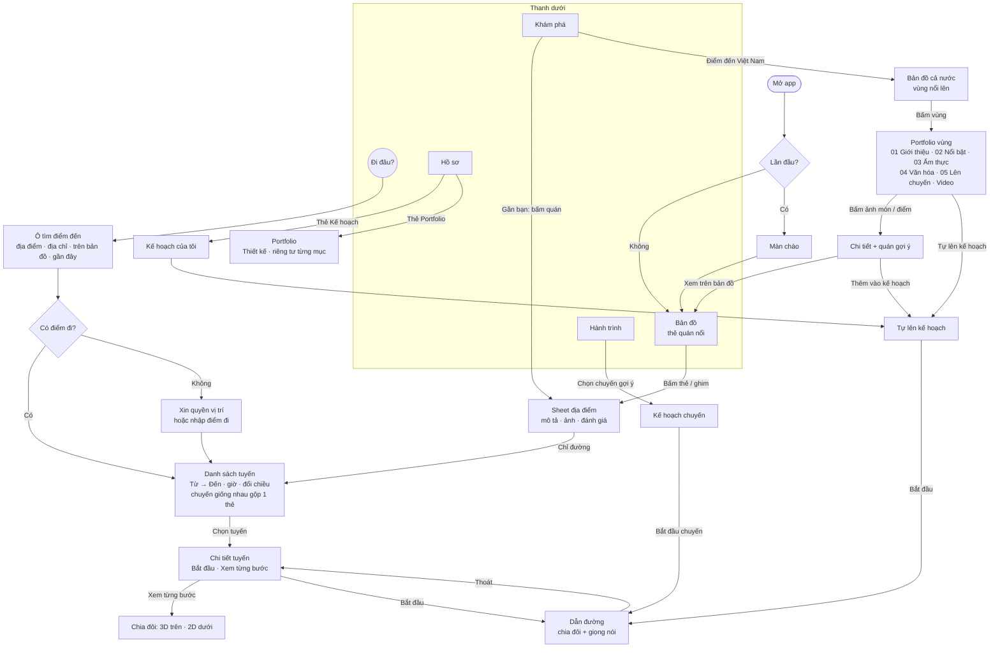

# UX-2 — Làm lại trải nghiệm app GoWander

> **Trạng thái:** **Đã duyệt hướng thiết kế** (chủ dự án, 14-11-2026: "tôi thấy oke"). Các câu hỏi ở §16 vẫn còn mở.
> **Quyết định kiến trúc:** [ADR-034](../decisions/ADR-034-ux2-information-architecture.md). **Mốc:** `PIPELINE.md` UX-2 (§5c).
> **Bản vẽ xem trước (mẫu bắt buộc theo):** artifact riêng tư https://claude.ai/artifact/XtZuZY6CkCk98ZPVd3dSp4#page-dcb81aee8d83, gồm 17 màn (danh sách ở §17). Muốn người khác xem thì chủ dự án chia sẻ qua menu Share.
> **Thay thế:** cấu trúc điều hướng và màn Bản đồ hiện tại (NAV-1, commit 85bbfdd và 3756e4f).
> **Lịch sử thảo luận:** `docs/changes/change-14-11-2026.md` mục 13–18.
> **Đầu vào:**
> - rà soát luồng người dùng;
> - bản phân tích luồng chủ dự án dán vào (Apple HIG, Material, Google Maps);
> - Design Kit v4 (`TABS`, các màn D/J/P/L);
> - `docs/design/03-product-ux-v4.0`, `docs/design/05-database-design-v1.2`, ADR-022, ADR-030, ADR-033;
> - 3 ảnh tham khảo của chủ dự án: thẻ nổi trên nền thành phố, portfolio du lịch, "Giới thiệu Phú Quốc". Chỉ dùng làm ý tưởng bố cục.

---

## 0. Giữ gì, làm lại gì

| Phần | Làm lại? | Ghi chú |
|---|---|---|
| Backend Go, OTP, PostGIS, Photon, dữ liệu buýt OSM | **Giữ** | Chỉ thêm API mới (§12) |
| Logic tuyến trong app (`RouteViewModel`, `Navigation.kt`) và test | **Giữ** | Thêm gộp chuyến (§7.3) và giọng nói (§8.3) |
| Điều hướng app (`App.kt`: tab, overlay, cờ `navSub`) | **Làm lại** | Back stack + 5 tab (§4) |
| Màn Bản đồ | **Làm lại** | Thẻ quán nổi trên bản đồ (§5) |
| Trang địa điểm | **Làm lại** | Sheet dùng chung (§6) |
| Đường đi + Xem trước | **Gộp** | "Xem từng bước", chia đôi màn (§8) |
| Khám phá | **Mở rộng** | Gần bạn + Điểm đến Việt Nam (§9) |
| Hành trình, Hồ sơ | **Mới** | §10, §11 |
| Màn chào / Lần đầu | **Rút gọn** | Bỏ màn Lần đầu (§4.4) |

## 1. Vấn đề của bản hiện tại (đã kiểm trong code)

1. Chọn điểm đến bằng địa điểm thì vào Danh sách tuyến, nhưng chọn bằng địa chỉ hay trên bản đồ thì vào tab Tìm tuyến và phải bấm thêm "Tìm".
2. Có 3 lối vào tìm đường. Tab Tìm tuyến lặp lại hàng chọn phương tiện.
3. `routeToPlace` đặt `tab = Tab.Plan`, nên đang ở Discover mà bấm địa điểm thì mất trang đang xem.
4. Có 3 nút gần nghĩa nhau: Bắt đầu / Xem trước / Đường đi. Back ở Xem trước về chỗ khác nhau tùy đường vào.
5. Cho bấm những thứ chưa làm được: 4/5 ngôn ngữ "Sắp có", nút English, Vệ tinh.
6. Có nhiều thẻ tuyến giống hệt nhau. Nhãn "Nhanh nhất" xuất hiện 2 lần.
7. "Gợi ý gần bạn" là danh sách che nửa bản đồ.

## 2. Nguyên tắc

1. **Theo ý định.** "Tìm để đi" thì vào tuyến. "Tìm để xem" thì vào trang địa điểm hoặc vùng. Cùng một hành động luôn dẫn tới cùng một chỗ.
2. **Một lần bấm để bắt đầu tìm đường**, từ bất kỳ đâu (nút giữa).
3. **Back luôn về đúng màn trước.** Mỗi tab giữ trạng thái riêng.
4. **Không cho bấm thứ chưa làm được:** ẩn đi, không hiện "Sắp có".
5. **Xin quyền khi cần**, không xin ngay lúc mở app.
6. **Mọi thứ hiện trên bản đồ đều có phương án đọc được** (nút Danh sách, nhãn cho trình đọc màn hình), theo WCAG 2.2 AA.
7. **Một font duy nhất: Be Vietnam Pro** cho toàn bộ app. Nhấn mạnh bằng độ đậm và cỡ chữ. Màu theo token của Design Kit v4.
8. **Android và iOS chạy giống nhau.** Mỗi thay đổi đều được build, test và chụp ảnh trên cả hai nền tảng trước khi coi là xong.
9. **Không bịa dữ liệu.** Đánh giá, ảnh, video, giờ xe phải có nguồn thật và giấy phép. Không cào Google, Foody hay app khác.
10. **Nói thật về phạm vi.** Tìm tuyến và dẫn đường chỉ có ở vùng pilot (TP.HCM); vùng khác ghi rõ "Chưa hỗ trợ tìm tuyến ở đây".

## 3. Người dùng chính

GoWander nhắm vào **khách du lịch** (trong nước và quốc tế) và người dân đi lại bằng phương tiện công cộng ở TP.HCM. Khách du lịch thường:
- tìm hiểu vùng và lên kế hoạch **trước** chuyến đi (Khám phá, Hành trình);
- khi tới nơi thì cần biết đi tới đâu bằng gì (Bản đồ, Đi đâu?, Dẫn đường);
- muốn lưu và kể lại chuyến đi (Hồ sơ, portfolio).

## 4. Kiến trúc thông tin

### 4.1. Thanh dưới: 5 mục (Design Kit v4)

```
[ Bản đồ ]  [ Khám phá ]  ( Đi đâu? )  [ Hành trình ]  [ Hồ sơ ]
                          nút giữa nổi
```

| Mục | Vai trò |
|---|---|
| **Bản đồ** | Quán và điểm hay ho nổi trên bản đồ quanh người dùng |
| **Khám phá** | 2 thẻ: **Gần bạn** và **Điểm đến Việt Nam** (bản đồ cả nước → portfolio vùng) |
| **Đi đâu?** (nút giữa) | Hành động tìm đường. **Mở ô tìm điểm đến, không mở một màn riêng** |
| **Hành trình** | Chuyến gợi ý, chuyến đang đi, Memory |
| **Hồ sơ** | 3 thẻ: **Portfolio · Kế hoạch · Đã lưu**; Cài đặt |

- Đặt hành động ở giữa thanh tab là ngoại lệ có chủ đích so với Apple HIG; 5 mục vẫn nằm trong khuyến nghị Material (3–5).
- Lý do chọn tìm đường làm nút giữa: đây là việc làm nhiều nhất và là thế mạnh riêng của GoWander. Đây là suy luận, sẽ đo lại bằng theo dõi sự kiện sau pilot.
- **Bỏ tab Tìm tuyến.** Phần sửa điểm đi, điểm đến, giờ và nút đổi chiều nằm ở đầu Danh sách tuyến.
- Tài liệu IA (`docs/design/03-…/01-…` §03) có tab **Community**, còn Design Kit thì không. Theo UX-2:
  - đánh giá và bình luận nằm trong sheet địa điểm;
  - đóng góp nằm trong portfolio;
  - bảng tin và theo dõi để sau pilot.
  - Chờ chủ dự án xác nhận (§16).

### 4.2. Sơ đồ luồng



### 4.3. Back stack và trạng thái

- Thay các cờ `overlay`, `navSub`, `previewFromSteps`, `detailOpen` bằng **back stack**: danh sách `sealed class Screen`, mỗi tab một stack riêng.
  - Back = bỏ màn trên cùng.
  - Đổi tab không mất trạng thái.
  - Lưu được qua xoay màn hình và khi hệ điều hành tạm giết app.
- Ví dụ: Khám phá → Điểm đến → Portfolio vùng → Chi tiết món → Xem trên bản đồ. Back từ Bản đồ quay về đúng Chi tiết món.
- Dữ liệu vẫn nằm trong ViewModel. Nếu dùng thư viện điều hướng (Navigation Compose Multiplatform) thì cần ADR riêng, và chỉ dùng khi bản ổn định hỗ trợ cả iOS.
- Code back stack nằm trong `commonMain` để Android và iOS dùng cùng một logic, có test đơn vị trong `commonTest`.

### 4.4. Lần đầu mở app và quyền

- **Màn chào → Bản đồ.** Bỏ màn Lần đầu.
- Khi chưa có quyền vị trí, bản đồ hiện khu vực pilot. **Không coi đó là vị trí của người dùng.**
- Xin quyền vị trí khi bấm nút định vị, hoặc khi tìm tuyến với điểm đi là "Vị trí của bạn". Bị từ chối thì không hỏi lại liên tục, mà mở ô nhập điểm đi.
- Không xin quyền thông báo cho tới khi có tính năng cần nó (ví dụ "nhắc ga xuống").

### 4.5. Ẩn những gì chưa xong

- Ẩn nút ngôn ngữ cho tới khi xong tiếng Anh (ADR-022).
- Bảng loại bản đồ chỉ có 2D / 3D. Vệ tinh hiện lại khi đã chọn nhà cung cấp.
- Hành trình và Hồ sơ trước khi làm xong (P5) mở màn tối thiểu **có nội dung thật**:
  - Hồ sơ: khách, Cài đặt, Nguồn dữ liệu và giấy phép;
  - Hành trình: tuyến đã xem gần đây.

## 5. Bản đồ: quán và điểm hay ho nổi trên bản đồ

| Mức zoom | Hiển thị |
|---|---|
| < 14 | Chấm gom nhóm có số; bấm vào thì zoom tới |
| 14 – 16 | Ghim có biểu tượng loại |
| ≥ 16 | **Thẻ nổi** (ảnh, tên, loại · ★ · khoảng cách, đường mảnh nối xuống điểm) cho tối đa **6** điểm nổi bật trong khung nhìn |

- **Nổi bật** = đã xác minh trong pilot, có ảnh hoặc mô tả, gần tâm bản đồ; khi có đánh giá thật thì cộng thêm điểm sao. Công thức đặt ở backend.
- Thẻ không chồng lên nhau, không che chấm vị trí, thanh tìm kiếm hay các nút.
- Phía trên có ô "Tìm quán, món ăn, địa điểm" (ý định *xem*) và chip lọc Tất cả · Ăn uống · Cà phê · Di tích · Mua sắm.
- Nền thẻ trắng 95% + viền + bóng. Hiệu ứng kính mờ thật để sau, vì Compose Multiplatform chưa làm được trên cả hai nền tảng.
- **Kỹ thuật:**
  - maplibre-compose 0.20 có `screenLocationFromPosition(position): DpOffset?` (đã kiểm mã nguồn), nên thẻ vẽ bằng Compose bám theo điểm;
  - phải spike trước (P3a): độ trễ khi kéo, fps trên máy tầm trung, **trên cả Android và iOS**. Dự phòng: symbol layer;
  - ghim và cụm dùng GeoJSON source + cluster của MapLibre;
  - chỉ tải dữ liệu khi bản đồ dừng.
- **Truy cập:**
  - mỗi thẻ và ghim là một nút có nhãn ("Chợ Bến Thành, chợ, 4,5 sao, cách 120 mét");
  - nút **Danh sách** mở cùng nội dung dạng danh sách;
  - tương phản ≥ 4,5:1.

## 6. Sheet địa điểm (dùng chung cho Bản đồ, Khám phá, Cẩm nang)

| Mức | Nội dung |
|---|---|
| Thấp | Tên · loại · ★ (số lượt) · khoảng cách · **[Chỉ đường]** · [Lưu] · [Chia sẻ] |
| Giữa | Ảnh (có ghi công) · mô tả · địa chỉ · giờ mở cửa nếu có · món nổi bật |
| Đầy | Thẻ Tổng quan / Đánh giá / Món nổi bật · đánh giá và bình luận · nguồn và giấy phép · báo sai thông tin |

- **Chỉ đường** đặt điểm đến là địa điểm này. Back từ Danh sách tuyến quay lại sheet.
- **Đánh giá và bình luận chia 2 bước:**
  - **R1 (trong UX-2):** sheet có sẵn khu vực đánh giá. Khi chưa có đăng nhập thì chỉ hiện "Chưa có đánh giá" và ẩn nút Viết.
  - **R2 (COM-1):** đăng nhập (ADR-022); `POST/GET /places/{id}/reviews`; mỗi người 1 đánh giá cho mỗi địa điểm; giới hạn tần suất; lọc từ cấm; báo cáo vi phạm; Admin duyệt (M07); dưới 3 lượt thì không hiện điểm trung bình. Bảng `reviews` đã có trong thiết kế DB (§7.3), FR-28.

## 7. Tìm tuyến

### 7.1. Ô tìm điểm đến (nút giữa "Đi đâu?")

- Gồm: "Từ: Vị trí của bạn" (đổi được), Chọn trên bản đồ, kết quả (địa điểm và địa chỉ), gần đây.
- **Chọn gì cũng vào thẳng Danh sách tuyến.**

### 7.2. Danh sách tuyến

- Đầu màn: Từ / Đến sửa tại chỗ, nút đổi chiều, chọn giờ (Đi ngay / Đi lúc / Đến lúc).
- Tab phương tiện: Buýt · Metro · Ô tô · Xe đạp · Đi bộ. Có giữ Ô tô và Xe đạp trong pilot hay không thì chờ chốt (§16).
  - Tuyến có cả buýt và metro hiện ở tab Metro (đúng như code hiện tại), kèm dòng giải thích.
  - Tuyến công cộng ghi "Đi bộ tổng X phút"; Ô tô và Xe đạp không có chặng đi bộ.
- Chip sắp xếp: Nhanh nhất / Ít đi bộ. Bỏ nhãn "Nhanh nhất" lặp trên thẻ.
- Ghi chú: "Giờ xe buýt là ước tính (OSM)".

### 7.3. Gộp chuyến giống nhau

- **Khóa gộp** = chuỗi chặng (phương tiện, mã tuyến, trạm lên, trạm xuống), **và** chênh lệch đi bộ không quá 2 phút.
- Thẻ gộp hiện "Chuyến sau: 17:22 · 17:34"; bấm một giờ thì chọn đúng chuyến đó.
- Gộp ở `RouteViewModel` (commonMain), có test đơn vị.

### 7.4. Chi tiết tuyến

- Bản đồ có tuyến; thẻ dưới có tổng thời gian, giờ đi → đến, và dòng thời gian từng chặng.
- **2 nút: Bắt đầu · Xem từng bước.**

## 8. Xem từng bước, Dẫn đường, Giọng nói

### 8.1. Chia đôi màn (chủ dự án yêu cầu giữ)

- **Nửa trên: góc nhìn người dùng trên đường.** Camera 3D thấp, nghiêng theo hướng đi, giả lập đang di chuyển. Có mũi tên lớn trên mặt đường và nút ︿ / ﹀ nhích **20 m**.
- **Nửa dưới: bản đồ 2D tổng quan.** Đổi sang Vệ tinh khi đã có nhà cung cấp.
- Hai nửa đồng bộ vị trí.
- Giới hạn camera: 65° / zoom 20,5. NAV-1 từng hết bộ nhớ ở 78°, nên phải đo bộ nhớ khi chạy 2 bản đồ trên cả Android và iOS.

### 8.2. Xem từng bước

- Thẻ dưới: chỉ dẫn hiện tại, "Bước 2/5 · còn 120 m"; các nút Trước / Chạy (▶▶ tự chạy, bấm lại để dừng) / Sau; nút mở danh sách bước.
- Back luôn về Chi tiết tuyến.

### 8.3. Dẫn đường và giọng nói

- Băng chỉ hướng trên cùng: mũi tên, khoảng cách, câu chỉ dẫn.
- Thẻ dưới: thời gian còn lại, km, giờ đến, nút Danh sách bước và **Thoát**.
- Lệch tuyến thì hiện nút "Tìm lại tuyến" (người dùng tự bấm, như NAV-1).
- **Giọng nói** (chưa có trong app; ADR-033 để "sau"):
  - dùng giọng có sẵn của máy (Android `TextToSpeech`, iOS `AVSpeechSynthesizer`, `vi-VN`) qua `expect/actual`; không thêm thư viện, không gửi dữ liệu ra ngoài;
  - đọc khi:
    - còn khoảng 200 m tới chỗ rẽ;
    - còn khoảng 30 m tới chỗ rẽ;
    - còn 1 trạm nữa là tới trạm xuống buýt hoặc metro;
    - đi lệch tuyến;
    - tới nơi;
  - nút loa có 3 mức: Bật / Chỉ cảnh báo / Tắt; lựa chọn được lưu lại;
  - nhạc của app khác nhỏ lại trong lúc đọc (iOS `duckOthers`, Android audio focus "may duck");
  - câu đang đọc cũng hiện chữ trên màn hình; không đọc chồng lên TalkBack hay VoiceOver;
  - máy không có giọng `vi-VN` thì báo một lần, rồi chỉ hướng dẫn bằng chữ.
- **Bắt buộc thử thực địa** trên máy thật trước pilot, gồm GPS, la bàn, pin, giọng nói, và T12 (mất GPS).

## 9. Khám phá

### 9.1. Thẻ "Gần bạn"

- Ô tìm "Tìm quán, món ăn, câu chuyện"; chip lọc Tất cả · Gần ga · Ẩm thực · Lịch sử.
- Thẻ giới thiệu hành trình gợi ý.
- Quán gần bạn kèm cách đi ("Đi bộ 5 phút", "Đi metro 6 phút"). Bấm vào thì mở sheet địa điểm. Có nút "Xem trên bản đồ".
- Mục **Câu chuyện**: bài lịch sử do biên tập viên viết, có nguồn.

### 9.2. Thẻ "Điểm đến Việt Nam": bản đồ cả nước

- **Không hiển thị dạng danh sách** (chủ dự án yêu cầu): bản đồ Việt Nam, các vùng nổi lên thành thẻ (ảnh, tên, miền) có đường nối xuống đúng vị trí. **Bấm vào mới mở portfolio của vùng.**
- Bản đồ **phải thể hiện quần đảo Hoàng Sa và Trường Sa** thuộc Việt Nam. Ranh giới lấy từ nguồn có giấy phép (ví dụ OSM).
- Vùng có tìm tuyến (TP.HCM) được làm nổi bật với nhãn "Có tìm tuyến".
- Zoom gần thì tách thêm các điểm đến nhỏ trong vùng, theo quy tắc ở §5.
- Có nút **Danh sách** để đọc được bằng trình đọc màn hình.

### 9.3. Portfolio vùng (bố cục như "Giới thiệu Phú Quốc")

1. **Bìa:** ảnh lớn, tên vùng, nhãn tìm tuyến, nút **Video** (§9.5).
2. **Mục lục** cố định để nhảy nhanh.
3. **01 Giới thiệu chung:** đoạn giới thiệu có nguồn; mùa khô và mùa mưa.
4. **02 Điểm nổi bật:** thẻ ngang, bấm vào thì mở sheet địa điểm.
5. **03 Ẩm thực:** món đặc trưng.
6. **04 Con người & văn hóa:** Câu chuyện.
7. **Ảnh từ cộng đồng** (§9.6).
8. **05 Lên chuyến ở đây:** chuyến gợi ý và nút **Tự lên kế hoạch** (§10.2).
9. **Đi lại:** ở TP.HCM có nút Tìm tuyến; vùng khác ghi "Chưa hỗ trợ tìm tuyến ở đây".

### 9.4. Bấm ảnh trong portfolio vùng

- Bấm ảnh món, điểm hay ảnh cộng đồng thì mở chi tiết: mô tả, quán hoặc điểm gợi ý gần đây (mỗi dòng có nút ghim), cùng 2 nút:
  - **Xem trên bản đồ:** chuyển sang tab Bản đồ, camera bay tới đúng chỗ, ghim được chọn sẵn; Back quay về chi tiết;
  - **Thêm vào kế hoạch.**

### 9.5. Video giới thiệu vùng

- **Nguồn:**
  - xin bằng văn bản từ Cục Du lịch Quốc gia Việt Nam hoặc Sở Du lịch địa phương, ghi rõ phạm vi dùng trong app, có được cắt ngắn không, thời hạn;
  - video tự quay;
  - video Wikimedia Commons có giấy phép CC.
  - Không cắt hay tải lại video YouTube của người khác.
- **Bắt buộc có phụ đề.** Không tự phát khi đang dùng dữ liệu di động; phát ở chế độ tắt tiếng trước.
- Lưu và phát qua CDN (có chi phí). Mỗi video có một dòng trong sổ dữ liệu DATA-1, gồm nguồn, giấy phép và hạn dùng.

### 9.6. Ảnh cộng đồng "có số sao ổn định"

- Ảnh được chọn tự động khi đủ **tất cả** các điều kiện sau (Admin sửa tay được):
  1. người đăng đã chọn giấy phép chia sẻ (CC BY hoặc CC BY-SA);
  2. ảnh đã qua kiểm duyệt (khuôn mặt, biển số, nội dung);
  3. địa điểm trong ảnh có ≥ 10 đánh giá, trung bình ≥ 4,0, và điểm trung bình 90 ngày gần nhất không giảm quá 0,3;
  4. mỗi người tối đa 2 ảnh trên một trang vùng.
- Chưa đủ ảnh cộng đồng thì dùng ảnh Wikimedia Commons có ghi công.

## 10. Hành trình

### 10.1. Chuyến gợi ý (Design Kit J1–J8)

- Hai thẻ: Gợi ý / Memory của tôi.
- Chọn thời gian có: 30 / 60 / 90 phút, hoặc tuỳ chỉnh (chủ đề, mức đi bộ, nơi kết thúc). Lựa chọn chỉ áp dụng cho chuyến này.
- Chuyến do biên tập viên soạn. Kế hoạch chuyến có các điểm theo thứ tự, chặng đi lại giữa các điểm, Thêm điểm, **Bắt đầu chuyến**.
- Khi đang đi: "Điểm 1 trên 3", Đọc câu chuyện, Tôi đã ghé, Bỏ qua, Kết thúc.
  - "Đã ghé" là người dùng tự xác nhận, không dùng GPS làm bằng chứng.
- Memory: lưu kỷ niệm (không bắt buộc), Storybook, mặc định riêng tư.

### 10.2. Tự lên kế hoạch (thủ công)

- Tên, ngày, giờ bắt đầu, cách đi.
- Danh sách điểm: giờ đến dự kiến, thời gian ở mỗi điểm, chặng đi lại (bộ tìm tuyến hiện có, chỉ ở vùng pilot); kéo để đổi thứ tự, xoá.
- **+ Thêm điểm** bằng tìm kiếm hoặc chọn trên bản đồ. **Gợi ý thêm** là các điểm gần những điểm đã chọn.
- "Sắp xếp lại cho đỡ đi vòng": chỉ chạy khi người dùng bấm, app không tự đổi.
- **Lưu vào Hồ sơ** và **Bắt đầu**. Vùng chưa có tìm tuyến thì vẫn lên được danh sách điểm, nhưng không có giờ đi lại.
- Chưa đăng nhập thì lưu trên máy; đăng nhập rồi thì đồng bộ. Cách lưu trên máy cần ADR riêng (§12).

## 11. Hồ sơ

### 11.1. Ba thẻ

- **Portfolio**, **Kế hoạch**, **Đã lưu** (Muốn đến / Đã ghé / Muốn quay lại).
- Thẻ **Kế hoạch** để vào nhanh: Sắp tới (Sửa / Bắt đầu), Bản nháp, Đã đi (nối sang Memory và portfolio), Tạo kế hoạch mới.
- Cài đặt gồm:
  - ngôn ngữ, giao diện;
  - thông báo "nhắc ga xuống";
  - quyền vị trí;
  - giọng nói;
  - kiểm soát gợi ý;
  - tài khoản (mật khẩu, liên kết Google, xoá tài khoản);
  - **Nguồn dữ liệu và giấy phép** (OSM, thời tiết, ảnh).

### 11.2. Portfolio hành trình

- **Các mục (bật/tắt, kéo đổi thứ tự):**
  - bìa (tên, câu giới thiệu, ảnh polaroid);
  - số liệu (chuyến, điểm đã ghé, đóng góp, câu chuyện);
  - Về tôi;
  - Chuyến nổi bật (Storybook);
  - Bản đồ khám phá;
  - **Đóng góp cho cộng đồng** (đánh giá, ảnh CC, sửa thông tin được duyệt, báo lỗi tuyến đã sửa);
  - Khoảnh khắc.
- **Thiết kế portfolio:** mẫu Polaroid / Tạp chí / Tối giản; 6 màu chủ đề cố định đã kiểm tương phản (Design Kit P2). Màu chủ đề chỉ dùng trong hồ sơ.
- **Riêng tư:**
  - mặc định chỉ mình tôi; mỗi mục chọn Chỉ mình tôi / Người có link / Công khai;
  - **Bản đồ khám phá luôn mặc định riêng tư.**
- **Không xếp hạng hay cấp bậc người dùng** (OVERVIEW: non-goal). Chỉ đếm đóng góp đã được duyệt.
- Ảnh muốn công khai phải chọn giấy phép trước.
- **Phụ thuộc:** đăng nhập (ADR-022), lưu trữ ảnh, kiểm duyệt (M07), security review (dữ liệu cá nhân). Thuộc COM-1.

## 12. Dữ liệu, API và phụ thuộc

| Tính năng | Backend / dữ liệu cần | Phụ thuộc |
|---|---|---|
| Thẻ quán trên bản đồ | `GET /api/v1/places/map?bbox=&zoom=&category=` (ghim + điểm nổi bật, cache) | PostGIS (M05) |
| Sheet địa điểm R1 | `PlaceDetail` hiện có | — |
| Đánh giá R2, ảnh cộng đồng, portfolio công khai | Tài khoản, `reviews`, media storage, kiểm duyệt | ADR-022, M07, COM-1 |
| Gộp chuyến | Không (làm ở app) | — |
| Giọng nói | Không (TTS của máy) | — |
| Bản đồ cả nước | Ranh giới có giấy phép, có Hoàng Sa và Trường Sa; danh sách vùng | DATA-1 |
| Portfolio vùng, Câu chuyện, chuyến gợi ý | Nội dung biên tập có nguồn; bảng `regions`, `stories`, `trips` | DATA-1 (CONTENT), M07 (Admin soạn) |
| Video vùng | Quyền dùng bằng văn bản, CDN | DATA-1, chi phí |
| Kế hoạch, Đã lưu (chưa đăng nhập) | Lưu trên máy: cần ADR chọn cách lưu (ví dụ SQLDelight hoặc file JSON) | ADR mới |
| Kế hoạch đồng bộ | API `plans` | ADR-022 |

## 13. Các giai đoạn

Mỗi giai đoạn đều phải có: test tự động; ảnh chụp **Android và iOS**; `ux_audit` + `e2e_ux.py` + iOS UI test; mục ghi thay đổi; chủ dự án duyệt trước khi sang giai đoạn sau. Nhánh: `feat/ux-2-redesign`, tạo từ `develop` sau khi `feat/navigation` đã merge (chủ dự án tạo).

| Giai đoạn | Nội dung | Kiểm chứng |
|---|---|---|
| **P0** Tài liệu | File này, ADR-034, UX-2 trong `PIPELINE.md` | Chủ dự án duyệt (14-11-2026) |
| **P1** Khung điều hướng | 5 tab, nút giữa, back stack, bỏ tab Tìm tuyến và màn Lần đầu, xin quyền khi cần, ẩn mục chưa xong, màn tối thiểu cho Hành trình và Hồ sơ | T1, T2, T5, T7, T10, T11; test back stack |
| **P2** Tìm tuyến | Ô điểm đến, đầu Danh sách tuyến sửa tại chỗ, gộp chuyến, chi tiết 2 nút, Xem từng bước và Dẫn đường chia đôi | T6, T8, T9; test gộp chuyến; đo bộ nhớ |
| **P2b** Giọng nói | §8.3 | Test thời điểm đọc; máy thật |
| **P3a** Spike thẻ nổi | 6 thẻ bám điểm, đo fps và độ trễ trên Android và iOS | Số đo trong `docs/evidence/`; chọn cách làm |
| **P3b** Bản đồ quán | API `places/map`, ghim, cụm, thẻ, chip, Danh sách | M1–M6 |
| **P3c** Sheet địa điểm | 3 mức, Chỉ đường, đánh giá R1 | T3, T4, M7 |
| **P4** Khám phá | Gần bạn mới; Điểm đến Việt Nam (bản đồ cả nước); portfolio vùng TP.HCM; bấm ảnh → bản đồ | V1–V6 |
| **P5** Hành trình + Hồ sơ | Chuyến gợi ý, Tự lên kế hoạch, thẻ Kế hoạch / Đã lưu (lưu trên máy), Cài đặt | K1–K5 |
| **P6** Thử với người dùng | 3–5 người (gồm ít nhất 1 khách nước ngoài khi đã có tiếng Anh), 6 nhiệm vụ (§14.4) | Thời gian, chỗ vấp; sửa rồi thử lại |
| **COM-1** | Đăng nhập, đánh giá R2, ảnh cộng đồng, portfolio công khai | Security review; kiểm duyệt trên Admin |
| **CONTENT** (thuộc DATA-1) | Nội dung vùng, câu chuyện, chuyến gợi ý, video, ranh giới bản đồ | Mỗi mục có nguồn và giấy phép trong sổ dữ liệu |

## 14. Test case

### 14.1. Luồng

- T1: mở app lần đầu, xem được Bản đồ và Khám phá mà không cần GPS.
- T2: chọn địa điểm hay địa chỉ đều đi cùng một luồng.
- T3: bấm thẻ trên bản đồ thì mở sheet.
- T4: Discover mở sheet, không tự nhảy sang tuyến.
- T5: chưa có điểm đi thì hỏi, không dùng tọa độ giả.
- T6: sửa điểm đến trong Danh sách tuyến thì tính lại.
- T7: từ chối quyền vị trí thì không bị hỏi lặp.
- T8: tuyến Buýt + Metro vẫn hiện.
- T9: gộp chuyến đúng, xem được giờ khác.
- T10: Back từ Chi tiết vẫn giữ bộ lọc.
- T11: Back từ Danh sách tuyến về đúng nơi bắt đầu.
- T12: mất GPS khi dẫn đường thì không tự báo "đã tới".

### 14.2. Bản đồ quán

- M1: tối đa 6 thẻ, không chồng nhau, không che các nút.
- M2: thẻ bám đúng điểm, chỉ tải dữ liệu khi bản đồ dừng.
- M3: bấm cụm thì zoom tới.
- M4: chip lọc hoạt động.
- M5: nút Danh sách đúng; TalkBack và VoiceOver đọc được thẻ.
- M6: tương phản ≥ 4,5:1.
- M7: sheet kéo được 3 mức; Chỉ đường rồi Back thì về sheet.

### 14.3. Khám phá, Hành trình, Hồ sơ

- V1: bản đồ cả nước có Hoàng Sa và Trường Sa.
- V2: bấm vùng thì mở đúng portfolio vùng; Back về bản đồ cả nước.
- V3: vùng không có tìm tuyến không hiện nút Tìm tuyến và có ghi chú.
- V4: bấm ảnh món → Xem trên bản đồ → camera tới đúng điểm; Back về chi tiết.
- V5: video có phụ đề, không tự phát khi dùng dữ liệu di động.
- V6: mọi ảnh và video đều có ghi công.
- K1: tạo kế hoạch, thêm, đổi thứ tự, xoá điểm; giờ dự kiến cập nhật.
- K2: lưu rồi mở lại từ Hồ sơ › Kế hoạch.
- K3: kế hoạch ở vùng không có tìm tuyến không hiện giờ đi lại.
- K4: "Sắp xếp lại" chỉ chạy khi người dùng bấm.
- K5: kế hoạch còn nguyên sau khi tắt và mở lại app (lưu trên máy).
- (COM-1) P1–P3: mặc định riêng tư; đổi quyền từng mục có hiệu lực; Bản đồ khám phá không công khai nếu người dùng không chủ động bật.

### 14.4. Thử với người dùng (P6)

1. Tìm một quán cà phê gần đây và đi tới đó bằng xe buýt.
2. Đi tới một địa chỉ cho sẵn.
3. Xem trước các bước rẽ.
4. Tìm hiểu một vùng và lên kế hoạch nửa ngày.
5. Từ ảnh một món ăn trong cẩm nang, mở vị trí trên bản đồ.
6. Mở lại kế hoạch đã lưu.

Đạt khi ít nhất 4/5 người tự làm xong mỗi nhiệm vụ.

## 15. Rủi ro

| Rủi ro | Cách xử lý |
|---|---|
| Thẻ nổi giật hoặc trễ, nhất là trên iOS | Spike P3a; dự phòng symbol layer |
| Chạy 2 bản đồ cùng lúc tốn bộ nhớ và pin | Giới hạn camera, đo trên máy tầm trung, nửa dưới cập nhật chậm hơn |
| Android và iOS lệch nhau (chữ xuống hàng, vùng an toàn, cử chỉ Back) | Logic trong commonMain; mỗi giai đoạn chạy iOS UI test + ảnh chụp iOS, không chỉ Android |
| Nội dung cả nước rất lớn (cẩm nang, câu chuyện, chuyến, video) | Pilot: TP.HCM đầy đủ + 3–5 vùng cẩm nang ngắn; CONTENT trong DATA-1; Admin soạn bài (M07) |
| Ảnh hoặc video không rõ quyền | Chỉ nhận khi có giấy phép hoặc văn bản cho phép; ghi vào sổ dữ liệu |
| Bản đồ quốc gia thiếu chủ quyền biển đảo | Bắt buộc có Hoàng Sa và Trường Sa (V1); duyệt trước khi phát hành |
| Đánh giá giả, spam, lộ dữ liệu cá nhân | Chỉ làm ở COM-1, cùng kiểm duyệt, giới hạn tần suất, riêng tư mặc định |
| Viết lại điều hướng làm hỏng luồng đang chạy | Làm P1 trước, chạy lại toàn bộ E2E |
| Máy dev thiếu RAM khiến emulator chập chờn | Chạy E2E khi máy rảnh; cân nhắc máy Android thật |

## 16. Câu hỏi còn mở (chủ dự án chốt)

1. **Community:** tách tab riêng như tài liệu IA, hay chia vào sheet địa điểm và portfolio như UX-2?
2. **Ô tô và Xe đạp:** giữ trong pilot (RD-0 đã làm) rồi sửa `OVERVIEW.md`, hay ẩn tới RD-1?
3. **Đánh giá và bình luận** có bắt buộc cho pilot không (COM-1 trước M10)?
4. **Những vùng nào** có trong pilot, và **ai viết nội dung**?
5. **Nguồn video** cho từng vùng.
6. **Ẩn nút ngôn ngữ** cho tới khi có tiếng Anh?

## 17. Danh sách màn trong bản vẽ

| # | Màn | Mục trong tài liệu |
|---|---|---|
| 1 | Bản đồ: quán nổi trên bản đồ | §5 |
| 2 | Sheet địa điểm | §6 |
| 3 | Đi đâu? (ô tìm điểm đến) | §7.1 |
| 4 | Danh sách tuyến | §7.2–7.3 |
| 5 | Chi tiết tuyến | §7.4 |
| 6 | Xem từng bước (chia đôi) | §8.1–8.2 |
| 7 | Dẫn đường (chia đôi + giọng nói) | §8.3 |
| 8 | Khám phá › Gần bạn | §9.1 |
| 9 | Hành trình: chọn chuyến | §10.1 |
| 10 | Kế hoạch chuyến | §10.1 |
| 11 | Hồ sơ › Portfolio | §11.2 |
| 12 | Thiết kế portfolio | §11.2 |
| 13 | Khám phá › Điểm đến Việt Nam (bản đồ cả nước) | §9.2 |
| 14 | Portfolio vùng (mẫu TP.HCM) | §9.3, §9.5, §9.6 |
| 15 | Bấm ảnh món / điểm | §9.4 |
| 16 | Tự lên kế hoạch | §10.2 |
| 17 | Hồ sơ › Kế hoạch | §11.1 |

Số sao, bình luận, tên người dùng, giờ xe và số liệu trên bản vẽ đều là **dữ liệu mẫu**. Bản đồ Việt Nam trên bản vẽ là hình minh họa vẽ tay, không đúng tỉ lệ.
