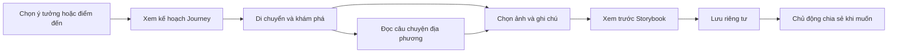

# GoWander Journey — Đề xuất trải nghiệm chủ lực

Trạng thái: **PROPOSED — đề xuất để chủ dự án xem xét**, không phải ADR Accepted hay cam kết phát hành. Tổng hợp từ hai bản ý tưởng người dùng gửi; bỏ CSS Mermaid và ảnh minh họa không xác định quyền sử dụng. Nguồn đối thủ được đối chiếu trong phiên nghiên cứu này; chưa thử nghiệm người dùng.

## 1. Đề xuất cốt lõi

Giữ tên GoWander và tagline **Move Smart. Explore More.** Làm rõ định vị: **người bạn đồng hành khám phá thành phố bằng giao thông công cộng**, bắt đầu từ TP.HCM và phạm vi dữ liệu đã xác minh.

**GoWander Journey** là trải nghiệm xuyên suốt, không phải thêm một module đứng riêng:

> Chọn một chuyến khám phá vừa thời gian của bạn, hiểu nơi mình đến và giữ lại câu chuyện của riêng mình.

Ba thành phần hỗ trợ nhau:

1. **Khám phá thuận hành trình:** gợi ý điểm ghé thực sự phù hợp với đường đi.
2. **Hiểu nơi mình đến:** câu chuyện văn hóa/lịch sử ngắn, có nguồn.
3. **Giữ ký ức:** ảnh và ghi chú do người dùng chọn, sắp xếp thành Journey Storybook riêng tư.

Journey Memory là kết quả có thể nhớ đến và quay lại xem. Tuy nhiên, chưa có bằng chứng nó sẽ tăng retention hoặc người dùng muốn tạo nhật ký. Không thay toàn bộ MVP bằng tính năng này.

## 2. Đối thủ: điều gì đã có, điều gì còn là giả thuyết?

| Nguồn chính thức | Điều đã xác nhận | Hàm ý cho đề xuất |
|---|---|---|
| KakaoMap [S1] | Chỉ đường nhiều phương tiện, thông báo lên/xuống, Nearby, Theme Map, vị trí bạn bè | Những tính năng này không tự tạo lợi thế khác biệt; không kết luận KakaoMap thiếu detour vì trang giới thiệu không mô tả thuật toán |
| Google Ask Maps [S2] | Truy vấn hội thoại về nơi chốn; ví dụ so sánh metro/lái xe và tìm cà phê trên đường | Chatbot hoặc gợi ý dọc đường không phải ý tưởng độc quyền; nguồn là công bố thị trường Ấn Độ, không chứng minh availability tại Việt Nam |
| Polarsteps [S3, S4] | Lập kế hoạch, theo dõi đường đi, cập nhật từng bước, chia sẻ và Travel Book | Nhật ký bản đồ + ảnh + sách kỷ niệm đã tồn tại; cần kiểm chứng lợi ích của sự kết hợp nội dung địa phương và chuyến đi đô thị ngắn |

**Giả thuyết khác biệt:** người mới đi metro tại TP.HCM có thể khám phá một cụm địa điểm dễ dàng hơn nếu có hướng dẫn cửa ga, câu chuyện tại điểm dừng và cách lưu kỷ niệm ít thao tác trong cùng một Journey.

Không tuyên bố “đối thủ không có” hoặc “duy nhất”. Lợi thế tiềm năng nằm ở độ chính xác địa phương, công sức biên tập, sự liên tục của hành trình và chất lượng trải nghiệm.

Đoạn người dùng gửi nhắc nghiên cứu Tourism Management năm 2025 nhưng thiếu tên bài/DOI/tác giả. Chưa xác định bài cụ thể nên **không sử dụng làm bằng chứng**. Các URL ảnh proxy và ví dụ Etsy/Behance không phải bằng chứng về hiệu quả UX hoặc quyền tái sử dụng ảnh.

## 3. Sáu ý tưởng sau khi gộp và điều chỉnh

| Ý tưởng | Vai trò | Bản nhỏ nhất nên thử | Điều kiện / giới hạn |
|---|---|---|---|
| Journey Memory / Storybook | Kết quả chủ lực | 1 chuyến, 2–3 điểm, vài ảnh/ghi chú, một mẫu storybook riêng tư | Không tracking nền, không AI bịa cảm nhận, không cần Community |
| Story Mode | Giá trị văn hóa trong chuyến đi | Thẻ đọc ngắn Việt–Anh tại điểm đến, nguồn mở rộng | Cần biên tập, giấy phép ảnh/nội dung; audio để sau |
| Explore Along My Route | Nối Mobility và Discover | Gợi ý quanh ga hoặc đoạn đi bộ đã biết, ghi đúng mức dữ liệu | Chỉ gọi “đi vòng thêm X phút” khi đã tính được tác động hành trình |
| Explore by Time | Điểm vào khi chưa biết đi đâu | Lọc vài Trip Ideas được biên tập theo khoảng thời gian 30/60/90 phút | Phải tính cả di chuyển, chờ, tham quan và quay về nếu người dùng yêu cầu |
| Transit Confidence Guide | Điều kiện để khách tự tin thực hiện | Tên ga, hướng tàu, cửa vào/ra có ảnh thật khi xác minh được | Không cam kết accessibility hoặc chỉ lối khi thiếu dữ liệu |
| Weather-aware Exploration | Trợ giúp quyết định | Cảnh báo đi bộ và phương án nội dung trong nhà có nguồn | Phân biệt xếp gợi ý khám phá với tính lại tuyến; tuân thủ ADR-021 |

**Explore by Budget hoãn:** chỉ bắt đầu khi có giá có nguồn và ngày cập nhật. Giá chưa biết phải hiển thị chưa biết; không khẳng định “dưới 150.000đ” khi bỏ sót vé, đồ ăn hoặc chi phí quay về.

## 4. Trải nghiệm mẫu và phạm vi prototype

Kịch bản: “Tôi đang ở Bến Thành, có 90 phút rảnh.” Đây là concept, chưa xác nhận hành trình thực tế trong 90 phút.

Prototype đề xuất **8 màn tập trung**, chưa yêu cầu tạo trong task này:

1. Chọn nhu cầu: biết điểm đến hoặc chọn thời gian rảnh; có lựa chọn phải quay về/đến đâu cuối chuyến.
2. Hai hoặc ba Journey mẫu: mục đích, khoảng thời gian, mức đi bộ, phần nào chưa có dữ liệu.
3. Kế hoạch: thứ tự điểm, thời gian tham quan dự kiến, đoạn di chuyển và tổng thời gian; có đổi/bỏ điểm.
4. Đang khám phá: bước hiện tại, hướng dẫn ga khi có, nút mở câu chuyện; không thúc giục chụp ảnh liên tục.
5. Story card: một đoạn đọc ngắn, nguồn và ngày rà soát; tách kiến thức biên tập khỏi cảm nhận người dùng.
6. Thêm kỷ niệm: chọn ảnh có chủ đích, ghi chú tùy chọn, tự đánh dấu đã ghé; vẫn lưu được nếu không có ảnh.
7. Xem trước Storybook: đổi thứ tự, bỏ ảnh/điểm, sửa tiêu đề và ghi chú; không tự bổ sung sự kiện người dùng chưa xác nhận.
8. Thư viện riêng tư: mở lại/sửa/xóa; hành động chia sẻ chỉ là tùy chọn, có preview kiểm tra thông tin.

Các biến thể cần thử: khách không đăng nhập, không cấp GPS, mất mạng, chưa có tuyến, không chụp ảnh, đổi kế hoạch, chuyến đi dở dang. Prototype dùng dữ liệu giả định phải ghi nhãn rõ. Cần kiểm tra thao tác quay lại không mất bản nháp.

### Quy tắc giảm công sức ghi nhật ký

- Không bắt viết ở từng điểm. Cho gom ảnh/ghi chú sau chuyến và tự chọn thứ tự.
- Template sắp xếp nội dung có sẵn là đủ cho bản đầu; chưa cần LLM.
- Chuyến không hoàn thành vẫn có thể lưu kỷ niệm; không ép người dùng đánh dấu đã đến mọi điểm.
- Khách có thể thử tạo nháp trên máy; đồng bộ tài khoản là quyết định triển khai sau, không ép đăng nhập trước khi thấy giá trị. Nháp local cần cảnh báo rõ rủi ro mất khi gỡ app.

## 5. Ngữ nghĩa và quyền riêng tư không được nhập nhằng

- **Planned Route:** kế hoạch người dùng chọn; không phải tuyến họ đã đi.
- **Visited:** người dùng tự xác nhận, không phải bằng chứng GPS.
- **Journey kết thúc:** người dùng kết thúc phiên; không chứng minh tất cả điểm đã ghé.
- Storybook có ba lớp tách biệt: kế hoạch, kỷ niệm cá nhân, kiến thức có nguồn. Nguồn văn hóa không được ghép thành lời kể cá nhân như thể người dùng đã trải nghiệm.
- Mặc định private. Lưu không đồng nghĩa đăng Community; chia sẻ chỉ chọn những trường/ảnh được xem trước.
- Nếu xuất ảnh/PDF, người nhận có thể lưu bản sao; thu hồi link sau này không thu hồi được file đã tải. Không hứa xóa mọi bản sao.
- Không tracking liên tục hoặc đọc cả thư viện ảnh. Dùng ảnh được chọn; kiểm soát EXIF/vị trí nhạy cảm trước chia sẻ.
- Xóa Journey và media cần quy tắc rõ cho bản sao, bản chia sẻ và dữ liệu dùng chung. Chưa quyết định retention trong đề xuất này.

## 6. Thứ tự làm phù hợp solo

| Giai đoạn | Công việc | Bằng chứng cần có |
|---|---|---|
| Ngay lúc nghiên cứu | Prototype Journey 8 màn, một cụm địa điểm, một mẫu storybook, câu chuyện Việt–Anh | Người thử hiểu và hoàn thành luồng; không phải gate kỹ thuật |
| Core hiện hành | Giữ M02/M03 và vertical slice Mobility–Discover; Confidence Guide khi có nguồn | OTP, map, quyền dữ liệu và lỗi được kiểm chứng theo PIPELINE |
| MVP+ có điều kiện | Story Mode đọc + Journey nháp riêng tư; gợi ý gần ga/đoạn đi bộ đã xác minh | Kiểm tra sở hữu dữ liệu, media, bản nháp và hiểu đúng kế hoạch/đã ghé |
| Tiếp theo | Explore by Time từ Trip Ideas; detour một điểm; xuất Storybook | Tính đủ thời gian, tác động lịch tàu và quyền xuất nội dung |
| Sau bằng chứng nhu cầu | Audio, ngân sách, nhiều điểm tối ưu, Community sharing | Chi phí vận hành, quyền nội dung, moderation, dữ liệu và kiểm thử tương ứng |

“Signature Feature” là ưu tiên trải nghiệm, không phải lý do vượt gate. Prototype được nghiên cứu song song theo yêu cầu chủ dự án; triển khai production vẫn theo thứ tự phụ thuộc. Không triển khai toàn bộ sáu ý tưởng cùng lúc.

Không thêm lúc này: bản đồ 3D/Street View riêng, chatbot tổng quát, live friend tracking, feed video, leaderboard, tự động tối ưu nhiều điểm hoặc in sách thương mại.

## 7. Kiến trúc và dữ liệu: giữ nền, làm rõ quan hệ

Giữ KMP, Go modular monolith, PostGIS và OTP. Journey nên là nghiệp vụ trong miền exploration hiện có hoặc ranh giới gần nó; chưa tạo microservice riêng.

Mô hình khái niệm (chưa phải migration):

- Journey: chủ sở hữu, tên, thời gian dự kiến, trạng thái nháp/đang đi/đã kết thúc, quyền riêng tư.
- JourneyStop: thứ tự điểm, tham chiếu place tùy chọn, trạng thái người dùng tự xác nhận. Hỗ trợ điểm ngoài catalog nếu nghiệp vụ được duyệt.
- Memory: ảnh/ghi chú gắn Journey hoặc stop; ưu tiên tái sử dụng `exploration_entries` và media hiện có, tránh lưu cùng nội dung hai nơi.
- Story reference: tham chiếu câu chuyện, nguồn và version để nội dung thay đổi không làm mất dấu nguồn cũ.
- Storybook: ban đầu là cách trình bày Journey + memories; **chưa cần bảng Storybook riêng**. Chỉ snapshot khi cần xuất/chia sẻ một phiên bản cố định.
- Route reference/snapshot tối thiểu: ghi kế hoạch và phiên bản dữ liệu phù hợp giấy phép; không lưu graph OTP hoặc raw GTFS vào mỗi Journey.

### Gần tuyến không đồng nghĩa detour

1. Lọc ứng viên gần tuyến/ga bằng không gian PostGIS chỉ là bước sơ tuyển.
2. Tính hành trình gốc và phương án ghé điểm với thời điểm phù hợp. Chi phí ghé gồm đi vòng, tham quan, chờ và khả năng lỡ chuyến tiếp theo.
3. Có thể định nghĩa `delta = thời gian tới đích khi ghé − thời gian tới đích gốc`, giữ cùng điều kiện xuất phát; công bố rõ có/không gồm thời gian tham quan.
4. Với transit, không lấy chênh lệch đường đi bộ thay cho chênh lệch tổng hành trình. Không có dữ liệu thì chỉ ghi “gần ga”, không ghi “thêm 5 phút”.
5. Tránh truy vấn OTP không giới hạn cho mọi POI; sơ tuyển một tập nhỏ, có timeout và đo chi phí sau PoC.

### Explore by Time

Thời gian dự kiến = di chuyển + chờ/chuyển + tham quan + buffer + quay về (nếu cần). Giờ mở cửa chưa biết thì không bảo đảm phù hợp. Bản đầu lọc Trip Ideas biên tập; không xây bộ giải tối ưu lịch trình tổng quát.

### Weather

Gợi ý hoạt động trong nhà là nghiệp vụ Discover, khác với đổi tốc độ đi bộ trong OTP. ADR-021 hiện đã cho nghiên cứu phần tốc độ sau M02; đề xuất này không hủy hoặc tự đẩy lùi quyết định đó. Các ảnh hưởng tới xếp hạng/tổng thời gian cần kiểm chứng.

## 8. Kiểm thử giá trị trước khi xây lớn

Đề xuất một vòng usability nhỏ 5–8 người, gồm khách Việt, khách dùng tiếng Anh và người ít quen metro. Đây là nghiên cứu định tính, không đủ suy rộng thị trường.

| Giả thuyết | Tác vụ / cách đo | Dấu hiệu phải xem lại |
|---|---|---|
| Journey dễ hiểu | Chọn chuyến, giải thích kế hoạch và điểm đã ghé | Người thử nhầm route mẫu thành tuyến thật hoặc tự động xác nhận đã đến |
| Story tăng giá trị khám phá | Đọc thẻ rồi giải thích điều thú vị/nguồn | Chỉ bấm qua hoặc tưởng nội dung là cảm nhận của mình |
| Memory đáng công tạo | Tạo một trang từ ảnh và ghi chú họ tự chọn; đo thời gian và trợ giúp | Nhiều bước, người dùng chỉ muốn giữ ảnh ở thư viện |
| Quyền riêng tư rõ | Lưu riêng tư rồi chỉ chia sẻ một phần | Nghĩ lưu là public hoặc không hiểu thông tin xuất đi |
| Muốn quay lại | Cho cơ hội mở lại trong lần tiếp theo và hỏi lý do | Chỉ khen hình thức, không có nhu cầu dùng tiếp |

Metrics production đề xuất sau này: tỷ lệ tạo nháp trong số người bắt đầu Journey; tỷ lệ tạo memory trong số người chủ động kết thúc Journey; tỷ lệ mở lại trong cửa sổ thời gian định trước. Chia sẻ không phải KPI bắt buộc. Không dùng số request tuyến làm số chuyến thực tế; không thu ảnh/ghi chú vào analytics.

Ngưỡng go/no-go cần chốt trước nghiên cứu; chưa đặt phần trăm thành công hay thời gian phát triển không có cơ sở. Nếu Memory không có nhu cầu, giữ nó nhẹ, ưu tiên Discover-to-Route và Story Mode thay vì cố buộc mọi chuyến thành nhật ký.

## 9. Tài liệu cần cập nhật nếu chủ dự án duyệt

- Strategy: hypothesis về chuyến đi đô thị ngắn, đối thủ và phép thử; không viết lợi thế như sự thật đã chứng minh.
- Overview: lời hứa City Exploration Companion và Journey xuyên suốt.
- Product UX: flow 8 màn, states, private/share, planned/visited và metrics.
- Technical/Database: ADR cho quan hệ Journey và media sau khi chốt nghiệp vụ; không thêm hàng loạt bảng.
- Admin solo: biên tập story/trip idea và nguồn trong mục Nội dung; không cần dashboard Journey riêng hay thêm vai trò.
- PIPELINE: chỉ bổ sung discovery work item khi duyệt; giữ gate dữ liệu/routing/map/backup hiện tại.
- Ngôn ngữ theo ADR-022: Việt–Anh trước, Trung–Hàn sau; câu chuyện cần người rà bản dịch.

Task hiện tại chỉ thêm báo cáo đề xuất và cập nhật snapshot tài liệu. Chưa sửa các đặc tả chuẩn, ADR, schema, pipeline hoặc plugin.

## 10. Nguồn và độ chắc chắn

- S1: [KakaoMap — trang sản phẩm chính thức](https://www.kakaocorp.com/page/service/service/KakaoMap/?lang=ENG). Xác nhận nhóm chức năng giới thiệu; không đủ kết luận về thuật toán detour.
- S2: [Google — Ask anything about any place on Maps with Gemini](https://blog.google/intl/en-in/products/explore-communicate/ask-anything-about-any-place-on-maps-with-gemini/), công bố 12-03-2026 tại Google India. Không suy ra đã khả dụng ở Việt Nam.
- S3: [Polarsteps — Plan, Track & Relive](https://www.polarsteps.com/). Xác nhận planner/tracker/Travel Book và chia sẻ.
- S4: [Polarsteps — tạo trip đầu tiên](https://support.polarsteps.com/hc/en-us/articles/29003811909394-How-do-I-create-my-first-trip). Hướng dẫn bật tracker tùy chọn; không lấy tracking nền làm yêu cầu GoWander.
- Nguồn dự án: [nghiên cứu UX](ux-wireframe-language-solo-admin.md), [ADR-020](../decisions/ADR-020-transit-data.md), [ADR-021](../decisions/ADR-021-weather.md), [ADR-022](../decisions/ADR-022-auth-languages-admin-scope.md), [PIPELINE](../../PIPELINE.md).

Kết luận đề xuất: thử **một Journey ngắn, riêng tư, có câu chuyện địa phương** trước. Tính detour, ngân sách, audio và Community được mở rộng bằng bằng chứng, không bằng số lượng tính năng.
